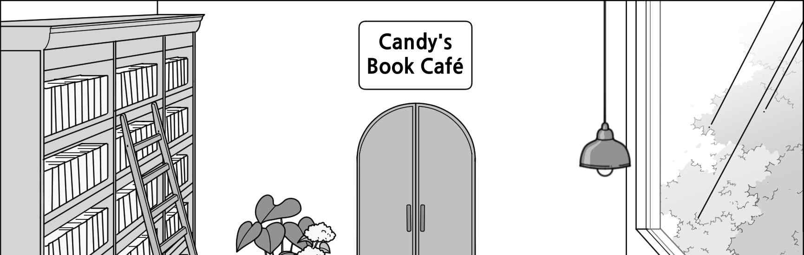
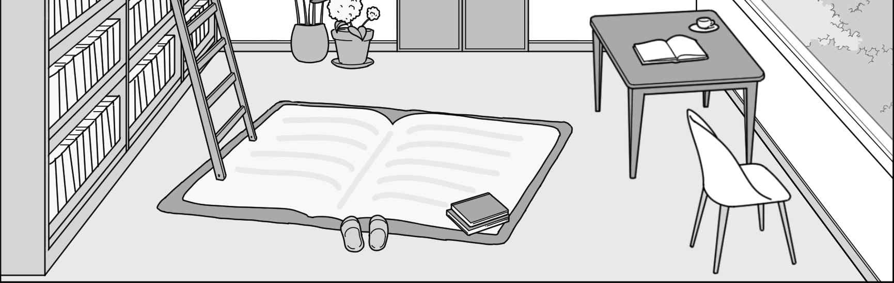
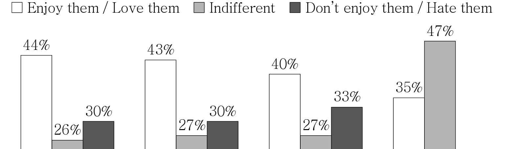
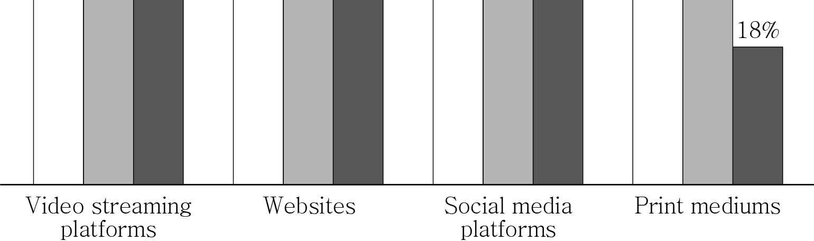

1. 다음을 듣고, 여자가 하는 말의 목적으로 가장 적절한 것을 고르시오.
① 진로 상담 신청을 독려하려고
② 진로 센터 프로그램을 홍보하려고
③ 진로 센터 이전에 관해 안내하려고
④ 진로 상담 신청 절차를 설명하려고
⑤ 진로 센터 운영 시간 연장을 공지하려고

2. 대화를 듣고, 남자의 의견으로 가장 적절한 것을 고르시오.

① 과대 포장은 밀키트 가격 상승의 주요 원인이다.
② 과대 포장을 하는 밀키트 배달 서비스 이용을 피해야 한다.
③ 환경 보호를 위해 재활용할 수 있는 포장재를 사용해야 한다.
④ 고객 후기가 많은 배달 서비스를 이용하는 것이 좋다.
⑤ 음식의 맛과 질을 기준으로 밀키트를 선택해야 한다.

3. 대화를 듣고, 두 사람의 관계를 가장 잘 나타낸 것을 고르시오.

① 주민 - 경비원
② 손님 - 가게 점원
③ 배달 기사 - 식당 주인
④ 야영객 - 캠프장 관리인
⑤ 건축가 - 엘리베이터 설치업자

4. 대화를 듣고, 그림에서 대화의 내용과 일치하지 않는 것을 고르시오.

5. 대화를 듣고, 남자가 여자를 위해 할 일로 가장 적절한 것을 고르시오.

① 꽃집에 전화하기
② 현수막 설치하기
③ 좌석 배치도 붙이기
④ 마이크 작동 여부 확인하기
⑤ 커버에 장학 증서 끼우기

6. 대화를 듣고, 여자가 지불할 금액을 고르시오.

① $35
② $40
③ $45
④ $50
⑤ $55

7. 대화를 듣고, 남자가 피트니스 센터 회원권을 갱신하지 않는 이유를 고르시오.

① 회원권이 너무 비싸서
② 테니스 수업을 받기로 해서
③ 당분간 운동을 할 수 없어서
④ 개인 지도 프로그램이 없어서
⑤ 시설이 더 좋은 곳으로 옮기고 싶어서

8. 대화를 듣고, Camellia Vegan Table에 관해 언급되지 않은 것을 고르시오.

① 위치
② 개점 시간
③ 메뉴
④ 음식 가격
⑤ 휴점일

9. Spring Stewardship Day에 관한 다음 내용을 듣고, 일치하지 않는 것을 고르시오.

① 올해는 4월 29일에 개최될 것이다.
② 참가자들은 쓰레기 줍기, 나무 보호 등을 도울 것이다.
③ 봉사 활동이 끝난 후 점심이 무료로 제공될 것이다.
④ 작업용 장갑을 포함하여 모든 도구와 장비가 제공될 것이다.
⑤ 참가비는 무료이지만 사전 등록이 필요하다.

10. 다음 표를 보면서 대화를 듣고, 여자가 구매할 무선 방수 스피커를 고르시오.

|  | Model | Price | Playtime (hours) | FM Radio | Color |
| --- | --- | --- | --- | --- | --- |
| ① | A | $35 | 8 | × | Silver |
| ② | B | $38 | 12 | ○ | Blue |
| ③ | C | $40 | 15 | ○ | Pink |
| ④ | D | $45 | 18 | × | White |
| ⑤ | E | $55 | 24 | ○ | Black |

11. 대화를 듣고, 남자의 마지막 말에 대한 여자의 응답으로 가장 적절한 것을 고르시오.

① It’s nice of you to help me read the lyrics of the songs.
② It took me so long to get to the language school.
③ I sing K-pop songs to master Korean.
④ I don’t go to the Korean language school anymore.
⑤ I was able to read Korean lyrics in about three months.

12. 대화를 듣고, 여자의 마지막 말에 대한 남자의 응답으로 가장 적절한 것을 고르시오.

① I know, but I already rented a car.
② Good idea. Let’s not rent a car this time.
③ Don’t worry. The next bus is coming soon.
④ I’m sorry. I forgot to rent a car for our trip.
⑤ You’re right. It’ll be exciting to drive a luxury car.

13. 대화를 듣고, 남자의 마지막 말에 대한 여자의 응답으로 가장 적절한 것을 고르시오. [3점]

Woman:
① No way. I’m still printing the banner.
② Yes, I’ll let you know the new date soon.
③ But I’ve already sent them to your school.
④ No problem. I’ll change the date on the banner.
⑤ Okay. I’ll put them in when packaging the banner.

14. 대화를 듣고, 여자의 마지막 말에 대한 남자의 응답으로 가장 적절한 것을 고르시오. [3점]

Man:
① I agree. Outdoor gardening is very good for health.
② Sounds great. I’ll help the beginners with gardening.
③ Yeah. I already made a couple of terrarium gardens.
④ Thanks. Last weekend’s terrarium workshop was helpful.
⑤ Sure. It’ll be fun to create my own garden in a glass jar.

15. 다음 상황 설명을 듣고, Kate가 Ben에게 할 말로 가장 적절한 것을 고르시오. [3점]

Kate:
① There’re many things to consider when adopting a cat.
② Let’s get advice from Sarah on how to start our club.
③ We should check with her if there’s an animal club.
④ Why don’t we join the school drama club instead?
⑤ How about helping Sarah organize a drama club?

16. 남자가 하는 말의 주제로 가장 적절한 것은?

① surprising and unusual laws around the world
② the most visited tourist attractions in the world
③ universal laws and principles governing your life
④ necessity of improving laws on cultural diversity
⑤ what to consider when choosing a family tour program

17. 언급된 나라가 아닌 것은?

① Italy
② Germany
③ France
④ Greece
⑤ Spain

18. 다음 글의 목적으로 가장 적절한 것은?

Morganic Corporation, located in the heart of Arkansas, spent the past decade providing great organic crops at a competitive price, growing into the ninth leading organic farming operation in the country. As a seasoned writer with access to Richard Taylor, the founder and president of Morganic, I propose writing a profile piece on Taylor for your magazine. I believe the time has come to cover Morganic’s rise in the organic farming industry. The piece would run in the normal 800 - 1,200 word range with photographs available of Taylor and Morganic’s operation. Thank you for your consideration of this article. I hope to hear from you soon.

19. 다음 글에 드러난 Mark의 심경 변화로 가장 적절한 것은?

Mark was participating in freestyle swimming competitions in this Olympics. He had a firm belief that he could get a medal in the 200m. Swimming was dominated by Americans at the time, so Mark was dreaming of becoming a national hero for his country, Britain. That day, Mark was competing in his very last race — the final round of the 200m. He had done his training and was ready. One minute and fifty seconds later, it was all over. He had tried hard and, at his best, was ranked number four. He fell short of a bronze medal by 0.49 of a second. And that was the end of Mark’s swimming career. He was heartbroken. He had nothing left.

20. 다음 글에서 필자가 주장하는 바로 가장 적절한 것은?

There is no denying that engaging in argument carries certain significant risks. When we argue, we exchange and examine reasons with a view toward believing what our best reasons say we should believe; sometimes we discover that our current reasons fall short, and that our beliefs are not well supported after all. Or sometimes we discover that a belief that we had dismissed as silly or obviously false in fact enjoys the support of highly compelling reasons. On other occasions, we discover that the reasons offered by those with whom we disagree measure up toe-to-toe with our own reasons. In any of these situations, an adjustment in our belief is called for; we must change what we believe, or revise it, or replace it, or suspend belief altogether.

21. 밑줄 친 live in the shadow of the future가 다음 글에서 의미하는 바로 가장 적절한 것은?

Thanks to the power of reputation, we help others without expecting an immediate return. If, thanks to endless chat and intrigue, the world knows that you are a good, charitable guy, then you boost your chance of being helped by someone else at some future date. The converse is also the case. I am less likely to get my back scratched, in the form of a favor, if it becomes known that I never scratch anybody else’s. Indirect reciprocity now means something like “If I scratch your back, my good example will encourage others to do the same and, with luck, someone will scratch mine.” By the same token, our behavior is endlessly shaped by the possibility that somebody else might be watching us or might find out what we have done. We are often troubled by the thought of what others may think of our deeds. In this way, our actions have consequences that go far beyond any individual act of charity, or indeed any act of mean-spirited malice. We all behave differently when we know we live in the shadow of the future. That shadow is cast by our actions because there is always the possibility that others will find out what we have done.

22. 다음 글의 요지로 가장 적절한 것은?

When you experience affect without knowing the cause, you are more likely to treat affect as information about the world, rather than your experience of the world. The psychologist Gerald L. Clore has spent decades performing clever experiments to better understand how people make decisions every day based on gut feelings. This phenomenon is called affective realism, because we experience supposed facts about the world that are created in part by our feelings. For example, people report more happiness and life satisfaction on sunny days, but only when they are not explicitly asked about the weather. When you apply for a job or college or medical school, make sure you interview on a sunny day, because interviewers tend to rate applicants more negatively when it is rainy. And the next time a good friend snaps at you, remember affective realism. Maybe your friend is irritated with you, but perhaps she didn’t sleep well last night, or maybe it’s just lunchtime. The change in her body budget, which she’s experiencing as affect, might not have anything to do with you.

23. 다음 글의 주제로 가장 적절한 것은? [3점]

Whenever possible, we should take measures to re-socialize the information we think about. The continual patter we carry on in our heads is in fact a kind of internalized conversation. Likewise, many of the written forms we encounter at school and at work — from exams and evaluations, to profiles and case studies, to essays and proposals — are really social exchanges (questions, stories, arguments) put on paper and addressed to some imagined listener or interlocutor. There are significant advantages to turning such interactions at a remove back into actual social encounters. Research demonstrates that the brain processes the “same” information differently, and often more effectively, when other human beings are involved — whether we’re imitating them, debating them, exchanging stories with them, synchronizing and cooperating with them, teaching or being taught by them. We are inherently social creatures, and our thinking benefits from bringing other people into our train of thought.

24. 다음 글의 제목으로 가장 적절한 것은?

Every day an enormous amount of energy is created by the movement of people and animals, and by interactions of people with their immediate surroundings. This is usually in very small amounts or in very dispersed environments. Virtually all of that energy is lost to the local environment, and historically there have been no efforts to gather it. It may seem odd to consider finding ways to “collect” energy that is given off all around us — by people simply walking or by walking upstairs and downstairs or by riding stationary/exercise bicycles, for example — but that is the general idea and nature of energy harvesting. The broad idea of energy harvesting is that there are many places at which small amounts of energy are generated — and often wasted — and when collected, this can be put to some practical use. Current efforts have begun, aimed at collecting such energy in smaller devices which can store it, such as portable batteries.

25. 다음 도표의 내용과 일치하지 않는 것은?

US Adults’ Attitudes to Media Ads (surveyed in 2022) “How do you feel about advertisements on each of the following?”

| Medium | Enjoy them / Love them | Indifferent | Don’t enjoy them / Hate them |
| --- | --- | --- | --- |
| Video streaming platforms | 44% | 26% | 30% |
| Websites | 43% | 27% | 30% |
| Social media platforms | 40% | 27% | 33% |
| Print mediums | 35% | 47% | 18% |

26. Georgy Gause에 관한 다음 글의 내용과 일치하지 않는 것은?

Georgy Gause was born in Moscow, Russia. He was admitted to Moscow State University, where he received his undergraduate degree in 1931 and PhD in 1940. Prior to achieving his doctoral degree, Gause published his ecological classic, The Struggle for Existence, in 1934 (and in English!). This book and similar research papers in the 1930s helped lay the early foundation for population ecology and indeed fostered the introduction of mathematics into the historical development of ecology. In ecology, Gause’s contributions are equally acknowledged along with those of other early ecologists who studied population dynamics. However, most ecologists are not aware that Gause eventually went on to conduct very important research on antibiotics and somewhat left ecology behind. From 1960 until his death he was director of the institute of antibiotics he and his wife had founded.

27. Project Pipeline Virtual Camp에 관한 다음 안내문의 내용과 일치하지 않는 것은?

Project Pipeline Virtual Camp Are you interested in buildings, cities, design and architecture? Join us in imagining and creating the city of the future! Who: Youth ages 11 - 15 When: August 17 - 19, 2023 10 a.m. - 1 p.m. (Thursday, Friday & Saturday) Where: Online Register at www.bosnoma.org/projectpipeline. Registration is FREE. All participants will receive a free art supply kit mailed to their home. Architecture and design professionals will teach drawing and modeling in a fun online environment. Questions? Contact us at projectpipeline@bosnoma.org.

28. 2023 Oyster Bay Town Toddler Sports Program에 관한 다음 안내문의 내용과 일치하는 것은?

2023 Oyster Bay Town Toddler Sports Program The Town’s Toddler Sports Program will return this spring on April 7th. This 6-week program offers sports classes at the Youth Center for children aged 3 and 4. • Parents who sign their toddler up for the program must choose one class per week, per child. Classes will take place on: Wednesdays 10 a.m. or 11 a.m. & Fridays 10 a.m. or 11 a.m. • Registration will take place ONLINE at www.obtown.org starting Friday, March 24th, at 9 a.m. Fee - $75 per resident child - $90 for any non-resident child For more information, call (516) 797-1234.

29. 다음 글의 밑줄 친 부분 중, 어법상 틀린 것은? [3점]

From the 8th to the 12th century CE, while Europe suffered the perhaps overdramatically named Dark Ages, science on planet Earth could be found almost exclusively in the Islamic world. This science was not exactly like our science today, but it was surely antecedent to it and was nonetheless an activity aimed at knowing about the world. Muslim rulers granted scientific institutions tremendous resources, such as libraries, observatories, and hospitals. Great schools in all the cities covering the Arabic Near East and Northern Africa (and even into Spain) trained generations of scholars. Almost every word in the modern scientific lexicon that begins with the prefix “al” owes its origins to Islamic science — algorithm, alchemy, alcohol, alkali, algebra. And then, just over 400 years after it started, it ground to an apparent halt, and it would be a few hundred years, give or take, before what we would today unmistakably recognize as science appeared in Europe — with Galileo, Kepler, and, a bit later, Newton.

30. 다음 글의 밑줄 친 부분 중, 문맥상 낱말의 쓰임이 적절하지 않은 것은? [3점]

In centuries past, we might learn much about life from the wisdom of our elders. Today, the majority of the messages we receive about how to live a good life come not from Granny’s long experience of the world, but from advertising executives hoping to sell us products. If we are satisfied with our lives, we will not feel a burning desire to purchase anything, and then the economy may collapse. But if we are unsatisfied, and any of the products we buy actually delivers the promised lasting fulfillment, subsequent sales figures may likewise drop. We exist in a fog of messaging designed explicitly to influence our behavior. Not surprisingly, our behavior often shifts in precisely the manner intended. If you can be made to feel sufficiently inferior due to your yellowed teeth, perhaps you will rush to the pharmacy to purchase whitening strips. The lack of any research whatsoever correlating tooth shade with life satisfaction is never mentioned. Having been told one hundred times a day how to be happy, we spend much of our lives buying the necessary accoutrements and feeling disappointed not to discover life satisfaction inside the packaging.

31. 다음 빈칸에 들어갈 말로 가장 적절한 것을 고르시오.

The quest for knowledge in the material world is a never-ending pursuit, but the quest does not mean that a thoroughly schooled person is an educated person or that an educated person is a wise person. We are too often blinded by our ignorance of our ignorance, and our pursuit of knowledge is no guarantee of wisdom. Hence, we are prone to becoming the blind leading the blind because our overemphasis on competition in nearly everything makes looking good more important than being good. The resultant fear of being thought a fool and criticized therefore is one of greatest enemies of true learning. Although our ignorance is undeniably vast, it is from the vastness of this selfsame ignorance that our sense of wonder grows. But, when we do not know we are ignorant, we do not know enough to even question, let alone investigate, our ignorance. No one can teach another person anything. All one can do with and for someone else is to facilitate learning by helping the person to discover the wonder of their ignorance.

32. 다음 빈칸에 들어갈 말로 가장 적절한 것을 고르시오.

Lewis-Williams believes that the religious view of hunter groups was a contract between the hunter and the hunted. ‘The powers of the underworld allowed people to kill animals, provided people responded in certain ritual ways, such as taking fragments of animals into the caves and inserting them into the “membrane”.’ This is borne out in the San. Like other shamanistic societies, they have admiring practices between human hunters and their prey, suffused with taboos derived from extensive natural knowledge. These practices suggest that honouring may be one method of softening the disquiet of killing. It should be said that this disquiet needn’t arise because there is something fundamentally wrong with a human killing another animal, but simply because we are aware of doing the killing. And perhaps, too, because in some sense we ‘know’ what we are killing. We make sound guesses that the pain and desire for life we feel — our worlds of experience — have a counterpart in the animal we kill. As predators, this can create problems for us. One way to smooth those edges, then, is to view that prey with respect.

33. 다음 빈칸에 들어갈 말로 가장 적절한 것을 고르시오. [3점]

The empiricist philosopher John Locke argued that when the human being was first born, the mind was simply a blank slate — a tabula rasa — waiting to be written on by experience. Locke believed that our experience shapes who we are and who we become — and therefore he also believed that, given different experiences, human beings would have different characters. The influence of these ideas was profound, particularly for the new colonies in America, for example, because these were conscious attempts to make a new start and to form a new society. The new society was to operate on a different basis from that of European culture, which was based on the feudal system in which people’s place in society was almost entirely determined by birth, and which therefore tended to emphasize innate characteristics. Locke’s emphasis on the importance of experience in forming the human being provided an optimistic framework for those trying to form a different society.

34. 다음 빈칸에 들어갈 말로 가장 적절한 것을 고르시오. [3점]

In A Theory of Adaptation, Linda Hutcheon argues that “An adaptation is not vampiric: it does not draw the life-blood from its source and leave it dying or dead, nor is it paler than the adapted work. It may, on the contrary, keep that prior work alive, giving it an afterlife it would never have had otherwise.” Hutcheon’s refusal to see adaptation as “vampiric” is particularly inspiring for those of us who do work on adaptations. The idea of an “afterlife” of texts, of seeing what comes before as an inspiration for what comes now, is, by its very definition, keeping works “alive.” Adaptations for young adults, in particular, have the added benefit of engaging the young adult reader with both then and now, past and present — functioning as both “monuments” to history and the “flesh” of the reader’s lived experience. While this is true for adaptations in general, it is especially important for those written with young adults in mind. Such adaptations allow young readers to make personal connections with texts that might otherwise come across as old-fashioned or irrelevant.

35. 다음 글에서 전체 흐름과 관계 없는 문장은?

According to the principle of social proof, one way individuals determine appropriate behavior for themselves in a situation is to examine the behavior of others there — especially similar others.

36. 주어진 글 다음에 이어질 글의 순서로 가장 적절한 것을 고르시오.

Aristotle explains that the Good for human beings consists in eudaimoniā (a Greek word combining eu meaning “good” with daimon meaning “spirit,” and most often translated as “happiness”). Whereas he had argued in a purely formal way that the Good was that to which we all aim, he now gives a more substantive answer: that this universal human goal is happiness. However, he is quick to point out that this conclusion is still somewhat formal since different people have different views about what happiness is.

37. 주어진 글 다음에 이어질 글의 순서로 가장 적절한 것을 고르시오. [3점]

A large body of research in decision science has indicated that one attribute that is regularly substituted for an explicit assessment of decision costs and benefits is an affective valuation of the prospect at hand. This is often a very rational attribute to substitute — affect does convey useful signals as to the costs and benefits of outcomes. A problem sometimes arises, however, when affective valuation is not supplemented by any analytic processing and adjustment at all. For example, sole reliance on affective valuation can make people insensitive to probabilities and to quantitative features of the outcome that should effect decisions. One study demonstrated that people’s evaluation of a situation where they might receive a shock is insensitive to the probability of receiving the shock because their thinking is swamped by affective evaluation of the situation. People were willing to pay almost as much to avoid a 1 percent probability of receiving a shock as they were to pay to avoid a 99 percent probability of receiving a shock. Clearly the affective reaction to the thought of receiving a shock was overwhelming the subjects’ ability to evaluate the probabilities associated.

38. 글의 흐름으로 보아, 주어진 문장이 들어가기에 가장 적절한 곳을 고르시오.

The linguistic resources we choose to use do not come to us as empty forms ready to be filled with our personal intentions; rather, they come to us with meanings already embedded within them. These meanings, however, are not derived from some universal, logical set of principles; rather, as with their shapes, they are built up over time from their past uses in particular contexts by particular groups of participants in the accomplishment of particular goals that, in turn, are shaped by myriad cultural, historical and institutional forces. The linguistic resources we choose to use at particular communicative moments come to these moments with their conventionalized histories of meaning. It is their conventionality that binds us to some degree to particular ways of realizing our collective history. However, while our resources come with histories of meanings, how they come to mean at a particular communicative moment is always open to negotiation. Thus, in our individual uses of our linguistic resources we accomplish two actions simultaneously. We create their typical — historical — contexts of use and at the same time we position ourselves in relation to these contexts.

39. 글의 흐름으로 보아, 주어진 문장이 들어가기에 가장 적절한 곳을 고르시오. [3점]

Going beyond very simple algorithms, some AI-based tools hold out the promise of supporting better causal and probabilistic reasoning in complex domains. Humans have a natural ability to build causal models of the world — that is, to explain why things happen — that AI systems still largely lack. For example, while a doctor can explain to a patient why a treatment works, referring to the changes it causes in the body, a modern machine-learning system could only tell you that patients who are given this treatment tend, on average, to get better. However, human reasoning is still notoriously prone to confusion and error when causal questions become sufficiently complex, such as when it comes to assessing the impact of policy interventions across society. In these cases, supporting human reasoning with more structured AI-based tools may be helpful. Researchers have been exploring the use of Bayesian Networks — an AI technology that can be used to map out the causal relationships between events, and to represent degrees of uncertainty around different areas — for decision support, such as to enable more accurate risk assessment. These may be particularly useful for assessing the threat of novel or rare threats, where little historical data is available, such as the risk of terrorist attacks and new ecological disasters.

40. 다음 글의 내용을 한 문장으로 요약하고자 한다. 빈칸 (A), (B)에 들어갈 말로 가장 적절한 것은?

The rise of large, industrial cities has had social consequences that are often known as urbanism. The city dissolves the informal controls of the village or small town. Most urban residents are unknown to one another, and most social interactions in cities occur between people who know each other only in specific roles, such as parking attendant, store clerk, or customer. Individuals became more free to live as they wished, and in ways that break away from social norms. In response, and because the high density of city living requires the pliant coordination of many thousands of people, urban societies have developed a wide range of methods to control urban behavior. These include regulations that control private land use, building construction and maintenance (to minimize fire risk), and the production of pollution and noise.

The social conditions in large, industrial cities made urban societies remove the informal controls of the village or small town, introducing restrictive measures to effectively induce coordinated urban behaviors.

41. 윗글의 제목으로 가장 적절한 것은?

Douglas Hofstadter is a scholar who writes about stereotypical thinking. He discusses what he calls default assumptions. Default assumptions are preconceived notions about the likely state of affairs — what we assume to be true in the absence of specific information. Given no other information, when I mention “secretary,” you are likely to assume the secretary is a woman, because “woman” and “secretary” are associated stereotypically. In the absence of specific details, people rely on the stereotype as a default assumption for filling in the blanks. Default assumptions have a tendency, in Hofstadter’s words, to “permeate our mental representations and channel our thoughts.” For instance, given the words “cat,” “dog,” and “chases,” you are likely to think first of a dog chasing a cat. This line of thought reflects a default assumption that, all else being equal, the dog is more likely to chase the cat than the other way around. Default assumptions are rooted in our socially learned associative clusters and linguistic categories. They are useful in that people cannot always afford the time it would take to consider every theoretical possibility that confronts them. Nonetheless, default assumptions are often wrong. Default assumptions are only one type of language-based categorization. Hofstadter is particularly interested in race-based and gender-based categorization and default assumptions. For instance, if you hear that your school basketball team is playing tonight, do you assume it’s the men’s team? Most people would assume so unless a qualifier is added to provide specific information. In this case, the qualifier would be “the women’s basketball team is playing tonight.”

42. 밑줄 친 낱말 중에서 문맥상 낱말의 쓰임이 적절하지 않은 것은?

Douglas Hofstadter is a scholar who writes about stereotypical thinking. He discusses what he calls default assumptions. Default assumptions are preconceived notions about the likely state of affairs — what we assume to be true in the absence of specific information. Given no other information, when I mention “secretary,” you are likely to assume the secretary is a woman, because “woman” and “secretary” are associated stereotypically. In the absence of specific details, people rely on the stereotype as a default assumption for filling in the blanks. Default assumptions have a tendency, in Hofstadter’s words, to “permeate our mental representations and channel our thoughts.” For instance, given the words “cat,” “dog,” and “chases,” you are likely to think first of a dog chasing a cat. This line of thought reflects a default assumption that, all else being equal, the dog is more likely to chase the cat than the other way around. Default assumptions are rooted in our socially learned associative clusters and linguistic categories. They are useful in that people cannot always afford the time it would take to consider every theoretical possibility that confronts them. Nonetheless, default assumptions are often wrong. Default assumptions are only one type of language-based categorization. Hofstadter is particularly interested in race-based and gender-based categorization and default assumptions. For instance, if you hear that your school basketball team is playing tonight, do you assume it’s the men’s team? Most people would assume so unless a qualifier is added to provide specific information. In this case, the qualifier would be “the women’s basketball team is playing tonight.”

43. 주어진 글에 이어질 내용을 순서에 맞게 배열한 것으로 가장 적절한 것은?

Now I will tell you a story. There lived a young boy named Nick. He would sing and whistle nearly all day. He was as merry as a lark. One day Nick went out taking a walk in the forest, at some distance from his home. When he reached a clear stream he felt very thirsty and bent down to drink water. But, just at that moment, he was suddenly seized and found himself in the hands of a fierce giant, a hundred times bigger than himself. For some time the giant held Nick in his big hands, and looked at him with great delight.

 He then put him into a large bag, and carried him away. Poor Nick, who was in great fear, did all he could do to escape from his cruel captor. He tried to tear the bag, but the giant only laughed at him. At last, the giant came to his own house with a high wall all around it, and no trees, nor flowers. He put Nick into a prison. It was quite a dark room, with iron bars all around it. Nick was very miserable, for he had never before been deprived of his liberty. He dashed backward and forward in his prison-house, but he could not escape. He thought of his own pleasant home, his companions, the sunlight, the trees, and the flowers. He screamed and tried to get out between the iron bars, but he only tore himself, and all in vain. In a moment, the giant came again to the prison. He told Nick to sing, the same as he did when he was in his own home. “Sing! sing! sing!” said he, “Why don’t you sing?” But Nick was too sad to sing. Who could sing in a prison! At length the giant grew very angry, and took Nick out of the prison to make him sing. He shook him, and then ordered him to sing. Nick felt terrified while missing whatever he enjoyed with freedom at his home. Now I will tell you who they were. Nick was a little bird and that giant was a cruel boy.

44. 밑줄 친 낱말 중에서 가리키는 대상이 나머지 넷과 다른 것은?

Now I will tell you a story. There lived a young boy named Nick. He would sing and whistle nearly all day. He was as merry as a lark. One day Nick went out taking a walk in the forest, at some distance from his home. When he reached a clear stream he felt very thirsty and bent down to drink water. But, just at that moment, he was suddenly seized and found himself in the hands of a fierce giant, a hundred times bigger than himself. For some time the giant held Nick in his big hands, and looked at him with great delight.

 He then put him into a large bag, and carried him away. Poor Nick, who was in great fear, did all he could do to escape from his cruel captor. He tried to tear the bag, but the giant only laughed at him. At last, the giant came to his own house with a high wall all around it, and no trees, nor flowers. He put Nick into a prison. It was quite a dark room, with iron bars all around it. Nick was very miserable, for he had never before been deprived of his liberty. He dashed backward and forward in his prison-house, but he could not escape. He thought of his own pleasant home, his companions, the sunlight, the trees, and the flowers. He screamed and tried to get out between the iron bars, but he only tore himself, and all in vain. In a moment, the giant came again to the prison. He told Nick to sing, the same as he did when he was in his own home. “Sing! sing! sing!” said he, “Why don’t you sing?” But Nick was too sad to sing. Who could sing in a prison! At length the giant grew very angry, and took Nick out of the prison to make him sing. He shook him, and then ordered him to sing. Nick felt terrified while missing whatever he enjoyed with freedom at his home. Now I will tell you who they were. Nick was a little bird and that giant was a cruel boy.

45. 윗글에 관한 내용으로 적절하지 않은 것은?

Now I will tell you a story. There lived a young boy named Nick. He would sing and whistle nearly all day. He was as merry as a lark. One day Nick went out taking a walk in the forest, at some distance from his home. When he reached a clear stream he felt very thirsty and bent down to drink water. But, just at that moment, he was suddenly seized and found himself in the hands of a fierce giant, a hundred times bigger than himself. For some time the giant held Nick in his big hands, and looked at him with great delight.

 He then put him into a large bag, and carried him away. Poor Nick, who was in great fear, did all he could do to escape from his cruel captor. He tried to tear the bag, but the giant only laughed at him. At last, the giant came to his own house with a high wall all around it, and no trees, nor flowers. He put Nick into a prison. It was quite a dark room, with iron bars all around it. Nick was very miserable, for he had never before been deprived of his liberty. He dashed backward and forward in his prison-house, but he could not escape. He thought of his own pleasant home, his companions, the sunlight, the trees, and the flowers. He screamed and tried to get out between the iron bars, but he only tore himself, and all in vain. In a moment, the giant came again to the prison. He told Nick to sing, the same as he did when he was in his own home. “Sing! sing! sing!” said he, “Why don’t you sing?” But Nick was too sad to sing. Who could sing in a prison! At length the giant grew very angry, and took Nick out of the prison to make him sing. He shook him, and then ordered him to sing. Nick felt terrified while missing whatever he enjoyed with freedom at his home. Now I will tell you who they were. Nick was a little bird and that giant was a cruel boy.

