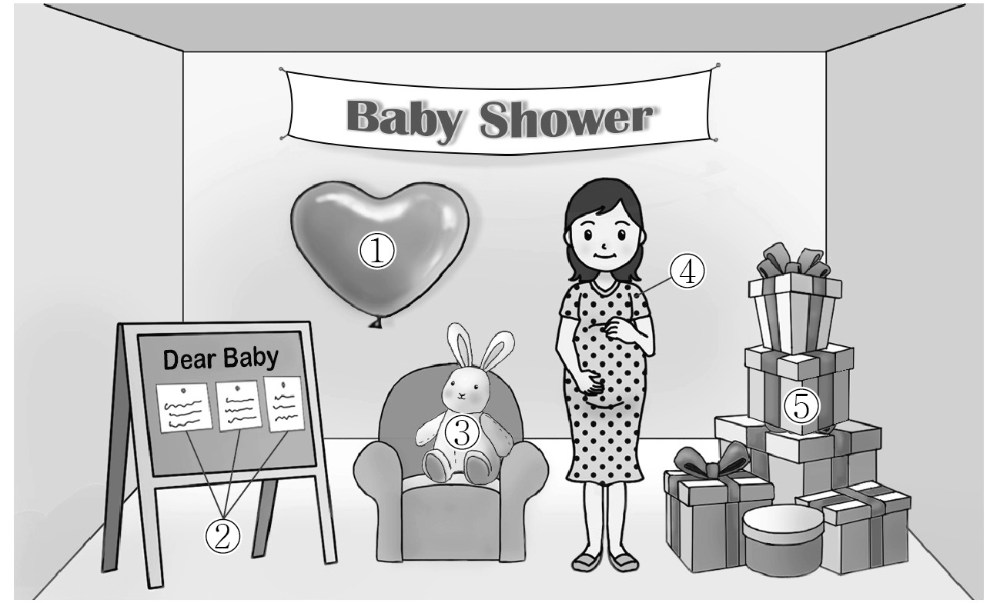
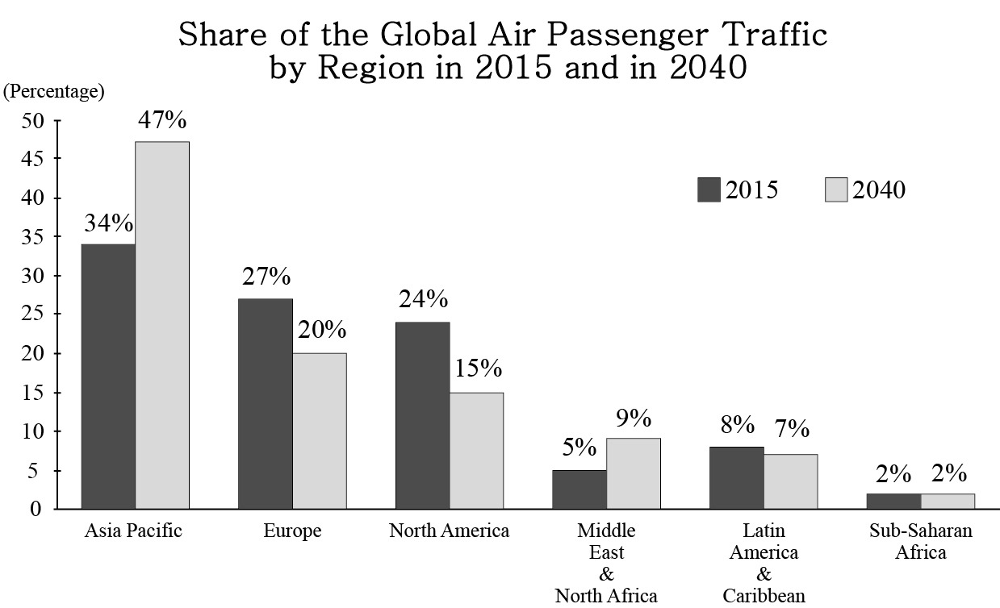

1. 다음을 듣고, 남자가 하는 말의 목적으로 가장 적절한 것을 고르시오.

① 발코니 사용 수칙을 안내하려고
② 화재 시 대피 방법을 설명하려고
③ 발코니 보수공사 동의를 요청하려고
④ 아파트 안전 점검 계획을 공지하려고
⑤ 아파트 주민 친목 행사를 홍보하려고

2. 대화를 듣고, 여자의 의견으로 가장 적절한 것을 고르시오.

① 언어 교육은 일찍 시작할수록 효과적이다.
② 외국어 학습 시 구체적인 목표를 설정해야 한다.
③ 외국어 교육을 위한 다양한 학습 방법 개발이 필요하다.
④ 외국어 말하기 연습 시 실수를 두려워하지 않아야 한다.
⑤ 언어를 통해 그 언어 사용자들의 문화를 이해할 수 있다.

3. 대화를 듣고, 두 사람의 관계를 가장 잘 나타낸 것을 고르시오.

① 방송 작가 - 애견 훈련사
② 고객 - 애견 미용사
③ 달력 디자이너 - 인쇄소 직원
④ 자원봉사자 - 수의사
⑤ 사진작가 - 유기견보호소 직원

4. 대화를 듣고, 그림에서 대화의 내용과 일치하지 않는 것을 고르시오.

5. 대화를 듣고, 남자가 할 일로 가장 적절한 것을 고르시오.

① 공항에 마중 나가기
② 안내 학생 선정하기
③ 안내 학생 이름표 만들기
④ 학교 방문단 사진 찍기
⑤ 학교 방문단 점심 준비하기

6. 대화를 듣고, 여자가 지불할 금액을 고르시오. [3점]

① $68
② $75
③ $81
④ $86
⑤ $95

7. 대화를 듣고, 남자가 스쿨버스를 놓친 이유를 고르시오.

① 늦잠을 자서
② 병원에 다녀와서
③ 아침 운동을 오래 해서
④ 수업 발표 자료를 두고 와서
⑤ 아파트 엘리베이터가 고장 나서

8. 대화를 듣고, Translators For All에 관해 언급되지 않은 것을 고르시오.

① 지원 자격
② 근무 장소
③ 급여
④ 채용 인원
⑤ 지원 방법

9. Firefly Walk에 관한 다음 내용을 듣고, 일치하지 않는 것을 고르시오.

① 곤충 전문가가 안내한다.
② 일일 최대 참여 인원은 12명이다.
③ 사전에 예약을 해야 한다.
④ 기부금만으로 운영된다.
⑤ 비가 오면 다른 행사로 대체된다.

10. 다음 표를 보면서 대화를 듣고, 두 사람이 주문할 베개를 고르시오.

|  | Model | Price | Thickness (inches) | Filling Material | Machine Wash |
| --- | --- | --- | --- | --- | --- |
| ① | A | $60 | 4 | Goose Down | × |
| ② | B | $62 | 5 | Cotton | ○ |
| ③ | C | $80 | 6 | Goose Down | ○ |
| ④ | D | $85 | 6 | Cotton | × |
| ⑤ | E | $110 | 7 | Cotton | ○ |

11. 대화를 듣고, 여자의 마지막 말에 대한 남자의 응답으로 가장 적절한 것을 고르시오.

① That painting won’t be displayed in this exhibition.
② I’ll pack all my paintings for delivery to the gallery.
③ I should start learning to paint like you.
④ I’ve already met some of the other painters.
⑤ It was sold on the first day of the gallery exhibition.

12. 대화를 듣고, 남자의 마지막 말에 대한 여자의 응답으로 가장 적절한 것을 고르시오.

① Of course. When are you available?
② No worries. Your package is the cheapest one.
③ Sure. The package is refundable if you don’t open it.
④ Absolutely. I’m happy to contact you before you leave.
⑤ Be careful. You should get enough information on the trip.

13. 대화를 듣고, 여자의 마지막 말에 대한 남자의 응답으로 가장 적절한 것을 고르시오. [3점]

Man:
① Great. A powerful stroke is my strongest point in tennis.
② I see. Is there any lighter racket I can borrow from you?
③ I agree. Try to practice your stroke more with this racket.
④ That’s true. I’ll be a respectful tennis player from now on.
⑤ Okay. I should drop by a shop to see which racket suits me.

14. 대화를 듣고, 남자의 마지막 말에 대한 여자의 응답으로 가장 적절한 것을 고르시오.

Woman:
① That’s why I changed all of my glass cups to plastic.
② I’ll try to look for a delivery restaurant to save time.
③ There’s a reason that restaurant is popular with people.
④ You really made me think again about using food delivery.
⑤ I hope people know how important it is to eat fresh food.

15. 다음 상황 설명을 듣고, Nicky가 Chris에게 할 말로 가장 적절한 것을 고르시오. [3점]

Nicky:

① You need to stick to your musical identity.
② Can you invite me to your band’s performance?
③ Think about becoming a professional musician later.
④ Why don’t we accept the proposal to try something new?
⑤ Let’s keep practicing so we win instead of that other team.

16. 남자가 하는 말의 주제로 가장 적절한 것은?

① animal-related terms in the financial sector
② what animals symbolize by country
③ aggressive tendencies of animals
④ how humans have domesticated animals
⑤ risks and benefits of livestock industry investment

17. 언급된 동물이 아닌 것은?

따라 답을 하시기 바랍니다.

① bulls
② sheep
③ cats
④ pigs
⑤ chicken

18. 다음 글의 목적으로 가장 적절한 것은?

Dear Mr. Adams, I am Jane Roe, director of the web-hosting department. As you are aware, the upcoming weeks will be crucial for the operations of our web-hosting facility because the number and variety of our clients are expanding daily. Our staff are doing their best under the circumstances. However, we are now badly understaffed in our department, so I would like to request that more staff members be hired. Most of our staff have spent the last five days on call, without a break. I hope you will consider this matter. I look forward to your positive response. Sincerely, Jane Roe

19. 다음 글에 드러난 Susan의 심경 변화로 가장 적절한 것은?

Susan’s daughter Carrie is a special needs kid. She goes to a special school, special camp, special therapists. One day, out of the blue, she asked Susan if she could go get a slice of pizza on her own, not far from their apartment. Anxious, Susan said, “Well... why not get the pizza and bring it home to eat?” “No!” said Carrie, sixteen at the time. “Other people eat at the pizza place, and I want to, too!” Susan was concerned, but said okay, and Carrie went off by herself a block or two away. After a while, Carrie came back, grinning. “You made it! What made you want to do this?” Susan asked. Carrie had seen her friend Izzy on TV talking about his subway ride. “I thought if he could do it, I could do it too.” Susan’s heart swelled, realizing her daughter was braver and much more grown-up than she thought.

20. 다음 글에서 필자가 주장하는 바로 가장 적절한 것은?

Leaving behind technology during intentional time alone is essential for the cognitive benefits, neurological repair, and spiritual clarity that are the gifts of solitude. Multiple studies show that anxiety is markedly reduced, and we gain benefits similar to solitude, not by simply turning our phones off but by having them not physically with us. If a phone is essential for safety during time alone, then turn off alerts, cover the screen — just tape paper right over it — and keep it somewhere that is terribly inconvenient to access. I am always surprised by how long it takes me to give up the impulse to reach for my phone, often for no reason at all, other than to “just check.” Check what? Always it is something that can do without me for the moment. It is important that we allow ourselves time to free our minds from even the possibility of constant connectivity, to “normalize deactivation,” as herbalist Sophia Rose puts it, allowing our overstimulated neuronal connections to rest and reassemble.

21. 밑줄 친 production and marketing이 다음 글에서 의미하는 바로 가장 적절한 것은?

Humans already have a longer period of protected immaturity — a longer childhood — than any other species. Across species, a long childhood is correlated with an evolutionary strategy that depends on flexibility, intelligence, and learning. There is a developmental division of labor. Children get to learn freely about their particular environment without worrying about their own survival — caregivers look after that. Adults use what they learned as children to mate, hunt, and generally succeed as grown-ups in that environment. Children are the R&D (research and development) department of the human species. We grown-ups are production and marketing. We start out as brilliantly flexible but helpless and dependent babies, great at learning everything but terrible at doing just about anything. We end up as much less flexible but much more efficient and effective adults, not so good at learning but terrific at planning and acting.

22. 다음 글의 요지로 가장 적절한 것은?

In order to be successful and equitable, ecosystem management must be linked to poverty reduction. Urban infrastructure projects need to address the trade-offs between conservation, livelihoods, and equitable distribution of resources. Historically there has been tension when conservation models that create protected areas are perceived as inaccessible to communities. Often, these models are implemented at the expense of poor and marginalized residents and users of resources from the areas. Social, economic, and environmental development programs have become obstacles to sustainable development because there is no balance between the need to protect ecosystem services and the desire to use resources to address community needs. Communities need to be allowed to identify and negotiate their own options and to increase their flexibility to cope with unexpected change.

23. 다음 글의 주제로 가장 적절한 것은? [3점]

For those of any age with an existing network of friendships built up in the three-dimensional world, social networking sites can be a happy extension of communication, along with email, video calls, or phone calls, when face-to-face time together just isn’t possible. The danger comes when a fake identity is both tempting and possible through relationships that are not based on real, three-dimensional interaction, and/or when the most important things in your life are the secondhand lives of others rather than personal experiences. Living in the context of the screen might suggest false norms of desirable lifestyles full of friends and parties. As ordinary human beings follow the activities of these golden individuals, self-esteem will inevitably drop; yet the constant narcissistic obsession with the self and its inadequacies will dominate. We can imagine a vicious circle where the more your identity is harmed as a result of social networking and the more inadequate you feel, the greater the appeal of a medium where you don’t need to communicate with people face-to-face.

24. 다음 글의 제목으로 가장 적절한 것은?

Melody is one of the primary ways that our expectations are controlled by composers. Music theorists have identified a principle called gap fill; in a sequence of tones, if a melody makes a large leap, either up or down, the next note should change direction. A typical melody includes a lot of stepwise motion, that is, adjacent tones in the scale. If the melody makes a big leap, theorists describe a tendency for the melody to “want” to return to the jumping-off point; this is another way to say that our brains expect that the leap was only temporary, and tones that follow need to bring us closer and closer to our starting point, or harmonic “home.” In “Over the Rainbow,” the melody begins with one of the largest leaps we’ve ever experienced in a lifetime of music listening: an octave. This is a strong schematic violation, and so the composer rewards and soothes us by bringing the melody back toward home again, but not by too much because he wants to continue to build tension. The third note of this melody fills the gap.

25. 다음 도표의 내용과 일치하지 않는 것은?

Share of the Global Air Passenger Traffic by Region in 2015 and in 2040

| Region | 2015 | 2040 |
| --- | --- | --- |
| Asia Pacific | 34% | 47% |
| Europe | 27% | 20% |
| North America | 24% | 15% |
| Middle East & North Africa | 5% | 9% |
| Latin America & Caribbean | 8% | 7% |
| Sub-Saharan Africa | 2% | 2% |

26. Anna May Wong에 관한 다음 글의 내용과 일치하지 않는 것은?

Anna May Wong is considered the first Chinese-American movie star in Hollywood. She dropped out of high school to pursue a full-time acting career and, at 17, she played her first leading role in The Toll of the Sea. Reviewers praised her extraordinary acting but her ethnicity prevented U.S. filmmakers from casting her as a leading lady. Frustrated, Wong left for Europe in 1928, where she had main roles in many notable films. When American studios wanted fresh European talent in the 1930s, Wong’s new prestige immediately led to a main role on Broadway. She returned to America and used her influence to advocate for better film opportunities for Chinese-Americans. In 1938, she sold her movie costumes and donated the money from the sale to organizations supporting Chinese refugees. During World War II, she gave political speeches against the anti-Asian attitudes in the U.S. In 2022, she became the first Asian American to appear on U.S. currency ― a century after she landed her first leading role.

27. Little Adventure Pack에 관한 다음 안내문의 내용과 일치하지 않는 것은?

 Little Adventure Pack Little Adventure Pack is back again in August! Enjoy the science of the National Museum with this easy and fun take-home activity pack! Ages: Recommended for kids aged 5 to 7 years Price: $5 for museum members / $10 for non-members Contents • Activity books (puzzles, paper crafts, etc.) • A mini telescope • A toy shark Order • Must be ordered online (www.nationalmuseum.org/lap) • Available from August 2, 2023 • Total number of packs available for sale is limited to 200.

28. 2023 Oakfield Mini Marathon에 관한 다음 안내문의 내용과 일치하는 것은?

2023 Oakfield Mini Marathon Join the 2023 Oakfield Mini Marathon to celebrate the opening of Central Park in our town! Runners, joggers, and walkers are all welcome. When: Saturday, October 21, starting at 8:30 a.m. Where: Start at Gate 1 of Central Park and finish in the parking lot Who: Ages 13 and above Distance: 10km Participation Fee: $5 per person Registration • Online only (www.oakfieldminimarathon.com) • September 1 to 30 ※ If you finish the race, you will receive a T-shirt and an e-certificate. For more information, visit our website.

29. 다음 글의 밑줄 친 부분 중, 어법상 틀린 것은?

The intelligence of monkeys pales in comparison with that of our closest relatives, the great apes: orangutans, gorillas, chimpanzees, and bonobos, whose brains are twice as large relative to their body weight. Most primatologists believe the apes acquired their larger brains to help them communicate with and manipulate their peers. And they certainly do exhibit complex social interactions within their group; they seem capable of feeling empathy, have a self-image, and exhibit a degree of consciousness as they can recognize themselves in a mirror. But this “social hypothesis” does not explain why it was the great apes that became so clever, rather than monkeys or a group of terrestrial mammals. Nor does it explain why orangutans, who seldom encounter their neighbors, are so intelligent. It seems likely that some other factor must have been in play that caused apes to become more intelligent in the first place, and which could subsequently have enabled some members of the group to develop high-level sociality.

30. 다음 글의 밑줄 친 부분 중, 문맥상 낱말의 쓰임이 적절하지 않은 것은? [3점]

The consequences of the mechanical breakdown of food by cooking are profound. Both the stiffness and toughness of the food is drastically reduced, making mechanical processing far easier. The forces your teeth need to apply to break up the food are lower, and the food releases its cell contents far more easily. The optimal tooth shape for breaking up the food also changes. Rather than needing thick, flat plates that can apply large compression forces to grind up tough materials and crush hard ones, it is better to have molars with pointed ends to cut through the softer food. It loosens at much higher forces and breaks up far more quickly. Modern hunter-gatherers spend far less time chewing their food even than apes that eat relatively soft fruit; they chew for less than an hour a day compared with five or six hours for chimpanzees. This frees up plenty of time for other tasks, such as looking after the fire, making a permanent camp, toolmaking, or further foraging.

31. 다음 빈칸에 들어갈 말로 가장 적절한 것을 고르시오.

Learning is constructive, not destructive. This means we don’t replace mental models ― we simply expand upon them. To understand what I mean, think back to your childhood. There was likely a time when you believed in Santa Claus; your mental model accepted him and your predictions accounted for his existence. At some point, however, you came to recognize he was fictitious and you updated your mental model accordingly. At that moment, you didn’t suddenly forget everything about Santa Claus. To this day, you can still recognize him, speak of him and embrace young children’s belief in him. In other words, you didn’t destroy your old mental model, you simply added new information to it. By building upon old mental models we are able to maintain ties to the past, foster a deeper understanding of concepts and develop an ever-expanding pool of information to draw upon in order to continually adapt to an ever-evolving world.

32. 다음 빈칸에 들어갈 말로 가장 적절한 것을 고르시오. [3점]

A commonality between conceptual and computer art was the suppression of authorial presence. Conceptual artists decoupled the relationship between the art object and artist by mitigating all personal signs of invention. The artist became detached from the idea of personalized draftsmanship by installing a predetermined system ― a type of instruction for another to follow. That way there was, as Sol LeWitt states, no “dependence on the skill of the artist as a craftsman.” Effectively any person could carry out the instructions. The same process was at work in computer art, where artists devised a predetermined drawing algorithm for the computer automaton to carry out the instruction. The human agent initiated the conceptual form, and a machine actuated it. Likewise, the computer artwork lacked any autographic mark, trace of spontaneity, or artistic authenticity. The plotter arm would replace the human arm in the production process.

33. 다음 빈칸에 들어갈 말로 가장 적절한 것을 고르시오. [3점]

Innate behaviors used for finding food, such as grazing, scavenging, or hunting, are more dependent on learning than behaviors used to consume food. Mating, nesting, eating, and prey-killing behaviors tend to be governed more by instinct. The greater dependence on learning to find food makes animals in the wild more flexible and able to adapt to a variety of environments. Behaviors used to kill or consume food can be the same in any environment. Ernst Mayr, an evolutionary biologist, called these different behavioral systems “open” or “closed” to the effects of experience. A lion hunting her prey is an example of an open system. The hunting female lion recognizes her prey from a distance and approaches it carefully. Charles Herrick, a neurobiologist, wrote, “the details of the hunt vary every time she hunts. Therefore no combination of simple reflex arcs laid down in the nervous system will be adequate to meet the infinite variations of the requirements for obtaining food.”

34. 다음 빈칸에 들어갈 말로 가장 적절한 것을 고르시오. [3점]

The revolution’s victorious party can claim to have resolved the fundamental anomalies of the old paradigm and to have renewed the prospects for successful research governed by shared assumptions. Indeed, the new community typically rewrites the textbooks, and retells its own history, to reflect this point of view. But from the standpoint of the losers, or even of those who look on impartially, such rewritings might seem to mark change without any genuine claim to progress, because there is no neutral standard by which to assess the merits of the change. The resulting body of knowledge is in any case not cumulative, since much of what was previously known (or merely believed) had to be excluded without ever having been conclusively refuted. One likewise cannot plausibly talk about revolutionary reconstitutions of science as aiming toward truth, for similarly, there can be no impartial formulation of standards for its assessment. The available justification of scientific knowledge after revolutions, couched in new terms according to newly instituted standards, may well be sufficient, but perhaps only because these standards and terms are now inevitably our own.

35. 다음 글에서 전체 흐름과 관계 없는 문장은?

The written word is the obvious, and easiest, place to start when exploring local history, if only to see what has already been written on the subject. Local history books have been written for centuries and are very variable in quality.

36. 주어진 글 다음에 이어질 글의 순서로 가장 적절한 것을 고르시오.

The desire to see and interact with animals, shaped as it is by popular culture, can be a motivating factor for travel, but negative perceptions of certain animals can perform an entirely opposite role in discouraging people from visiting some destinations. The harmful effects of animals on tourism experiences has been the subject of analysis in a small number of studies, but deaths or injuries caused by animals to tourists are tiny in comparison to other causes such as drowning and vehicular accidents. Nevertheless, the possibility that they might encounter a dangerous animal such as shark or snake or catch a disease such as malaria is sufficient to stop at least some tourists from visiting destinations where such threats exist. Sometimes this fear is turned into a marketing opportunity. For example, there are a variety of t-shirt and tea towel designs which celebrate the dangerous animals that can be encountered in Australia. This is a whimsical reconfiguration of the perceived threat that these animals pose to some tourists considering travel to this country.

37. 주어진 글 다음에 이어질 글의 순서로 가장 적절한 것을 고르시오. [3점]

In the course of acquiring a language, children are exposed to only a finite set of utterances. Yet they come to use and understand an infinite set of sentences. This has been referred to as the creative aspect of language use. This ‘creativity’ does not refer to the ability to write poetry or novels but rather the ability to produce and understand an unlimited set of new sentences never spoken or heard previously. The precise linguistic input children receive differs from child to child; no two children are exposed to exactly the same set of utterances. Yet, they all arrive at pretty much the same grammar. The input that children get is haphazard in the sense that caretakers do not talk to their children to illustrate a particular point of grammar. Yet, all children develop systematic knowledge of a language. Thus, despite the severe limitations and variation in the input children receive, and also in their personal circumstances, they all develop a rich and uniform system of linguistic knowledge. The knowledge attained goes beyond the input in various ways.

38. 글의 흐름으로 보아, 주어진 문장이 들어가기에 가장 적절한 곳을 고르시오.

Often time, or lack of time, plays an important role in the purchase of everyday products. Milica Milosavljevic and his coworkers conducted an experiment looking at the relationship between visual salience and the decision to purchase. They showed subjects 15 different food items on fMRI, such as those we find in a candy vending machine at the train station, that is, bars, chips, fruity items, etc. These were rated by the subjects on a scale of 1–15 according to “favorite snack” to “don’t like at all.” They were then presented in varying brightness and time, with subjects always having to make a choice between two products. The result was that we don’t always buy what we like best, but when things have to happen quickly, we tend to go for the product that catches our eye the most. If we are also distracted because we are talking to someone, on the phone, or our thoughts are elsewhere at the moment, our actual preference for a product falls further into the background and visual conspicuousness comes to the fore. Colors play an important role in this.

39. 글의 흐름으로 보아, 주어진 문장이 들어가기에 가장 적절한 곳을 고르시오.

If we look at contemporary British ‘culture’ we will probably quickly conclude that sport is an important part of the culture. In other words, it is something that many people in the society share and value. In addition, we would also probably conclude that the most ‘important’ sport within British culture is football. We would ‘know’ this from the evidence that on a daily basis there is a significant amount of ‘cultural’ activity all focused on football in terms of the amount of people who play it, watch it, read about it and talk about it. However, within British society not everybody would see football as ‘their’ game. It could be argued from looking at their ‘cultural’ activities and habits, that people from a middle-class background seem to prefer rugby over football, or that more women play netball than football. Equally, if you went to the USA and were talking about ‘football’, most people would assume you were talking about American football rather than soccer. From this we can conclude that different cultures produce different ways of understanding, or evaluating, human activities such as sport.

40. 다음 글의 내용을 한 문장으로 요약하고자 한다. 빈칸 (A), (B)에 들어갈 말로 가장 적절한 것은?

As a social species, should we not all be synchronized and therefore awake at the same time to promote maximal human interactions? Perhaps not. Humans likely evolved to co-sleep as families or even whole tribes, not alone or as couples. Appreciating this evolutionary context, the benefits of such genetically programmed variation in sleep/wake timing preferences can be understood. The night people in the group would not be going to sleep until one or two a.m., and not waking until nine or ten a.m. The morning people, on the other hand, would have retired for the night at nine p.m. and woken at five a.m. Consequently, the group as a whole is only collectively vulnerable (i.e., every person asleep) for just four rather than eight hours, despite everyone still getting the chance for eight hours of sleep. That’s potentially a 50 percent increase in survival fitness. Mother Nature would never pass on a biological trait — here, the useful variability in when individuals within a collective tribe go to sleep and wake up — that could enhance the survival safety and thus fitness of a species by this amount. And so she hasn’t.

Individuals have differences in the time of the day when they prefer to sleep and wake up, which could promote their survivability as a group.

41. 윗글의 제목으로 가장 적절한 것은?

Generalization promotes cognitive economy, so that we don’t focus on particulars that don’t matter. The great Russian neuropsychologist Alexander Luria studied a patient, Solomon Shereshevsky, with a memory impairment that was the opposite of what we usually hear about ― Solomon didn’t have amnesia, the loss of memories; he had what Luria called hypermnesia (we might say that his superpower was superior memory). His supercharged memory allowed him to perform amazing feats, such as repeating speeches word for word that he had heard only once, or complex mathematical formulas, long sequences of numbers, and poems in foreign languages he didn’t even speak. Before you think that having such a fantastic memory would be great, it came with a cost: Solomon wasn’t able to form abstractions because he remembered every detail as distinct. He had particular trouble identifying people. From a neurocognitive standpoint, every time you see a face, it is unlikely that it looks at least slightly different from the last time ― you’re viewing it at a different angle and distance than before, and you might be encountering a different expression. While you’re interacting with a person, their face goes through a parade of expressions. Because your brain can generalize, you see all of these different manifestations of the face as belonging to the same person. Solomon couldn’t do that. As he explained to Luria, recognizing his friends and colleagues was nearly impossible because “everyone has so many faces.”

42. 밑줄 친 낱말 중에서 문맥상 낱말의 쓰임이 적절하지 않은 것은? [3점]

Generalization promotes cognitive economy, so that we don’t focus on particulars that don’t matter. The great Russian neuropsychologist Alexander Luria studied a patient, Solomon Shereshevsky, with a memory impairment that was the opposite of what we usually hear about ― Solomon didn’t have amnesia, the loss of memories; he had what Luria called hypermnesia (we might say that his superpower was superior memory). His supercharged memory allowed him to perform amazing feats, such as repeating speeches word for word that he had heard only once, or complex mathematical formulas, long sequences of numbers, and poems in foreign languages he didn’t even speak. Before you think that having such a fantastic memory would be great, it came with a cost: Solomon wasn’t able to form abstractions because he remembered every detail as distinct. He had particular trouble identifying people. From a neurocognitive standpoint, every time you see a face, it is unlikely that it looks at least slightly different from the last time ― you’re viewing it at a different angle and distance than before, and you might be encountering a different expression. While you’re interacting with a person, their face goes through a parade of expressions. Because your brain can generalize, you see all of these different manifestations of the face as belonging to the same person. Solomon couldn’t do that. As he explained to Luria, recognizing his friends and colleagues was nearly impossible because “everyone has so many faces.”

43. 주어진 글에 이어질 내용을 순서에 맞게 배열한 것으로 가장 적절한 것은?

Ignace Jan Paderewski, the famous composer-pianist, was scheduled to perform at a great concert hall in America. It was an evening to remember ― black tuxedos and long evening dresses, a high-society event. Present in the audience that evening was a mother with her nine-year-old son. Tired of waiting, he squirmed constantly in his seat. His mother was in hopes that her son would be encouraged to practice the piano if he could just hear the great Paderewski at the keyboard. So, against his wishes, he had come.

 As she turned to talk with friends, her son could stay seated no longer. He slipped away from her side, strangely drawn to the black concert grand piano and its leather stool on the huge stage flooded with blinding lights. Without much notice from the sophisticated audience, the boy sat down at the piano stool, staring wide-eyed at the black and white keys. He placed his small, shaky fingers in the right location and began to play “Chopsticks.” The roar of the crowd became quiet as hundreds of frowning faces pointed in his direction. Irritated and embarrassed, they began to shout: “Get that boy away from there!” “Who’d bring a kid that young in here?” “Where’s his mother?” “Stop him!” Backstage, Paderewski overheard the sounds out front and quickly put together in his mind what was happening. Hurriedly, he grabbed his coat and rushed toward the stage. Without one word of announcement Paderewski bent over behind the boy, reached around both sides, began to improvise a countermelody to harmonize with and enhance “Chopsticks.” As the two of them played together, he kept whispering in the boy’s ear: “Keep going. Don’t quit. Keep on playing... don’t stop... don’t quit.” Together, the old master and the little boy transformed an embarrassing situation into a wonderfully creative experience. The audience was mesmerized.

44. 밑줄 친 낱말 중에서 가리키는 대상이 나머지 넷과 다른 것은?

Ignace Jan Paderewski, the famous composer-pianist, was scheduled to perform at a great concert hall in America. It was an evening to remember ― black tuxedos and long evening dresses, a high-society event. Present in the audience that evening was a mother with her nine-year-old son. Tired of waiting, he squirmed constantly in his seat. His mother was in hopes that her son would be encouraged to practice the piano if he could just hear the great Paderewski at the keyboard. So, against his wishes, he had come.

 As she turned to talk with friends, her son could stay seated no longer. He slipped away from her side, strangely drawn to the black concert grand piano and its leather stool on the huge stage flooded with blinding lights. Without much notice from the sophisticated audience, the boy sat down at the piano stool, staring wide-eyed at the black and white keys. He placed his small, shaky fingers in the right location and began to play “Chopsticks.” The roar of the crowd became quiet as hundreds of frowning faces pointed in his direction. Irritated and embarrassed, they began to shout: “Get that boy away from there!” “Who’d bring a kid that young in here?” “Where’s his mother?” “Stop him!” Backstage, Paderewski overheard the sounds out front and quickly put together in his mind what was happening. Hurriedly, he grabbed his coat and rushed toward the stage. Without one word of announcement Paderewski bent over behind the boy, reached around both sides, began to improvise a countermelody to harmonize with and enhance “Chopsticks.” As the two of them played together, he kept whispering in the boy’s ear: “Keep going. Don’t quit. Keep on playing... don’t stop... don’t quit.” Together, the old master and the little boy transformed an embarrassing situation into a wonderfully creative experience. The audience was mesmerized.

45. 윗글에 관한 내용으로 적절하지 않은 것은?

Ignace Jan Paderewski, the famous composer-pianist, was scheduled to perform at a great concert hall in America. It was an evening to remember ― black tuxedos and long evening dresses, a high-society event. Present in the audience that evening was a mother with her nine-year-old son. Tired of waiting, he squirmed constantly in his seat. His mother was in hopes that her son would be encouraged to practice the piano if he could just hear the great Paderewski at the keyboard. So, against his wishes, he had come.

 As she turned to talk with friends, her son could stay seated no longer. He slipped away from her side, strangely drawn to the black concert grand piano and its leather stool on the huge stage flooded with blinding lights. Without much notice from the sophisticated audience, the boy sat down at the piano stool, staring wide-eyed at the black and white keys. He placed his small, shaky fingers in the right location and began to play “Chopsticks.” The roar of the crowd became quiet as hundreds of frowning faces pointed in his direction. Irritated and embarrassed, they began to shout: “Get that boy away from there!” “Who’d bring a kid that young in here?” “Where’s his mother?” “Stop him!” Backstage, Paderewski overheard the sounds out front and quickly put together in his mind what was happening. Hurriedly, he grabbed his coat and rushed toward the stage. Without one word of announcement Paderewski bent over behind the boy, reached around both sides, began to improvise a countermelody to harmonize with and enhance “Chopsticks.” As the two of them played together, he kept whispering in the boy’s ear: “Keep going. Don’t quit. Keep on playing... don’t stop... don’t quit.” Together, the old master and the little boy transformed an embarrassing situation into a wonderfully creative experience. The audience was mesmerized. 하시오.

