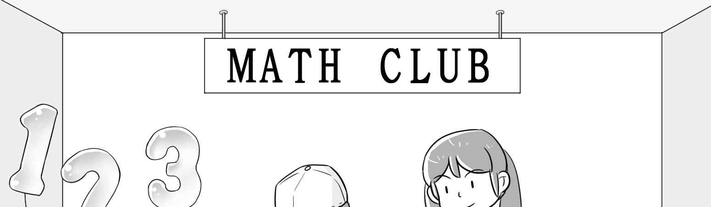
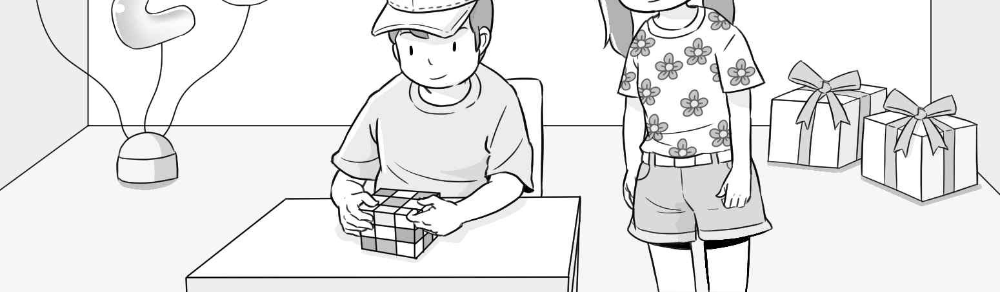
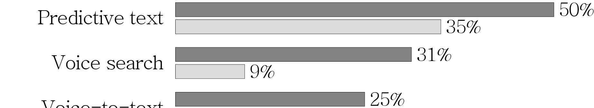
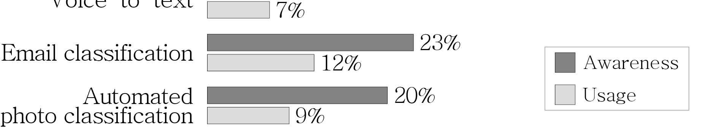

1. 다음을 듣고, 여자가 하는 말의 목적으로 가장 적절한 것을 고르시오.
① 학생회 모집 기간 연장을 알리려고
② 현장 학습 장소 변경을 안내하려고
③ 학교 홈페이지 서버 점검 시간을 공지하려고
④ 현장 학습 선호 장소를 묻는 설문 참여를 독려하려고
⑤ 현장 학습에 대한 학생 만족도 설문 결과를 발표하려고

2. 대화를 듣고, 남자의 의견으로 가장 적절한 것을 고르시오.

① 전광판에는 핵심적인 내용만 담아야 한다.
② 현수막보다 전광판을 사용하는 게 친환경적이다.
③ 현수막은 반드시 지정된 장소에만 게시해야 한다.
④ 친환경 재료로 제작된 현수막을 사용하는 것이 좋다.
⑤ 전광판에 다양한 색상을 사용하면 홍보에 더 효과적이다.

3. 다음을 듣고, 여자가 하는 말의 요지로 가장 적절한 것을 고르시오.

① 빠르게 변화하는 세상에 적응해야 성공할 수 있다.
② 다른 사람에게 솔직해야 인간관계를 오래 유지할 수 있다.
③ 자기 자신을 있는 그대로 받아들이고 인정하는 것이 중요하다.
④ 자기 자신에 대한 주변 사람들의 평판에 귀 기울여야 한다.
⑤ 자신의 강점을 최대한 발휘할 수 있는 일을 찾아야 한다.

4. 대화를 듣고, 그림에서 대화의 내용과 일치하지 않는 것을 고르시오.

5. 대화를 듣고, 여자가 할 일로 가장 적절한 것을 고르시오.

① 재료 주문하기
② 가격표 만들기
③ 행사 장소 꾸미기
④ 광고 게시하기
⑤ 잔돈 준비하기

6. 대화를 듣고, 여자가 지불할 금액을 고르시오. [3점]

① $27
② $30
③ $36
④ $45
⑤ $50

7. 대화를 듣고, Community Rock Festival이 연기된 이유를 고르시오.
① 음향 시스템 수리에 걸린 시간이 예상보다 길어져서
② 아트 센터 강당이 이번 주까지 공사 중이어서
③ 공연 당일에 비가 온다는 일기 예보가 있어서
④ 출연 예정 공연자들의 일정 조율이 어려워서
⑤ 야외 공연 장소를 새로 섭외해야 해서

8. 대화를 듣고, Bluehill Toy Library에 관해 언급되지 않은 것을 고르시오.

① 위치
② 장난감 대여 비용
③ 연체료
④ 운영 시간
⑤ 휴관일

9. Rider Card에 관한 다음 내용을 듣고, 일치하지 않는 것을 고르시오.
① 공항 리무진이나 고속 철도에도 사용할 수 있다.
② 사용 첫 달에는 승차 횟수와 상관없이 10% 환급받는다.
③ 카드를 사용하려면 최초 1회 등록이 필요하다.
④ 모바일 앱에서 승차 횟수를 확인할 수 있다.
⑤ 모바일 앱에서 환급액을 자신의 은행 계좌로 보낼 수 있다.

10. 다음 표를 보면서 대화를 듣고, 여자가 주문할 디지털 카메라를 고르시오.

|  | Model | Customer Ratings | Weight | Price | Built-in Wi-Fi |
| --- | --- | --- | --- | --- | --- |
| ① | A | ★★★★☆ | 410 g | $275 | ○ |
| ② | B | ★★★★☆ | 390 g | $250 | ○ |
| ③ | C | ★★★★★ | 350 g | $195 | ○ |
| ④ | D | ★★★★☆ | 320 g | $180 | × |
| ⑤ | E | ★★☆☆☆ | 260 g | $175 | × |

11. 대화를 듣고, 남자의 마지막 말에 대한 여자의 응답으로 가장 적절한 것을 고르시오.

① Thanks, but I’ll buy my tickets online.
② No way. You’ve got the wrong number.
③ You’re in luck. I have only one ticket left.
④ My apologies. I’ll move to my seat right away.
⑤ Well, stop complaining about your mistakes.

12. 대화를 듣고, 여자의 마지막 말에 대한 남자의 응답으로 가장 적절한 것을 고르시오. [3점]

① It’s amazing that you completed your task so early.
② You set the deadline for a task and it sends reminders.
③ Sorry, but I’ve never heard of time management apps.
④ Let’s develop a new app for time management together.
⑤ I wonder how you always get great scores on your reports.

13. 대화를 듣고, 남자의 마지막 말에 대한 여자의 응답으로 가장 적절한 것을 고르시오. [3점]

Woman:
① Absolutely. I can be a good teacher for you.
② Never mind. It’s your first time using the tool.
③ Great. That would really help me get a sense of it.
④ No, thanks. I don’t have any interest in making songs.
⑤ No problem. I’ll submit your application for the contest.

14. 대화를 듣고, 여자의 마지막 말에 대한 남자의 응답으로 가장 적절한 것을 고르시오.

Man:
① You should. Getting enough sleep helps your muscles grow.
② Wow! It’s been a year since you worked out at our gym.
③ Hang in there. You’ve almost burned your target calories.
④ Don’t worry. You gain weight when you gain muscles. ⑤ Exactly. It’s not as high in protein as you think.

15. 다음 상황 설명을 듣고, Jane이 Ben에게 할 말로 가장 적절한 것을 고르시오.

Jane:
① Let’s inform the elevator users about the order of priority.
② Why don’t we wait and take the next elevator?
③ The elevator needs to be replaced right away.
④ Please, set up more rest areas for injured students.
⑤ How about helping the teachers with their heavy items?

16. 남자가 하는 말의 주제로 가장 적절한 것은?

① sea creatures in danger of extinction
② cooperative animals that live in a group
③ unique survival strategies of marine animals
④ the impact of climate change on ecosystems
⑤ intelligent marine animals that have remarkable abilities

17. 언급된 해양 동물이 아닌 것은?

① dolphins
② octopuses
③ penguins
④ sea lions
⑤ great white sharks

18. 다음 글의 목적으로 가장 적절한 것은?

I hope this email finds you well. Thank you for considering me as a speaker for the upcoming Digital Marketing Workshop. I appreciate the invitation and your thoughtfulness. The workshop sounds like an amazing event, and I would have loved to participate. However, I regret to inform you that I will be overseas on a business trip during the workshop. It is unfortunate that the timing does not work out. Although I cannot attend as a speaker this time, I remain hopeful for future opportunities where our schedules might coincide. I hope the workshop goes well.

19. 다음 글에 드러난 Sarah의 심경 변화로 가장 적절한 것은?

Setting out to find some wood for the campfire, Sarah moved through the forest. Just then, she noticed an approaching danger ―a large, threatening bear. Panic spread through her body. Frozen and unable to shout, she watched in horror. Her heart beat louder with each step the bear took. But then, as if by a miracle, the bear paused, looked around, and, uninterested, turned away, retreating into the shadows of the woods. When the bear had disappeared completely out of her sight, her knees nearly gave way. Sarah could finally let out the breath she had been holding. A wave of immense relief washed over her.

20. 다음 글에서 필자가 주장하는 바로 가장 적절한 것은?

There are few universals in this world, but among them are our love for our children and our love of music. When we hold a baby in our arms, comforting her with song, we are channelling the emotional power of music. We do so instinctively, just as our ancestors did. Music can be a powerful parental ally during the challenging child-rearing years. To successfully prepare our children for life in the twenty-first century, we will need to nurture qualities such as curiosity, imagination, empathy, creative entrepreneurship, and most of all resilience. Musical practice in early childhood develops all of the above and more. Research has shown that musical practice in early childhood is beneficial not only for mental acuity but for social and emotional development as well. Music is not just a hobby, a pleasant pastime; it is an integral part of what makes us happy, healthy, and whole. Indeed, if we want to do one thing to help our children develop into emotionally, socially, intellectually, and creatively competent human beings, we should start the musical conversation — the earlier the better.

21. 밑줄 친 Now I zip along the surface like a guy on a Jet Ski가 다음 글에서 의미하는 바로 가장 적절한 것은? [3점]

In 1890, William James described attention as “the taking possession by the mind, in clear and vivid form, of one out of what seem several simultaneously possible objects or trains of thought.” Attention is a choice we make to stay on one task, one line of thinking, one mental road, even as attractive off-ramps signal. When we fail to make that choice and allow ourselves to be frequently sidetracked, we end up in “the confused, dazed, scatterbrained state” that James said is the opposite of attention. Staying on one road got much harder when the internet arrived and moved much of our reading online. Every hyperlink is an off-ramp, calling us to abandon the choice we made moments earlier. Nicholas Carr, in his 2010 book, grieved his lost ability to stay on one path. Life on the internet changed how his brain sought out information, even when he was off-line trying to read a book. It reduced his ability to focus and reflect because he now craved a constant stream of stimulation: “Once I was a scuba diver in the sea of words. Now I zip along the surface like a guy on a Jet Ski.”

22. 다음 글의 요지로 가장 적절한 것은?

Technical, book knowledge consists of “formulated rules which are, or may be, deliberately learned.” Practical knowledge, on the other hand, cannot be taught or learned but only transmitted and acquired. It exists only in practice. When we talk about practical knowledge, we tend to use bodily metaphors. We say that somebody has a touch for doing some activity — an ability to hit the right piano key with just enough force and pace. We say that somebody has a feel for the game, an intuition for how events are going to unfold, an awareness of when you should plow ahead with a problem and when you should put it aside before coming back to it. When the expert is using her practical knowledge, she isn’t thinking more; she is thinking less. She has built up a repertoire of skills through habit and has thereby extended the number of tasks she can perform without conscious awareness. This sort of knowledge is built up through experience, and it is passed along through shared experience.

23. 다음 글의 주제로 가장 적절한 것은?

The human desire to make pictures is deeply rooted. At least 64,000 years ago, Neanderthals used colored oxide and charcoal to make paintings of large wild animals, tracings of human hands, and abstract patterns on cave and rock walls. Today, people create images with a multitude of mediums, including photography. What drives this picturemaking impulse? Some make pictures for commercial reasons. Others create informational systems or employ scientific imaging tools to visualize the unseen. Artists use images expressionistically, to conceptualize and articulate who they are and how they view the world. However, the fundamental motive for making the vast majority of pictures is a desire to preserve: to document, and therefore honor, specific people, events, and possessions of importance. Regardless of purpose, the making of images persists because words alone cannot always provide a satisfactory way to describe and express our relationship to the world. Pictures are an essential component of how humans observe, communicate, celebrate, comment, and, most of all, remember. What and how we remember shapes our worldview, and pictures can provide a stimulus to jog one’s memory.

24. 다음 글의 제목으로 가장 적절한 것은? [3점]

We naturally gravitate toward people whose views and beliefs are similar to our own, seeking what the eighteenth-century moral philosopher Adam Smith called “a certain harmony of minds.” Spending time with people who share our opinions reinforces our group identity, strengthening trust, cooperation, equality, and productivity. Our shared reality grounds us not just in our common perceptions but in similar feelings and worldviews. This helps to preserve our core values and beliefs about ourselves. It also provides us with meaning and a feeling of self-worth. And with each decision or interaction that confirms our tribe’s common experience, we get rewarded with the hormonal happiness we crave. Our perception of ourselves is a mixture of our own unique characteristics and our sense of belonging to our in-groups. In fact, our personal identity is so closely interwoven with our social identity that our brains can’t tell them apart. If I put you in a scanner and ask you to talk about yourself and then about the groups to which you feel the closest affinity, it will activate the same neural networks in your brain.

25. 다음 도표의 내용과 일치하지 않는 것은?

Awareness and Usage of Smartphone Applications Featuring Machine Learning in 2017

| Application | Awareness | Usage |
| --- | --- | --- |
| Predictive text | 50% | 35% |
| Voice search | 31% | 9% |
| Voice-to-text | 25% | 7% |
| Email classification | 23% | 12% |
| Automated photo classification | 20% | 9% |

26. Mary Douglas Leakey에 관한 다음 글의 내용과 일치하지 않는 것은?

Mary Douglas Leakey was born in 1913 in London, England in a family of scholars and researchers. Her father, who was an artist, took her to see the stone tools being studied by French prehistorians. This sparked her interest in archaeology. When she was just 17 years old, she served as an illustrator at a dig in England. Shortly after marrying Louis Leakey, she left for East Africa with her husband. Together, they made important fossil discoveries. In 1948, Mary found a partial skull fossil of Proconsul africanus on Rusinga Island in Lake Victoria. In 1959 in Tanzania, she discovered the skull of an early hominin that her husband named Zinjanthropus boisei, which is now known as Paranthropus boisei. Even after her husband’s death in 1972, Mary continued her work in Africa. Mary died in 1996, in Nairobi, Kenya.

27. 2024 “Be Active” Community Challenge에 관한 다음 안내문의 내용과 일치하지 않는 것은?

2024 “Be Active” Community Challenge The “Be Active” Community Challenge invites all of you. Let’s get moving this fall!
When: October 1 - October 31
How It Works: - Keep track of the number of minutes you were active every day. - Every kind of exercise counts: jogging, dancing, football, etc.
Tracking Your Progress: - Log your active minutes daily on the “Be Active” app. - Deadline for submitting your total time is November 1, 10:00 a.m.
Entry Fees: $10 (12 years and under are FREE.)
Rewards and Recognition: - The three participants who recorded the highest total time will win a prize. - Winners will be announced online.

28. Heritage Hotel Stay Information에 관한 다음 안내문의 내용과 일치하는 것은?

Heritage Hotel Stay Information Dear guests, please read the following to ensure your safety and comfort during your stay.
Check in & Check out - Room check in is from 2 p.m. - Room check out is until 12 p.m.
During the Stay - Used towels are changed every other day. - Free Wi-Fi is available ONLY in the lobby. - Two bottles of water are provided for FREE.
Facilities - The gym and business center are open 24 hours. - The parking lot is in front of the hotel.

29. 다음 글의 밑줄 친 부분 중, 어법상 틀린 것은? [3점]

Sometime late in the next millennium, our descendants may head off to other star systems. They may use comets as stepping-stones, some of which are only loosely bound to our sun because they reach almost halfway to the nearest star system, Alpha Centauri. Our remote descendants may eventually colonize much of our galaxy just as the first living organisms on Earth once colonized Earth’s young oceans. Interstellar migrations will depend on as yet unimagined technologies for driving ships, for maintaining sustainable environments, and for putting humans into hibernations lasting for centuries. Interstellar journeys will also depend on the existence of groups willing to risk long and dangerous voyages with little or no hope of returning. It would take spaceships traveling at 1 percent of the speed of light more than four hundred years to reach the Alpha Centauri system. But if they spread out from there at a similar rate, they could settle star systems throughout the Milky Way within one hundred million years, which is just a bit longer than the span of time since dinosaurs ruled our Earth.

30. 다음 글의 밑줄 친 부분 중, 문맥상 낱말의 쓰임이 적절하지 않은 것은?

Notably, young animals of many species have a special status, a leeway period granted by older members of the group. This break from the hierarchy is called “puppy license” by the behaviorists who see it in dogs, but it’s a feature of family dynamics in a range of species. Older animals will overlook, or gently correct, an inappropriate display of dominance as long as the offender is young enough not to know better. Puppy license also covers play: older dogs seem to enjoy puppy playfulness, and may encourage young dogs by wrestling more gently, barking more softly, and sometimes letting the puppies win. As soon as that young dog hits a certain point in adolescence, however, its puppy license extends. Behaviors that were lightheartedly tolerated just a few days before are now met with adult pushback. Although the dog is still young and may lack experience, it is challenged and treated like an adult. In the human world and in the dog world, as juveniles mature into wildhood and their puppy licenses are no longer valid, a tolerant world becomes irritated and intolerant.

31. 다음 빈칸에 들어갈 말로 가장 적절한 것을 고르시오.

After we make some amount of scientific and technological progress, does further progress get easier or harder? Intuitively, it seems like it could go either way because there are two competing effects. On the one hand, we “stand on the shoulders of giants”: previous discoveries can make future progress easier. On the other hand, we “pick the low-hanging fruit”: we make the easy discoveries first, so those that remain are more difficult. You can only invent the wheel once, and once you have, it’s harder to find a similarly important invention. Though both of these effects are important, when we look at the data it’s the latter effect that predominates. Overall, past progress makes future progress harder. It’s easy to see this qualitatively by looking at the history of innovation. Consider physics. In 1905, his “miracle year,” Albert Einstein revolutionized physics, describing the photoelectric effect, Brownian motion, the theory of special relativity, and his famous equation, E=mc². He was twenty-six at the time and did all this while working as a patent clerk. Compared to Einstein’s day, progress in physics is now much harder to achieve.

32. 다음 빈칸에 들어갈 말로 가장 적절한 것을 고르시오.

Behavior is, for the most part, a product of genes and brain neuropathways. Consider the elegant chemistry at work when living organisms move, think, behave, and act. Certainly, the environment is a factor here because it can influence how we act. An analogy would illustrate this adequately. Think of the environment as gasoline, and our body as the engine. Truly, the engine does not run without the gasoline, but all the intricate parts of the engine are the product of physical architecture, designed and assembled for a reactive purpose long before the gasoline is injected. Inject more gas and the engine accelerates, less, and it slows. The same is true for an organism. Behavior is a response to the environment. We have ‘free will,’ but the ultimate characteristic of that response can only act with respect to the architecture of our genes and our brain. In other words, the environment can, effectively, accelerate or slow down a potential behavior, but the engine for that behavior is already built and functional; therefore, the environment is but a catalyst.

33. 다음 빈칸에 들어갈 말로 가장 적절한 것을 고르시오. [3점]

The social-cognitive revolution at 1 year of age sets the stage for infants’ second year of life, in which they begin to imitatively learn the use of all kinds of tools, artifacts, and symbols. For example, in a study by Meltzoff (1988), 14-month-old children observed an adult bend at the waist and touch its head to a panel, thus turning on a light. They followed suit. Infants engaged in this somewhat unusual and awkward behavior, even though it would have been easier and more natural for them simply to push the panel with their hand. One interpretation of this behavior is that infants understood that the adult had the goal of illuminating the light and then chose one means for doing so, from among other possible means, and if they had the same goal, they could choose the same means. Similarly, Carpenter et al. (1998) found that 16-month-old infants will imitatively learn from a complex behavioral sequence only those behaviors that appear intentional, ignoring those that appear accidental. Young children do not just imitate the limb movements of other persons, they attempt to reproduce other persons’ intended actions in the world.

34. 다음 빈칸에 들어갈 말로 가장 적절한 것을 고르시오.

As an ideal of intellectual inquiry and a strategy for the advancement of knowledge, the scientific method is essentially a monument to the utility of error. Most of us gravitate toward trying to prove our beliefs, to the extent that we bother investigating their validity at all. But scientists gravitate toward falsification; as a community if not as individuals, they seek to disprove their beliefs. Thus, the defining feature of a hypothesis is that it has the potential to be proven wrong (which is why it must be both testable and tested), and the defining feature of a theory is that it hasn’t been proven wrong yet. But the important part is that it can be — no matter how much evidence appears to confirm it, no matter how many experts endorse it, no matter how much popular support it enjoys. In fact, not only can any given theory be proven wrong; sooner or later, it probably will be. And when it is, the occasion will mark the success of science, not its failure. This was the crucial insight of the Scientific Revolution: that the advancement of knowledge depends on current theories collapsing in the face of new insights and discoveries.

35. 다음 글에서 전체 흐름과 관계 없는 문장은?

It is important to remember that to achieve acceptance and use of new technologies/systems, the personal importance to the users has to be valued more highly than the degree of innovation. However, policies and political goals are often confused with the driver’s personal goals.

36. 주어진 글 다음에 이어질 글의 순서로 가장 적절한 것을 고르시오.

From infancy, even before we learn to speak, we absorb how to infer people’s emotions from their behaviors. As we grow older, however, this capacity can atrophy. We start to pay increasing attention to what people say rather than what they do, to the point where we can fail to notice nonlinguistic clues. Spoken language is so information rich that it lulls us into ignoring hints that someone might be, say, upset and instead focus on their words when they say, It’s nothing. I feel fine. Some people, however, have a talent for detecting emotions, even when they’re unspoken. We all know people like this: Friends who seem to intuit when we’re feeling down, even if we haven’t said anything; managers who sense when a kind word is needed to help us get over the hump at work. It’s natural to assume these people are unusually observant, or uncommonly sensitive. Sometimes they are. But years of research indicates this is a skill anyone can develop. We can learn to identify the nonverbal clues that indicate someone’s true emotions and use these hints to understand what they are feeling.

37. 주어진 글 다음에 이어질 글의 순서로 가장 적절한 것을 고르시오. [3점]

Some epistemic feelings let us know that we know. These include the feeling of knowing, the feeling of certainty, and the feeling of correctness. For example, you feel sure that “1666” is the answer to the question, “When did the Great Fire of London occur?” Feeling that you know, even that you are sure, is not unfailing. We can be mistaken in those feelings. 신속하게 사용하는 어림짐작의 기술) Other epistemic feelings alert our attention to what we do not yet know. Curiosity, awe, and wonder fall into this category. As with the feelings of knowing, we can ask whether feelings of not-yet-knowing are necessarily right. It does seem that if you wonder at something, there is something that prompted you to wonder. This feeling alerts you to the fact that your current body of knowledge — the schemas, heuristics, and other information you use — did not prepare you for the thing you wonder at. As such, wonder is a useful emotion, because it points to gaps in what you thought you knew.

38. 글의 흐름으로 보아, 주어진 문장이 들어가기에 가장 적절한 곳을 고르시오. [3점]

Memory often plays tricks. According to Mlodinow, we give “unwarranted importance to memories that are the most vivid and hence most available for retrieval — our memory makes it easy to remember the events that are unusual and striking not the many events that are normal and dull.” The self-serving bias works because, as Trivers observes, “There are also many processes of memory that can be biased to produce welcome results. Memories are continually distorting in self-serving ways.” A recent study argues that several forms of cognitive bias cause distortions in storing and retrieving memories. This, in turn, has a bearing on theories of agenda setting, priming, and framing, which argue that how people respond to the news is strongly influenced by what is most easily and readily accessible from their memories. But what if memories about news stories are faulty and distort, forget, or invent what was actually reported? In such cases, it may be the manipulation of memories in individual minds that primes, frames, and sets the agenda, not the original news stories.

39. 글의 흐름으로 보아, 주어진 문장이 들어가기에 가장 적절한 곳을 고르시오.

One way to catch a fly ball is to solve all the differential equations governing the ball’s trajectory as well as your own movements and at the same time reposition your body based on those solutions. Unfortunately, you don’t have a differential equation-solving device in your brain, so instead you solve a simpler problem: how to place the glove most effectively between the ball and your body. The cerebellum assumes that your hand and the ball should appear in similar relative positions for each catch. So, if the ball is dropping too fast and your hand appears to be going too slowly, it will direct your hand to move more quickly to match the familiar relative position. These simple actions by the cerebellum to map sensory inputs onto muscle movements enable us to catch the ball without solving any differential equations. We are also able to use the cerebellum to anticipate what our actions would be even if we don’t actually take them. Your cerebellum might tell you that you could catch the ball but you’re likely to crash into another player, so maybe you should not take this action.

40. 다음 글의 내용을 한 문장으로 요약하고자 한다. 빈칸 (A), (B)에 들어갈 말로 가장 적절한 것은?

Philosophical interest in poetry has been dominated by the question of whether poetry can aid philosophical thought and promote philosophical inquiry. This focus reflects a tradition of philosophers like Pope and Rumi presenting their philosophical work in verse. In addition, poets like William Wordsworth and T. S. Eliot have been celebrated as poet-philosophers, with their work valued as the product of philosophy through poetry. However, arguments against poetry having a role to play in philosophical inquiry have tended to focus on poetry’s (negative) relationship to truth (or, as John Koethe puts it, poetry’s indifference to truth). Although we may accept works of poetry as having philosophical themes, this does not amount to doing philosophy through poetry. One such argument hinges on the non-paraphrasability of poetry and form-content unity. The thought goes, if poetry is to play a role in philosophy, then it needs to be paraphrasable (that is, its content must be separable from its form). The assumption is that paraphrase is a mark of understanding and indicates that some proposition has a fixed meaning and that only a proposition with a fixed meaning can be evaluated in terms of truth or falsity. Poetry resists paraphrase: to change the words is to change the poem.

Some believe in the ability of poetry to convey philosophy, but for others, its resistance to paraphrasing restricts its philosophical role.

41. 윗글의 제목으로 가장 적절한 것은?

Vocal sounds produced by parrots, regardless of the fact that they may be audibly indistinguishable from spoken words and regardless of the fact that someone or some group of people may take them to be words, are not words. They are not given a semantic dimension by physical similitude to spoken words. Nor can the “talk” of a parrot be given a semantic dimension by being taken to be a set of linguistic acts. In like manner, weather etchings on a stone or shapes in the clouds, regardless of how physically similar they may be to written words or drawings of objects and regardless of what they are taken to be by observers, are not words or pictures. They do not have the appropriate etiology and they have no inherent semantic content or object. They are simply physical objects that resemble certain other things. For observers, they may call to mind the things they resemble. In this regard, they may function as natural signs by virtue of the physical resemblance, but they have no semantic content about which one could be right or wrong. If people take A to be a sign of B by virtue of some nonsemantic relation that holds, or is believed to hold, between A and B, A is a sign of B. But words, pictures, and images are not that way. They exclude a semantic content to be understood.

42. 밑줄 친 낱말 중에서 문맥상 낱말의 쓰임이 적절하지 않은 것은? [3점]

Vocal sounds produced by parrots, regardless of the fact that they may be audibly indistinguishable from spoken words and regardless of the fact that someone or some group of people may take them to be words, are not words. They are not given a semantic dimension by physical similitude to spoken words. Nor can the “talk” of a parrot be given a semantic dimension by being taken to be a set of linguistic acts. In like manner, weather etchings on a stone or shapes in the clouds, regardless of how physically similar they may be to written words or drawings of objects and regardless of what they are taken to be by observers, are not words or pictures. They do not have the appropriate etiology and they have no inherent semantic content or object. They are simply physical objects that resemble certain other things. For observers, they may call to mind the things they resemble. In this regard, they may function as natural signs by virtue of the physical resemblance, but they have no semantic content about which one could be right or wrong. If people take A to be a sign of B by virtue of some nonsemantic relation that holds, or is believed to hold, between A and B, A is a sign of B. But words, pictures, and images are not that way. They exclude a semantic content to be understood.

43. 주어진 글에 이어질 내용을 순서에 맞게 배열한 것으로 가장 적절한 것은?

One frosty morning, a rabbit was jumping about on a hill. There stood a snowman which had been made by some children. He had a broom in his hand and a carrot nose. The rabbit saw the carrot and swallowed hard. “I will have a delicious breakfast,” he thought and jumped up, reaching out for the snowman’s nose. But before the rabbit even touched him, something hit him hard.

 “Go Away!” the snowman threatened him with his great broom. “Sorry, Mr. Snowman, I just...” murmured the rabbit. “You wanted to eat my nose!,” he shouted. “I was so hungry and it looked so tasty,” apologized the rabbit. The snowman thought for a moment. “Hmm... Here, I am bored by myself. I would like to go to the village where the children are. If you take me there, I’ll give you my carrot,” said the snowman. Excited by the offer, the rabbit told the snowman to wait and disappeared. He returned shortly, dragging a sled and said to the snowman, “Let’s go!” The sled ran smoothly over the snow. The snowman with joy waved his broom. After a while, they arrived in the middle of the village. “Here we are,” said the rabbit. “Thank you. Here’s the carrot,” said the snowman, giving him his carrot. The rabbit hesitated for a moment. “Come on, take it. I have a feeling that I’ll get a new one,” urged the snowman. He finally accepted the carrot and leapt back into the woods. Not long after, the children gathered around the snowman. Noticing that he had no nose, they gave him a fresh carrot. From that time on, the snowman stood in the middle of the village, with a broom in his hand and a marvelous new carrot nose.

44. 밑줄 친 낱말 중에서 가리키는 대상이 나머지 넷과 다른 것은?

One frosty morning, a rabbit was jumping about on a hill. There stood a snowman which had been made by some children. He had a broom in his hand and a carrot nose. The rabbit saw the carrot and swallowed hard. “I will have a delicious breakfast,” he thought and jumped up, reaching out for the snowman’s nose. But before the rabbit even touched him, something hit him hard.

 “Go Away!” the snowman threatened him with his great broom. “Sorry, Mr. Snowman, I just...” murmured the rabbit. “You wanted to eat my nose!,” he shouted. “I was so hungry and it looked so tasty,” apologized the rabbit. The snowman thought for a moment. “Hmm... Here, I am bored by myself. I would like to go to the village where the children are. If you take me there, I’ll give you my carrot,” said the snowman. Excited by the offer, the rabbit told the snowman to wait and disappeared. He returned shortly, dragging a sled and said to the snowman, “Let’s go!” The sled ran smoothly over the snow. The snowman with joy waved his broom. After a while, they arrived in the middle of the village. “Here we are,” said the rabbit. “Thank you. Here’s the carrot,” said the snowman, giving him his carrot. The rabbit hesitated for a moment. “Come on, take it. I have a feeling that I’ll get a new one,” urged the snowman. He finally accepted the carrot and leapt back into the woods. Not long after, the children gathered around the snowman. Noticing that he had no nose, they gave him a fresh carrot. From that time on, the snowman stood in the middle of the village, with a broom in his hand and a marvelous new carrot nose.

45. 윗글에 관한 내용으로 적절하지 않은 것은?

One frosty morning, a rabbit was jumping about on a hill. There stood a snowman which had been made by some children. He had a broom in his hand and a carrot nose. The rabbit saw the carrot and swallowed hard. “I will have a delicious breakfast,” he thought and jumped up, reaching out for the snowman’s nose. But before the rabbit even touched him, something hit him hard.

 “Go Away!” the snowman threatened him with his great broom. “Sorry, Mr. Snowman, I just...” murmured the rabbit. “You wanted to eat my nose!,” he shouted. “I was so hungry and it looked so tasty,” apologized the rabbit. The snowman thought for a moment. “Hmm... Here, I am bored by myself. I would like to go to the village where the children are. If you take me there, I’ll give you my carrot,” said the snowman. Excited by the offer, the rabbit told the snowman to wait and disappeared. He returned shortly, dragging a sled and said to the snowman, “Let’s go!” The sled ran smoothly over the snow. The snowman with joy waved his broom. After a while, they arrived in the middle of the village. “Here we are,” said the rabbit. “Thank you. Here’s the carrot,” said the snowman, giving him his carrot. The rabbit hesitated for a moment. “Come on, take it. I have a feeling that I’ll get a new one,” urged the snowman. He finally accepted the carrot and leapt back into the woods. Not long after, the children gathered around the snowman. Noticing that he had no nose, they gave him a fresh carrot. From that time on, the snowman stood in the middle of the village, with a broom in his hand and a marvelous new carrot nose.

