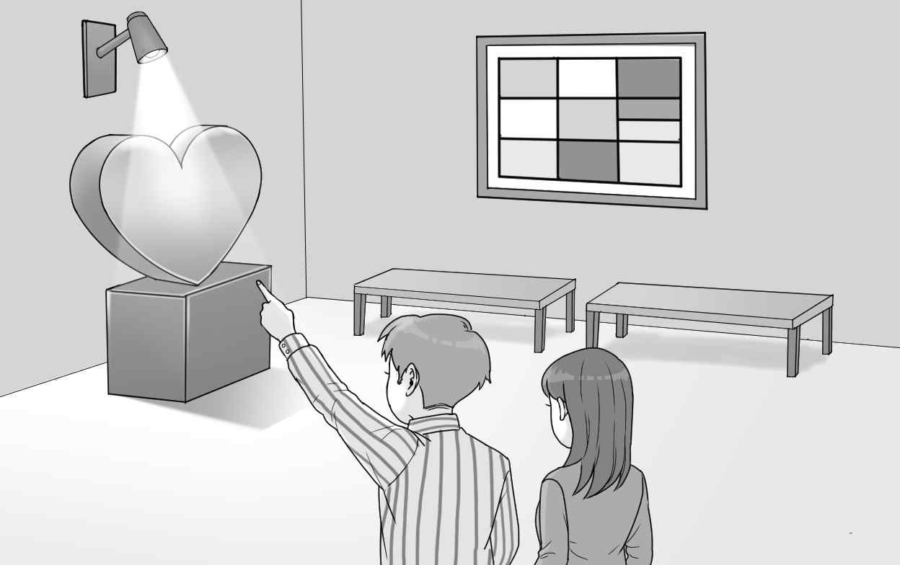
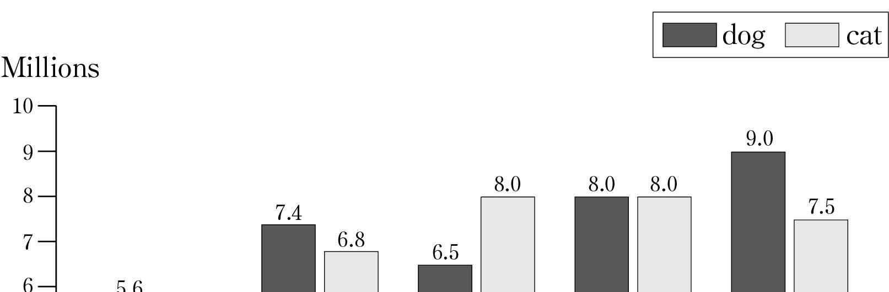
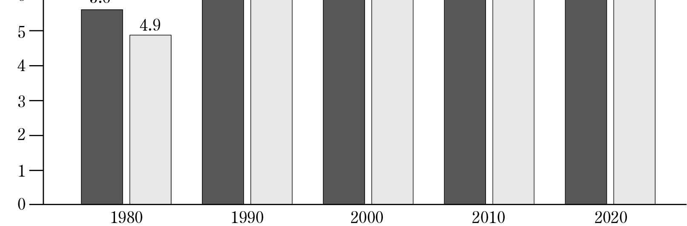

1. 다음을 듣고, 남자가 하는 말의 목적으로 가장 적절한 것을 고르시오.
① 도서관 이용 시간을 안내하려고
② 교내 불만 접수 방법을 설명하려고
③ 여름 방학 안전 수칙을 교육하려고
④ 특별 구역 청소 담당자를 모집하려고
⑤ 여름 방학에 예정된 학교 청소를 공지하려고

2. 대화를 듣고, 여자의 의견으로 가장 적절한 것을 고르시오.

① 편안한 환경은 책을 읽는 데 도움이 된다.
② 명확한 목적을 가지고 책을 선정해야 한다.
③ 문학 작품을 많이 읽으면 공감 능력이 커진다.
④ 일기 쓰기를 통해 지난 하루를 되돌아볼 수 있다.
⑤ 독서 일기를 쓰면 책의 내용을 잘 기억할 수 있다.

3. 다음을 듣고, 남자가 하는 말의 요지로 가장 적절한 것을 고르시오.

① 일상생활 속 자투리 시간을 효율적으로 활용해야 한다.
② 창의성을 발휘하려면 적당한 휴식 시간을 가져야 한다.
③ 충분한 수면 시간은 집중력 향상에 도움이 된다.
④ 보행 중에 휴대전화를 사용하는 것은 위험하다.
⑤ 성과를 내기 위해서는 책을 많이 읽어야 한다.

4. 대화를 듣고, 그림에서 대화의 내용과 일치하지 않는 것을 고르시오.

5. 대화를 듣고, 여자가 할 일로 가장 적절한 것을 고르시오.

① 평가 기준 정하기
② 카메라 빌리기
③ 인터뷰 후보 선정하기
④ 지원서 검토하기
⑤ 인터뷰 장소 예약하기

6. 대화를 듣고, 남자가 지불할 금액을 고르시오. [3점]

① $54
② $60
③ $108
④ $110
⑤ $120

7. 대화를 듣고, 여자가 자가용으로 출근하지 않은 이유를 고르시오.

① 버스 요금이 저렴해서
② 회사 주차 공간이 부족해서
③ 퇴근 후 헬스장에 가야 해서
④ 걷기 운동을 하기 위해서
⑤ 자동차 수리를 맡겨서

8. 대화를 듣고, Harmony in Pages에 관해 언급되지 않은 것을 고르시오.

① 가입 대상
② 모임 일시
③ 모임 장소
④ 활동 내용
⑤ 활동 경비

9. Healthy Heart Day에 관한 다음 내용을 듣고, 일치하지 않는 것을 고르시오.

① 3월 30일에 열릴 것이다.
② 심장에 좋은 음식과 음료를 제공할 것이다.
③ 방문자들은 자신의 혈압과 체온 등을 확인할 수 있다.
④ 사전 등록 없이 특별 강연을 들을 수 있다.
⑤ 퀴즈에 참여한 누구나 티셔츠를 받을 수 있다.

10. 다음 표를 보면서 대화를 듣고, 두 사람이 구매할 무선 마이크를 고르시오.

|  | Model | Price | Color | Battery Life (hours) | LED light |
| --- | --- | --- | --- | --- | --- |
| ① | A | $25 | black | 4 | X |
| ② | B | $40 | white | 4 | O |
| ③ | C | $50 | pink | 6 | O |
| ④ | D | $55 | white | 8 | X |
| ⑤ | E | $75 | pink | 8 | O |

11. 대화를 듣고, 남자의 마지막 말에 대한 여자의 응답으로 가장 적절한 것을 고르시오.

① I’m sorry, but you can’t use it as a credit card.
② Yes, I think it’d be great to take a group photo here.
③ No need. You can have your photo taken on the spot.
④ Fortunately, I found my ID card at the Lost and Found.
⑤ Right. The student services office doesn’t reissue ID cards.

12. 대화를 듣고, 여자의 마지막 말에 대한 남자의 응답으로 가장 적절한 것을 고르시오.

① It wasn’t easy. It took over three hours to get there.
② You’re right. Let’s pull over at the next rest area.
③ No problem. I got my car fixed before the trip.
④ Careful! You shouldn’t go over the speed limit.
⑤ Okay. I can take over driving after the break.

13. 대화를 듣고, 남자의 마지막 말에 대한 여자의 응답으로 가장 적절한 것을 고르시오. [3점]

Woman:
① Sure. I will send it to you right away.
② I’m afraid we only have fruit juice and tea.
③ I’m sorry that you’re not satisfied with our service.
④ Okay. I’ll let you know the new date of our seminar.
⑤ Good. Let’s order some drinks using the delivery service.

14. 대화를 듣고, 여자의 마지막 말에 대한 남자의 응답으로 가장 적절한 것을 고르시오.

Man:
① I’m sorry, but I’m not that interested in baking.
② Think twice. We already have an oven at home.
③ Fantastic! Then I can try more recipes at home.
④ Well, thank you for inviting me to your baking class.
⑤ Oh, no! I forgot to bring you some cookies and muffins.

15. 다음 상황 설명을 듣고, Taylor가 교장 선생님에게 할 말로 가장 적절한 것을 고르시오. [3점]

① Could you set up a bike parking station at school?
② Can we use the gym for the student council event?
③ Can you install a charging station for electric bikes?
④ Is it okay to include a bike tour during the field trip?
⑤ Could you repair the broken lockers inside the classrooms?

16. 여자가 하는 말의 주제로 가장 적절한 것은?

① benefits of taking in raw foods
② the most globally used ingredients
③ dangers of consuming too much fat
④ different food cultures around the world
⑤ healthy foods for improving brain functions

17. 언급된 식품이 아닌 것은?

① avocado
② salmon
③ almond
④ broccoli
⑤ walnut

18. 다음 글의 목적으로 가장 적절한 것은?

It has been a privilege to serve in this company for the past four years. The experiences and insights I have gained as a safety manager have been invaluable. However, after careful consideration, I have accepted a position at another company and will be leaving Lewis Ltd. This was not an easy decision to make, but I am confident that my new role will help me with my future goals. My last day of work will be on April 30th. I will do all I can to assist in a smooth transfer of duties. I wish both you and Lewis Ltd. every good fortune.

19. 다음 글에 드러난 Anna의 심경 변화로 가장 적절한 것은?

The piece of wreckage Anna held on to that served as a life preserver had a window. Now that there was light, she looked through it and down into the water. She wished she hadn’t. She spied dark shapes moving beneath her. What could they be? Fish? Sharks? Anna shook with fear, her blood running cold. The last bits of strength were draining away from her arms and upper body. She did not know how much longer she could hang on, but then Anna glanced up and couldn’t believe what she saw. A fishing boat was approaching over the big waves. After being in the water for 3 hours, she was finally rescued. When she got on the boat, she felt a sense of relief spread through her body.

20. 다음 글에서 필자가 주장하는 바로 가장 적절한 것은?

By definition, adult learners have a self-concept of being in charge of their own lives and have a need to be seen and treated as being capable of taking responsibility for their own learning. As such, learners need to be given the freedom and autonomy to assume responsibility for their own choices and to be proactive in making decisions that contribute to their educational experiences. Rather than perform the role of the “sage on the stage,” in working with adult learners, the instructor’s role should be the “guide on the side” — a facilitator of learning, and a coach or mentor who works alongside their learners to promote achievement and academic success. The facilitator role extends beyond course delivery, and includes the broader pedagogical tasks that will support learners on their growth such as helping them effectively manage their time; fostering engagement; assigning meaningful and relevant learning activities; and so on.

21. 다음 밑줄 친 you taste its price가 의미하는 바로 가장 적절한 것은?

That perception is a construction is not true just of one’s perception of sensory input, such as visual and auditory information. It is true of your social perceptions as well ― your perceptions of the people you meet, the food you eat, and even of the products you buy. For example, in a study of wine, when wines were tasted blind, there was little or no correlation between the ratings of a wine’s taste and its cost, but there was a significant correlation when the wines were labeled by price. That wasn’t because the subjects consciously believed that the higher-priced wines should be the better ones and thus revised whatever opinion they had accordingly. Or rather, it wasn’t true just at the conscious level. We know because as the subjects were tasting the wine, the researchers were imaging their brain activity, and the imaging showed that drinking what they believed was an expensive glass of wine really did activate their centers of taste for pleasure more than drinking a glass of the same wine that had been labeled as cheaper. That’s related to the placebo effect. Like pain, taste is not just the product of sensory signals; it depends also on psychological factors: you don’t just taste the wine; you taste its price.

22. 다음 글의 요지로 가장 적절한 것은?

Though it may seem extreme, a multilingual can quite literally feel differently about people, events or things when using one language versus another. The likelihood of being rattled by curse words or taboo words changes across native and second languages. Speakers of multiple languages not only report feeling different, but their bodies have different physiological reactions and their minds make different emotionally driven decisions across languages. The exact relationship between positive and negative emotions and language varies across people. For some, the second language carries more positive connotations because it is associated with freedom, opportunity, financial well-being and escape from persecution, whereas the native language is associated with poverty and hardship. For others, the opposite is true ― the second language is associated with post-immigration challenges, discrimination and lack of close relationships, whereas the native language is associated with family, friends and parental love. And many are somewhere in between, having a mix of positive and negative experiences associated with each language.

23. 다음 글의 주제로 가장 적절한 것은? [3점]

Sociologist Brooke Harrington said if there was an E = mc² of social science, it would be SD > PD, “social death is more frightening than physical death.” This is why we feel deeply threatened when a new idea challenges the ones that have become part of our identity. For some ideas, the ones that identify us as members of a group, we don’t reason as individuals; we reason as a member of a tribe. We want to seem trustworthy, and reputation management as a trustworthy individual often overrides most other concerns, even our own mortality. This is not entirely irrational. A human alone in this world faces a lot of difficulty, but being alone in the world before modern times was almost certainly a death sentence. So we carry with us an innate drive to form groups, join groups, remain in those groups, and oppose other groups. But once you can identify them, you start favoring us; so much so that given a choice between an outcome that favors both groups a lot or one that favors both much less but still favors yours more than theirs, that’s the one you will pick.

24. 다음 글의 제목으로 가장 적절한 것은?

Distance in time is like distance in space. People matter even if they live thousands of miles away. Likewise, they matter even if they live thousands of years hence. In both cases, it’s easy to mistake distance for unreality, to treat the limits of what we can see as the limits of the world. But just as the world does not stop at our doorstep or our country’s borders, neither does it stop with our generation, or the next. These ideas are common sense. A popular proverb says, “A society grows great when old men plant trees under whose shade they will never sit.” When we dispose of radioactive waste, we don’t say, “Who cares if this poisons people centuries from now?” Similarly, few of us who care about climate change or pollution do so solely for the sake of people alive today. We build museums and parks and bridges that we hope will last for generations; we invest in schools and longterm scientific projects; we preserve paintings, traditions, languages; we protect beautiful places. In many cases, we don’t draw clear lines between our concerns for the present and the future ― both are in play.

25. 다음 도표의 내용과 일치하지 않는 것은?

Changes in Pet Population (Millions)

| Year | dog | cat |
| --- | --- | --- |
| 1980 | 5.6 | 4.9 |
| 1990 | 7.4 | 6.8 |
| 2000 | 6.5 | 8.0 |
| 2010 | 8.0 | 8.0 |
| 2020 | 9.0 | 7.5 |

26. Ilya Prigogine에 관한 다음 글의 내용과 일치하지 않는 것은?

Ilya Prigogine was born into a Jewish family in Moscow. In 1921, he and his family left Russia, eventually settling in Belgium. His parents encouraged him to become a lawyer, and he first studied law at the Free University of Brussels. It was then that he became interested in psychology and behavioral research. In turn, reading about these subjects sparked his interest in chemistry since chemical processes affect the mind and body. He eventually dropped out of law school. Prigogine then studied chemistry and physics at the same time at the Free University of Brussels. He obtained the equivalent of a master’s degree in both fields in 1939, and he obtained a PhD in chemistry in 1941 at the Free University of Brussels, where he accepted the position of professor in 1947. Considered one of the founders of complexity science, Ilya Prigogine was awarded the Nobel Prize in Chemistry in 1977.

27. Electronic Safe User Manual에 관한 다음 안내문의 내용과 일치하지 않는 것은?

Electronic Safe User Manual OPENING THE SAFE FOR THE FIRST TIME Upon first use, users should open the safe with the emergency key. INSERTING THE BATTERIES • Insert four AA batteries, and the green light will flash. • If both the green light and the red light are on, replace the batteries. SETTING A PASSWORD • With the door open, press the reset button. Then, input a four-digit password and press the “enter” button. • When the new password is set, the green light will flash twice. OPENING THE DOOR WITH A PASSWORD Input your password and press the “enter” button. CAUTION: A wrong password input will set off an alarm.

28. World Poetry Day Competition에 관한 다음 안내문의 내용과 일치하는 것은?

World Poetry Day Competition In honor of World Poetry Day, let’s experience the power of words with our poetry competition! Competition Details • Theme: Unexpected Moments • Deadline: March 21, 2024 (World Poetry Day) • Age: Only those who are under age 18 can participate. Special Opportunities • Poetry Workshop: All participants can join our poetry workshop led by well-known poets. How to Participate • Compose your poem inspired by the theme. • You can submit your piece only through E-mail at administer@worldpoetry.org.

29. 다음 글의 밑줄 친 부분 중, 어법상 틀린 것은?

The process of crossing cultures challenges the very basis of who we are as cultural beings. It offers opportunities for new learning and growth. Being “uprooted” from our home brings us understanding not only of the people and their culture in our new environment, but of ourselves and our home culture. Although the difficulties that can arise from crossing cultures are often shocking, success stories are everywhere. Despite, or rather because of, the suffering and ambivalence we undergo when we cross cultures, we gradually find ourselves uniquely privileged to define ourselves and others anew with clarity and insight that we could not have cultivated without leaving home. Adapting to a new and unfamiliar culture, then, is more than survival. It is a life-changing journey. It is a process of “becoming” — personal reinvention, transformation, growth, reaching out beyond the boundaries of our own existence. The process does not require that we abandon our former personalities and the cultures into into which we were born. Rather, it compels us to find ourselves as if for the first time, particularly those “cultural invariants” within us — aspects that we hold dear and refuse to compromise.

30. 다음 글의 밑줄 친 부분 중, 문맥상 낱말의 쓰임이 적절하지 않은 것은? [3점]

While it has been found that young children rely exclusively on geometric information to determine the location of an object hidden in a small enclosure, exclusive use of geometry does not occur in larger spaces. Although, in a small room, children failed to incorporate information about nongeometric features (i.e., a blue wall), they used both types of information in a larger room. These findings suggest that geometric and nongeometric information may be combined in a weighted fashion. Geometry may be privileged because it is more stable across time than is nongeometric information. Whether or not nongeometric landmark information is combined with geometry may depend on the ecological validity of nongeometric features; for example, larger features may be more stable and hence more reliable. Further, a variety of mobile animals give more weight to nearer than to farther landmarks in estimation, consistent with Weber’s law in which smaller distances would be coded more accurately than larger distances.

31. 다음 빈칸에 들어갈 말로 가장 적절한 것을 고르시오.

From about ages eight through sixteen, our manual dexterity has strengthened through continually improving eye-hand coordination. There is considerable improvement in handwriting skills. We gain mastery over the mechanics of language. We also gradually eliminate the logical gaps in our stories ― characteristic of our earlier stage of perception ― as intense preoccupation with the whole vision gives way to preoccupation with correctness. As a result, our writing and oral storying become increasingly conventional and literal, with an accompanying loss of the spontaneity and originality that characterized our earlier efforts. At this stage our vocabulary is firmly grounded. We use words everyone else uses. We have little need to invent metaphors to communicate. By now we know that a star is “a hot gaseous mass floating in space” in contrast to our innocent stage, when we noticed, “Look that star is like a flower without a stem!”

32. 다음 빈칸에 들어갈 말로 가장 적절한 것을 고르시오.

The commonsense understanding of the moral status of altruistic acts conforms to how most of us think about our responsibilities toward others. We tend to get offended when someone else or society determines for us how much of what we have should be given away; we are adults and should have the right to make such decisions for ourselves. Yet, when interviewed, altruists known for making the largest sacrifices — and bringing about the greatest benefits to their recipients — assert just the opposite. They insist that they had absolutely no choice but to act as they did. Organ donors, and everyday citizens who risk their own lives to save others in mortal danger are remarkably consistent in their explicit denials that they have done anything deserving of high praise as well as in their assurance that anyone in their shoes should have done exactly the same thing. To be sure, it seems that the more altruistic someone is, the more they are likely to insist that they have done no more than all of us would be expected to do, lest we shirk our basic moral obligation to humanity.

33. 다음 빈칸에 들어갈 말로 가장 적절한 것을 고르시오. [3점]

Epictetus wrote, “A man’s master is he who is able to confirm or remove whatever that man seeks or shuns.” If you depend on no one except yourself to satisfy your desires, you will have no master other than yourself and you will be free. Stoic philosophy was about that ― taking charge of your life, learning to work on those things that are within your power to accomplish or change and not to waste energy on things you cannot. In particular, the Stoics warned against reacting emotionally to what is outside your control. Often, Epictetus argued, it’s not our circumstances that get us down but rather the judgments we make about them. Consider anger. We don’t get angry at the rain if it spoils our picnic. That would be silly because we can’t do anything about the rain. But we often do get angry if someone mistreats us. We usually can’t control or change that person any more than we can stop the rain, so that is equally silly. More generally, it is just as pointless to tie our feelings of well-being to altering another individual’s behavior as it is to tie them to the weather. Epictetus wrote, “If it concerns anything not in our control, be prepared to say that it is nothing to you.”

34. 다음 빈칸에 들어갈 말로 가장 적절한 것을 고르시오. [3점]

Japanese used to have a color word, ao, that spanned both green and blue. In the modern language, however, ao has come to be restricted mostly to blue shades, and green is usually expressed by the word midori. When the first traffic lights were imported from the United States and installed in Japan in the 1930s, they were just as green as anywhere else. Nevertheless, in common parlance the go light was called ao shingoo, perhaps because the three primary colors on Japanese artists’ palettes are traditionally aka(red), kiiro(yellow), and ao. The label ao for a green light did not appear so out of the ordinary at first, because of the remaining associations of the word ao with greenness. But over time, the difference between the green color and the dominant meaning of the word ao began to feel awkward. Nations that are less assertive might have opted for the solution of simply changing the official name of the go light to midori. Not so the Japanese. Rather than alter the name to fit reality, the Japanese government announced in 1973 that reality should be altered to fit the name: henceforth, go lights would be a color that better corresponded to the dominant meaning of ao.

35. 다음 글에서 전체 흐름과 관계 없는 문장은?

No doubt students collaborating with other speakers of English might encounter language variances, which may interfere with intentionality.

36. 주어진 글 다음에 이어질 글의 순서로 가장 적절한 것을 고르시오. [3점]

Different creative pursuits require varying degrees of unconscious flexible thinking, in combination with varying degrees of the conscious ability to adjust it and shape it through analytical thinking. In music, for example, at one end of the creative spectrum are improvisational artists, such as jazz musicians. They have to be particularly talented at lowering their inhibitions and letting in their unconsciously generated ideas. And although the process of learning the fundamentals of jazz would require a high degree of analytical thought, that thinking style is not as big a factor during the performance. On the other end of the spectrum are those who compose complex forms, such as a symphony or concerto, that require not just imagination but also careful planning and exacting editing. We know, for example, through his letters and the reports of others, that even Mozart’s creations did not appear spontaneously, wholly formed in his consciousness, as the myths about him portray. Instead, he spent long, hard hours analyzing and reworking the ideas that arose in his unconscious, much as a scientist does when producing a theory from a germ of insight. In Mozart’s own words: “I immerse myself in music... I think about it all day long ― I like experimenting ― studying ― reflecting...”

37. 주어진 글 다음에 이어질 글의 순서로 가장 적절한 것을 고르시오.

Today, historic ideas about integrating nature and urban/suburban space find expression in various interpretations of sustainable urban planning. But Landscape Urbanists find that these designs do not prioritize the natural environment and often involve diverting streams and disrupting natural wetlands. Still others, such as those advocating for “just sustainabilities” or “complete streets,” find that both approaches are overly idealistic and neither pays enough attention to the realities of social dynamics and systemic inequality. However, critics claim that Landscape Urbanists prioritize aesthetic and ecological concerns over human needs. In contrast, New Urbanism is an approach that was popularized in the 1980s and promotes walkable streets, compact design, and mixed-use developments. However, the role of social justice in these approaches remains highly controversial. For example, Landscape Urbanism is a relatively recent planning approach that advocates for native habitat designs that include diverse species and landscapes that require very low resource use.

38. 글의 흐름으로 보아, 주어진 문장이 들어가기에 가장 적절한 곳을 고르시오.

Insurance companies are expected to err on the safe side. They calculate risks thoroughly, carefully picking and choosing the customers they insure. They are boring because their role in the economy is to shield everyone and everything from disastrous loss. Unlike manufacturing, nothing truly revolutionary ever happens in the insurance industry. For centuries, insurers have charged higher premiums to people in “high-risk categories” such as smokers, male drivers under the age of thirty, and extreme-sports enthusiasts. This type of classification frequently results in biases and outright discrimination against disadvantaged groups. But in the future, real-time data collection will enable insurance companies to charge pay-as-you-drive rates depending on people’s actual behavior on the road, as opposed to generalized stereotypes of certain “at-risk” groups. Bad or high-risk individual drivers will end up paying more for insurance, regardless of whether they are men or women, young or old. The Big Brother connotations are threatening, but many people might agree to the real-time monitoring of their driving behavior if it means lower rates.

39. 글의 흐름으로 보아, 주어진 문장이 들어가기에 가장 적절한 곳을 고르시오. [3점]

Almost all the figurative paintings we are familiar with now are in perspective. They present foreshortened figures and objects that diminish as they move away from the focal point of the painting. A painting in perspective represents how the world looks to a person seeing the scene from a particular position in space. This stands in contrast to earlier figurative art, which had been as focused on representing what the artist knew about the objects and the space he or she was painting as on how they looked. These pictures are beautiful in their own right, but they do not represent scenes as we might see them if we were looking at them. They are also less informative as to the layout of the space they represent. The fact that perspective and information about spatial layout go together reveals something important about seeing. Not only do we see the world through an egocentric frame but we also see it in a way that allows us to extract information about distances to, and sizes of, objects relative to us, and relative to one another.

40. 다음 글의 내용을 한 문장으로 요약하고자 한다. 빈칸 (A), (B)에 들어갈 말로 가장 적절한 것은?

“Brain plasticity” is a term we use in neuroscience. Whether intentionally or not, “plasticity” suggests that the key idea is to mold something once and keep it that way forever: to shape the plastic toy and never change it again. But that’s not what the brain does. It carries on remolding itself throughout your life. Think of a developing city, and note the way it grows, improves, and responds to the world around it. Observe where the city builds its truck stops, how it crafts its immigration policies, and how it modifies its education and legal systems. A city is always changing. A city is not designed by urban planners and then immobilized like a plastic object. It continually develops. Just like cities, brains never reach an end point. We spend our lives blossoming toward something, even as the target moves. Consider the feeling of encountering a diary that you wrote many years ago. It represents the thinking, opinions, and viewpoint of someone who was a bit different from who you are now, and that previous person can sometimes border on the unrecognizable. Despite having the same name and the same early history, in the years between inscription and interpretation the narrator has altered. The word “plastic” can be stretched to fit this notion of ongoing change.

While some understand “brain plasticity” to mean permanence upon molding, the brain is actually capable of transformation.

41. 윗글의 제목으로 가장 적절한 것은?

You are the narrator of your own life. The tone and perspective with which you describe each experience generates feelings associated with that narration. For example, if you find yourself constantly assuming, “This is hard,” “I wonder whether I’m going to survive,” or “It looks like this is going to turn out badly,” you’ll generate anxious feelings. It’s time to restructure the way you think. Underlying this narration are the beliefs that frame your experience and give it meaning. Think of your beliefs as having many layers. On the surface are your automatic thoughts. These are like short tapes that momentarily flash through your mind. Call these automatic thoughts a form of “self-talk” that you use as you navigate through the day. You produce a wide variety of these automatic thoughts, some consciously and some unconsciously. For example, automatic thoughts that fuel anxiety go something like this: You walk into a room, see a few new people, and say to yourself, “Oh no, I don’t like this. This is not good.” Or, “These people will soon find out that I am full of anxiety and will reject me.” Automatic thoughts are bad habits that cloud fresh and positive experiences. They can turn a potentially good experience into one fraught with anxiety. If you tell yourself that you are always stressed or full of anxiety before doing something new, that new experience will be tainted by that anxiety.

42. 밑줄 친 낱말 중에서 문맥상 낱말의 쓰임이 적절하지 않은 것은? [3점]

You are the narrator of your own life. The tone and perspective with which you describe each experience generates feelings associated with that narration. For example, if you find yourself constantly assuming, “This is hard,” “I wonder whether I’m going to survive,” or “It looks like this is going to turn out badly,” you’ll generate anxious feelings. It’s time to restructure the way you think. Underlying this narration are the beliefs that frame your experience and give it meaning. Think of your beliefs as having many layers. On the surface are your automatic thoughts. These are like short tapes that momentarily flash through your mind. Call these automatic thoughts a form of “self-talk” that you use as you navigate through the day. You produce a wide variety of these automatic thoughts, some consciously and some unconsciously. For example, automatic thoughts that fuel anxiety go something like this: You walk into a room, see a few new people, and say to yourself, “Oh no, I don’t like this. This is not good.” Or, “These people will soon find out that I am full of anxiety and will reject me.” Automatic thoughts are bad habits that cloud fresh and positive experiences. They can turn a potentially good experience into one fraught with anxiety. If you tell yourself that you are always stressed or full of anxiety before doing something new, that new experience will be tainted by that anxiety.

43. 주어진 글에 이어질 내용을 순서에 맞게 배열한 것으로 가장 적절한 것은?

Once upon a time in the small town of Meadowville, there lived a curious boy named Tommy. Tommy’s grandfather, affectionately known as Grandpa Joe, had always been a mysterious figure to him. Grandpa Joe was a man of few words, but his eyes lit up from stories untold. One lazy summer afternoon, while searching the garage, Tommy found an old, forgotten box. As he opened it, the treasure of memories spilled out, including an old baseball card featuring a young Grandpa Joe.

 Tommy’s eyes widened with excitement as he examined the card. In the card, Grandpa Joe stood proudly in a baseball uniform. He was not the quiet person Tommy knew. Intrigued by this discovery, Tommy rushed inside the house to find Grandpa Joe. “Hey, Grandpa! I found this cool baseball card of you. Were you a baseball player?” he asked, eyes filled with curiosity. A spark of nostalgia lit up Grandpa Joe’s eyes as he took the card. Memories flooded back, and he told stories of his youthful days on the baseball field. Grandpa Joe spoke of the thrill of the game and the joy of hitting a home run. Tommy, fascinated by these stories, felt more connected to his grandfather. Eager to learn more, he asked Grandpa Joe to teach him about baseball. They spent afternoons in the backyard as he shared the wisdom of the game with his grandson. Together, they practiced hitting, catching, and even laughed over the mistakes. As they bonded over baseball, the gap between generations closed. Grandpa Joe’s eyes no longer held just the twinkle of untold stories; they now radiated warmth and shared memories.

44. 밑줄 친 낱말 중에서 가리키는 대상이 나머지 넷과 다른 것은?

Once upon a time in the small town of Meadowville, there lived a curious boy named Tommy. Tommy’s grandfather, affectionately known as Grandpa Joe, had always been a mysterious figure to him. Grandpa Joe was a man of few words, but his eyes lit up from stories untold. One lazy summer afternoon, while searching the garage, Tommy found an old, forgotten box. As he opened it, the treasure of memories spilled out, including an old baseball card featuring a young Grandpa Joe.

 Tommy’s eyes widened with excitement as he examined the card. In the card, Grandpa Joe stood proudly in a baseball uniform. He was not the quiet person Tommy knew. Intrigued by this discovery, Tommy rushed inside the house to find Grandpa Joe. “Hey, Grandpa! I found this cool baseball card of you. Were you a baseball player?” he asked, eyes filled with curiosity. A spark of nostalgia lit up Grandpa Joe’s eyes as he took the card. Memories flooded back, and he told stories of his youthful days on the baseball field. Grandpa Joe spoke of the thrill of the game and the joy of hitting a home run. Tommy, fascinated by these stories, felt more connected to his grandfather. Eager to learn more, he asked Grandpa Joe to teach him about baseball. They spent afternoons in the backyard as he shared the wisdom of the game with his grandson. Together, they practiced hitting, catching, and even laughed over the mistakes. As they bonded over baseball, the gap between generations closed. Grandpa Joe’s eyes no longer held just the twinkle of untold stories; they now radiated warmth and shared memories.

45. 윗글에 관한 내용으로 적절하지 않은 것은?

Once upon a time in the small town of Meadowville, there lived a curious boy named Tommy. Tommy’s grandfather, affectionately known as Grandpa Joe, had always been a mysterious figure to him. Grandpa Joe was a man of few words, but his eyes lit up from stories untold. One lazy summer afternoon, while searching the garage, Tommy found an old, forgotten box. As he opened it, the treasure of memories spilled out, including an old baseball card featuring a young Grandpa Joe.

 Tommy’s eyes widened with excitement as he examined the card. In the card, Grandpa Joe stood proudly in a baseball uniform. He was not the quiet person Tommy knew. Intrigued by this discovery, Tommy rushed inside the house to find Grandpa Joe. “Hey, Grandpa! I found this cool baseball card of you. Were you a baseball player?” he asked, eyes filled with curiosity. A spark of nostalgia lit up Grandpa Joe’s eyes as he took the card. Memories flooded back, and he told stories of his youthful days on the baseball field. Grandpa Joe spoke of the thrill of the game and the joy of hitting a home run. Tommy, fascinated by these stories, felt more connected to his grandfather. Eager to learn more, he asked Grandpa Joe to teach him about baseball. They spent afternoons in the backyard as he shared the wisdom of the game with his grandson. Together, they practiced hitting, catching, and even laughed over the mistakes. As they bonded over baseball, the gap between generations closed. Grandpa Joe’s eyes no longer held just the twinkle of untold stories; they now radiated warmth and shared memories.

