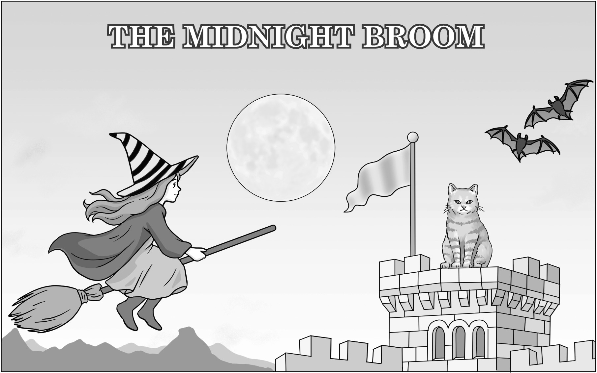
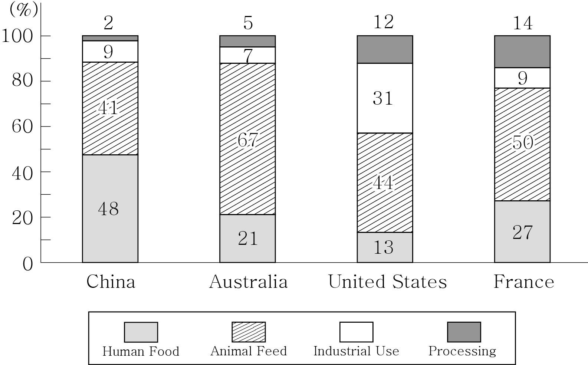

1. 다음을 듣고, 여자가 하는 말의 목적으로 가장 적절한 것을 고르시오.
① 교내 상담실 이용 방법을 안내하려고
② 의사소통 능력 향상을 위한 캠프를 홍보하려고
③ 방학 특강에 대한 만족도 조사 참여를 독려하려고
④ 의사소통 능력 캠프의 일정 변경을 공지하려고
⑤ 또래 상담 봉사 활동 지원자를 모집하려고

2. 대화를 듣고, 남자의 의견으로 가장 적절한 것을 고르시오.

① 노트북의 보안 프로그램을 최신 상태로 유지해야 한다.
② 전자 제품을 고를 때 사용 후기를 참고해야 한다.
③ 전자 제품은 공식 판매처에서 구매해야 한다.
④ 노트북을 구매할 때 출시 연도를 고려해야 한다.
⑤ 전자 제품을 구매하기 전에 보증 기간을 확인해야 한다.

3. 다음을 듣고, 여자가 하는 말의 요지로 가장 적절한 것을 고르시오.

① 꾸준히 운동하려면 자신이 즐기는 운동을 선택해야 한다.
② 전문가에게 운동을 배워야 운동 능력을 향상할 수 있다.
③ 준비 운동을 충분히 해야 부상 위험을 줄일 수 있다.
④ 다른 사람들과 함께 운동하면 동기 부여에 도움이 된다.
⑤ 운동을 시작할 때 체계적인 계획을 세우는 것이 중요하다.

4. 대화를 듣고, 그림에서 대화의 내용과 일치하지 않는 것을 고르시오.

5. 대화를 듣고, 남자가 할 일로 가장 적절한 것을 고르시오.

① 상자에 라벨 붙이기
② 쓰레기봉투 사다 주기
③ 물건 분류하기
④ 물건 포장하기
⑤ 상자 옮기기

6. 대화를 듣고, 여자가 지불할 금액을 고르시오. [3점]

① $41
② $43
③ $58
④ $61
⑤ $63

7. 대화를 듣고, 오늘 농구 연습이 진행되지 않는 이유를 고르시오.

① 체력을 아끼기 위해서
② 팀원이 부상을 입어서
③ 체육관이 보수 중이어서
④ 시합이 다음 주로 연기되어서
⑤ 체육관에서 학교 행사가 열려서

8. 대화를 듣고, Grab a Book Challenge에 관해 언급되지 않은 것을 고르시오.

① 운영 주체
② 활동 내용
③ 운영 기간
④ 참가 기념품
⑤ 참가 대상

9. Global Street Arts Festival에 관한 다음 내용을 듣고, 일치하지 않는 것을 고르시오.

① 2주 동안 주말마다 열린다.
② 시청에서 도서관까지 이어진다.
③ 입장료는 무료이다.
④ 아이들만을 위한 특별 구역이 있다.
⑤ 정오에 무용수들의 퍼레이드가 열린다.

10. 다음 표를 보면서 대화를 듣고, 여자가 신청할 강좌를 고르시오.

|  | Course | Fee | Level | Lesson Type | Day |
| --- | --- | --- | --- | --- | --- |
| ① | Curling | $120 | Advanced | Group | Friday |
| ② | Skating | $140 | Beginner | Private | Sunday |
| ③ | Ice Hockey | $150 | Beginner | Group | Thursday |
| ④ | Skiing | $180 | Beginner | Private | Tuesday |
| ⑤ | Snowboarding | $250 | Advanced | Private | Saturday |

11. 대화를 듣고, 여자의 마지막 말에 대한 남자의 응답으로 가장 적절한 것을 고르시오. [3점]

① We don’t take reservations at our restaurant.
② Let me check and see if we have a table available.
③ This isn’t the restaurant you’ve made a reservation at.
④ I’m afraid you’ve arrived too late for your reservation.
⑤ It’s so kind of you to save seats for two of us.

12. 대화를 듣고, 남자의 마지막 말에 대한 여자의 응답으로 가장 적절한 것을 고르시오.

① Good idea. Let’s take those toys to the store tomorrow.
② Oh, no! The toy is so popular that it’s already sold out.
③ Too bad. I wish we had that store near our house, too.
④ Thank you. Our son will be delighted with his new toys.
⑤ Never mind. I’ve already bought the toys from the store.

13. 대화를 듣고, 남자의 마지막 말에 대한 여자의 응답으로 가장 적절한 것을 고르시오. [3점]

Woman:
① I don’t care. I think my hairstyle really suits me.
② You’re right. It’s time for you to get a new camera.
③ Okay. I hope I can find a new hairstyle with the app.
④ No problem. I can help you download the camera app.
⑤ No thanks. I’ve already used it but it wasn’t that helpful.

14. 대화를 듣고, 여자의 마지막 말에 대한 남자의 응답으로 가장 적절한 것을 고르시오.

Man:
① Alright. Let’s start with the experiment plan then.
② I see. Let’s meet after lunch to clean the school lab.
③ No worries. We can choose whichever topic we want.
④ Sorry. I’m not interested in doing science experiments.
⑤ Absolutely! The experiment went well thanks to your help.

15. 다음 상황 설명을 듣고, Dr. Lee가 Jake에게 할 말로 가장 적절한 것을 고르시오.

Dr. Lee:
① You should take your dog out for short walks more often.
② Why don’t you change your diet to care for your health?
③ Try giving your dog less snacks to manage its weight.
④ I recommend this medicine for treating your dog’s wound.
⑤ Make sure the food you feed it is something dogs can eat.

16. 여자가 하는 말의 주제로 가장 적절한 것은?

① everyday devices that are equipped with AI
② safety guidelines for using smart electronics
③ once popular devices that are now rarely used
④ overestimated value of innovative devices with AI
⑤ different home devices for maximum electricity saving

17. 언급된 기기가 아닌 것은?

① speakers
② TVs
③ washing machines
④ air conditioners
⑤ refrigerators

18. 다음 글의 목적으로 가장 적절한 것은?

Thank you for applying for the winter internship program. I’m writing this email to provide you with important information regarding the next step in your application process. Based on the materials you submitted, we’ve recognized your genuine interest in advancing your technical expertise and software development skills. As mentioned before, additional documentation is required before moving to the final stage. We kindly ask that you provide the original copies of the certificates you listed in your application. Please send the documentation via mail by November 7. Thank you.

19. 다음 글에 드러난 Mike의 심경 변화로 가장 적절한 것은?

Mike stared at the blinking cursor on the screen, his heart sinking deeper with each passing hour. He had rewritten the final sentence over and over, yet nothing felt right. The pressure to finish was mounting — he was so close, but the words didn’t come to his mind. He buried his face in his hands with a deep sigh. Then, in the stillness, something sparked. With a rush, he typed a single sentence. A big smile spread across his face. “This is it! It’s perfect!” Mike shouted in joy, jumping up from his chair. He clapped his hands with delight. It felt like the final puzzle piece sliding into place. He had finally completed what he had long dreamed of.

20. 다음 글에서 필자가 주장하는 바로 가장 적절한 것은?

You probably have quirks in your own memory and feedback loop: the past negative experiences that feel bigger than they should, or the positive affirmations that we can over-interpret. The important thing is to take some conscious control over a process that otherwise proceeds unconsciously, robbing us of complete ownership of how we think about life situations and make decisions. If you are struggling to commit to a relationship because your last one was difficult, you need to remember that your previous one does not define you; the weighting of that may be too heavy in your feedback loop, inhibiting your ability to judge the new relationship on its merits. We need to think about why we feel a certain way, whether that is uncertain or over-confident, and try to locate the root of that emotion in the previous experiences that have filled our memory banks and conditioned our feedback loops.

21. 밑줄 친 I am a general, my soldiers are the keys.가 다음 글에서 의미하는 바로 가장 적절한 것은? [3점]

One consequence of the hierarchical organization of action is that when we reach for a cup of coffee, we do not need to consciously activate the sequence of muscles to send our arm and hand out toward the cup. Instead, most action plans are made at a higher level — we want to taste the coffee, and our arm, hand, and mouth coordinate to make it so. This means that in a skilled task such as playing the piano, there is a delicate ballet between conscious plans unfolding further up the hierarchy (choosing how fast to play, or how much emphasis to put on particular passages) and the automatic and unconscious aspects of motor control that send our fingers toward the right keys at just the right time. When watching a concert pianist at work, it seems as though their hands and fingers have a life of their own, while the pianist glides above it all, issuing commands from on high. As the celebrated pianist Vladimir Horowitz declared, “I am a general, my soldiers are the keys.”

22. 다음 글의 요지로 가장 적절한 것은?

Our yearning for belonging is so hardwired that we often try to acquire it by any means possible, including trying to fit in and working hard for approval and acceptance. Not only are these efforts hollow substitutes for belonging, but they are the greatest barriers to belonging. When we work to fit in and be accepted, our “belonging” is unstable. If we do or say something that’s true to who we are but outside the expectations or rules of the group, we risk everything. If people don’t really know who we are and what we believe or think, there’s no true belonging. Because we can feel belonging only if we have the courage to share our most authentic selves with people, our sense of belonging can never be greater than our level of self-acceptance. We can never truly belong if we are betraying ourselves, our ideals, or our values in the process. That is why it’s a mistake to think that belonging is passive and simply about joining or “going along” with others. It’s not.

23. 다음 글의 주제로 가장 적절한 것은? [3점]

Places today have become exhibitions of themselves. Through heavy investment in architecture, art, design, exhibition space, landscaping and various kinds of redevelopment towns, cities and countryside pronounce their possession of various cultural values — such as unchanging nature, the historic past, the dynamic future, multiculturalism, fun and pleasure, artistic creativity or simply stylishness. These cultural values have come to be seen as a place’s identity, the possession of which is key to the important task of attracting visitors. And this identity is expected to be easily accessed by those visitors or, to use a currently favoured term in urban design, to be legible. Places whose identity seems inaccessible, confusing or contradictory do not present themselves as destinations. They do not, in other words, seem visitable. An identity that is not pointed to in the form of well-restored or beautifully designed buildings, artworks, shopping plazas, streets, walkways or gardens does not compose itself into a view nor offer itself as an ‘experience’. To avoid such a fate, places should ‘make the most of themselves’. In this way, they can find their niche in the new cultural economy of visitability.

24. 다음 글의 제목으로 가장 적절한 것은?

For most people, the word “property” just refers to “stuff”: land, yes, but also the structures on that land, as well as physical possessions and even intangibles like ideas or radio frequencies. If you can own it, or claim some kind of right to it, it’s property. But sociologists and anthropologists have observed that in human societies, property rights systems aren’t really about “stuff”; they’re about people. More specifically, a property right isn’t a relationship between a person and an object, it’s an agreement between people about the object. And these agreements aren’t limited to written deeds and titles, or other property laws in a society. Becher explained that a sociologist like herself “would see property as a kind of social agreement. Property rights certainly exist in writing, in law, and that’s part of what they are. But they’re really only real to the extent that we respect them. [So, property rights are, in a sense,] claims that people make that get respected by others. So they’re always social.”

25. 다음 도표의 내용과 일치하지 않는 것은?

Share of Cereals Allocated to Human Food, Animal Feed, Industrial Use, and Processing, 2022 (%)

| Country | Human Food | Animal Feed | Industrial Use | Processing |
| --- | --- | --- | --- | --- |
| China | 48 | 41 | 9 | 2 |
| Australia | 21 | 67 | 7 | 5 |
| United States | 13 | 44 | 31 | 12 |
| France | 27 | 50 | 9 | 14 |

26. Mary Eliza Mahoney에 관한 다음 글의 내용과 일치하지 않는 것은?

Born in 1845 in Boston, Mary Eliza Mahoney was known as the first African American nurse in the United States. She attended the Phillips School in Boston, one of the first integrated schools in the United States. When she was in her teens, Mahoney knew that she wanted to become a nurse. To work towards her goal, Mahoney began working at the New England Hospital for Women and Children, which operated one of the first nursing schools in the United States. She was admitted to its nursing program in 1878 at the age of 33. Upon graduation, she became a private duty nurse. In 1908, Mahoney co-founded the National Association of Colored Graduate Nurses (NACGN) to promote equality for African American nurses. Recognizing that Mahoney served as an outstanding role model for nurses of all races, NACGN created the Mary Mahoney Award in 1936.

27. Playtime with Books에 관한 다음 안내문의 내용과 일치하지 않는 것은?

 Playtime with Books Read, write, and play — your Saturday becomes a story-filled adventure.
Date: December 6
Target: Elementary school students (Grades 3 & 4)
Location: Bluebell Library Multipurpose Room
Registration - Registration starts on November 17. - Visit our homepage and click the event banner. * Note: First come, first served! Registration will close once all spots are filled.
Programs - Morning Program: Create Your Own Amazing Tales - Afternoon Program: Design Your Book Cover

28. Bluetooth VR Goggles에 관한 다음 안내문의 내용과 일치하는 것은?

 Bluetooth VR Goggles - Instruction Manual - How to Operate the Bluetooth VR Goggles
Turn on Bluetooth in your smartphone settings, and search for the “VR Goggles” Bluetooth signal.
Start the app or content you want to use on your smartphone, before putting on the goggles.
If the goggles remain inactive for 30 minutes, they will automatically shut down. Charging Instructions
The red light means the device needs to be charged.
The green light means the battery is fully charged.
The power connector is on the left strap. Caution When Charging
Do not charge while wearing the goggles.
When charging, put the goggles in a cool and dry area.

29. 다음 글의 밑줄 친 부분 중, 어법상 틀린 것은? [3점]

The physical act of movement in the morning is not just beneficial for the body — it serves as a powerful stimulant for the brain, awakening it from the stillness of sleep and preparing it for the demands of the day. This awakening goes beyond physical health; it plays a critical role in enhancing cognitive function, particularly in the realms of creativity and imagination. One of the key mechanisms through through which this occurs is increased blood flow to the hippocampus, a part of the brain responsible for memory, learning, and the creation of new ideas. The hippocampus, often described as the brain’s center for imagination and memory consolidation, thrives on the increased oxygenation and nutrients provided by physical movement. Studies published in journals highlight the positive effects of regular morning exercise on cognitive flexibility and creative thinking, confirming that exercise not only promotes physical health but also stimulates neural plasticity — the brain’s ability to reorganize itself by forming new neural connections. This adaptability is essential for creative thought, as it allows individuals to approach problems from new angles, make novel associations, and think more differently.

30. 다음 글의 밑줄 친 부분 중, 문맥상 낱말의 쓰임이 적절하지 않은 것은?

Information is an important ingredient for good decision-making. And so, a variety of guardrails exist that shape what information is available. For instance, in the United States, corporate disclosure laws limit what a company’s executives can share publicly and when. Share too much information and you risk being fined. In other contexts, the reverse is true, and one is forbidden to make public certain information. Pharmaceutical companies need to disclose possible side effects for the drugs they manufacture and the food industry needs to put nutritional labels on most of their products. Sometimes, such a l’obligation d’information, as the French call it poetically, may apply to a company’s clients. Insurance policies are an example. The insured is typically under a duty to disclose material facts that affect the risk to the insurer. In a similar way, the state itself makes available a wide variety of information to help individuals make better decisions. Laws are made public so that citizens can obey them, at least in democratic states. Public registers, such as for corporations or landownership, help people decide whether to engage in a business transaction.

31. 다음 빈칸에 들어갈 말로 가장 적절한 것을 고르시오.

As a general rule, when the individuals of a population encounter a new environmental stress, some individuals in the population will die prematurely and some individuals will survive. If the reason for their survival (such as a slightly enhanced ability or trait) can be passed on to their offspring (that is, it’s genetically encoded), then the next generation should be better able to withstand the newly encountered environmental stress, and the population overall will be less susceptible to it. Therefore, the key to the ability of a population to survive by adaptation lies in the rapidity with which the next generation, the more resistant generation, is produced by the survivors of this generation. It follows that those species capable of producing a new generation very quickly should be better able to respond to a stress very quickly. Those species that require more time for reproduction will be slower to adapt to the stress because of the additional time needed for them to produce stress-tolerant offspring.

32. 다음 빈칸에 들어갈 말로 가장 적절한 것을 고르시오.

The digital age has brought remarkable advancements in communication. A message that might have taken weeks to deliver by mail can now be sent in seconds. Yet, in this shift toward efficiency, we’ve lost something essential: the richness of face-to-face interaction. Think about it — when you communicate through a text or email, you’re missing out on nonverbal cues like facial expressions, tone of voice, and body language. These elements carry emotional weight, helping us to interpret meaning and intent. Without them, our understanding of others’ emotions is often incomplete, leading to confusion and frustration. Take, for instance, a short reply to an email: “Okay.” Depending on the context, the sender’s intention might be neutral, annoyed, or even sarcastic. But without vocal inflections or facial expressions to guide us, we are left guessing. This is why digital communication requires heightened emotional awareness — not only to express ourselves effectively but also to decode the emotions behind the words we receive.

33. 다음 빈칸에 들어갈 말로 가장 적절한 것을 고르시오. [3점]

Our epistemic relation to self-determination is open to error and, thus, subjective. Turning oneself into an agent of a particular kind by conceiving of oneself as that type of agent does not suffice to make it the case that one actually is that type of agent. Just imagine someone who believes himself to be a natural born tango dancer. He has watched many videos about tango dancing and practices dancing by himself for many years. Having prepared himself for a glorious entrance on the international scene, he travels to Buenos Aires and shows up at Maldita Milonga to show his skills. Unbeknownst to him, though, his dancing (if dancing it be) does not even remotely resemble tango, and nothing he does on stage can be recognized as tango dancing. Hence, while he conceived of himself as a tango dancer and did many things in light of that self-conception (including buying a ticket to Buenos Aires, dressing up, consuming hours of tango videos, reading books about tango, learning Spanish, etc.), he failed at meeting some of the minimal norms of actually being a tango dancer at all.

34. 다음 빈칸에 들어갈 말로 가장 적절한 것을 고르시오. [3점]

What makes social attention distinct, and more far-reaching than many other forms of social connection, is that it can live outside of the actual relationships we have. You can’t have a relationship with a celebrity unless you know him and he knows you. But a celebrity can be the object of your social attention. And this kind of one-sided social attention isn’t something trivial or secondary, but an enormous part of our lives. In tenth grade, you can spend most of your waking hours daydreaming about a high school senior you have a crush on. As an adult, you might find yourself having imaginary arguments in your head with a certain media personality. Think for a moment of the pantheon of strangers we have in our heads that we put our social attention on — from athletes we root for or jeer, to celebrities, to people whose struggle we encounter in the news. An enormous part of our social attention falls upon people who do not know us at all.

35. 다음 글에서 전체 흐름과 관계 없는 문장은?

We often use the word ignorance to denote a primitive or foolish set of beliefs. In fact, I would say that “explanation” is often primitive or foolish, and the recognition of ignorance is the beginning of scientific discourse.

36. 주어진 글 다음에 이어질 글의 순서로 가장 적절한 것을 고르시오. [3점]

Some propositions about lotteries are extremely likely to be true. Consider the proposition ‘any given ticket in a ten-million ticket lottery is a losing ticket’. Despite being overwhelmingly likely to be true, many philosophers think that such propositions, based on probabilities alone, are different from other propositions we regularly rely upon. It’s been popular to suppose, for instance, that we don’t know that we have lost the lottery just by reflecting on how unlikely winning is. This is puzzling, because there are many things we take ourselves to know even though we presumably have more than a one-in-ten-million chance of being wrong. For example, you might know you will attend a meeting later, even though occasionally meetings get cancelled unexpectedly — and surely more frequently than one-in-ten-million meetings! If we want to avoid conceding that the scope of our knowledge is much more limited than usually supposed, there must be some difference between the probabilistic evidence we have about the lottery and evidence for regular things that we do know.

37. 주어진 글 다음에 이어질 글의 순서로 가장 적절한 것을 고르시오.

In everyday life, most people think that media effects are things that show up during a media exposure or immediately afterward. This is an example of a media message triggering an immediate effect — a buying behavior — on you. But let’s say you did not click on the buy now button to buy the product; does this mean there was no media effect? Perhaps, but also perhaps not. Of course some effects do show up immediately, but other effects may take a long time to manifest themselves. Let’s say you see an ad for a product on a website and you click on a buy now button to buy that product. If you continually expose yourself to ads in the media, you may gradually over time come to believe that you have more needs than you really have and that all of those needs can be easily satisfied by buying particular products. This is a long-term effect on what you believe; it cannot be attributed to any one media exposure but instead gradually builds up in a steady drip-drip-drip manner over time.

38. 글의 흐름으로 보아, 주어진 문장이 들어가기에 가장 적절한 곳을 고르시오. [3점]

Since its invention at the end of the nineteenth century, the automobile remained a machine that had to be controlled by a human driver. Without human control of steering wheel, gas pedal and brakes none of the billions of miles could have been traversed by the billions of cars in the world: A car always needed the driving skills of a human to fulfill its function. Without a driver, it would have been only an immobile artifact, left to stand still in its parking lot. In the early years of motoring, this necessity of a human driver was not seen as a barrier. Manual driving promised to fulfill the human dream of individual mobility and freedom, of self-guidance, of autonomy. But with the emerging mass automobility in the first decades of the twentieth century, the negative effects of human agency behind the steering wheel — accidents for example — became a serious topic of concern. It is no surprise that the fantasy of a self-driving car, a car that can navigate without a human driver, can be dated to this period.

39. 글의 흐름으로 보아, 주어진 문장이 들어가기에 가장 적절한 곳을 고르시오.

That the brain had limitations on the amount of information processing it could handle was not news to psychologists. Indeed, about 15 years earlier, Miller showed this with his famous paper on the limited capacity of short-term memory. What was novel was the connection between categorization and stereotyping, and that categorization was an inevitable aspect of human cognition. At any given second, there are hundreds, even thousands, of different stimuli that can be perceived in our immediate environment. If we had to constantly think carefully about every one of those stimuli (or even a small subset thereof), in order to understand its nature and function, we would never get anything done! Instead, we learn about different stimuli, and tend to group them in terms of common features, attributes, or functions. This categorization process then becomes so well practiced as to become automatic, and it frees up our consciousness to attend to things that are novel in our environment, or to our current task. Thus, categorization helps us reduce the complexity of the stimuli in our social environment.

40. 다음 글의 내용을 한 문장으로 요약하고자 한다. 빈칸 (A), (B)에 들어갈 말로 가장 적절한 것은?

Cinema and law share the same subjects and audience. Rather than an abstract desire for truth as a value in itself, the law deals with the messiness of human relations. Both disciplines struggle with what it means to be human and try to communicate to us something about our existence; both are human artifacts directed at man. Indeed, foundational to law is its anxiety about human nature: man desires freedom but is simultaneously too violent to exist in a state of nature without a regime of commands and prohibitions. However, there is also an important difference here that makes a study of the interaction between cinema and law interesting: while cinema expresses man’s affective life, the law keeps it in check. It tries to ensure that we are not overwhelmed and destroyed by our desires and drives. The law obsessively tries to suppress affects, fearing the horror of their consequences, whereas cinema introduces us to our affects, often forcing us to identify the most unbearable ones in ourselves.

Cinema and law are both human creations that explore humanity, yet they differ in how they handle emotion — cinema has us confront it, and law imposes limits on it.

41. 윗글의 제목으로 가장 적절한 것은?

Few pick up a novel and criticize it because the situations it describes and the people it contains never existed in real life. Perhaps even when we should criticize fiction for giving us inaccurate or biased views of the state of the world, it generally escapes our scorn. It’s only fiction, we say. But of course fiction is more than just something made up. If it were only that, we would not bother engaging with it, and it would not occupy such a large part of our lives. Humans are drawn to fiction, to invented stories, in a way unique among animals. If we think about this, it may seem odd — why should we be interested in reading or watching on screen a story that never happened, and in many cases that could never happen, the travails of people who never existed and could never exist? Why do we enjoy this? What do we get out of it? We’re not learning anything about the world, we’re not gaining any kind of useful experience that will help us navigate our lives more effectively, we’re not learning any new skill or developing any new material. Most of us of course will argue that there is a great deal of value in engaging with fiction and other kinds of art, even though these things may teach us nothing about the world or generate art-independent skills. After all, we spend insignificant amounts of our time engaging with such fiction. It is no surprise that films, television and sports, video games, novels, and the like, are billion-dollar industries.

42. 밑줄 친 낱말 중에서 문맥상 낱말의 쓰임이 적절하지 않은 것은?

Few pick up a novel and criticize it because the situations it describes and the people it contains never existed in real life. Perhaps even when we should criticize fiction for giving us inaccurate or biased views of the state of the world, it generally escapes our scorn. It’s only fiction, we say. But of course fiction is more than just something made up. If it were only that, we would not bother engaging with it, and it would not occupy such a large part of our lives. Humans are drawn to fiction, to invented stories, in a way unique among animals. If we think about this, it may seem odd — why should we be interested in reading or watching on screen a story that never happened, and in many cases that could never happen, the travails of people who never existed and could never exist? Why do we enjoy this? What do we get out of it? We’re not learning anything about the world, we’re not gaining any kind of useful experience that will help us navigate our lives more effectively, we’re not learning any new skill or developing any new material. Most of us of course will argue that there is a great deal of value in engaging with fiction and other kinds of art, even though these things may teach us nothing about the world or generate art-independent skills. After all, we spend insignificant amounts of our time engaging with such fiction. It is no surprise that films, television and sports, video games, novels, and the like, are billion-dollar industries.

43. 주어진 글에 이어질 내용을 순서에 맞게 배열한 것으로 가장 적절한 것은?

On a bright fall day, a young boy named Jay visited the pumpkin festival with his grandfather. There, he became fascinated by the giant, prize-winning pumpkins on display. Jay made up his mind to grow an enormous pumpkin himself. With stars sparkling in his eyes, he eagerly shared his dream with his grandfather that he wanted to grow the next show-winning pumpkin.

 Seeing Jay’s excitement, he promised to help him grow a giant pumpkin. When they visited a pumpkin farm to buy seeds, he explained the basics to Jay: choose a large variety and plant seeds from the biggest pumpkins. He also advised planting them in late May, when the soil is warm, by forming small hills about eight inches high and placing six to eight seeds in each. Following his grandfather’s advice, he picked out a few promising pumpkin seeds. Though his grandfather reminded him that a little luck was also needed, Jay remained confident. He carefully kept the seeds he had bought and spent the winter thinking about how he would grow his pumpkins. When spring finally arrived, he received help from his grandfather. He used his tractor to prepare the garden with Jay. Jay eagerly planted the seeds and waited with anticipation for them to grow. But then, disaster struck. A squirrel dug up and ate every single seed. When Jay found out what the squirrel had done, he searched through the soil but found nothing. His dream was crushed! Still, his grandfather encouraged him to plant some pie pumpkin seeds he had on hand. Jay agreed and planted them. After some time, small pumpkins filled the garden. The family baked delicious pies using the pumpkins Jay had harvested. Despite the setback, Jay found joy in the harvest and the time spent with his family. Jay promised himself that next year, he would try again to grow the biggest pumpkin of all.

44. 밑줄 친 낱말 중에서 가리키는 대상이 나머지 넷과 다른 것은?

On a bright fall day, a young boy named Jay visited the pumpkin festival with his grandfather. There, he became fascinated by the giant, prize-winning pumpkins on display. Jay made up his mind to grow an enormous pumpkin himself. With stars sparkling in his eyes, he eagerly shared his dream with his grandfather that he wanted to grow the next show-winning pumpkin.

 Seeing Jay’s excitement, he promised to help him grow a giant pumpkin. When they visited a pumpkin farm to buy seeds, he explained the basics to Jay: choose a large variety and plant seeds from the biggest pumpkins. He also advised planting them in late May, when the soil is warm, by forming small hills about eight inches high and placing six to eight seeds in each. Following his grandfather’s advice, he picked out a few promising pumpkin seeds. Though his grandfather reminded him that a little luck was also needed, Jay remained confident. He carefully kept the seeds he had bought and spent the winter thinking about how he would grow his pumpkins. When spring finally arrived, he received help from his grandfather. He used his tractor to prepare the garden with Jay. Jay eagerly planted the seeds and waited with anticipation for them to grow. But then, disaster struck. A squirrel dug up and ate every single seed. When Jay found out what the squirrel had done, he searched through the soil but found nothing. His dream was crushed! Still, his grandfather encouraged him to plant some pie pumpkin seeds he had on hand. Jay agreed and planted them. After some time, small pumpkins filled the garden. The family baked delicious pies using the pumpkins Jay had harvested. Despite the setback, Jay found joy in the harvest and the time spent with his family. Jay promised himself that next year, he would try again to grow the biggest pumpkin of all.

45. 윗글에 관한 내용으로 적절하지 않은 것은?

On a bright fall day, a young boy named Jay visited the pumpkin festival with his grandfather. There, he became fascinated by the giant, prize-winning pumpkins on display. Jay made up his mind to grow an enormous pumpkin himself. With stars sparkling in his eyes, he eagerly shared his dream with his grandfather that he wanted to grow the next show-winning pumpkin.

 Seeing Jay’s excitement, he promised to help him grow a giant pumpkin. When they visited a pumpkin farm to buy seeds, he explained the basics to Jay: choose a large variety and plant seeds from the biggest pumpkins. He also advised planting them in late May, when the soil is warm, by forming small hills about eight inches high and placing six to eight seeds in each. Following his grandfather’s advice, he picked out a few promising pumpkin seeds. Though his grandfather reminded him that a little luck was also needed, Jay remained confident. He carefully kept the seeds he had bought and spent the winter thinking about how he would grow his pumpkins. When spring finally arrived, he received help from his grandfather. He used his tractor to prepare the garden with Jay. Jay eagerly planted the seeds and waited with anticipation for them to grow. But then, disaster struck. A squirrel dug up and ate every single seed. When Jay found out what the squirrel had done, he searched through the soil but found nothing. His dream was crushed! Still, his grandfather encouraged him to plant some pie pumpkin seeds he had on hand. Jay agreed and planted them. After some time, small pumpkins filled the garden. The family baked delicious pies using the pumpkins Jay had harvested. Despite the setback, Jay found joy in the harvest and the time spent with his family. Jay promised himself that next year, he would try again to grow the biggest pumpkin of all.

