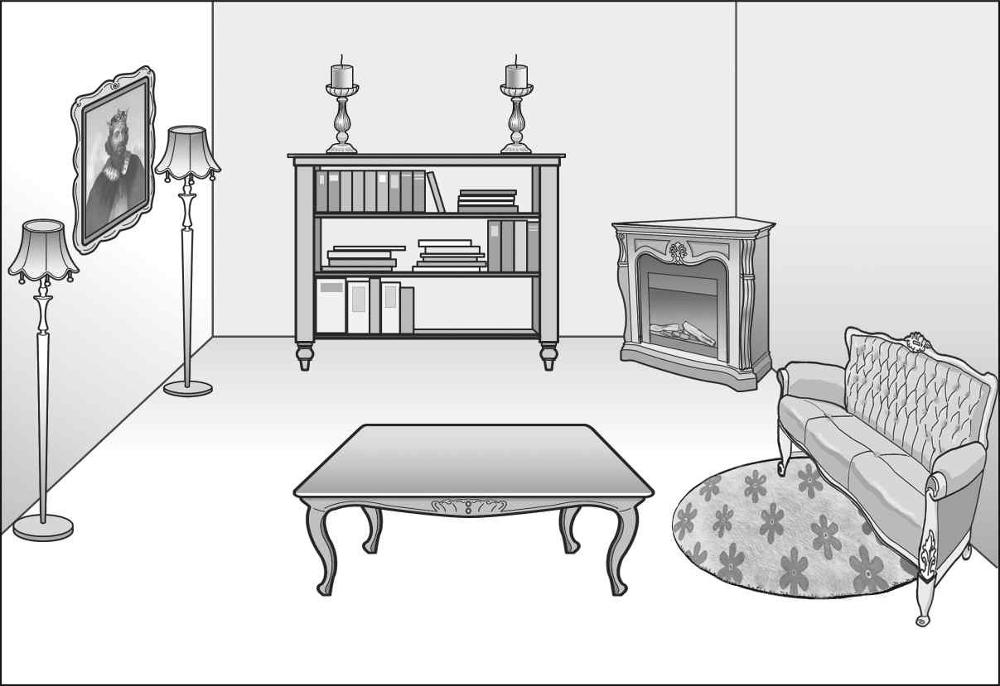
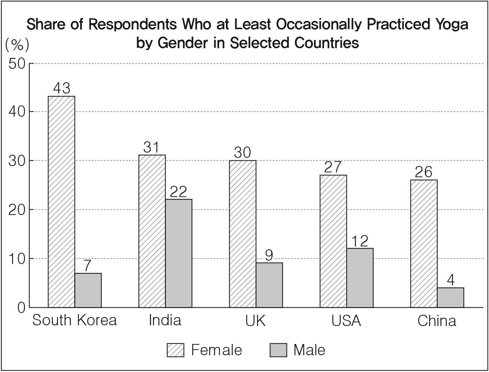
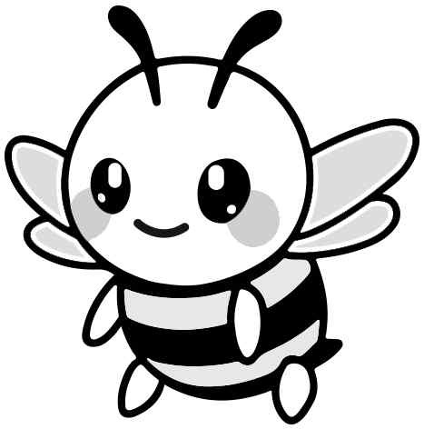
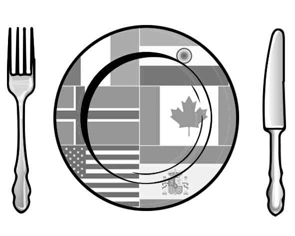

1. 다음을 듣고, 남자가 하는 말의 목적으로 가장 적절한 것을 고르시오.

① 작품 제출 기한 연장을 알리려고
② 작품 전시 장소 변경을 공지하려고
③ 책 삽화 전시회 출품을 독려하려고
④ 도서관 운영 프로그램을 홍보하려고
⑤ 도서관 확장 개관식 일정을 안내하려고

2. 대화를 듣고, 여자의 의견으로 가장 적절한 것을 고르시오.

① 프로젝트 시작 단계에서부터 명확한 주제를 정하는 것이 좋다.
② 팀 프로젝트 성공을 위해서는 다른 사람들과 협력해야 한다.
③ 반복적인 검토가 프로젝트의 오류를 줄이는 데 도움이 된다.
④ 프로젝트 진행 시 선배들의 경험을 경청하는 것이 중요하다.
⑤ 새로운 프로젝트 시작 시 이전 프로젝트를 검토해야 한다.

3. 다음을 듣고, 남자가 하는 말의 요지로 가장 적절한 것을 고르시오.

① 효과적인 학습 습관을 만드는 것이 집중력 향상을 돕는다.
② 스트레스를 해소하기 위해 규칙적 휴식 습관이 필요하다.
③ 일정한 장소를 정해 학습하면 집중력을 키울 수 있다.
④ 안정적인 환경 조성을 통해 불안감을 줄일 수 있다.
⑤ 다양한 학습 도구의 사용이 학습 효과를 올린다.

4. 대화를 듣고, 그림에서 대화의 내용과 일치하지 않는 것을 고르시오.

5. 대화를 듣고, 여자가 할 일로 가장 적절한 것을 고르시오.

① 안내장 가져다 두기
② 인터넷 연결 점검하기
③ 관람객 의자 배치하기
④ 대형 스크린 설치하기
⑤ 시상식 상품 준비하기

6. 대화를 듣고, 남자가 지불할 금액을 고르시오.

① $42
② $43
③ $45
④ $46
⑤ $49

7. 대화를 듣고, 여자가 녹찻잎 따기 체험에 갈 수 없는 이유를 고르시오.

① 부모님을 모시러 기차역에 가야 해서
② 오케스트라 연습에 참여해야 해서
③ 고객과의 계약을 마무리해야 해서
④ 해외 출장을 가야 해서
⑤ 고향을 방문해야 해서

8. 대화를 듣고, 현대 무용 수업에 관해 언급되지 않은 것을 고르시오.

① 장소
② 수강료
③ 시간
④ 모집 인원
⑤ 등록 방법

9. Queensway Street Theatre Festival에 관한 다음 내용을 듣고, 일치하지 않는 것을 고르시오.

① 2년에 한 번씩 열린다.
② 시청 앞 광장에서 진행될 것이다.
③ 10개 국가의 예술가들이 참가할 것이다.
④ 특별 행사 티켓은 현장에서 구매할 수 있다.
⑤ 푸드 트럭에서 음식을 구입할 수 있다.

10. 다음 표를 보면서 대화를 듣고, 두 사람이 주문할 디지털 체온계를 고르시오.

|  | Model | Measurement Site | Price | Visual Alarm | Age Adjustment Setting |
| --- | --- | --- | --- | --- | --- |
| ① | A | forehead | $45 | 3 colors | ☓ |
| ② | B | forehead | $39 | 3 colors | ◯ |
| ③ | C | ear | $33 | 3 colors | ☓ |
| ④ | D | ear | $29 | 2 colors | ◯ |
| ⑤ | E | armpit | $25 | 2 colors | ☓ |

11. 대화를 듣고, 남자의 마지막 말에 대한 여자의 응답으로 가장 적절한 것을 고르시오. [3점]

① I’m sorry. We should’ve arrived earlier.
② Not really. I can’t find any hotels nearby.
③ Awesome! I want to see the attractions now.
④ Absolutely. I’ll call you when I check out.
⑤ Good idea. Let’s reach out to the hotel.

12. 대화를 듣고, 여자의 마지막 말에 대한 남자의 응답으로 가장 적절한 것을 고르시오.

① Thank you. I’ll take a look and correct them.
② No worries. The launch location is finally fixed.
③ That’s okay. I can wait until you finish your review.
④ Right. Your presentation will be the highlight of the show.
⑤ Why not? I can contact the business and cancel the event.

13. 대화를 듣고, 남자의 마지막 말에 대한 여자의 응답으로 가장 적절한 것을 고르시오. [3점]

Woman:

① Too bad. I can’t find your name on the waiting list.
② Okay. Let me go ahead and reserve that time for you.
③ Oh, no. I forgot to bring your examination report today.
④ Great. I’ll see you on Saturday morning for your check-up.
⑤ Really? I think you’d better go to the hospital immediately.

14. 대화를 듣고, 여자의 마지막 말에 대한 남자의 응답으로 가장 적절한 것을 고르시오.

Man:

① I got it. I promise not to use them when I ride.
② Thanks. I’ll consider the weather next time.
③ That’s true. I’m not allowed to go outside.
④ I see. I can lend you my protective gear.
⑤ Sorry. I’m trying not to make noises.

15. 다음 상황 설명을 듣고, Chris가 Olivia에게 할 말로 가장 적절한 것을 고르시오. [3점]

Chris:

① Friday to Saturday is always fully reserved.
② Do you mind delaying the reservation by an hour?
③ Would it be possible to host the party on Saturday?
④ Can I recommend another dish for your birthday party?
⑤ You should try to finish the party before it gets too late.

16. 여자가 하는 말의 주제로 가장 적절한 것은?

① how animals predict natural disasters
② strategies animals use to detect prey
③ tips for owners to keep animals safe from danger
④ influence of climate disasters on animal populations
⑤ why animals and humans develop similar sensory organs

17. 언급된 동물이 아닌 것은?

따라 답을 하시기 바랍니다.

① cats
② elephants
③ snakes
④ dogs
⑤ sharks

18. 다음 글의 목적으로 가장 적절한 것은?

To whom it may concern, The creation of an additional new road to address the traffic on worn-out Mahogany Road was quite pleasant news for our community. I pen this letter with the hope that the relevant authorities will intervene in regard to an unresolved inconvenience. I fully agree that the toll on Mahogany Road needed to be high in past years, because the road was a single one with lots of traffic and its miserable state required frequent maintenance. Yet, the road’s drivers are still asked to pay $3 each time, and this price is similar to that of the newly built road, so the traffic jams don’t go away as drivers flock to the new road. For better distribution of traffic, I suggest there be a proper adjustment in price on Mahogany Road. I hope the new road can fulfill our needs well as planned. Yours faithfully, Dan Sullivan

19. 다음 글에 드러난 ‘I’의 심경 변화로 가장 적절한 것은?

“Please welcome to the stage, Stacy Pan!” My legs tremble as I step onto the stage to narrate a story I wrote. The spotlight blinds me, and my mind cries out. Don’t mess up. Don’t hesitate. Just keep going. I adjust the microphone, trying to ignore the fact that hundreds of people are watching me. I begin, diving straight into the story as I have practiced. My voice shakes, and I focus on each word, afraid that one misstep will ruin everything. The room is silent, but I keep going, word by word. Finally, I approach the last line and deliver it without a single mistake. There’s a moment of silence before I realize I’ve finished. I breathe out, all my tension melting away. My chest feels lighter as I step off the stage. It’s done, and I didn’t fail. It’s not joy I feel — just stillness and peace.

20. 다음 글에서 필자가 주장하는 바로 가장 적절한 것은?

AI technology is powerful, and it is transformative, but the AI hype of recent years has contributed to a god complex that positions technology leaders as voices of authority on the societal problems their creations have often caused. Listening to scientists and innovators is important. But those who are profiting from AI hype are not experts on how that work should be judged. Neither do distinguished computer scientists, no matter how gifted in their field, automatically understand the complex systems of power, money, and politics that will govern the use of their products in the future. In fact, those already living at the frontline of AI-enabled worker surveillance, or trapped in a nightmare of AI decision-making, are far better qualified for that. So it is critically important for the future of AI that a much wider group of people become involved in shaping its future. Instead of continually turning to the architects of AI for predictions of the future and solutions to its ills, the introduction of AI into society requires a broader and more inclusive approach.

21. 밑줄 친 we are all children of the Moon이 다음 글에서 의미하는 바로 가장 적절한 것은?

The early Earth collided with numerous other masses during its formation; indeed, the proto-Earth is thought to have sustained a massive impact with a Mars-sized body named ‘Theia’. The Moon probably formed from this collision about 100 million years after the formation of the solar system. This impact is thought to have knocked the Earth off its ‘daily’ rotational axis so that the Earth now tilts about 23.4° away from its orbital axis around the Sun, although there is a slight ‘wobble’ of a few degrees. This 23.4° tilt, as we orbit around the Sun, causes our yearly cycle of the seasons. During part of the year, the northern hemisphere is tilted towards the Sun (summer) and the southern hemisphere is tilted away (winter). Six months later, the situation is reversed. Critically, the Moon’s gravitational pull stabilizes the Earth’s axial tilt, moderating the degree of wobble. This has produced a relatively stable climate on Earth for billions of years, and many believe that life on Earth would never have got started without this stabilization by the Moon. To rephrase a song from the 1970s, we are all children of the Moon.

22. 다음 글의 요지로 가장 적절한 것은?

Whether or not an observation is evidence for a person depends crucially on what the person is bringing to the table in terms of background knowledge. The physician sees the Koplik spots as Koplik spots and thereby gains evidence for her belief that the patient is coming down with the measles. I, a nonexpert, see the same spots, but I do not see them as Koplik spots. Thus, they are not evidence for me, because they don’t provide me with good reasons for believing that I am confronted with a case of the measles. Only observations that are seen as this or that can be evidence for (or against) some hypothesis. Another way of putting the same point is this: During the processing of sensory stimuli, we bring ― often automatically ― various categories, background knowledge, and similar things, to bear. Thus, categorized observations are what constitutes evidence. Some might worry that we are overintellectualizing evidence. However, it seems to us that in the empirical sciences, unconceptualized experiences hardly ever play a role as evidence.

23. 다음 글의 주제로 가장 적절한 것은?

Some multinational IT companies, which generate revenue through digital advertising and data collection, have been accused of exploiting loopholes in international tax regimes to shift profits to low-tax territories. This practice, known as profit shifting, allows corporations to pay minimal taxes in the countries where they operate, depriving governments of critical revenue. In response, several countries have attempted to impose digital services taxes on tech giants, but these efforts have been met with fierce resistance. Corporations argue that such taxes unfairly target their business models, while governments contend that they are necessary to level the playing field and ensure that corporations contribute their fair share to the public good. These disputes over taxation illustrate the broader challenge that governments face in regulating multinational corporations. Meanwhile, traditional regulatory frameworks, designed for nation-bound businesses, are often ill-equipped to address the complexities of global operations. As a result, corporations are frequently able to avoid or undermine regulations, operating in a legal gray area where national laws cannot easily reach them.

24. 다음 글의 제목으로 가장 적절한 것은? [3점]

Time denial, rooted in a very human combination of pride and existential dread, is perhaps the most common and forgivable form of what might be called chronophobia. But there are other, more toxic varieties that work together with the less harmful kind to create a prevalent, stubborn, and dangerous temporal illiteracy in our society. We in the twenty-first century would be shocked if an educated adult were unable to identify the continents on a world map, yet we are quite comfortable with widespread ignorance about anything but the most superficial highlights from the planet’s long history: perhaps the Bering Strait, dinosaurs, or Pangaea. Most humans have no sense of temporal proportion ― the durations of the great chapters in Earth’s history, the rates of change during previous intervals of environmental instability, the intrinsic timescales of “natural capital” like groundwater systems. As a species, we have a childlike disinterest and partial disbelief in the time before our appearance on Earth. With no appetite for stories lacking humans, many people simply can’t be bothered with natural history.

25. 다음 도표의 내용과 일치하지 않는 것은?

Share of Respondents Who at Least Occasionally Practiced Yoga by Gender in Selected Countries (%)

| Country | Female | Male |
| --- | --- | --- |
| South Korea | 43 | 7 |
| India | 31 | 22 |
| UK | 30 | 9 |
| USA | 27 | 12 |
| China | 26 | 4 |

26. Octavio Paz에 관한 다음 글의 내용과 일치하지 않는 것은?

Mexican poet and diplomat Octavio Paz was one of the chief literary figures of the 20th century. He was born in Mexico City to a Spanish mother and a Mexican father in 1914. He came into early contact with literature due to his grandfather’s extensive library. After attending a Roman Catholic school he went to the University of Mexico. While at university he published his first book of poetry, Forest Moon, in 1933. On a visit to Spain in 1937, he wrote Beneath Your Clear Shadow and Other Poems, which showed him to be a poet of great promise. From 1962 until 1968, Paz served as Mexico’s ambassador to India, although he continued writing poetry as well. After his resignation, he taught briefly at Cambridge University in England and at Harvard University in the United States. In 1990, Paz won the Nobel Prize for Literature, becoming the first Mexican writer to do so.

27. The Wonders of Bees에 관한 다음 안내문의 내용과 일치하지 않는 것은?

 The Wonders of Bees Attention, all bee lovers! Come and discover the wonders of these tiny creatures! When: May 17 - 24, 2025 Where: National Science Museum Admission Fee: $5 (Hands-on activities not included) Exhibitions Place Theme 1st Floor Bee Communication 2nd Floor Structure of a Beehive 3rd Floor Bees’ Habitat Loss Hands-on Activities · $1 extra per participant · An adult companion required for kids under 7 Place Activity Building a Model Beehive Newton Hall Tracing Bees in Virtual Reality For more information, call us at (254) 832-9585.

28. Global Gourmet Potluck Party에 관한 다음 안내문의 내용과 일치하는 것은?

 Global Gourmet Potluck Party Are you ready to share your country’s special dish? Join us and have a delicious meal together. Site & Date - Main cafeteria - Friday, July 18, 2025 Guidelines - Participation is only for freshman international students of Pineview Culinary Institute. - Participants must make and bring one of their countries’ dishes. Schedule · 5:00 p.m.: Introduction of each local dish · 5:30 p.m.: Sharing and enjoying dishes · 6:30 p.m.: Voting for the best dish · 7:00 p.m.: Dance party with drinks and desserts Notes - Drinks and desserts will be served for free. - A trophy will be given to the student who brings the best dish.

29. 다음 글의 밑줄 친 부분 중, 어법상 틀린 것은?

Working with neuroscientists who use neuroimaging to understand how the human brain works, anthropologist Simon Cohn has shown the extent to which scientists need to develop personal, even intimate, relationships with their subjects in order to secure their cooperation. Only by enlisting subjects in a social relationship, even if briefly, do the researchers feel they can depend on the subjects to follow directions to the best of their ability. Strapped down uncomfortably in a dark, noisy scanner, subjects must nonetheless pay attention and follow directions in order to produce data the researchers can use. Before the subjects ever enter the scanner, researchers provide them with reassurance and sympathy and share personal experiences, creating a subjective alliance between researcher and subject. Although these tactics might influence the specific subjective experiences revealed in the scanner, they are carefully eliminated from the experimental reports so that only the signals from subjects’ brains in response to stimuli in the scanner coming to light.

30. 다음 글의 밑줄 친 부분 중, 문맥상 낱말의 쓰임이 적절하지 않은 것은? [3점]

Because we are attuned to the world by being-in-a-mood, the world is disclosed to us through our moods but it also influences these moods. This is relevant to the claim that mood is ‘scaffolded’ by the environment, where an interaction with the environment is necessary for the creation of affective states. In one type of affective scaffolding, one can ‘experientially incorporate parts of the world’ in the sense that when one undergoes certain moods, one experiences certain aspects of the world as part of oneself. In this case, the way that the world appears is directly dependent upon the way we are attuned to it through mood. To give an example ‘when I am melancholic it is not just that I feel as though the world is grey. Rather, when I am melancholic the world is grey.’ Such a state presupposes the presence of a distinction between what is out there and what is in here. The boundaries between ourselves and the external world seem to disappear such that the mood one is in determines which features of the environment will matter and in what way.

31. 다음 빈칸에 들어갈 말로 가장 적절한 것을 고르시오. [3점]

According to philosopher Habermas, the public sphere is ‘the sphere of private people come together as a public’. Habermas’s basic praise of the private sphere contradicts that of the ancients. It is not a realm of mere particularity; it harbours its own universals. It is in fact equal in value to the public sphere. As Habermas explains, ‘the public sphere has a complementary relation to this private sphere, from which the public, as the bearers of the public sphere, is recruited’. Habermas pictures the private sphere as the waiting room in which people develop the consciousness that enables them to step out in public. This involves self-confidence, critical faculties, opinion- and will-formation, and so on. It is in the private sphere, especially the privacy of one’s own home, that one is able to find one’s very identity, to achieve existential meaning and a personal conception of the good. It is the lifeworld out of which the public sphere is generated, enabling defects in the economic and political systems to be confronted. Privacy thus persons for the public sphere, for rational-critical interaction in street meetings or on social media.

32. 다음 빈칸에 들어갈 말로 가장 적절한 것을 고르시오.

There is a view of culture that rejects the idea that culture can be owned. This view is exemplified by Xuanzang, the Chinese traveler who went to India and brought back Buddhist manuscripts. It was embraced by Arab and Persian scholars who translated Greek philosophy. It was practiced by countless scribes, teachers, and artists who found inspiration far outside their local culture. Culture, for these figures, is made not only from the resources of one community but also from encounters with other cultures. It is crafted not only from the lived experience of individuals but also from borrowed forms and ideas that help individuals understand and articulate their experience in new ways. When seen through the lens of culture as property, these figures might appear to be unwelcome visitors, appropriators, even thieves. But they pursued their work with humility and dedication because they understood instinctively that; they knew that false ideas of property and ownership impose limits and constraints, leading to impoverished forms of expression.

33. 다음 빈칸에 들어갈 말로 가장 적절한 것을 고르시오. [3점]

An expense that reinforces the honesty of a signal is its potential reputational cost. For example, a signal might be considered costly when there’s a greater risk that a dishonest signaller will receive a penalty as a result. The most powerful signals in nature aren’t directed one-to-one. The brightly coloured poison frog and the impressive tail of the peacock are for all to see. The more witnesses of a signal, the higher the risk is for a dishonest signaller. Interestingly, the arrival of digital communications (specifically targeted ads online), is limiting this reputational risk, theoretically reducing the impact of a communicator’s signal. Writer Don Marti hypothesises that, in communications, “targeting breaks signalling.” This means that when you see an advertisement that’s targeting you alone, it’s more like a cold call than a public message. It doesn’t carry the same credible information about the seller’s intentions because it’s free of reputational cost. It’s maybe no surprise that deceptive sellers have far more success online than through more public communication channels. To build trust, often it’s not just about seeing the message, it’s knowing that.

34. 다음 빈칸에 들어갈 말로 가장 적절한 것을 고르시오. [3점]

When someone recounts their story of some tragedy, the other responds with ‘I feel for you. That happened to me.’ Through identification, the object of the emotional response shifts from the other person to oneself. Such identification fails to count as empathy since it is not a genuine instance of sharing in the emotional response of the other (with temporarily activated concern for the other) but is a simple projection of the self onto the other. It is merely one’s own ― imagined or remembered ― emotional response. To put this in other words, there is a forgetting that it is not you but the other who is in the situation. What happens in the case of empathy is an attempt to appreciate a situation from another’s point of view. In other words, we attempt to consider what it is to experience such circumstances with a particular set of beliefs and desires that we take the other to hold (which may or may not overlap with our own).

35. 다음 글에서 전체 흐름과 관계 없는 문장은?

Almost all life shows a 24-hour pattern of activity and rest, even bacteria. It seems very likely that this rhythm evolved as a result of living on a planet that rotates once every 24 hours and that the resultant changes in light, temperature and food availability forced an adaptive evolutionary response.

36. 주어진 글 다음에 이어질 글의 순서로 가장 적절한 것을 고르시오.

Flowering plants and bees are not strict mutualists. Flowering plants don’t want to give up all their precious pollen to undesirable pollinators or even to generally dependable pollinating bees. Instead, they deceive male bees into thinking a particular orchid flower is a receptive, ready, and waiting female of their species to make them pollinate. Why not? They produce the same chemical scents and even sort of look like those female bees. A small fraction of a flower’s pollen grains must make their way to other flowers to ultimately produce seeds and foster new generations of plants. Bees, on the other hand, would like to collect all the pollen and not give any of it up. This difference leads to cheaters in the system. Some nectar-robbing bees cut slits or holes at the bases of tube-shaped flowers and never deposit pollen on stigmas. They are anti-pollinators. Orchids and a few other flowering plants offer no food to bee pollinators.

37. 주어진 글 다음에 이어질 글의 순서로 가장 적절한 것을 고르시오. [3점]

The bond of friendship may solve a problem known as the banker’s paradox. When you are facing financial ruin and most need a loan, the bank is unlikely to grant you one as you represent a terrible credit risk. On the other hand, when things are going well the bank is only too happy to offer you funds. Why would a non-relative come to your aid, with a greatly reduced chance of being paid back the favour? The evolution of friendship provides a solution to the dilemma. The oxytocin-mediated bond between friends makes them irreplaceable to each other. So if a friend falls seriously ill, rather than abandoning them to find someone else with whom to engage in reciprocal altruism, you have an emotional stake in their well-being that compels you to help them pull through. Friendship may have developed in human evolution as a form of insurance. This same dynamic would also have posed a deep problem for reciprocal altruism in the world of our ancestors. Individuals may be least likely to receive help when they most need it, because they are least able to reciprocate.

38. 글의 흐름으로 보아, 주어진 문장이 들어가기에 가장 적절한 곳을 고르시오. [3점]

Yet this, the increasingly collective nature of science, is often missed in stories of individual genius, whether Newton sitting under an apple tree or Einstein writing at night after his job. For most of history science was secretive, obscure and often considered indistinguishable from magic. Modern science by contrast combines observation, interpretation and action in forms that collectivize the knowledge gained and institutionalizes them in labs, centres, disciplines, funds and stored memories. As a collective, science polices itself, as happened in 2018 when a Chinese scientist, He Jiankui, announced the birth of twin girls with edited genomes, and was met with a storm of disapproval. This open and collective nature was understood early in the history of modern science. Joseph Glanvill was one of its first theorists, arguing in the 1660s that ‘free and ingenious exchange of the reasons of our particular sentiments’ is the best method of discovering truth and improving knowledge. But the more we know, the more collective science looks, dependent on networks of collaborators, supporters and colleagues.

39. 글의 흐름으로 보아, 주어진 문장이 들어가기에 가장 적절한 곳을 고르시오.

In contrast, introductory social science texts often describe their subjects as a series of competing perspectives. Social scientists find it harder to agree than do natural scientists. Researchers at the leading edge of physics, for example, may argue fiercely, but there is sufficient consensus among the discipline’s scholars for an introductory physics textbook to state with authority the basic knowledge that is accepted by the field. There are benefits to stressing what divides us. By taking specific emphases to their logical conclusions, we can readily perceive the arguments that need to be resolved if we are to explain this or that aspect of the social world. Like politicians in elections, advocates of particular schools try to put ‘clear blue water’ between themselves and their rivals. But, like politicians in power, when the same advocates get round to doing sociology (rather than just advertising their brand of it) they tend to fall back to a common middle ground.

40. 다음 글의 내용을 한 문장으로 요약하고자 한다. 빈칸 (A), (B)에 들어갈 말로 가장 적절한 것은?

In one revealing series of studies, researchers from the Julius-Maximilians University of Würzburg, Germany, enrolled test subjects in a well-known experiment called “die under the cup.” In the experiment, participants make a series of die rolls under a cup, the results of which only they can see, and then report their results anonymously. Participants were told they would earn money depending on the outcome of their rolls, with higher rolls rewarded more favorably. To ensure appropriate conditions, the researchers varied the time participants had to report their results. In the first round, they asked participants to report their results immediately. In the second, they were instructed to do so after a short delay. The results were clear, supporting what many researchers have long suspected: the results reported immediately were more honest than those reported after a delay, suggesting that honesty is a more instinctive response and showing that dishonesty takes greater cognitive effort.

In one experiment, the subjects were more likely to produce responses when they were given a delay to respond, which implies that honesty is a response that is made.

41. 윗글의 제목으로 가장 적절한 것은?

Our ability to simulate the future — which gives Present You a chance to walk in Future You’s shoes ― provides human brains with a huge evolutionary advantage, but it also has some limitations. For one, the simulations don’t predict emotional intensity well. We imagine it’s scary skydiving, but it’s definitely scarier once a 200-pound man strapped to your back slowly pushes your toes to the edge. Jumping out of a plane is just an idea that’s somewhat disconnected from reality until it’s actually happening. In the same way, what Future You will be thinking and feeling is just an abstract idea until Future You becomes Present You. When we make a decision to put something off, we can simulate what the consequences of that decision will be — we’ll have less time to work on something, people might get frustrated with us, and we might run into unexpected problems. But the simulation of what our procrastination will feel like is usually more charitable than the reality — we overestimate the stress it will cause, the guilt we’ll feel for continuing the pattern, or the disappointment that will stem from a missed opportunity. So, even the best human simulators have limitations. Procrastinators’ simulators are weak in general, and they struggle to consider the consequences of their choices. They’re more concerned about what they’re doing and how they’re feeling in this moment and less concerned about the future. As a result, they keep prioritizing what they want right now over what they’ll need in the future.

42. 밑줄 친 낱말 중에서 문맥상 낱말의 쓰임이 적절하지 않은 것은?

Our ability to simulate the future — which gives Present You a chance to walk in Future You’s shoes ― provides human brains with a huge evolutionary advantage, but it also has some limitations. For one, the simulations don’t predict emotional intensity well. We imagine it’s scary skydiving, but it’s definitely scarier once a 200-pound man strapped to your back slowly pushes your toes to the edge. Jumping out of a plane is just an idea that’s somewhat disconnected from reality until it’s actually happening. In the same way, what Future You will be thinking and feeling is just an abstract idea until Future You becomes Present You. When we make a decision to put something off, we can simulate what the consequences of that decision will be — we’ll have less time to work on something, people might get frustrated with us, and we might run into unexpected problems. But the simulation of what our procrastination will feel like is usually more charitable than the reality — we overestimate the stress it will cause, the guilt we’ll feel for continuing the pattern, or the disappointment that will stem from a missed opportunity. So, even the best human simulators have limitations. Procrastinators’ simulators are weak in general, and they struggle to consider the consequences of their choices. They’re more concerned about what they’re doing and how they’re feeling in this moment and less concerned about the future. As a result, they keep prioritizing what they want right now over what they’ll need in the future.

43. 주어진 글에 이어질 내용을 순서에 맞게 배열한 것으로 가장 적절한 것은?

 A gardener saw his young son sitting quietly, his eyes filled with tears. Concerned, he gently asked, “What’s troubling you, son?” The boy looked up and said, with his voice trembling, “My classmates mock me every time I lose a race. They laugh and say that I am slow and weak.” The father paused, then spoke softly, “Come with me, son. Let’s spend some time in the garden together.” The father smiled and replied, “Remember, son. Sometimes, the ‘dirt’, or difficult things we face, actually makes us stronger, just like the plant that grew with dirty water. People may try to bring you down, but there is nothing wrong with you. Let their words make you stronger and wiser.” The boy listened, realizing that he should try to turn the harsh words of others into strength and wisdom, just as his father had taught him. In the days that followed, the father and son tended to their plants with care. The son observed how his plant seemed to thrive just as much as his father’s, if not more. Weeks later, the father asked, “Why don’t you come and see the two flowers?” The boy found that his flower was even healthier than his father’s and exclaimed, “How is that possible?” The father led his son to a small section of their garden, where he took out a handful of flower seeds. Smiling, he said, “Let’s try an experiment. I’ll plant one seed, and you’ll plant another. I’ll water mine with clean water from the lake, and you’ll use dirty water from the pond for yours. Let’s see how they grow.” He carefully pressed one seed into the soil, making sure it was just deep enough to sprout. Watching his father, the boy copied his movements, determined to do it perfectly.

44. 밑줄 친 낱말 중에서 가리키는 대상이 나머지 넷과 다른 것은?

 A gardener saw his young son sitting quietly, his eyes filled with tears. Concerned, he gently asked, “What’s troubling you, son?” The boy looked up and said, with his voice trembling, “My classmates mock me every time I lose a race. They laugh and say that I am slow and weak.” The father paused, then spoke softly, “Come with me, son. Let’s spend some time in the garden together.” The father smiled and replied, “Remember, son. Sometimes, the ‘dirt’, or difficult things we face, actually makes us stronger, just like the plant that grew with dirty water. People may try to bring you down, but there is nothing wrong with you. Let their words make you stronger and wiser.” The boy listened, realizing that he should try to turn the harsh words of others into strength and wisdom, just as his father had taught him. In the days that followed, the father and son tended to their plants with care. The son observed how his plant seemed to thrive just as much as his father’s, if not more. Weeks later, the father asked, “Why don’t you come and see the two flowers?” The boy found that his flower was even healthier than his father’s and exclaimed, “How is that possible?” The father led his son to a small section of their garden, where he took out a handful of flower seeds. Smiling, he said, “Let’s try an experiment. I’ll plant one seed, and you’ll plant another. I’ll water mine with clean water from the lake, and you’ll use dirty water from the pond for yours. Let’s see how they grow.” He carefully pressed one seed into the soil, making sure it was just deep enough to sprout. Watching his father, the boy copied his movements, determined to do it perfectly.

45. 윗글에 관한 내용으로 적절하지 않은 것은?

 A gardener saw his young son sitting quietly, his eyes filled with tears. Concerned, he gently asked, “What’s troubling you, son?” The boy looked up and said, with his voice trembling, “My classmates mock me every time I lose a race. They laugh and say that I am slow and weak.” The father paused, then spoke softly, “Come with me, son. Let’s spend some time in the garden together.” The father smiled and replied, “Remember, son. Sometimes, the ‘dirt’, or difficult things we face, actually makes us stronger, just like the plant that grew with dirty water. People may try to bring you down, but there is nothing wrong with you. Let their words make you stronger and wiser.” The boy listened, realizing that he should try to turn the harsh words of others into strength and wisdom, just as his father had taught him. In the days that followed, the father and son tended to their plants with care. The son observed how his plant seemed to thrive just as much as his father’s, if not more. Weeks later, the father asked, “Why don’t you come and see the two flowers?” The boy found that his flower was even healthier than his father’s and exclaimed, “How is that possible?” The father led his son to a small section of their garden, where he took out a handful of flower seeds. Smiling, he said, “Let’s try an experiment. I’ll plant one seed, and you’ll plant another. I’ll water mine with clean water from the lake, and you’ll use dirty water from the pond for yours. Let’s see how they grow.” He carefully pressed one seed into the soil, making sure it was just deep enough to sprout. Watching his father, the boy copied his movements, determined to do it perfectly.

