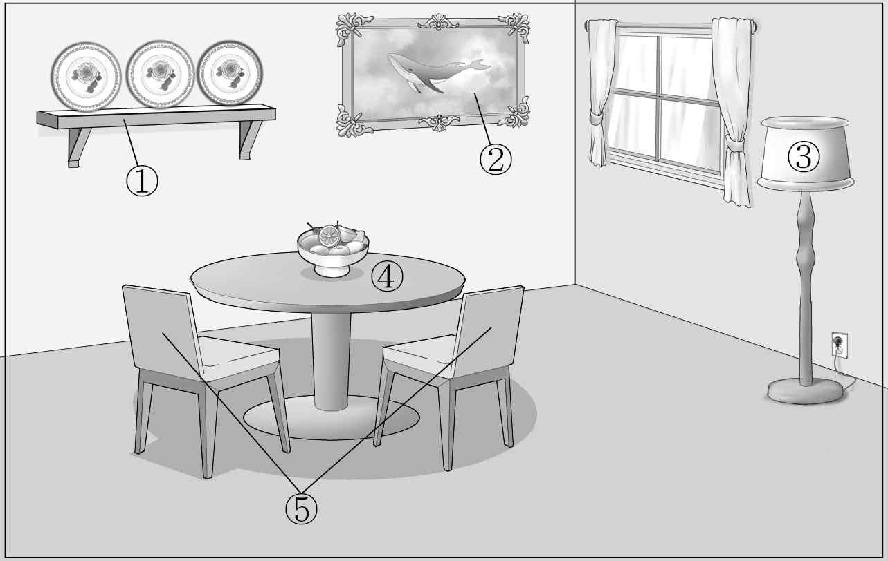
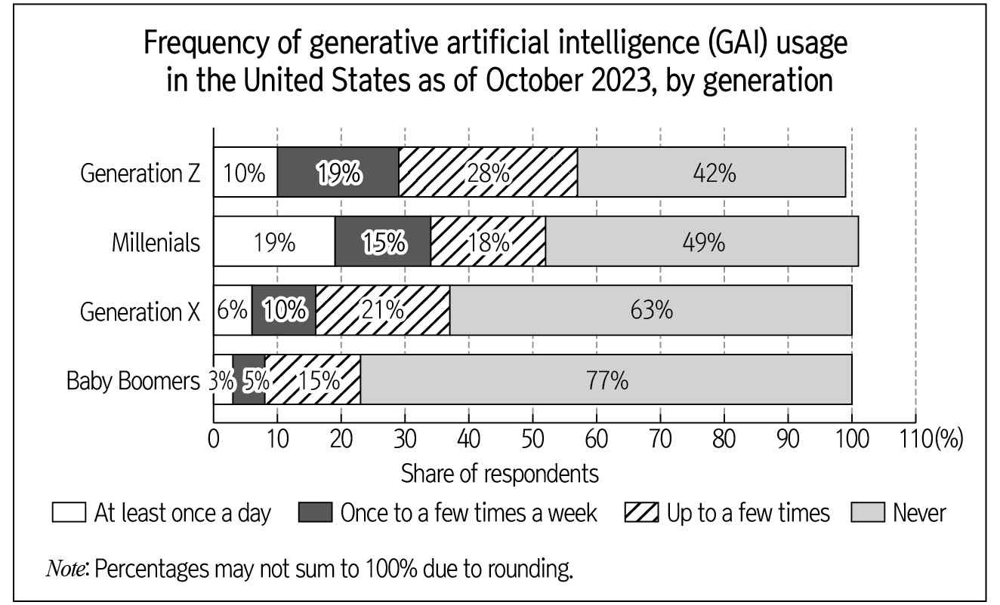

1. 다음을 듣고, 여자가 하는 말의 목적으로 가장 적절한 것을 고르시오.

① 교내 진로 특강 만족도 조사 결과를 안내하려고
② 채식 급식 메뉴에 대한 설문 참여를 요청하려고
③ 채식 메뉴의 영양적 가치를 설명하려고
④ 급식실 확장 공사 일정을 공지하려고
⑤ 새로 부임한 영양 교사를 소개하려고

2. 대화를 듣고, 남자의 의견으로 가장 적절한 것을 고르시오.

① 적절한 스트레스는 삶에 활기를 부여한다.
② 건강 유지를 위해 혈압을 꾸준히 관리해야 한다.
③ 바쁜 일상에서도 생각을 정리하는 시간이 필요하다.
④ 규칙적인 호흡 훈련은 스트레스 해소에 효과적이다.
⑤ 운동을 습관화하려면 실천 가능한 계획을 세워야 한다.

3. 다음을 듣고, 여자가 하는 말의 요지로 가장 적절한 것을 고르시오.

① 걸으면서 회의하는 것은 창의적인 아이디어 도출에 도움을 준다.
② 회의를 진행할 때는 타인의 의견을 경청할 필요가 있다.
③ 사무실 환경 개선을 통해 업무 효율을 높일 수 있다.
④ 토론 활동은 새로운 관점을 가지는 기회를 제공한다.
⑤ 동료들과 운동하는 것이 팀워크를 향상시킬 수 있다.

4. 대화를 듣고, 그림에서 대화의 내용과 일치하지 않는 것을 고르시오.

5. 대화를 듣고, 남자가 할 일로 가장 적절한 것을 고르시오.

① 책상 배치하기
② 카트 빌려오기
③ 이름표 올려두기
④ 참가 선물 포장하기
⑤ 인터넷 연결 확인하기

6. 대화를 듣고, 여자가 지불할 금액을 고르시오.

① $70
② $72
③ $80
④ $99
⑤ $110

7. 대화를 듣고, 여자가 이번 주말에 농장에 갈 수 없는 이유를 고르시오.

① 친구들과의 모임이 있어서
② 비가 많이 온다는 예보가 있어서
③ 밀린 집안일을 다 끝내지 못해서
④ 프로젝트 관련 업무 일정이 있어서
⑤ 농사에 필요한 도구가 배송되지 않아서

8. 대화를 듣고, Pastry Paradise에 관해 언급되지 않은 것을 고르시오.

① 날짜
② 전시 품목
③ 참가 인원
④ 주최 기관
⑤ 입장료

9. Virtual Reality Workout Program에 관한 다음 내용을 듣고, 일치하지 않는 것을 고르시오.

① 7월 15일부터 7월 17일까지 열린다.
② 운영 시간은 오후 6시부터 오후 8시까지이다.
③ 가상 사이클링과 복싱을 체험할 수 있다.
④ 장비는 체육관에서 대여할 수 있다.
⑤ 연령 제한 없이 등록할 수 있다.

10. 다음 표를 보면서 대화를 듣고, 여자가 구입할 탁상용 수족관을 고르시오.

|  | Model | Volume | Shape | Material | LED Lighting |
| --- | --- | --- | --- | --- | --- |
| ① | A | 6 L | Round | Glass | ○ |
| ② | B | 7.5 L | Rectangular | Plastic | ○ |
| ③ | C | 7.5 L | Round | Glass | ○ |
| ④ | D | 8 L | Rectangular | Plastic | ☓ |
| ⑤ | E | 10 L | Rectangular | Glass | ☓ |

11. 대화를 듣고, 남자의 마지막 말에 대한 여자의 응답으로 가장 적절한 것을 고르시오.

① You’re right. I think I need to practice more.
② I had eggs for lunch. Let’s eat something else.
③ How about an egg salad? It’s not hard to make.
④ Okay. I recommend using this camera for the video.
⑤ Sure. Let me show you the best way to wash dishes.

12. 대화를 듣고, 여자의 마지막 말에 대한 남자의 응답으로 가장 적절한 것을 고르시오. [3점]

① Thanks to you, I managed to catch the train.
② No problem. I know a shortcut that avoids traffic.
③ Sounds good. Please take me straight to the terminal.
④ Don’t worry. The train will arrive at the station on time.
⑤ I’m sorry, but I’m not sure I want to go anywhere today.

13. 대화를 듣고, 남자의 마지막 말에 대한 여자의 응답으로 가장 적절한 것을 고르시오. [3점]

Woman:
① Thanks. Last weekend’s detox was quite helpful.
② Okay. I’ll bring some books and magazines to read.
③ No worries. You’ll be fine after getting some fresh air.
④ Of course. I’ll let you know if you can bring your phone.
⑤ Never mind. You don’t really need any electronic devices.

14. 대화를 듣고, 여자의 마지막 말에 대한 남자의 응답으로 가장 적절한 것을 고르시오. [3점]

Man:
① I got it. I’m using mouthwash too often.
② Exactly. I’m sure your client will understand.
③ That’s true. I can schedule your next check-up.
④ Okay. I’ll come back tomorrow right after work.
⑤ You’re right. It’s hard to remove stains from your teeth.

15. 다음 상황 설명을 듣고, David가 Sienna에게 할 말로 가장 적절한 것을 고르시오.

David:
① We’d better meet and practice on Mondays.
② You don’t have to worry about the schedule.
③ I can help you with rehearsing only on the weekends.
④ You should practice harder before I help you rehearse.
⑤ I’ll gladly give you a ride to the audition this weekend.

16. 여자가 하는 말의 주제로 가장 적절한 것은?

① moral lessons from Aesop’s fables
② idiomatic expressions related to fruits
③ various fruits that benefit your health
④ popular fruits throughout human history
⑤ ambiguous meanings in linguistic expressions

17. 언급된 과일이 아닌 것은?

따라 답을 하시기 바랍니다.

① 사과
② 포도
③ 체리
④ 키위
⑤ 레몬

18. 다음 글의 목적으로 가장 적절한 것은?

To our readers, We hope you are well and enjoying the latest issue of our magazine, Kitchen Gazette. As always, we strive to bring you the most useful content, and we appreciate your continued support. While we aim for perfection with each of our recipes, we occasionally make mistakes. It has come to our attention that the recipe for Banana Cream Pie in the June issue was incomplete. Although the directions did mention adding milk, the list of ingredients did not include it. The correct listing should specify one and three-quarter cups of milk. We hope you’ll try it again using the corrected version. Thank you for your understanding, and we look forward to bringing you more delicious recipes in the future! Warm regards, Jenny Perker Kitchen Gazette Food Content Director

19. 다음 글에 드러난 ‘I’의 심경 변화로 가장 적절한 것은?

I got married in the middle of a small wood outside of Cambridge during the summer of 2019; the night before my wedding, it started to pour with rain. At two o’clock in the morning, the rain sounded like a biblical tempest. I moved myself into the spare bedroom and spent the night awake, sick to my stomach with anxiety, and imagining the tables, chairs, hay bales and sofas we had set out in the woods that day getting soaked through, and my family and in-laws covered in mud. But in the woods at noon the next day, there was no sign of the storm. Sunlight floated through the leaves and landed on the heads of family members I thought for years might never attend my wedding. I looked over at my wife, and then for the next ten hours felt overjoyed up until the moment I went to sleep.

20. 다음 글에서 필자가 주장하는 바로 가장 적절한 것은?

The idea of cutting out a budget category probably makes you nervous. But being mindful about your spending doesn’t have to be an all-or-nothing game. Instead of forcing yourself to go entirely without, reduce spending on that category by just 10 percent each month. You won’t see sudden, drastic change in your budget, but the shift will be a lot easier to stomach. Say you spent $148 at coffee shops last month. The idea of never buying coffee is enough to make you want to hide from your budget forever, but what if you challenged yourself to spend just 10 percent less on coffee this month? That’s $14.80 less, for a total of $133.20. Then, next month, see if you can bring that expense down by 10 percent again to $119.88. By introducing incremental shifts instead of huge, radical changes, you’re more likely to stick with your new, moderately reduced habits.

21. 밑줄 친 this liquidity가 다음 글에서 의미하는 바로 가장 적절한 것은? [3점]

Media coverage of sports is, by its very nature, ephemeral. The temporary loss of the here and now is embraced when we consume mediated sports coverage as a welcome break from the press of everyday demands. Yet, many sports fans recognize that contests that once seemed both urgent and critical often melt into the background in a week’s time and are summarily forgotten. The ubiquity of sports contests and the blur of discussions about them across the contemporary mediascape contribute to this liquidity; a new “big game” is seemingly always around the corner and newly-fueled anticipation routinely supersedes reflection about results that have quickly faded in our memories and become trivial in the records of sports. However, rising above ubiquitous sporting competitions that quickly fade as cultural amnesia are those holding promise to become ground-breaking moments in lived experience and common culture. These are the events and championships that define a sport, solidifying one’s fanship, and serving as historical markers that bring order, meaning, and significance to the sports landscape.

22. 다음 글의 요지로 가장 적절한 것은?

Making your marketing fun for customers is what makes them tell other people about you. This is the basis of viral marketing — the word of mouth that ultimately generates more business than all the advertising campaigns put together. Humor is good, but something that encourages customers to pass on messages to friends, business colleagues, family, and indeed anyone else will result in stronger customers’ perception of your brand and increased awareness of what your company is all about. The message need not be too serious, either, or indeed be an overt marketing plug. Just passing the brand name along, and having it associated with something entertaining and fun, is quite sufficient. Your other marketing promotions will fill in the gaps, and anyway no single promotion will ever cover all the communication you want it to — the best you can hope for is that one communication will sensitize the customers to receiving a later one.

23. 다음 글의 주제로 가장 적절한 것은?

The prevalence of diseases among wild animals can be compared to an iceberg. It is only its top that appears visible to us, an insignificant fraction of its total volume. There are two main causes that converge to bring about this scenario. First, until very recently, research on wild animal disease has been an underestimated field of inquiry. Wild animal disease is thought to be relevant only inasmuch as it proves instrumental in bettering our knowledge about treatment of diseases affecting human and domestic populations. Second, disease is a fundamentally surreptitious phenomenon, often resulting from many factors interacting simultaneously. Unlike humans and other animals under human control, wild animals are anonymous. We can make estimations about their numbers and whereabouts, but we do not have accurate records of them. In addition, sick and dead animals are quickly assimilated into the environment by predators and scavengers. As a consequence, the results of wild animal death caused by disease remain, for the most part, hidden from us.

24. 다음 글의 제목으로 가장 적절한 것은? [3점]

What sets off literary works from other narrative display texts is that they have undergone a process of selection: they have been published, reviewed, and reprinted, so that readers approach them with the assurance that others have found them well constructed and ‘worth it’. So for literary works, the cooperative principle is ‘hyper-protected’. We can put up with many obscurities and apparent irrelevancies, without assuming that this makes no sense. Readers assume that in literature complications of language ultimately have a communicative purpose and, instead of imagining that the speaker or writer is being uncooperative, as they might in other speech contexts, they struggle to interpret elements that flout principles of efficient communication in the interests of some further communicative goal. ‘Literature’ is an institutional label that gives us reason to expect that the results of our reading efforts will be ‘worth it’. And many of the features of literature follow from the willingness of readers to pay attention, to explore uncertainties, and not immediately ask ‘what do you mean by that?’

25. 다음 도표의 내용과 일치하지 않는 것은?

Frequency of generative artificial intelligence (GAI) usage in the United States as of October 2023, by generation

| Generation | At least once a day | Once to a few times a week | Up to a few times | Never |
| --- | --- | --- | --- | --- |
| Generation Z | 10% | 19% | 28% | 42% |
| Millennials | 19% | 15% | 18% | 49% |
| Generation X | 6% | 10% | 21% | 63% |
| Baby Boomers | 3% | 5% | 15% | 77% |

26. Barbara Ann Scott에 관한 다음 글의 내용과 일치하지 않는 것은?

Barbara Ann Scott was one of the most famous Canadian figure skaters. She was born in Ottawa in 1928. At the age of seven, she began skating at the Minto Skating Club. When she was just 10, she became the youngest Canadian to pass the “gold figures test.” Although she tried to win the Canadian Senior Championship in both 1941 and 1942, she finished second both years. Later, Scott traveled overseas and became the first North American to win both the European and World Figure Skating Championships. She gained widespread fame by winning the gold medal at the 1948 Olympic Games in Switzerland. She toured with an ice show and engaged in various other activities. After getting married, she settled in Chicago and passed away in Florida in 2012. She became known as “Canada’s Sweetheart” and had a lasting impact on Canadian figure skating history.

27. National Kite Festival에 관한 다음 안내문의 내용과 일치하지 않는 것은?

 National Kite Festival Kite enthusiasts from all over the country are invited to City Park, San Francisco, to showcase their kite-flying skills. This event celebrates cultural diversity through the art of kite-making and kite-flying. Event Details
Date: August 10th, 2025
Time: From 10 a.m. to 6 p.m.
Open to all ages Competition
Categories: Largest Kite, Highest-Flying Kite, Most Creative Design
All competitors must use self-made kites. (Purchased ones are not allowed.) Additional Activities
Kite-making workshops available for $10 per person
Face painting and a kite-themed costume parade þ Scan the QR code for the latest updates and event registration.

28. FREE CPR Class Downtown Los Angeles에 관한 다음 안내문의 내용과 일치하는 것은?

FREE CPR Class Downtown Los Angeles Learn how to save lives with a CPR training course in Downtown Los Angeles.
Date and Time: November 30th, 2025, from 2 p.m. to 5 p.m.
Location: Blue Healthcare Training Center
Classroom: 5th floor, Suite 510
Certification: Upon course completion, participants will receive a CPR certificate valid for 2 years.
Reservations are required.
Free parking is available. þ Scan the QR code for reservations and more information. We look forward to seeing you!

29. 다음 글의 밑줄 친 부분 중, 어법상 틀린 것은?

There is a kind of artificial intelligence application that is frequently advertised, which can be described as “vaporware”. Vaporware is applications that have either been announced or made available for sale but are not yet fully functional as artificial intelligence applications. It is often systems that seem to run on artificial intelligence technologies, but which in fact do not. Instead, they are frequently built by people manually adding the content that the artificial intelligence application is supposed to be processing. This is frequently done because initially it is cheaper to pay people to add this content than it is to develop full artificial intelligence capabilities and populate the data. Vaporware can be used for many reasons. Sometimes a product may start to be sold before it is fully developed. Taking a vaporware product to market means developers can validate ideas with customers before investing the amounts required to build a full application, allowing for more flexibility in development and for more time to build data.

30. 다음 글의 밑줄 친 부분 중, 문맥상 낱말의 쓰임이 적절하지 않은 것은? [3점]

Although we’d never admit it, partly because we’re unlikely to be aware of it, most of our purchase decisions are driven by unconscious cues. For example, car studies have found that consumers tend to purchase cars they emotionally relate to — ones that represent their lifestyle and personality. They then look for data to justify their decisions. Car specs are important, but not to inspire someone to purchase a particular car; it’s vice versa: they’re used to validate a car that’s already been chosen. Through all five senses, we’re exposed to millions of bits of information and stimuli every second. Obviously we can’t attend to all of it. We therefore focus consciously on what’s new, threatening, and especially interesting, and on problems that need to be solved. The rest — which represents 99.99 percent of the information we receive — gets sent to “internal processing,” formally known as our unconscious mind and colloquially known as things like gut reactions, cravings, habits, and impulses. The unconscious mind may be hidden from us, but that doesn’t diminish its power. The fact that people generally — and mistakenly — believe that they make decisions logically and consciously only decreases its influence.

31. 다음 빈칸에 들어갈 말로 가장 적절한 것을 고르시오. [3점]

No matter how astoundingly well written, all characters lack the complexity, the detailed history, the ambivalence and the sheer volume of details that your own life has. It is your life that makes your work in the role distinct and individual. Bring your life to the table! By examining the character and the events of the play, and both comparing them to and understanding them through your own life, you personalize the role. By personalizing the role, you deepen your interest and desire to perform this particular part. You know full well that the greater your interest in a task, the better you do it. Once you have fully examined the circumstances in the text, find similar situations in your past. If not precisely similar in event, you can abstract the nature of the circumstance. You may not have killed, but you have been driven to do harm. This simple understanding of the moment in your own terms bonds you consciously and subconsciously with the part. Parallel experiences will sometimes provide you with what you might “do,” and doing that often reclaims and releases in you the original emotion. The performance of the role is your own life examined in the light of the circumstances and central themes of the play.

32. 다음 빈칸에 들어갈 말로 가장 적절한 것을 고르시오.

In history, power stems only partially from knowing the truth. It also stems from the ability to maintain social order among a large number of people. Suppose you want to make an atom bomb. To succeed, you obviously need some accurate knowledge of physics. But you also need lots of people to mine uranium ore, build nuclear reactors and provide food for the construction workers, miners and physicists. The Manhattan Project directly employed about 130,000 people, with millions more working to sustain them. Robert Oppenheimer could devote himself to his equations because he relied on thousands of miners to extract uranium at the Eldorado mine in northern Canada and the Shinkolobwe mine in the Belgian Congo — not to mention the farmers who grew potatoes for his lunch. If you want to make an atom bomb, you must find a way to make millions of people cooperate.

33. 다음 빈칸에 들어갈 말로 가장 적절한 것을 고르시오.

The “rosy view” phenomenon tells us that tourists overestimate the happiness experienced during vacations. The actual experience is perceived less enjoyable than anticipated experience and recollected experience. Some researchers further analyzed future vacation choice by investigating how the anticipated, on-line (i.e., during vacation), and remembered vacation experience in terms of emotions, predicted the desire to take a similar vacation in the future. They found that not on-line or predicted experience, but remembered experience predicted the desire to repeat the vacation. Thus, a rosy memory — accurate or not — is a major determinant for future plans for vacation travel. More recent neurological research supports these empirical observations revealing that the area in the brain that gives humans the ability to imagine the future is the same area that allows recollection of the past.

34. 다음 빈칸에 들어갈 말로 가장 적절한 것을 고르시오. [3점]

It is typically considered important to make sure species do not go extinct, unless they are really nasty. Since most species are above the threshold, there is, according to this argument, not really much of a general problem. The focus is just on a specific subset of endangered species. But suppose that the unit is not a species (or not just a species), but ecosystems and their supporting habitats. Suppose within ecosystems everything depends upon everything depends upon everything else. Then it is the system that needs to stay above the threshold. In this case, while it is still necessary to protect species from falling below their particular thresholds, it is not sufficient just to do this. Sustainability now requires much more ― preserving and enhancing ecosystems and habitats to a level sufficient to sustain the myriad of interrelated species. Weak sustainability suddenly becomes a much more serious and complex matter.

35. 다음 글에서 전체 흐름과 관계 없는 문장은?

It wasn’t until 1960 that a market for photographic art began to form in the United States. This development coincided with a rejection of many traditional notions of art: that it was the work of the hand, that each work was a unique creation.

36. 주어진 글 다음에 이어질 글의 순서로 가장 적절한 것을 고르시오.

Social insects use alarm pheromones to alert related individuals of danger. Such chemical signals are often employed to alert a colony of some invader, and these alarms can cause huge numbers of worker ants or bees to flow from their nests, either to defend their nestmates, or simply to flee. Chemical signals may also be sent to individuals of a different species. Stink bugs, stick insects, and many other insects have glands that produce repugnant — and sometimes powerfully pungent or even caustic and harmful — fluids that are meant to fight off an attacker. Blister beetles are so named because their defensive secretion, cantharidin, is particularly powerful and can cause chemical burns. Toxic species often advertise this aspect of themselves through some form of coloration, called aposematic coloration. Among blister beetles, for example, some may be black with prominent red, orange, or yellow bands or spots, signaling “do not touch.” Others, however, can be entirely black or blue and yet just as capable of causing a painful burn.

37. 주어진 글 다음에 이어질 글의 순서로 가장 적절한 것을 고르시오. [3점]

Sanctuaries are a semi-contrived setting that, at first glance, appear quite similar to zoos. Animals are kept in enclosures simulating a natural environment, similar animal farming techniques are used, and sometimes there are even animals on display for tourists. However, in contrast to zoos, the purpose of a sanctuary is not to keep animals captive but to hold them temporarily until such a time as they can be rehabilitated and safely released. Some animals may be held indefinitely due to complications that would prevent their survival in the wild. Many sanctuary models operate mixed-access facilities in which there is a side open to ecotourists that holds such animals indefinitely and a rehabilitation side, closed to the public in which animals can recover in privacy. There are also pre-release enclosures that are meant to simulate a natural environment as closely as possible in order to ensure an animal is ready for release after time spent in an artificial environment for medical rehabilitation.

38. 글의 흐름으로 보아, 주어진 문장이 들어가기에 가장 적절한 곳을 고르시오.

Sometimes theories that have been out of fashion for some while can come back into consideration in view of later developments. A case in point is an idea that Lord Kelvin put forward in about 1867, in which atoms (the elementary particles of his day) were to be regarded as being composed of tiny knot-like structures. This idea attracted some considerable attention at the time, and the mathematician J. G. Tait began a systematic study of knots on the basis of this. But the theory did not lead to any clear-cut correspondence with the actual physical behaviour of atoms, so it became largely forgotten. However, more recently, ideas of this general kind have begun to find favour again, partly in view of their connection with string-theoretic notions. The mathematical theory of knots has also encountered a revival, since around 1984, starting with the work of Vaughan Jones, whose seminal ideas had their roots in theoretical considerations within quantum field theory. The methods of string theory were subsequently employed by Edward Witten to obtain a kind of quantum field theory which, in a certain sense, encompasses these new developments in the mathematical theory of knots.

39. 글의 흐름으로 보아, 주어진 문장이 들어가기에 가장 적절한 곳을 고르시오. [3점]

Music-licensing has always been an integral and lucrative part of the music business, but there has often been a tension between music publishers and record labels. Although music is the shared value for both publishers and labels, their aims and their business models differ. To the music publisher or the licensing department of a full-service music firm, licensing opportunities are the bread and butter of their business. There is simply no other kind of income besides the royalties paid by the licensees. From the record labels’ point of view, the licensing has a completely different purpose, and that purpose is to promote an act. The licensing fee paid by the licensee is only the icing on the cake, since the majority of a traditional record label’s revenues are generated by selling audio recordings (primarily CDs) to consumers. In a competition to have a song included in a film etc., the record label might be inclined to waive the fee in order to win the competition and achieve the much-desired media presence.

40. 다음 글의 내용을 한 문장으로 요약하고자 한다. 빈칸 (A), (B)에 들어갈 말로 가장 적절한 것은?

Earlier navigational aids, particularly those available and affordable to ordinary folks, were just that: aids. They were designed to give travelers a greater awareness of the world around them — to sharpen their sense of direction, provide them with advance warning of danger, highlight nearby landmarks and other points of orientation, and in general help them situate themselves in both familiar and alien settings. Satellite navigation systems can do all those things, and more, but they’re not designed to deepen our involvement with our surroundings. They’re designed to relieve us of the need for such involvement. By taking control of the mechanics of navigation and reducing our own role to following routine commands, the systems, whether running through a dashboard, a smartphone, or a dedicated GPS receiver, end up isolating us from the environment. As a team of Cornell University researchers put it in a 2008 paper, “With the GPS you no longer need to know where you are and where your destination is, attend to physical landmarks along the way, or get assistance from other people in the car and outside of it.”

Compared to earlier navigational aids that enabled users to be more connected with their surroundings, satellite navigation systems detach us from the environment by limiting our part to simply following directions. connected detach

41. 윗글의 제목으로 가장 적절한 것은?

The speed at which we form language can carry almost as much meaning as the words we say. Silence is not neutral or meaningless. If a job applicant hesitates too long before responding to a difficult question in a job interview, for example, we may think the applicant is at a loss for words because of being unprepared. We might interpret an awkward silence following a confession of love as indication that the addressee does not feel the same way. Other non-verbal cues may help inform our interpretation of these silences. This is also a factor when we communicate online or via text. Most modern messaging services and apps tell us when a message has been read by its recipient, and so an uneasy type of silence can arise when we know the recipient has read our message but, for whatever reason, has not responded. This is often referred to as leaving somebody ‘on read’ and is generally considered rude in online communication. Compared to face-to-face silences, where one can still read the other person’s expressions or body language, these online silences feel acceptable and can be even more hurtful if sensitive or difficult topics are involved. For instance, a romantic interest leaving an invitation for a second date ‘on read’ might be even more disheartening than a flat-out rejection in many cases. Social media has created a new kind of anxiety for humans. Waiting for a response makes us insecure. As such, we are pressured by social media to respond quickly.

42. 밑줄 친 낱말 중에서 문맥상 낱말의 쓰임이 적절하지 않은 것은?

The speed at which we form language can carry almost as much meaning as the words we say. Silence is not neutral or meaningless. If a job applicant hesitates too long before responding to a difficult question in a job interview, for example, we may think the applicant is at a loss for words because of being unprepared. We might interpret an awkward silence following a confession of love as indication that the addressee does not feel the same way. Other non-verbal cues may help inform our interpretation of these silences. This is also a factor when we communicate online or via text. Most modern messaging services and apps tell us when a message has been read by its recipient, and so an uneasy type of silence can arise when we know the recipient has read our message but, for whatever reason, has not responded. This is often referred to as leaving somebody ‘on read’ and is generally considered rude in online communication. Compared to face-to-face silences, where one can still read the other person’s expressions or body language, these online silences feel acceptable and can be even more hurtful if sensitive or difficult topics are involved. For instance, a romantic interest leaving an invitation for a second date ‘on read’ might be even more disheartening than a flat-out rejection in many cases. Social media has created a new kind of anxiety for humans. Waiting for a response makes us insecure. As such, we are pressured by social media to respond quickly.

43. 주어진 글에 이어질 내용을 순서에 맞게 배열한 것으로 가장 적절한 것은?

It was in the bleak midwinter, and a pair of wanderers struggled through the cold night, seeking shelter. The father-to-be searched desperately for a safe place for his companion, who walked heavily, carrying new life inside her. They could not stay out in the bitter cold when her time came. Their names were Pepper and Cooper, a pair of beagles, wandering a rural highway near Bethel, Ohio. Gus Kiebel, a county wildlife officer, was driving home through the snowstorm when his headlights revealed the dogs.

 Their collars and tags suggested they belonged to someone, but why were they outside in such harsh weather? Gus stopped his truck and approached the two dogs, who didn’t try to flee. He read their tags — Pepper and Cooper — but when he called the phone number, the man who answered said, “I gave them to another family. They’re not mine anymore.” When Gus asked where they were sent, the man paused and said, “I don’t know.” Then, he hung up abruptly, leaving Gus feeling surprised and uneasy. The beagles had nowhere to go. Gus couldn’t bring himself to leave the dogs out in the storm. That night, he prepared a warm bed with food and water close by. As a boy, he had dreamed of owning a beagle, but keeping this pair was not an option — Gus already had a dog. However, Gus knew someone at the League for Animal Welfare, an animal shelter in nearby Batavia. The next morning, he took the dogs to the shelter to drop them off — on one condition. “I’m not signing the dogs over to you if you’re going to separate them,” Gus said. The shelter worker promised him she’d keep the pair together. Over the next few days, Gus called the shelter to ensure that Pepper and Cooper were safe. Just after Christmas, the beagles were adopted as a pair by a loving family. Gus practiced kindness by giving shelter to a wandering couple, demonstrating the best of himself. When kindness and love triumph over cruelty and the elements, it can feel like the greatest miracle of all.

44. 밑줄 친 낱말 중에서 가리키는 대상이 나머지 넷과 다른 것은?

It was in the bleak midwinter, and a pair of wanderers struggled through the cold night, seeking shelter. The father-to-be searched desperately for a safe place for his companion, who walked heavily, carrying new life inside her. They could not stay out in the bitter cold when her time came. Their names were Pepper and Cooper, a pair of beagles, wandering a rural highway near Bethel, Ohio. Gus Kiebel, a county wildlife officer, was driving home through the snowstorm when his headlights revealed the dogs.

 Their collars and tags suggested they belonged to someone, but why were they outside in such harsh weather? Gus stopped his truck and approached the two dogs, who didn’t try to flee. He read their tags — Pepper and Cooper — but when he called the phone number, the man who answered said, “I gave them to another family. They’re not mine anymore.” When Gus asked where they were sent, the man paused and said, “I don’t know.” Then, he hung up abruptly, leaving Gus feeling surprised and uneasy. The beagles had nowhere to go. Gus couldn’t bring himself to leave the dogs out in the storm. That night, he prepared a warm bed with food and water close by. As a boy, he had dreamed of owning a beagle, but keeping this pair was not an option — Gus already had a dog. However, Gus knew someone at the League for Animal Welfare, an animal shelter in nearby Batavia. The next morning, he took the dogs to the shelter to drop them off — on one condition. “I’m not signing the dogs over to you if you’re going to separate them,” Gus said. The shelter worker promised him she’d keep the pair together. Over the next few days, Gus called the shelter to ensure that Pepper and Cooper were safe. Just after Christmas, the beagles were adopted as a pair by a loving family. Gus practiced kindness by giving shelter to a wandering couple, demonstrating the best of himself. When kindness and love triumph over cruelty and the elements, it can feel like the greatest miracle of all.

45. 윗글에 관한 내용으로 적절하지 않은 것은?

It was in the bleak midwinter, and a pair of wanderers struggled through the cold night, seeking shelter. The father-to-be searched desperately for a safe place for his companion, who walked heavily, carrying new life inside her. They could not stay out in the bitter cold when her time came. Their names were Pepper and Cooper, a pair of beagles, wandering a rural highway near Bethel, Ohio. Gus Kiebel, a county wildlife officer, was driving home through the snowstorm when his headlights revealed the dogs.

 Their collars and tags suggested they belonged to someone, but why were they outside in such harsh weather? Gus stopped his truck and approached the two dogs, who didn’t try to flee. He read their tags — Pepper and Cooper — but when he called the phone number, the man who answered said, “I gave them to another family. They’re not mine anymore.” When Gus asked where they were sent, the man paused and said, “I don’t know.” Then, he hung up abruptly, leaving Gus feeling surprised and uneasy. The beagles had nowhere to go. Gus couldn’t bring himself to leave the dogs out in the storm. That night, he prepared a warm bed with food and water close by. As a boy, he had dreamed of owning a beagle, but keeping this pair was not an option — Gus already had a dog. However, Gus knew someone at the League for Animal Welfare, an animal shelter in nearby Batavia. The next morning, he took the dogs to the shelter to drop them off — on one condition. “I’m not signing the dogs over to you if you’re going to separate them,” Gus said. The shelter worker promised him she’d keep the pair together. Over the next few days, Gus called the shelter to ensure that Pepper and Cooper were safe. Just after Christmas, the beagles were adopted as a pair by a loving family. Gus practiced kindness by giving shelter to a wandering couple, demonstrating the best of himself. When kindness and love triumph over cruelty and the elements, it can feel like the greatest miracle of all. 하시오.

