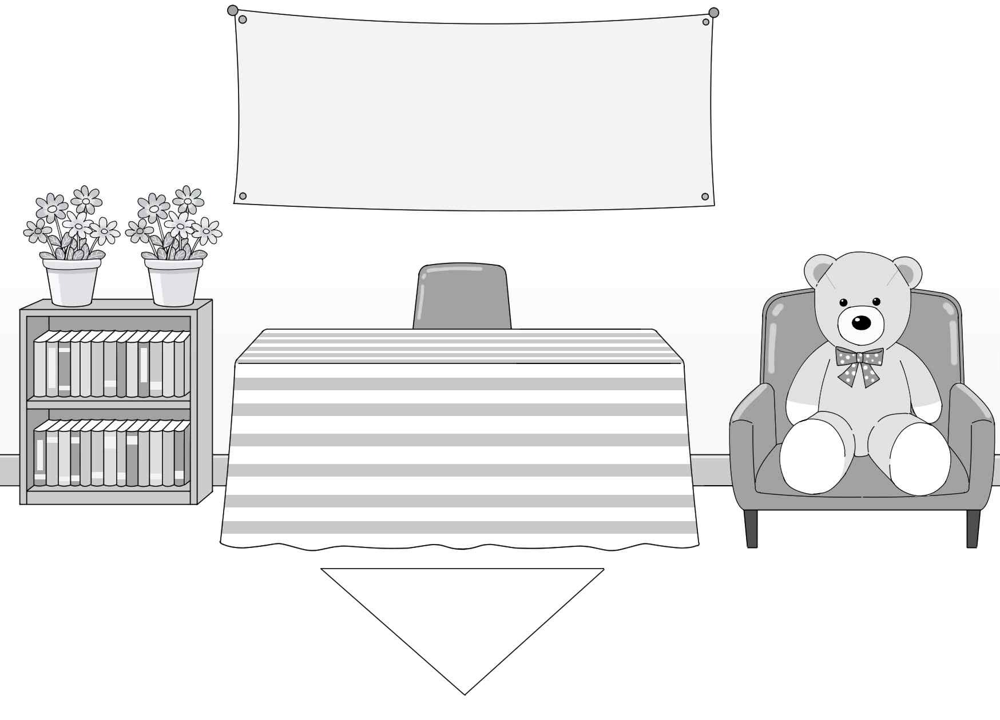
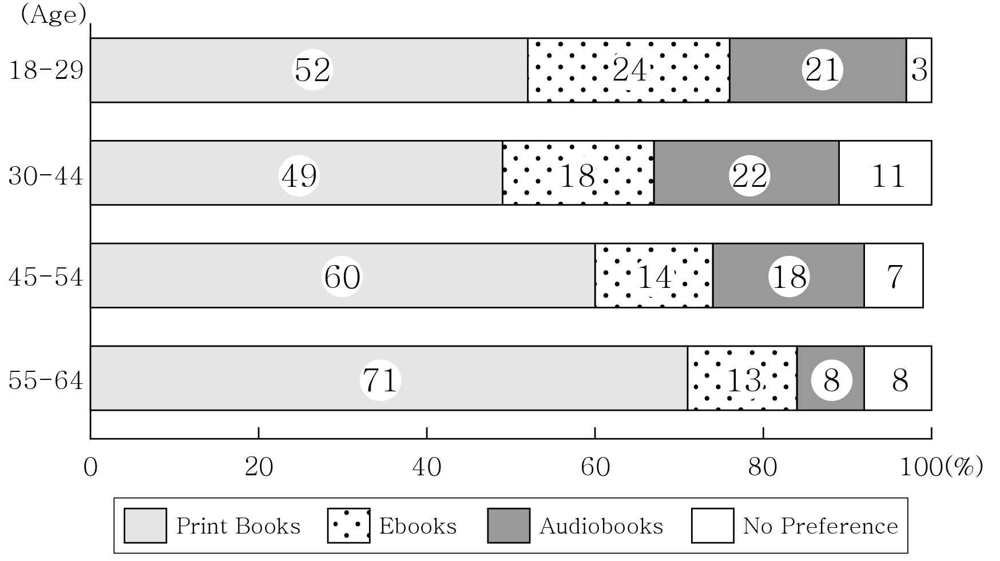

1. 다음을 듣고, 남자가 하는 말의 목적으로 가장 적절한 것을 고르시오.
① 교실 환기 시 유의 사항을 전달하려고
② 학교 외벽 청소 일정 변경을 공지하려고
③ 하교 시 교실 창문을 닫을 것을 당부하려고
④ 교실 창문 교체로 인한 출입 제한을 안내하려고
⑤ 교내 배관 문제로 인해 물 사용 자제를 요청하려고

2. 대화를 듣고, 여자의 의견으로 가장 적절한 것을 고르시오.

① 배운 것을 보지 않고 백지에 적어 보는 것은 복습에 효과적이다.
② 수업 중에 필기한 내용을 교과서를 활용하여 보완해야 한다.
③ 유명한 학습법이 모든 학습자에게 효과적인 것은 아니다.
④ 학습한 내용을 더 오래 기억하려면 당일에 복습해야 한다.
⑤ 이해하기 어려운 과목은 친구들과 함께 복습하면 도움이 된다.

3. 다음을 듣고, 남자가 하는 말의 요지로 가장 적절한 것을 고르시오.

① 상쾌한 아침을 위해 일정한 수면 시간을 유지하는 것이 좋다.
② 취침 전 스마트폰 사용은 수면의 질을 떨어뜨릴 수 있다.
③ 아침 운동은 하루의 집중력을 높이는 데 효과적이다.
④ 스마트폰의 알람 기능은 효율적인 시간 관리에 도움을 준다.
⑤ 기상 알람으로 스마트폰보다 실제 시계를 사용하는 것이 좋다.

4. 대화를 듣고, 그림에서 대화의 내용과 일치하지 않는 것을 고르시오.

⑤ The Dreaming Bear
④ Line Up Here

5. 대화를 듣고, 여자가 할 일로 가장 적절한 것을 고르시오.

① 초대장 보내기
② 전구 교체하기
③ 방명록 준비하기
④ 포스터 게시하기
⑤ 방문객 선물 포장하기

6. 대화를 듣고, 남자가 지불할 금액을 고르시오. [3점]

① $17
② $27
③ $30
④ $37
⑤ $40

7. 대화를 듣고, 여자가 봉사 활동을 하러 갈 수 없는 이유를 고르시오.
① 가족 여행을 가야 해서
② 역사 발표 준비를 해야 해서
③ 생일 선물을 사러 가야 해서
④ 모집 공고를 확인하지 못해서
⑤ 반려견을 동물병원에 데려가야 해서

8. 대화를 듣고, Quote & Reflection Club에 관해 언급되지 않은 것을 고르시오.

① 활동 내용
② 담당 교사
③ 모임 장소
④ 모집 인원
⑤ 신청 방법

9. Starlight Festival에 관한 다음 내용을 듣고, 일치하지 않는 것을 고르시오.

① Big Island에서 매년 개최된다.
② 3일 동안 진행된다.
③ 30개가 넘는 단체가 참여한다.
④ 모든 방문객은 과학 활동 소책자를 받는다.
⑤ 사전 예약이 필요하다.

10. 다음 표를 보면서 대화를 듣고, 두 사람이 구입할 캣타워를 고르시오.

|  | Model | Price | Number of Levels | Material | Hammock |
| --- | --- | --- | --- | --- | --- |
| ① | A | $105 | 3 | Cardboard | × |
| ② | B | $130 | 4 | Plastic | × |
| ③ | C | $155 | 4 | Metal | ○ |
| ④ | D | $180 | 5 | Wood | ○ |
| ⑤ | E | $210 | 5 | Fabric | ○ |

11. 대화를 듣고, 남자의 마지막 말에 대한 여자의 응답으로 가장 적절한 것을 고르시오. [3점]

① It went well. The food we prepared was all sold out.
② Our booth has a big blue banner. You can’t miss it.
③ I know. But the food booth doesn’t need any help.
④ That’s easy. I’ll help you with the booth decorations.
⑤ I’m glad you can come. Just avoid coming on Saturday.

12. 대화를 듣고, 여자의 마지막 말에 대한 남자의 응답으로 가장 적절한 것을 고르시오.

① Of course. I already watched it last week.
② Not yet. The movie will be released this weekend.
③ Really? Then I’d better check if there’s a seat available.
④ You’re right. The ticket price is not at all reasonable.
⑤ Not so nice. I should’ve checked the movie review.

13. 대화를 듣고, 남자의 마지막 말에 대한 여자의 응답으로 가장 적절한 것을 고르시오.

Woman:
① Sure. I’ll make a poster about the bicycle parking issue.
② Never mind. I’ve already found the parking zone.
③ Well, this is my first time making a poster.
④ That’s okay. I’ll show you how to ride a bicycle.
⑤ I agree. Let’s hang up the completed posters first.

14. 대화를 듣고, 여자의 마지막 말에 대한 남자의 응답으로 가장 적절한 것을 고르시오. [3점]

Man:
① That’s a relief. I’m glad the slides were clear enough.
② I’m sorry. I’ll make sure it doesn’t happen again.
③ Don’t worry. I’ve already connected my laptop.
④ My goodness. I forgot to reply to your message.
⑤ Good idea. Let’s open a chat room to fix the schedule.

15. 다음 상황 설명을 듣고, Emma가 Sophia에게 할 말로 가장 적절한 것을 고르시오.

Emma:
① How about traveling separately for a few hours a day?
② We should book the museum program in advance.
③ Why don’t we start our trip a few days earlier?
④ We can skip all the landmarks and go shopping together.
⑤ Let’s check out the places that you recommended before.

16. 여자가 하는 말의 주제로 가장 적절한 것은?

① examples of universal design applied in clothing
② parts of clothing that were invented by accident
③ clothing designs universally preferred by designers
④ unique parts of traditional clothing in different cultures
⑤ universal design features that are falling out of use today

17. 언급된 요소가 아닌 것은?

① buttons
② waistbands
③ zippers
④ pockets
⑤ labels

18. 다음 글의 목적으로 가장 적절한 것은?

Thank you for always ordering pies from our bakery for your special occasions. We truly appreciate your continued support and always try to provide pies of the highest quality. Unfortunately, we are writing to inform you that we are unable to prepare the apple pie you’ve ordered for the upcoming birthday celebration. Due to a delayed apple harvest this season, we are currently experiencing difficulties sourcing fresh apples. As a result, we are unable to fulfill the order that you’ve requested. We sincerely apologize for this situation. We appreciate your understanding and look forward to serving you again in the future.

19. 다음 글에 드러난 Dan의 심경 변화로 가장 적절한 것은?

The night had finally arrived. It was the night to take a photo of the Milky Way. Dan had been checking the weather and searching for the perfect location. As he drove to the spot, he couldn’t stop smiling and his heart raced with anticipation. However, when he arrived, dark clouds began to cover the sky. Within minutes, every star disappeared behind the thick clouds. Dan waited for over an hour, checking his weather app constantly. Even worse, it started to rain. He lowered his head, letting out a loud sigh. He could do nothing but drive back home, downhearted.

20. 다음 글에서 필자가 주장하는 바로 가장 적절한 것은?

Did you know that shadows are the color of the sky? That counterintuitive reality reminds us that preconceived notions, bias, and prejudice color our view of the world. One profound habit of thinking individuals is to first acknowledge their biases and then intentionally overcome them. Asking challenging questions can help. Passionately argue an issue from the opposite point of view, and ask probing and difficult questions that challenge your original stance. Be brutally honest and see what’s actually there rather than what’s expected. Get in the habit of asking, “Do I really know?” and refuse to accept assertions blindly. Challenge everything and everyone — including your teachers. Don’t be intimidated. You are the best authority on what you don’t understand — trust yourself: don’t be afraid to ask the questions you need to ask, and be brave enough to change your thinking when you uncover a blind spot.

21. 밑줄 친 “develops the photograph” of the original text가 다음 글에서 의미하는 바로 가장 적절한 것은? [3점]

All the philosophical dilemmas about whether translation “reflects” or instead “transforms” what’s in the original need to be swept aside. This is exactly the dichotomy that Merleau-Ponty’s account of perception is trying to free us from: are we “seeing” objects or “constituting” them? Neither, because we perceive things in a world we live in and have the power to transform: a chair is something we can go sit in; a mug is something we can pick up. One of Merleau-Ponty’s many great metaphors is that perception neither finds the world nor creates it: it reveals it, which he expresses using the term révélateur, the developing fluid for photographs in a darkroom. The act of seeing develops what’s in the world, like developing a photograph. Likewise, a translation “develops the photograph” of the original text. Translators don’t simply “recognize” what’s there, but nor are we “changing” it into anything it isn’t already, though we can be more or less aggressively interventionist in our darkroom. As a translator I take up the affordances of the original, moving through its world and constantly invited to respond in certain ways.

22. 다음 글의 요지로 가장 적절한 것은?

In some ways, we are more eager to track down and recover knowledge from the distant past than ever. New storage technologies make it possible to preserve texts, images, and music at minimal cost, and social media have made it simpler to share this stored content more widely than ever before. Never have previously produced cultural artifacts and practices been as readily available to as many people as they are now. Yet, amid this digital abundance of cultural content, older file formats, websites, and entire databases are becoming unreadable at a frightening speed, raising the question of whether we’re really so much better at preserving the past than our ancestors were. And while the technologies of cultural storage and distribution have changed, the laws governing how culture works — how it is preserved, transmitted, exchanged, and recovered — haven’t. The interplay of preservation and destruction, of loss and recovery, of error and adaptation continues unabated in a world that has put almost all human cultures in constant contact.

23. 다음 글의 주제로 가장 적절한 것은?

We use space, eye contact, and touch to communicate positive and negative attitudes toward others. These signals can reflect and regulate the intimacy in a relationship. In one interesting application of this idea, researchers found that nonverbal intimacy regulation even occurs when people interact with others via avatars in online environments. As in face-to-face encounters, people typically respond to decreased distances by compensating with reduced gaze. But we should keep in mind what communication scholar Mark Knapp has pointed out: These stereotypical immediacy behaviors — close distances, eye contact, touch, body lean, and so forth — are more evident during the early stages of intimacy than they are during later stages. When people become comfortable with each other, they may become more selective in their use of nonverbal immediacy signals, using them during a personal crisis, after a fight, on special occasions, at particular social gatherings, and the like. They may also adopt other more idiosyncratic ways of showing their affection — a unique gesture or a special touch, for instance — and they may feel less obliged overall to display their affections in public.

24. 다음 글의 제목으로 가장 적절한 것은?

In many situations, corporate moral decisions do not entail a trade-off: doing the right thing is sometimes good for business. Legal scholar Lucian Bebchuk calls this type of reasoning “instrumental stakeholderism.” Making stakeholders (customers, the community, employees, and so on) happy, even if it costs a little, may be in the interest of shareholders. For Bebchuk, such situations do not pose a challenge to economist Milton Friedman’s view that managers should aim at maximizing profits. Giving an extra week of paid vacation or long maternity leave may help attract the most talented young college graduates. Sourcing inputs responsibly may appeal to millennial consumers who are concerned with the environment. Being more environmentally conscious than what current standards require might give a leading edge if one anticipates that regulations will become tighter in the near term. Morality can be seen in such cases as an instrument for (current and long-term) profits, not necessarily as a goal for its own sake.

25. 다음 도표의 내용과 일치하지 않는 것은?

Canadians’ Preferred Reading Formats by Age Group in 2025 (%)

| Age | Print Books | Ebooks | Audiobooks | No Preference |
| --- | --- | --- | --- | --- |
| 18-29 | 52 | 24 | 21 | 3 |
| 30-44 | 49 | 18 | 22 | 11 |
| 45-54 | 60 | 14 | 18 | 7 |
| 55-64 | 71 | 13 | 8 | 8 |

26. Otto Loewi에 관한 다음 글의 내용과 일치하지 않는 것은?

Otto Loewi was a pharmacologist whose discoveries greatly advanced the study of chemical communication between nerve cells. Born in Frankfurt, Germany, in 1873, he originally hoped to study art history. However, following his parents’ advice, Loewi studied medicine at the University of Strasbourg, Germany (now part of France). Although he was qualified as a physician, he chose to switch from a doctor treating patients to a medical researcher seeking cures. In 1902, he first met Henry Dale in Ernest Starling’s laboratory in London, where he spent several months. In 1936, he and Henry Dale shared the Nobel Prize in Physiology or Medicine. After Germany invaded Austria in 1938, Loewi was forced to leave Austria, where he was living at the time. Loewi became a research professor at New York University’s College of Medicine in 1940.

27. Ice Hockey Club Recruitment에 관한 다음 안내문의 내용과 일치하지 않는 것은?

Ice Hockey Club Recruitment

■ Who We Are Looking For - We are open to all adults. - No prior skating experience is necessary.

■ Schedule & Location - Practice is on every Friday, 7:00 p.m. – 10:00 p.m. - Location is at Pinewood Ice Rink.

■ Member Benefits - A free introductory lesson is offered to new members. - Equipment is available for free rental. - Professional hockey players offer one-on-one coaching. - Inter-club matches are held once a month.

28. E-Bike City Tour에 관한 다음 안내문의 내용과 일치하는 것은?

 E-Bike City Tour Explore the city’s hidden spots on an E-Bike!

■ Schedule & Meeting Site - Schedule: Every Saturday at 10 a.m. - Meeting Site: Riverside Park North Entrance

■ Program Details - Safety training on braking and signaling (30 mins) - Guided group tour along the city path (1 hour)

■ Participation Requirements - Age: Must be 16 years or older (valid ID required) - Maximum Speed: 30 km/h

■ Fees - $25 per person - 10% off the total for groups of 4 or more (full refund if canceled 2 days before the tour but non-refundable after that)

29. 다음 글의 밑줄 친 부분 중, 어법상 틀린 것은?

Deduction makes us feel safe: If and when we know all the elements of the problem situation and how they hang together, then we can confidently deduce the outcome. This is rationality at its most unassailable. In professional practice, this type of thinking expresses itself in the belief that we can produce “logical” strategies and blueprints, or the claim to base ourselves on “best practices” and “evidence-based interventions.” But this gold standard of pure logic can only be achieved in a closed world, in in which we are absolutely sure we know all the elements of the problem situation and completely understand all the relationships at play beforehand. In the real world, this never happens — and when it does, we are talking about quite uninteresting, mechanical, routine reasoning. In practice, all problems are messy. Yet it is tempting to claim that we have used deduction in dealing with a problem; this claim to pure rationality is so strong that we don’t even have to defend the result. It is “logical,” after all.

30. 다음 글의 밑줄 친 부분 중, 문맥상 낱말의 쓰임이 적절하지 않은 것은? [3점]

At the base of the status hierarchy among performers are cover bands, which are often accorded little critical artistic weight. Reliance on someone else’s material concedes that you have nothing of your own to say. However, playing covers fulfills aesthetic, educational and economic roles. Some covers take the original recording as a starting point and modify or reinvent it creatively. Bands starting out rely on cover versions for a large part of their repertoire out of necessity, mastering them as part of a learning process. Even ‘original’ performers will usually play a few covers. The distinction between ‘cover’ and ‘original’ is important, since upward career mobility is directly tied to notions of originality. Learning such songs is part of the apprenticeship process in acquiring musicianship through engaging with a musical tradition. An example is the development of ‘rock’ in England in the 1960s through local bands covering imported copies of American rhythm and blues hits. Cover songs are literally music to the ears of the managers of pubs and the like, as they are tapping into a proven product that the audience can identify with. For each new generation of listeners, a ‘good’ song is a good song.

31. 다음 빈칸에 들어갈 말로 가장 적절한 것을 고르시오.

Almost all generalizations that political philosophers have made about the nature of human beings are wrong. If there is anything we know about human nature in all of its history, art, literature, and the sciences, it is that traits vary. Graph the distribution of human beings from the number who exhibit extreme self-interest to those who exhibit extreme self-sacrifice, and you will have variation. Do the same with intelligence, rationality, brutishness, aggressiveness, or whatever feature you want, and you will find a range, with the exceptional numbering in the very few, and most of us somewhere in the middle. We are no more selfish than we are selfless, nor more brutish than we are refined. We are no more disposed to live in a large-scale society than we are inclined to live in familial tribes. We are mostly, in almost all respects that explain our behaviors and dispositions, in the middle of a spectrum. Very few behavioral or psychological traits are categorically universal to humankind, at least if the sciences are to be believed.

32. 다음 빈칸에 들어갈 말로 가장 적절한 것을 고르시오.

Reflective customer service chatbots employ self-assessment methodologies to continuously improve their ability to provide effective and satisfactory responses to users. By introspecting on past conversations, these chatbots can identify patterns, strengths, weaknesses, and areas for improvement, enabling them to refine their knowledge base, response strategies, and overall interaction capabilities. One key aspect of self-assessment is the ability to analyze the outcomes of past conversations. Chatbots can review user feedback, sentiment analysis, and conversation metrics to measure the success or failure of their responses. For instance, a chatbot might identify conversations where users expressed frustration or dissatisfaction through negative sentiment or low satisfaction ratings. By reflecting on these instances, the chatbot can pinpoint potential issues, such as misunderstandings, inadequate information, or inappropriate tone or language. Conversely, the chatbot can also analyze conversations that went well, where users expressed satisfaction or gratitude for the provided solutions. By studying the characteristics of these successful interactions, the chatbot can reinforce effective response strategies, identify best practices, and replicate them in future conversations.

33. 다음 빈칸에 들어갈 말로 가장 적절한 것을 고르시오. [3점]

The biggest obstacle for AI in real-world settings is that most human tasks aren’t nearly as tidy in their rules and boundaries. Those “gray areas” (like driving on busy city streets) are where AI tools often falter. Despite years of expert forecasts of their imminent arrival, we don’t yet have self-driving cars that can safely replace human drivers, other than in controlled settings. That’s why some driverless taxis created chaos on the streets of San Francisco. Despite years of optimistic predictions, many AI tools cannot yet be trusted in open-world environments, where the human stakes are high, and failure means real, permanent loss. AI performance in these areas can still improve, as the size of AI models grows, and they are trained on more human driving data. But they will improve only by mirroring more of the patterns found in our intelligent performances, as we cope with a world that no data set can ever contain.

34. 다음 빈칸에 들어갈 말로 가장 적절한 것을 고르시오. [3점]

Commercial culture — generating the stories, images, and sounds that mattered most to the public — pushed folk culture practices underground. People still composed and sang songs and amateur writers still scribbled verse. At the same time, grassroots fan communities emerged in response to mass media content. Some media scholars hold on to the useful distinction between mass culture (a category of production) and popular culture (a category of consumption). They argue that popular culture is what happens to the materials of mass culture when they get into the hands of consumers, when a song played on the radio becomes so associated with a particularly romantic evening that two young lovers decide to call it “our song,” or when a fan becomes so fascinated with a particular television series that it inspires her to write original stories about its characters. In other words, popular culture is what happens as mass culture gets pulled back into folk culture. The culture industries never really had to confront the existence of this alternative cultural economy because, for the most part, it existed behind closed doors and its products circulated only among a small circle of friends and neighbors.

35. 다음 글에서 전체 흐름과 관계 없는 문장은?

Research with patients with damage to the hippocampus has indicated that conscious memory of events and motor learning are separate neurological systems.

36. 주어진 글 다음에 이어질 글의 순서로 가장 적절한 것을 고르시오. [3점]

In social cognition, the perceiver is interested in attributes such as intelligence, trustworthiness, love, aggressiveness, or humour. Individuals have no sensory receptors for these attributes, which refer to distal entities that have to be inferred from more proximal cues, and sometimes have no objective existence at all. For example, we cannot directly observe the “aggressiveness” of a particular person. We can observe whether the person is hitting someone, and we may use this observation to infer aggressiveness. Because these kinds of attributes cannot be directly observed, their assessment requires far more constructive processing than the assessment of size or colour. To make social judgments, individuals must go beyond the information given far more than when judging inanimate objects. One may argue that even basic perceptions such as colour and size require a considerable degree of inference. However, in most cases, it is the social judgments that require far more inferential processes, and it is precisely this large proportion of constructive processes that makes social cognition a specific and unique process.

37. 주어진 글 다음에 이어질 글의 순서로 가장 적절한 것을 고르시오.

The seamless conjoining of all our sensory information into a single, integrated experience is no easy task and to achieve it, the brain relies on a little trickery. For instance, it has to compensate for discrepancies in the time it takes to process the different senses: vision, being so data rich, takes a fraction longer than the other senses. That’s why even in the twenty-first century we begin sprint finals with a starting pistol, rather than traffic lights. The fact that a pistol is used isn’t about tradition; it’s simply because athletes, like the rest of us, are slightly slower to react to the light than the sound. Our sensory synchronisation is only possible because the brain imposes slight lags on different senses to make everything line up. Moreover, everything we experience has already happened by the time we register it. To keep up with the real world and to compensate for this slight delay, the brain has to predict movements. If it didn’t, we’d be hopelessly out of sync.

38. 글의 흐름으로 보아, 주어진 문장이 들어가기에 가장 적절한 곳을 고르시오. [3점]

Homo sapiens as a species is defined by its genome. Unlike a digital document that can be flawlessly copied, again and again, without a single character missing or out of place, genomes are subject to random mutations and copying errors as the information is passed from parents to offspring. This comes on top of the genetic lottery as we inherit about half of our dad’s genes and half of our mom’s, but which of our dad’s genes and which of our mom’s genes we inherit is random, like a deck of shuffled cards. We all carry variants of nature’s instruction manual for who we can become — differing in roughly one out of every thousand nucleotides. These “copying errors” are not a bug but a feature, as offspring with diverse genomes are the raw material shaped by the forces of evolution by natural selection. Some may be better adapted to a particular ecological niche, while most are either neutral or do worse. The former will have a higher chance, and the latter a lower one, of surviving and therefore passing on their genome to the next generation.

39. 글의 흐름으로 보아, 주어진 문장이 들어가기에 가장 적절한 곳을 고르시오.

Science is the study of things that can be observed or measured in our material reality. We have built the modern world on a set of processes that we call the scientific method that advance our understanding of the nature of that reality. Metaphysics, on the other hand, is the study of the things that lie outside of that material reality, such as the nature of the mind, consciousness, being, causality, and, well, pretty much everything we wonder about but don’t have a scientific way to investigate. The line between the two is fuzzy, and it shifts as science solves old mysteries and uncovers new ones. But it would be a mistake to say that scientific truths are the only ones we can ever know for certain. Rather, they are the only ones we can prove — a very different thing. In point of fact, the vast majority of what you know cannot be scientifically proven. The old reporter’s adage, “If your mother says she loves you, check it out,” is funny because you can’t check it out, but you can obviously know it to be true.

40. 다음 글의 내용을 한 문장으로 요약하고자 한다. 빈칸 (A), (B)에 들어갈 말로 가장 적절한 것은? [3점]

Social norms are so pervasive and so deeply embedded in our performative muscle memory that we typically engage in them without even thinking. When someone greets us and asks, “How are you?,” we tend to respond automatically with something along the lines of “I’m OK” or “Not bad.” The response is hardly ever “You know, I’m having a pretty awful day, and I’m really worried because there is talk of layoffs happening at my job,” even though that may be the case. This degree of transparency upon greeting someone is typically perceived as socially awkward. The list of social norms within a given community or society is ever growing and ever changing as community members negotiate what is acceptable behavior based on the standing beliefs and ideologies of the collective. During this process, new rules are constructed and enforced to establish expectations for community members. Social norms could easily be reduced to practicing “good behavior,” but it’s much more than that. Social norms are the means by which social cohesion is achieved. And we navigate these rules, and thousands more like them, every single day.

While social norms are often practiced unconsciously in daily interactions, these negotiated rules act as a mechanism that ultimately strengthens social ties.

41. 윗글의 제목으로 가장 적절한 것은?

Music allows several individuals to produce sounds together. Notably, only humans can synchronize their movements (including vocalizations) flexibly in a group to an external pulse. This ability is possibly the simplest cognitive function that just separates us from animals, which would make music the decisive evolutionary step of the Homo sapiens. Animals have “song” and “drumming”, but gorillas do not drum in synchrony, and whales do not sing in unison. Making music together in a group, that is, joint synchronized action, is a powerful elicitor of social bonding. Comparable to Robin Dunbar’s vocal grooming hypothesis, music might have replaced manual grooming as the main mechanism for social bonding during human evolution. Dunbar’s hypothesis is based on the observation that, similar to manual grooming, human language plays a key role in building and maintaining affiliative bonds and group cohesion. This process is supposedly driven by increased group size, which increases the number of social relationships an individual needs to maintain and monitor. Once the number of relationships becomes too large, an individual can no longer maintain its social networks with tactile interactions alone, and selection will favor alternative mechanisms such as talking to several individuals at the same time. However, many more individuals can make music in a group, and thus establish and foster social relationships. This makes music the more obvious candidate to maintain social networks, and increase social cohesion in large groups. Thus a musical grooming hypothesis seems at least as likely to explain the emergence of music as a vocal grooming hypothesis for the emergence of language.

42. 밑줄 친 낱말 중에서 문맥상 낱말의 쓰임이 적절하지 않은 것은?

Music allows several individuals to produce sounds together. Notably, only humans can synchronize their movements (including vocalizations) flexibly in a group to an external pulse. This ability is possibly the simplest cognitive function that just separates us from animals, which would make music the decisive evolutionary step of the Homo sapiens. Animals have “song” and “drumming”, but gorillas do not drum in synchrony, and whales do not sing in unison. Making music together in a group, that is, joint synchronized action, is a powerful elicitor of social bonding. Comparable to Robin Dunbar’s vocal grooming hypothesis, music might have replaced manual grooming as the main mechanism for social bonding during human evolution. Dunbar’s hypothesis is based on the observation that, similar to manual grooming, human language plays a key role in building and maintaining affiliative bonds and group cohesion. This process is supposedly driven by increased group size, which increases the number of social relationships an individual needs to maintain and monitor. Once the number of relationships becomes too large, an individual can no longer maintain its social networks with tactile interactions alone, and selection will favor alternative mechanisms such as talking to several individuals at the same time. However, many more individuals can make music in a group, and thus establish and foster social relationships. This makes music the more obvious candidate to maintain social networks, and increase social cohesion in large groups. Thus a musical grooming hypothesis seems at least as likely to explain the emergence of music as a vocal grooming hypothesis for the emergence of language.

43. 주어진 글에 이어질 내용을 순서에 맞게 배열한 것으로 가장 적절한 것은?

Martin was an experienced woodworker in a small town. His assistant Tom loved creating delicate designs. Tom always carried a sketchbook filled with design ideas. One day, a librarian ordered a bookcase for children. Martin confidently started to build a bookcase with thick oak boards. Tom suggested adding a few decorative touches and showed him his sketches. But Martin just said, “If it can hold books safely, it has done its job.”

 Several days later, the librarian stopped by to see how the bookcase was coming along. Martin expected praise. Instead, the librarian said, “This bookcase is certainly strong and well-made, but it doesn’t look like it belongs in a children’s library. I wish it looked more playful.” To solve the issue, Martin painted the bookcase yellow. However, it still looked too plain, and he had to admit that he had no idea what else to do. Seeing his frustration, Tom quietly showed his sketches once more. “Maybe the color isn’t the problem,” Tom said. “Perhaps a few small details could make a difference.” Martin looked at the sketches. Not having a better idea, he allowed Tom to add some details. Tom picked up his brushes and painted flowers on both sides of the bookcase. At first, Martin had his doubts, but over time the bookcase came to look better. When the workshop grew dark, Martin quietly placed a lamp beside Tom so that he could continue working. His work was finished late that night. The next morning, the librarian smiled when she saw the bookcase. “This is exactly what we hoped for,” she said. “The kids are going to love it when they see it.” After the librarian left, Martin apologized to Tom. “I was so proud of my work that I forgot the importance of details,” he admitted. Martin picked up Tom’s sketchbook and turned the pages. Together, they decided to use one of the sketches for their next project. Tom was happy that Martin finally came to see the value of the details he had once ignored.

44. 밑줄 친 낱말 중에서 가리키는 대상이 나머지 넷과 다른 것은?

Martin was an experienced woodworker in a small town. His assistant Tom loved creating delicate designs. Tom always carried a sketchbook filled with design ideas. One day, a librarian ordered a bookcase for children. Martin confidently started to build a bookcase with thick oak boards. Tom suggested adding a few decorative touches and showed him his sketches. But Martin just said, “If it can hold books safely, it has done its job.”

 Several days later, the librarian stopped by to see how the bookcase was coming along. Martin expected praise. Instead, the librarian said, “This bookcase is certainly strong and well-made, but it doesn’t look like it belongs in a children’s library. I wish it looked more playful.” To solve the issue, Martin painted the bookcase yellow. However, it still looked too plain, and he had to admit that he had no idea what else to do. Seeing his frustration, Tom quietly showed his sketches once more. “Maybe the color isn’t the problem,” Tom said. “Perhaps a few small details could make a difference.” Martin looked at the sketches. Not having a better idea, he allowed Tom to add some details. Tom picked up his brushes and painted flowers on both sides of the bookcase. At first, Martin had his doubts, but over time the bookcase came to look better. When the workshop grew dark, Martin quietly placed a lamp beside Tom so that he could continue working. His work was finished late that night. The next morning, the librarian smiled when she saw the bookcase. “This is exactly what we hoped for,” she said. “The kids are going to love it when they see it.” After the librarian left, Martin apologized to Tom. “I was so proud of my work that I forgot the importance of details,” he admitted. Martin picked up Tom’s sketchbook and turned the pages. Together, they decided to use one of the sketches for their next project. Tom was happy that Martin finally came to see the value of the details he had once ignored.

45. 윗글에 관한 내용으로 적절하지 않은 것은?

Martin was an experienced woodworker in a small town. His assistant Tom loved creating delicate designs. Tom always carried a sketchbook filled with design ideas. One day, a librarian ordered a bookcase for children. Martin confidently started to build a bookcase with thick oak boards. Tom suggested adding a few decorative touches and showed him his sketches. But Martin just said, “If it can hold books safely, it has done its job.”

 Several days later, the librarian stopped by to see how the bookcase was coming along. Martin expected praise. Instead, the librarian said, “This bookcase is certainly strong and well-made, but it doesn’t look like it belongs in a children’s library. I wish it looked more playful.” To solve the issue, Martin painted the bookcase yellow. However, it still looked too plain, and he had to admit that he had no idea what else to do. Seeing his frustration, Tom quietly showed his sketches once more. “Maybe the color isn’t the problem,” Tom said. “Perhaps a few small details could make a difference.” Martin looked at the sketches. Not having a better idea, he allowed Tom to add some details. Tom picked up his brushes and painted flowers on both sides of the bookcase. At first, Martin had his doubts, but over time the bookcase came to look better. When the workshop grew dark, Martin quietly placed a lamp beside Tom so that he could continue working. His work was finished late that night. The next morning, the librarian smiled when she saw the bookcase. “This is exactly what we hoped for,” she said. “The kids are going to love it when they see it.” After the librarian left, Martin apologized to Tom. “I was so proud of my work that I forgot the importance of details,” he admitted. Martin picked up Tom’s sketchbook and turned the pages. Together, they decided to use one of the sketches for their next project. Tom was happy that Martin finally came to see the value of the details he had once ignored.

