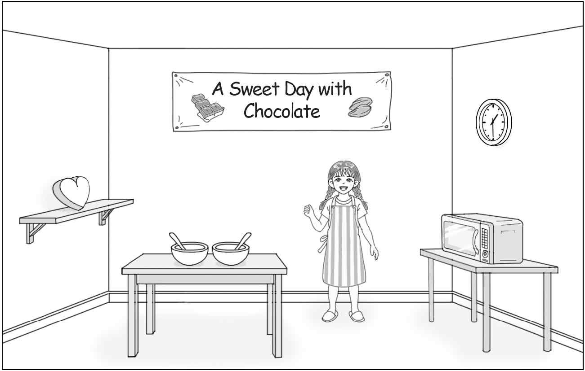
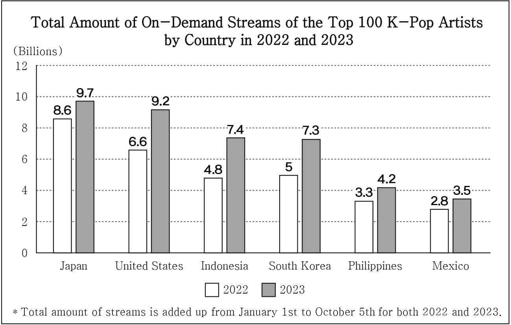

1. 다음을 듣고, 여자가 하는 말의 목적으로 가장 적절한 것을 고르시오.

① 자전거를 지정된 구역에 주차할 것을 요청하려고
② 공원 내 단체 조깅 시 소음을 자제할 것을 부탁하려고
③ 자전거 이용 시 안전 장비 착용의 중요성을 강조하려고
④ 공원에서 자전거 이용 시 제한 속도 준수를 당부하려고
⑤ 공사로 인해 공원 산책로 이용이 임시 중단됨을 안내하려고

2. 대화를 듣고, 남자의 의견으로 가장 적절한 것을 고르시오.

① 속독보다는 정독이 글의 내용 이해에 효과적이다.
② 배경지식에 의존한 독해는 글의 내용을 왜곡할 수 있다.
③ 독서는 새로운 어휘를 자연스럽게 익히는 데 도움이 된다.
④ 모르는 단어의 뜻을 매번 찾는 것은 글 전체의 이해를 어렵게 한다.
⑤ 요지를 정확히 전달하기 위해 맥락에 맞는 어휘 사용이 필요하다.

3. 다음을 듣고, 여자가 하는 말의 요지로 가장 적절한 것을 고르시오.

① 시끄러운 음악은 불안감을 더욱 증가시킨다.
② 개인의 성향은 음악에 대한 취향에서 드러난다.
③ 배경 음악은 사람들의 대화 방식에 영향을 미친다.
④ 작업 중 음악 감상은 사람들의 집중력을 떨어뜨린다.
⑤ 음악은 듣는 사람에게 특정 경험과 기억을 상기시킨다.

4. 대화를 듣고, 그림에서 대화의 내용과 일치하지 않는 것을 고르시오.

5. 대화를 듣고, 남자가 할 일로 가장 적절한 것을 고르시오.

① 악기 옮기기
② 마이크 충전하기
③ 마실 물 가져오기
④ 여분의 배터리 챙기기
⑤ 행사 안내 방송 요청하기

6. 대화를 듣고, 여자가 지불할 금액을 고르시오. [3점]

① $27
② $35
③ $36
④ $40
⑤ $45

7. 대화를 듣고, 남자가 Stand-up Comedy Show에 갈 수 없는 이유를 고르시오.

① 직장 동료 송별회가 있어서
② 대학원 야간 수업이 있어서
③ 회사 프로젝트를 준비해야 해서
④ 가족과 저녁 식사를 하기로 해서
⑤ 스트레스로 인해 몸이 좋지 않아서

8. 대화를 듣고, Big Wave Surfing Class에 관해 언급되지 않은 것을 고르시오.

① 장소
② 소요 시간
③ 최대 수강 인원
④ 수강료
⑤ 등록 방법

9. Ironveil Castle Tour에 관한 다음 내용을 듣고, 일치하지 않는 것을 고르시오.

① 오전 10시부터 투어가 있다.
② 왕가의 정원에서부터 성탑까지 진행된다.
③ 가이드는 왕과 왕비에 대한 이야기를 들려준다.
④ 기념품으로 책갈피를 받게 된다.
⑤ 티켓은 현장 구매가 가능하다.

10. 다음 표를 보면서 대화를 듣고, 두 사람이 구입할 빨래 바구니를 고르시오.

|  | Product | Size | Material | Price | Handles |
| --- | --- | --- | --- | --- | --- |
| ① | A | Small | Wood | $22 | ◯ |
| ② | B | Medium | Plastic | $28 | ◯ |
| ③ | C | Medium | Stainless Steel | $33 | ☓ |
| ④ | D | Large | Stainless Steel | $38 | ◯ |
| ⑤ | E | Large | Wood | $42 | ☓ |

11. 대화를 듣고, 남자의 마지막 말에 대한 여자의 응답으로 가장 적절한 것을 고르시오.

① I think I’ll be done before lunch time.
② Let’s go over the slides together next week.
③ It takes too long to get a response from you.
④ I’ll start making my slides when you’re done.
⑤ You must memorize the script for the presentation.

12. 대화를 듣고, 여자의 마지막 말에 대한 남자의 응답으로 가장 적절한 것을 고르시오.

① I set the tables before everyone arrived.
② I wonder if we can change to the smaller room.
③ I’m afraid they’ve arrived too late at the dinner.
④ I’ll call the restaurant to update the reservation.
⑤ I haven’t decided which restaurant to choose yet.

13. 대화를 듣고, 남자의 마지막 말에 대한 여자의 응답으로 가장 적절한 것을 고르시오.

Woman:

① Sure. You should rest to get over your fatigue.
② Of course. I can send you the schedule I made.
③ Yes, I’ll consider that the next time I plan a trip.
④ Good. I’d like to try a guided tour like the one you took.
⑤ Actually, we canceled most of our plans because of rain.

14. 대화를 듣고, 여자의 마지막 말에 대한 남자의 응답으로 가장 적절한 것을 고르시오. [3점]

Man:

① Look! People wrote positive reviews about my pizza.
② Don’t worry. There are so many pizza places around here.
③ Well, I always put photos of the restaurant in the reviews.
④ Oh, no. I shouldn’t have spent so much time on social media.
⑤ Great. That could let more people know about my restaurant.

15. 다음 상황 설명을 듣고, Emily가 Ryan에게 할 말로 가장 적절한 것을 고르시오. [3점]

Emily:

① We’d better close the booth before it gets too late.
② Let’s get some rest first and walk around in an hour.
③ Why don’t we walk quickly to see as many booths as we can?
④ We should come up with fun activities to attract more visitors.
⑤ How about choosing a few booths we like and enjoying them more?

16. 여자가 하는 말의 주제로 가장 적절한 것은?

① importance of colors in company logos
② various ways to display emotion through colors
③ color-related expressions used in the economy
④ influence of product colors on economic outcomes
⑤ color preferences depending on cultural backgrounds

17. 언급된 색깔이 아닌 것은?

따라 답을 하시기 바랍니다.

① red
② blue
③ green
④ white
⑤ orange

18. 다음 글의 목적으로 가장 적절한 것은?

Dear Organizing Committee, As the head coach of Banpool Football Club, I am writing in connection with an issue that occurred in yesterday’s match between our team and Firestone Football Club. During the match, a player named Karl Bellinger participated, and it has come to our attention that Bellinger is also the captain of Ironfield Football Club, a team that has already been eliminated from this competition. Firestone Football Club has clearly violated competition rules by using a player registered with another club. We urge the committee to investigate this matter. I am concerned that such actions may undermine the integrity of the competition. I look forward to your response regarding this matter. Sincerely, Steven Richardson

19. 다음 글에 드러난 ‘Paul’의 심경 변화로 가장 적절한 것은?

Paul was standing in the train station. This was real. His long-awaited holiday had just begun. The long, silver train was already there, and as he boarded, he felt alive with anticipation. He found his seat and it was perfect — a window seat with a great view. A moment later, the train began to move. Paul leaned back in his seat and smiled, looking forward to the journey ahead. About twenty minutes later, a man in a uniform walked toward him checking tickets. “Tickets, please,” said the man. Paul reached into his pocket. His ticket wasn’t there. He searched his jacket, then his backpack. Nothing! “I’m sorry. I know I bought the ticket, but I can’t find it now,” said Paul, pulling his shaking hands out of the backpack. “I am sorry, sir. I’m afraid you’ll have to get off at the next station,” replied the man. Paul’s heart raced, and his hands grew sweaty. He had no idea what to do.

20. 다음 글에서 필자가 주장하는 바로 가장 적절한 것은?

Giving kids an edible treat that you know they love after a tricky day to cheer them up or soothe them can be tempting but I advise you not to. When we try to comfort a child with food rather than attend to their physical and emotional needs, we leave them feeling not understood. Instead of learning that they’ll receive appropriate comfort and attention, they receive the message that their needs can’t or won’t be met appropriately. Consequently, they understand one of the following: that their needs are not valid; that they are too much for their parent; that they are being silly; that next time they should keep quiet; or that they need to shout louder to be heard. If, after tending to your child’s emotional and physical wounds you want to offer some chocolate, ice cream or a trip to a fast-food restaurant, that is, of course completely fine ― but it must not replace the nurture.

21. 밑줄 친 sees without scenes가 다음 글에서 의미하는 바로 가장 적절한 것은?

A scientist named Speiser suspects that scallop vision works in a very different way than ours. Our brains combine the overlapping information from our two eyes into a single scene. A scallop could do the same across a hundred eyes, but that seems unlikely given how primitive its brain is. Instead, each eye might simply tell the brain whether it has detected something moving or not. Think of the scallop’s brain as a security guard watching a bank of a hundred monitors, each connected to a motion-sensing camera. The cameras may be state-of-the-art, but the images they capture are not sent to the guard. All the guard sees on the monitors is a warning light for every camera that has spotted something. If Speiser is right about this strange setup, it means that even though each individual scallop eye has good spatial resolution, the animal itself might not have spatial vision. It knows when eyes in a certain region of its body have detected something, but it has no visual image of that object. It doesn’t experience a movie in its head the same way we do. It sees without scenes.

22. 다음 글의 요지로 가장 적절한 것은?

In some sense, cities generate themselves ― they are complex, adaptive, self-organizing systems. Of course, it is actually people who create cities, either individually or as organized into businesses, governments, and other institutions. But, for the most part, they do so unintentionally as they go about their daily lives. They move to satisfy immediate needs ― drop the children off at school, get to work, find a location for a new branch office, build a house to live in. They do not intend to build a city; that just happens. Even though, along the way, there are many acts of planning, these tend to be local, temporary, or incomplete. So, ultimately, a city emerges as the collective result of many individual events, most of which are not intended to be city building. But the acts of planning are intended to guide the development of the city, and these, to be successful, must rely on an understanding of the processes by which the city generates itself.

23. 다음 글의 주제로 가장 적절한 것은? [3점]

The gene-centric view separates the organism from its environment, and in large part, removes agency from the organism. The ‘environment’ becomes a box within which ‘gene-motivated’ organisms behave. Thus, it misleadingly partitions ‘genetic’ from ‘environmental’ causes, giving primacy to the former. Therefore, altruism is denied because ‘in reality’ organisms behave to enhance their genes in the ‘gene pool’ ― and love, hate, desires and other motivations flow through and from genes. With this there can be no creativity. The organism is a prisoner of its genes. This is evidently nonsense because, if there is a prisoner, it must be the genes, locked in the organism and obeying its will. It is the organism as a self-organising entity that has motivation and uses genes in its capacity to act. The word ‘organism’ has its origins in defining organisms as self-organising beings, going back at least to Immanuel Kant’s 1790 Critique of Judgment. The gene-centric view strips the organism of its definitive self.

24. 다음 글의 제목으로 가장 적절한 것은?

There are fundamental differences between our attention to animals and our attention to plants, and these are deeply embedded in our visual systems. One study used a core tool from visual cognition studies called “attentional blink.” “Blink” is when the focus that is given to one object slows down our ability to engage with a new object. Our visual processing power is a finite resource, so the more attention the first object takes up, the slower we are to shift on to the second. In this study, one group of people were first shown an animal and another group were first shown a plant. A second object, a water droplet, followed in quick succession. Those looking at an animal initially were much less likely to see the water than those first looking at a plant. The plant simply took up less of their attention, freeing up capacity to notice other things. Plants are not only thought of as less interesting, they are fundamentally given less processing power in our visual system, becoming a mass of crowded, unmoving background greenery.

25. 다음 도표의 내용과 일치하지 않는 것은?

Total Amount of On-Demand Streams of the Top 100 K-Pop Artists by Country in 2022 and 2023 (Billions)

| Country | 2022 | 2023 |
| --- | --- | --- |
| Japan | 8.6 | 9.7 |
| United States | 6.6 | 9.2 |
| Indonesia | 4.8 | 7.4 |
| South Korea | 5 | 7.3 |
| Philippines | 3.3 | 4.2 |
| Mexico | 2.8 | 3.5 |

26. Alan Seeger에 관한 다음 글의 내용과 일치하지 않는 것은?

Alan Seeger, an American poet, was born in New York City in 1888 and grew up in a wealthy home. After his father’s trading business went bankrupt, his family moved to Mexico City for two years. Its landscape influenced many of his works. Seeger returned to the States and later graduated from Harvard University, where he was inspired by the Romantic poets. Seeger left for Paris, France to live out his romanticized notion of bohemian life and made friendships with many artists. When World War I broke out in 1914, he joined the French army as a volunteer to defend his beloved France. During the war, he wrote a poem, I Have a Rendezvous with Death, about a soldier accepting his upcoming death and it made Seeger instantly famous when it was published. Seeger died during the Battle of the Somme in 1916. Following his death, the French Military awarded him the Croix de Guerre, the highest French military honor.

27. 2026 Space Exploration Exhibition에 관한 다음 안내문의 내용과 일치하지 않는 것은?

2026 Space Exploration Exhibition Join us at the Ashmont Science Museum for an extraordinary journey into the cosmos! We offer hands-on experiences for space enthusiasts of all ages. When & Where - May 16th - 31st, from 10 a.m. to 5 p.m. - Kepler Hall on the 2nd Floor Exhibition Tickets - Adult (15 & over): $15 - Child (14 & under): $10 ※ Exhibition tickets allow access to all areas of the museum. Activities 1) touching authentic lunar rock 2) playing astronaut games in space suits 3) taking photos in front of spacecraft models Notes - Volunteers will be on site to answer questions. - The first 100 visitors will receive a space-themed pen as a souvenir each day. For more information, please visit www.ashmontsm.org.

28. Barkfield Pawlish Grooming Studio에 관한 다음 안내문의 내용과 일치하는 것은?

Barkfield Pawlish Grooming Studio Is your dog in need of a professional touch? Visit us! Your dog will leave looking and feeling their best! Opening Hours · Monday – Saturday: 9 a.m. – 5 p.m. · Sunday: Closed Services & Pricing · Hair Cut: $50 · Bath & Brush: $30 · Nail Clipping: $20 · Ear Cleaning: $10 ※ Additional charges may apply depending on your dog’s size or hair type. Notes · Inform us if your dog has any medical conditions. · We provide dog snacks, but you are welcome to bring your dog’s own snacks. Reservations should be made online (www.barkfield.com) at least one day before your visit.

29. 다음 글의 밑줄 친 부분 중, 어법상 틀린 것은? [3점]

A study by Eurofound found that young people who were working remotely reported more difficulties in managing their workload than older colleagues. Moreover, many young people began their careers working remotely during the pandemic, unlike those in older generations who had many years to establish interpersonal connections and embed themselves in the organizational culture in an in-person job. A survey by Prospects found that almost half of students and graduates in the United Kingdom found it difficult to work from home during the pandemic due to a lack of suitable workspace or distractions. While young people may struggle long-term with remote work, perhaps more of a hybrid model where they can work from home part of the time and work onsite other times, would work well for them. But it may not be that they need a formal hybrid structure with specific days of the week designated for working remotely but instead a fluid option that allows them, if possible, depending on the job role, chooses their day-to-day work location.

30. 다음 글의 밑줄 친 부분 중, 문맥상 낱말의 쓰임이 적절하지 않은 것은?

In humans, the infant immune system is less active than that of adults, enabling a wide range of bacteria to establish in our guts. Similarly, young plants release fewer defensive compounds into the soil than older ones, allowing a broad variety of microbes to colonize their rhizospheres. Human breast milk contains sugars. At first, scientists struggled to understand why mothers express these compounds, as babies can’t digest them. It now seems that their sole purpose is to feed the bacteria with which the child will grow. They selectively cultivate a particular bacterial species with a crucial role in helping the gut to develop and fine-tuning the immune system. Similarly, young plants release large quantities of sugars into the soil, to feed and develop their new microbiomes. Like the human gut, the rhizosphere not only digests food, but also helps to protect plants from disease. Just as the bacteria that live in our guts outcompete and attack invading pathogens, the microbes in the rhizosphere create a defensive ring around the root. Plants feed beneficial bacteria species, so that they accumulate pathogenic microbes.

31. 다음 빈칸에 들어갈 말로 가장 적절한 것을 고르시오.

Orb-weaving spiders often use distinct vibrational signals to defend their webs. When a rival approaches, the resident spider will rapidly shake its web, sending out a series of intense vibrations. These vibrations can be interpreted as a challenge, signaling the resident spider’s readiness to fight. The intensity and complexity of these signals often correlate with the size and strength of the spider, allowing the invader to assess the risk of engaging in a direct confrontation. The beauty of vibrational signaling lies in its efficiency. It avoids costly physical clashes, allowing spiders to resolve territorial disputes with minimal risk of injury. A smaller or weaker spider, upon receiving a strong vibrational warning, may choose to retreat and seek a less contested territory, rather than risk a potentially fatal fight. This makes vibrational communication a crucial tool for maintaining stability and reducing aggression within spider populations.

32. 다음 빈칸에 들어갈 말로 가장 적절한 것을 고르시오. [3점]

According to British economist Lionel Robbins, whether goods and services are beneficial to human welfare or not, economics should study them if they satisfy the wants of some men. It is also worth noting that in view of Robbins, economics does not deal with the question as to what ends should be achieved, that is, what wants should be satisfied and what not, because in this regard man himself has to decide. Economics itself does not make a choice. Economist only tells in what ways the given ends or wants can be achieved with the minimum possible resources. What ends or wants should be selected for satisfaction is not the concern of economists. Whether the ends chosen by man are good or bad, noble or ignoble, economics should study them, because the task of economist is not to praise or criticise but only to analyse and explain. To decide about the desirability or otherwise of a thing is beyond the scope of economics. Therefore, according to Robbins, economics is neutral between ends.

33. 다음 빈칸에 들어갈 말로 가장 적절한 것을 고르시오. [3점]

In some parts of India there are temples to Sitala, who is a goddess of skin diseases. Historically, people in these regions made offerings to Sitala in order to protect themselves against smallpox. During the colonial period in India, the British introduced the smallpox vaccine, which ultimately led to the elimination of smallpox. This in turn led to a significant decline in the worship of Sitala as people no longer needed her assistance to avoid smallpox. Was it right for the British to introduce the smallpox vaccine given that it undermined the cultural practice of making offerings to Sitala? Or was this cultural imperialism? Should the British simply have lived and let live, or lived and let die as the case may be? That might seem harsh, but there are some scholars who argue for that. What is beyond dispute is that no matter how you answer that question, you are making a value judgment. In this example, choosing to live and let live isn’t value-neutral; it’s a choice that values cultural autonomy over the lives of those who would otherwise be saved.

34. 다음 빈칸에 들어갈 말로 가장 적절한 것을 고르시오. [3점]

What are the relations between social determinations and subjective aesthetic experience? If every author comes out with his/her own set of values and personal history, how is this subjective vision of the world influenced by the society in which the author lives? The inner world of the writer necessarily meets the social world outside of him or her. Pierre Bourdieu, in La distinction, tries to answer this question from a materialistic point of view, saying that the analysis of this kind of relation between the inner and the social world must go back to the earliest stage of a child’s life when s/he experiences pleasure and aversion. But children are already part of a social group thanks to their family, and therefore the pleasure and the aversion they experience are class-specific, according to the volume of capital they can access, so that the ‘purest’ pleasures, Bourdieu affirms, are rooted in these socially conditioned experiences. In other words, for Bourdieu, from the beginning of life, every experience is already conditioned by the world outside, and this influence manifests itself in literary works too.

35. 다음 글에서 전체 흐름과 관계 없는 문장은?

Pre-Consumer Waste is “waste” that is generated by the industrial processes used to make the products or packaging that we buy as consumers. This is manufacturing “waste” and is typically very clean, of consistent quality and comprises only a single material.

36. 주어진 글 다음에 이어질 글의 순서로 가장 적절한 것을 고르시오.

The autonomy granted to the individual in terms of free speech can be both individual (understood purely from the speaker’s point of view) and relational in nature. The individual’s speech must be protected in order to allow them to freely develop their personality. This is important, even bearing in mind that this development is only possible in social life, which means in relation to and possibly in cooperation with others. Relational autonomy, however, also takes the interests of the audience of the speech into account. Speech can also limit the autonomy of others, for example in the case of defamation, invasion of privacy, or hate speech that hurts certain community. European legal systems also take the latter aspect into account when setting the limits of freedom of expression. They restrict freedom of expression in the interests of the autonomy of those affected by the speech, in order to ensure the peace and security of social coexistence.

37. 주어진 글 다음에 이어질 글의 순서로 가장 적절한 것을 고르시오.

The belief that vision is important to driving safely is the reason why measurements of visual capability are an integral part of the test for issuing a driving licence in most countries. Despite these requirements, attempts to find a link between simple visual functions such as visual sharpness and the accident record of drivers have proved largely fruitless. This may be because drivers with worse visual capabilities are aware of their abilities and drive within them. Alternatively, it may be that the visual capabilities measured are too simple. The fact is the drivers’ task is a complex one, involving both visual and cognitive factors. Within a very limited time, the driver has to interpret what is likely to happen on the road ahead. To do this, the driver has developed a series of expectations of other drivers’ behaviour and of what are the appropriate locations to examine. The driver will be faced with objects of different degrees of visibility and noticeability and will have to make judgements for which the visual system is not always well suited.

38. 글의 흐름으로 보아, 주어진 문장이 들어가기에 가장 적절한 곳을 고르시오.

Mathematics can be considered a universal language, but most of it is explicitly taught. However, it is suggested that some aspects of mathematical knowledge could be innate and present from birth: for example, the ability to discern between different quantities (i.e. large versus small), while understanding of the relationships and associations between numbers are predominantly learnt. Although mathematics can be considered a universal language, there are distinct language and cultural differences in how counting systems are used. For example, in English, words like ‘eleven’ and ‘twelve’ do not directly reflect the values that they stand for, 10+1 and 10+2. However, in Chinese, the number system is very logical, with words that directly reflect the values that are used. For example, the number 20 in Chinese, ershí, literally translates as ‘two-ten’. But it is not only the linguistic representation of numbers that differs; the counting systems used also differ. Although the decimal system predominates today, other counting systems have been developed over time, for example, the Mayan numeral system used a base 20 system.

39. 글의 흐름으로 보아, 주어진 문장이 들어가기에 가장 적절한 곳을 고르시오. [3점]

When we practice, we want to strengthen the synapses relaying information on how to play something correctly, while weakening those that send erroneous messages. To understand how this works, think of a leaky hose that has many holes in it. Some of the water will go through the hose and out the nozzle, but a lot of it will leak out the holes. This is what your brain is like when you first start to learn something: the water running out the holes is all the erroneous information your brain is sending to your fingers, lips, etc. Once you plug the holes in the hose, all the water goes then out the nozzle; in your brain, this is analogous to the synapses relaying the correct messages being much stronger than those sending incorrect messages. The brain accomplishes this through changing the structure of the synapse to make it easier for the correct neurons to communicate. A common phrase in neuroscience is “neurons that fire together wire together,” meaning neurons that communicate with each other often change their structure to make that communication easier.

40. 다음 글의 내용을 한 문장으로 요약하고자 한다. 빈칸 (A), (B)에 들어갈 말로 가장 적절한 것은?

New York University’s Leif D. Nelson and Tom Meyvis explored a surprising phenomenon in a 2008 study. The researchers recruited participants who were told they would be reviewing a massage cushion. Participants were split into two groups. The first group used the device for three minutes (180 seconds) without a break. The second group used the massage cushion for two periods of 80 seconds, with a 20-second break between sessions. Afterwards, participants were asked to rate their enjoyment of the massage on a nine-point scale (one = not pleasant; nine = extremely pleasant). Those who had a three-minute massage gave an average rating of 6.05 out of 9. However, those forced to take a 20-second break during their massage gave a rating of 7.05 ― that’s a 17% improvement in satisfaction. At first glance, that’s counter-intuitive. The group who had the shorter massage enjoyed it more. But the theory is that the break in pleasure prevents us from becoming too familiar with the positive experience and thus noticing it less ― a process called habituation.

In the experiment, participants who took a break during a massage were more content than those who received a longer, continuous massage, which shows that the break blocked the participants’ adaptation to the positive experiences.

41. 윗글의 제목으로 가장 적절한 것은?

Flashback to 50,000 years ago on the Serengeti, and you are dragging an antelope back to the village. Let us just say it has cost you, metabolically speaking, 2,000 calories to stalk, chase and bring down the antelope. When you get back to the village, you would clearly have to consume at least 2,000 calories to recover your expenditure. But there is no guarantee that you would successfully get an antelope the next time out, so if you ONLY ate to your metabolic need, you wouldn’t survive very long. That is when the hedonic part of the brain, which governs the feeling of reward kicks in, driving you to eat more. But how do you get past the mechanical difficulty of a stomach packed full with 2,000 calories of meat? Your brain becomes more picky, it begins to desire foods that are more calorically dense and more calorically available, which are going to be foods high in free sugars and fat. What foods are high in free sugars and fat? Desserts. Your dessert stomach is an evolutionary leftover from your days in the Serengeti, to make sure that even when full, you were still desiring the right types of foods to ensure you were able to restrict your caloric intake at every meal, because there was never a guarantee of when the next meal would arrive. It kept us alive in regular feast-famine cycles, but has become toxic for many of us in the feast-feast environment of today.

42. 밑줄 친 낱말 중에서 문맥상 낱말의 쓰임이 적절하지 않은 것은? [3점]

Flashback to 50,000 years ago on the Serengeti, and you are dragging an antelope back to the village. Let us just say it has cost you, metabolically speaking, 2,000 calories to stalk, chase and bring down the antelope. When you get back to the village, you would clearly have to consume at least 2,000 calories to recover your expenditure. But there is no guarantee that you would successfully get an antelope the next time out, so if you ONLY ate to your metabolic need, you wouldn’t survive very long. That is when the hedonic part of the brain, which governs the feeling of reward kicks in, driving you to eat more. But how do you get past the mechanical difficulty of a stomach packed full with 2,000 calories of meat? Your brain becomes more picky, it begins to desire foods that are more calorically dense and more calorically available, which are going to be foods high in free sugars and fat. What foods are high in free sugars and fat? Desserts. Your dessert stomach is an evolutionary leftover from your days in the Serengeti, to make sure that even when full, you were still desiring the right types of foods to ensure you were able to restrict your caloric intake at every meal, because there was never a guarantee of when the next meal would arrive. It kept us alive in regular feast-famine cycles, but has become toxic for many of us in the feast-feast environment of today.

43. 주어진 글에 이어질 내용을 순서에 맞게 배열한 것으로 가장 적절한 것은?

Matthew loved tennis. He had been practicing hard for weeks, preparing for the biggest match of the year. Today was the day. He wanted to win. He had trained so much. His best friend and training partner Larry was on the sidelines, cheering him on. The match started off great. He ran across the court, hitting each ball with speed and precision. But then, SNAP! His racket strings broke!

 Matthew froze and his heart pounded as he stared at the loose strings hanging from his racket. He had never had a string break during a match before, and now it had happened in his most important match. The referee called for a short break while Matthew figured out what to do. He was about to give up when he heard a voice. “Use my spare!” He turned to see Larry holding out his extra racket. Matthew hesitated. It wasn’t his racket. It wouldn’t feel the same. But then he remembered something his coach always said, “Champions never give up.” Taking a deep breath, he grabbed Larry’s racket and returned to the court. The new racket was heavier than his own, and the grip wasn’t as comfortable. He missed an easy ball, and his opponent scored a point. But instead of getting upset, Matthew told himself, ‘It’s okay. I just need to adapt.’ He focused on his footwork and adjusted his grip. Despite his best efforts, things didn’t go as Matthew hoped. And by the end of the match, he had lost. He had wanted to win so badly. As Matthew walked miserably to the net, he looked at his opponent. The boy was smiling, holding out his hand. He didn’t want to admit his defeat. But then, he remembered something Larry always said: “Winning isn’t about the score. It’s about how you play the game.” Matthew realized he had done his best. Matthew smiled, shook the boy’s hand and said, “Congratulations. You played a great game.”

44. 밑줄 친 낱말 중에서 가리키는 대상이 나머지 넷과 다른 것은?

Matthew loved tennis. He had been practicing hard for weeks, preparing for the biggest match of the year. Today was the day. He wanted to win. He had trained so much. His best friend and training partner Larry was on the sidelines, cheering him on. The match started off great. He ran across the court, hitting each ball with speed and precision. But then, SNAP! His racket strings broke!

 Matthew froze and his heart pounded as he stared at the loose strings hanging from his racket. He had never had a string break during a match before, and now it had happened in his most important match. The referee called for a short break while Matthew figured out what to do. He was about to give up when he heard a voice. “Use my spare!” He turned to see Larry holding out his extra racket. Matthew hesitated. It wasn’t his racket. It wouldn’t feel the same. But then he remembered something his coach always said, “Champions never give up.” Taking a deep breath, he grabbed Larry’s racket and returned to the court. The new racket was heavier than his own, and the grip wasn’t as comfortable. He missed an easy ball, and his opponent scored a point. But instead of getting upset, Matthew told himself, ‘It’s okay. I just need to adapt.’ He focused on his footwork and adjusted his grip. Despite his best efforts, things didn’t go as Matthew hoped. And by the end of the match, he had lost. He had wanted to win so badly. As Matthew walked miserably to the net, he looked at his opponent. The boy was smiling, holding out his hand. He didn’t want to admit his defeat. But then, he remembered something Larry always said: “Winning isn’t about the score. It’s about how you play the game.” Matthew realized he had done his best. Matthew smiled, shook the boy’s hand and said, “Congratulations. You played a great game.”

45. 윗글에 관한 내용으로 적절하지 않은 것은?

Matthew loved tennis. He had been practicing hard for weeks, preparing for the biggest match of the year. Today was the day. He wanted to win. He had trained so much. His best friend and training partner Larry was on the sidelines, cheering him on. The match started off great. He ran across the court, hitting each ball with speed and precision. But then, SNAP! His racket strings broke!

 Matthew froze and his heart pounded as he stared at the loose strings hanging from his racket. He had never had a string break during a match before, and now it had happened in his most important match. The referee called for a short break while Matthew figured out what to do. He was about to give up when he heard a voice. “Use my spare!” He turned to see Larry holding out his extra racket. Matthew hesitated. It wasn’t his racket. It wouldn’t feel the same. But then he remembered something his coach always said, “Champions never give up.” Taking a deep breath, he grabbed Larry’s racket and returned to the court. The new racket was heavier than his own, and the grip wasn’t as comfortable. He missed an easy ball, and his opponent scored a point. But instead of getting upset, Matthew told himself, ‘It’s okay. I just need to adapt.’ He focused on his footwork and adjusted his grip. Despite his best efforts, things didn’t go as Matthew hoped. And by the end of the match, he had lost. He had wanted to win so badly. As Matthew walked miserably to the net, he looked at his opponent. The boy was smiling, holding out his hand. He didn’t want to admit his defeat. But then, he remembered something Larry always said: “Winning isn’t about the score. It’s about how you play the game.” Matthew realized he had done his best. Matthew smiled, shook the boy’s hand and said, “Congratulations. You played a great game.”

