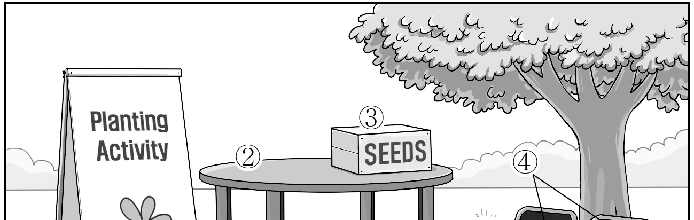
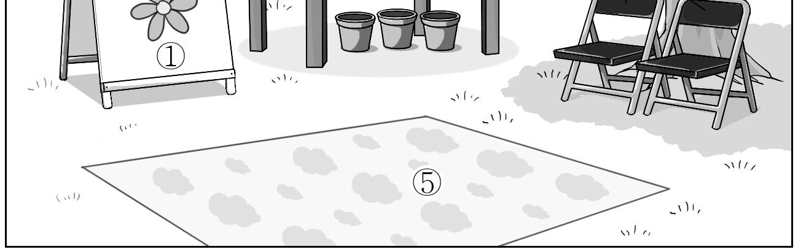
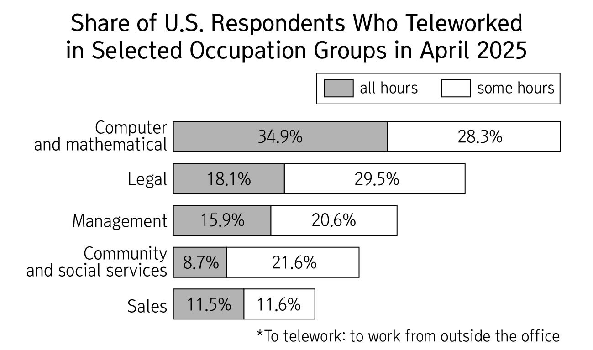
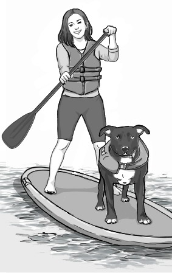

1. 다음을 듣고, 여자가 하는 말의 목적으로 가장 적절한 것을 고르시오.

① 방학 중 도서 반납 방법을 설명하려고
② 여름방학 중 도서관 폐쇄를 공지하려고
③ 도서관 이용 규칙의 변경 사항을 안내하려고
④ 여름방학 도서관 특별 프로그램을 홍보하려고
⑤ 도서관 시설 개선을 위한 설문 참여를 독려하려고

2. 대화를 듣고, 남자의 의견으로 가장 적절한 것을 고르시오.

① 다양한 사진 활용은 블로그 방문자 유입에 효과적이다.
② 블로그 글의 제목을 본문과 구별되게 만드는 것이 좋다.
③ 블로그 게시물은 일정한 주기로 업데이트할 필요가 있다.
④ 블로그 글 작성 시 개인정보 포함 여부를 확인해야 한다.
⑤ 모바일 환경에 맞추어 블로그를 디자인하는 것이 중요하다.

3. 다음을 듣고, 여자가 하는 말의 요지로 가장 적절한 것을 고르시오.

① 친구와의 잦은 교류는 정서적 안정에 효과적이다.
② 이웃과의 작은 상호작용으로 외로움을 줄일 수 있다.
③ 이웃을 배려하는 태도는 건강한 공동체 형성에 필수적이다.
④ 진솔한 대화를 통해 지역 공동체의 갈등을 완화할 수 있다.
⑤ 지역사회 행사 참여는 새로운 이웃을 사귀는 데 도움이 된다.

4. 대화를 듣고, 그림에서 대화의 내용과 일치하지 않는 것을 고르시오.

5. 대화를 듣고, 남자가 할 일로 가장 적절한 것을 고르시오.

① 냉장고에 음료 넣기
② 차고에서 그릴 꺼내기
③ 문자 메시지 보내기
④ 돼지고기 주문하기
⑤ 의자 배치하기

6. 대화를 듣고, 여자가 지불할 금액을 고르시오. [3점]

① $27
② $30
③ $34
④ $36
⑤ $40

7. 대화를 듣고, 남자가 도예 워크숍에 참가할 수 없는 이유를 고르시오.

① 워크숍 참가 비용이 너무 비싸서
② 새 프로젝트를 아직 끝내지 못해서
③ 유기견 센터 자원봉사를 해야 해서
④ 할아버지를 병원에 모시고 가야 해서
⑤ 도예에 필요한 도구를 준비하지 못해서

8. 대화를 듣고, Blueberry Picking Event에 관해 언급되지 않은 것을 고르시오.

① 장소
② 기간
③ 예약 방법
④ 입장료
⑤ 준비물

9. Lights for Wildlife에 관한 다음 내용을 듣고, 일치하지 않는 것을 고르시오.

① 오후 9시에 시작한다.
② 총 2,000대의 드론이 이용된다.
③ 개인 피크닉 매트를 가져올 수 있다.
④ 공식 행사 티셔츠는 현장에서도 구매할 수 있다.
⑤ 주차를 위한 공간이 제공된다.

10. 다음 표를 보면서 대화를 듣고, 여자가 구입할 스마트 안경을 고르시오.

|  | Model | Price | Lens Style | Battery Life (in hours) | Blue-light Filter |
| --- | --- | --- | --- | --- | --- |
| ① | A | $65 | Rectangle | 4 | × |
| ② | B | $80 | Rectangle | 6 | × |
| ③ | C | $95 | Round | 5 | ○ |
| ④ | D | $110 | Rectangle | 6 | ○ |
| ⑤ | E | $125 | Round | 7 | ○ |

11. 대화를 듣고, 남자의 마지막 말에 대한 여자의 응답으로 가장 적절한 것을 고르시오. [3점]

① Sure. I’ll stop by my cousin’s and grab the missing pieces.
② Absolutely, but don’t forget to bring the puzzle next time.
③ Unfortunately, I already gave the pieces to someone else.
④ Thanks. I prefer to start the game before dinner.
⑤ Sorry, I think we need all of them for tonight.

12. 대화를 듣고, 여자의 마지막 말에 대한 남자의 응답으로 가장 적절한 것을 고르시오.

① Okay, then I’ll have a soda with no sugar.
② Never mind. You don’t have to be on a diet.
③ Well, you should have brought your own drinks.
④ No, that’s why I stopped drinking cold beverages.
⑤ See? I told you this vending machine isn’t working.

13. 대화를 듣고, 남자의 마지막 말에 대한 여자의 응답으로 가장 적절한 것을 고르시오. [3점]

Woman:
① Well, I’m proud you did it without help.
② Don’t worry. Even beginners can easily follow it.
③ I’ll keep uploading AI-generated music on my channel.
④ Exactly. People should take copyright issues seriously.
⑤ That’s okay. Your music is already good enough to use.

14. 대화를 듣고, 여자의 마지막 말에 대한 남자의 응답으로 가장 적절한 것을 고르시오.

Man:
① Perfect. I’ll be there by then with my laptop.
② No thanks. I already sent everything this evening.
③ Right. You finished it on your own, but not on time.
④ Maybe. You can ask our client to cancel the meeting.
⑤ No problem. We don’t have to fix the computer right now.

15. 다음 상황 설명을 듣고, Ryan이 Emily에게 할 말로 가장 적절한 것을 고르시오.

Ryan:
① How about we meet when I’m back in town?
② Send me your speech after you finish editing it.
③ Let’s figure it out together when you are ready.
④ Would you like to volunteer with us this weekend?
⑤ Don’t you think you need to practice your speech more?

16. 여자가 하는 말의 주제로 가장 적절한 것은?

① effective ways to control animal populations
② why certain animals are attracted to gardens
③ animals that contribute to a flourishing garden
④ how different species of animals communicate
⑤ necessary conditions for animals to live in gardens

17. 언급된 동물이 아닌 것은?

따라 답을 하시기 바랍니다.

① ants
② spiders
③ lizards
④ frogs
⑤ earthworms

18. 다음 글의 목적으로 가장 적절한 것은?

To Whom It May Concern: People have been dumping their waste in areas of our neighborhood where it’s not permitted. Some of my neighbors are leaving their garbage on street corners and at bus stops. Even though it’s illegal to leave trash in those areas, recently more and more people are doing it and the situation is getting worse. The large buildup of garbage attracts animals and insects, which has left the neighborhood in a disgusting state. To fix this growing problem, I urge the city to strengthen management and supervision of illegal dumping in the community. Consistent and strict oversight is desperately needed to protect the cleanliness of our neighborhood. Thank you for your time and consideration. Sincerely, Julia Morgan

19. 다음 글에 드러난 Steller의 심경 변화로 가장 적절한 것은?

It was late autumn, months after Steller’s journey had begun. Dreadful weather and endless hunger had drained him of strength. The ship drifted without direction, food was gone, and Steller felt his body worn down by exhaustion. There seemed no escape from the sea. For a long time, he scanned all around for land to no avail, sinking into despair with the thought that everyone on the ship might perish. Then something appeared. Under the rising sun, distant peaks emerged, and light angled across a vast land. Below the light lay green lagoons, winding paths, and living wilderness. Unlike the empty ocean, this land suggested shelter and food, with plants and fruits that could be gathered. Steller felt relief that they might live, letting out a long breath.

20. 다음 글에서 필자가 주장하는 바로 가장 적절한 것은?

If your goal is superficial, you may find that your desire to achieve this goal is rooted in a place of anxiety or self-consciousness. Moving toward a goal for the sole purpose of reducing an anxiety is something that you may want to look closely at. Wanting to lose weight because people at work have made rude comments toward you is activating a goal for the wrong reasons. This is why it is so important to not only home in on your goals but also why you want to achieve them. Your goals should benefit you and your life in some positive way, not create an escape route away from the things or people who are hurting you. If you are being brought down by people at work for something like your weight, then the issue is not your weight ― it is the rudeness and lack of professionalism displayed by your colleagues.

21. 밑줄 친 Eat the orange, throw away the peel이 다음 글에서 의미하는 바로 가장 적절한 것은?

When you are keenly aware of your own struggles but blind to those of others, it’s easy to assume you’re missing some skill or secret that others have. The more we describe successful people as having superhuman powers, the more everyone else looks at them and says, “I could never do that.” Which is unfortunate, because more people would be willing to try if they knew that those they admire are probably normal people who played the odds right. When someone is viewed as more extraordinary than they are, you’re more likely to overvalue their opinion on things they have no special talent in. Like a successful hedge fund manager’s political views, or a politician’s investment advice. Only when you get to know someone well do you realize the best you can do in life is to become an expert at some things while remaining unskilled at others ― and that’s if you’re good. There’s an important difference between someone whose specific talent should be celebrated versus someone whose ideas should never be questioned. Eat the orange, throw away the peel.

22. 다음 글의 요지로 가장 적절한 것은?

There are layers of limits around every growing plant, child, new product, technological advance, company, city, economy, and population. Insight comes not only from recognizing which factor is limiting, but from seeing that growth itself depletes or enhances limits and therefore changes what is limiting. The interplay between a growing plant and the soil, a growing company and its market, a growing economy and its resource base, is dynamic. Whenever one factor ceases to be limiting, growth occurs, and the growth itself changes the relative scarcity of factors until another becomes limiting. To shift attention from the abundant factors to the next potential limiting factor is to gain real understanding of, and control over, the growth process. Any physical entity with multiple inputs and outputs ― a population, a production process, an economy ― is surrounded by layers of limits. As the system develops, it interacts with and affects its own limits. The growing entity and its limited environment together form a coevolving dynamic system.

23. 다음 글의 주제로 가장 적절한 것은?

If we reduce language to a system of symbols capable of describing a bird in terms only applicable to a bird, then almost by definition it is no longer a language we ourselves understand. Perfect accuracy is achieved only at the cost of total incomprehension. What we have to do instead is use the language we have to bridge this gap, knowing that it is systematically impure in this way and using it as sensitively and critically as we can. That is why we rely so much on analogy and metaphor in our ordinary descriptions and evocations of birds and why we need to be open to the larger imaginative frameworks of art and literature as well. Description involves language and the language is in the end a human language, which has its own history and is shot through with echoes and reverberations from that history and with meanings and metaphors drawn from human experience. The metaphors may be conscious or unconscious, dead or alive, but they are there at work.

24. 다음 글의 제목으로 가장 적절한 것은? [3점]

Over hundreds of thousands of years of dwelling outside, the human organism became precisely adjusted to the characteristics of its grassy environment, so that even today, our senses and our cognition are able to easily and efficiently process the particular features present in natural settings. Our minds are tuned to the frequencies of the organic world. No such evolutionary adjustment has prepared us for the much more recent emergence of the world in which we now spend almost all our time: the built environment, with its sharp lines and unforgiving textures and constant motion. We’ve set up camp amid the high-rises and highways of our modern surroundings, but our minds are not at ease in this habitat. The mismatch between the stimuli we evolved to process and the sights and sounds that regularly confront our senses has the effect of depleting our limited mental resources. We are left worn-out, fatigued, and prone to distraction, simply as a function of the hours we spend in a setting for which we are biologically ill-equipped.

25. 다음 도표의 내용과 일치하지 않는 것은?

Share of U.S. Respondents Who Teleworked in Selected Occupation Groups in April 2025

| Occupation Group | all hours | some hours |
| --- | --- | --- |
| Computer and mathematical | 34.9% | 28.3% |
| Legal | 18.1% | 29.5% |
| Management | 15.9% | 20.6% |
| Community and social services | 8.7% | 21.6% |
| Sales | 11.5% | 11.6% |

26. Laura Newbold Wood에 관한 다음 글의 내용과 일치하지 않는 것은?

Laura Newbold Wood was an American journalist and biographer born in Missouri in 1911. She wrote her first novel at the age of seven, and her second three years later. Her family was sufficiently well off that she was able to continue her studies even during the difficult years of the Great Depression. After graduating from Vassar College in 1932, she began her career as a journalist and contributed to several well-known periodicals. In 1940, she married a lawyer and soon turned to writing full-length nonfiction. In 1943, her first full-length biography, Walter Reed: Doctor in Uniform, was published. In 1948, she published a biography of Louis Pasteur, in which she detailed not only his famous achievements but lesser-known experiments. In addition to her journalism and editorial work, Wood was active as an amateur photographer and volunteered at her children’s schools. She died in Massachusetts in 2003.

27. Stand-Up Paddleboarding with Your Dog에 관한 다음 안내문의 내용과 일치하지 않는 것은?

Stand-Up Paddleboarding with Your Dog Come have a unique experience by trying stand-up paddleboarding with your dog along the scenic coast of Lunakoa Bay. Dates: August 7th (Fri.) - August 29th (Sat.) Price: $50 Booking - Available only on our website - Each session allows up to 8 people (one dog per person). Program Details - Each session lasts 90 minutes. - All sessions will be led by certified instructors. - The program is for ages 12 and up. - Life jackets will be provided for all participants. ※ Please visit our website at www.supdogforyou.com for more information.

28. Book Exchange Day에 관한 다음 안내문의 내용과 일치하는 것은?

 Book Exchange Day Share your books and discover new ones! Encourage reading and help books find new readers at the Community Culture Center on August 22, 2026. How to Participate - Bring 1 to 3 books in good condition to exchange. - No pre-registration is required. (Anyone can join on the day of the event.) Activities - Book Trading: Exchange your books with others. (Textbooks or damaged books are not exchangeable.) - Recommendation Board: Share the titles of your favorite books. - Bookmark-making Booth: Make your own bookmarks for free with recycled paper. Notices - Snacks will be provided. - Any remaining books will be donated to local libraries. ※ For more details, please visit our community website.

29. 다음 글의 밑줄 친 부분 중, 어법상 틀린 것은?

To date, the focus of much of the research in medicine and the health sciences has understandably been on disease processes. Research on the physiological mechanisms linking mind and body has also focused primarily on the negative consequences of factors such as stress, trauma and ageing. Whereas a large body of research exists detailing the relationship between functioning of the brain and that of systems such as the autonomic, endocrine and immune systems, most of this research has focused on negative outcomes. It is becoming clear that well-being and ill-being may have biological, psychological, social and spiritual causes that are only partially overlapping and attempting to understand the body during states of wellness rather than under conditions of illness is essentially a paradigm shift in thinking. The positive health construct points to the intriguing possibility that the physiological mechanisms underlying thriving may be unique and may not merely mirror that underlying disease and illness. For example, the impact of well-being on secretion patterns of such hormones as cortisol, serotonin and oxytocin is not just the opposite to that of stress and distress.

30. 다음 글의 밑줄 친 부분 중, 문맥상 낱말의 쓰임이 적절하지 않은 것은?

Distinction is valuable because it provides definition. If everyone were identical, it would be hard to have any sense of self. Where would that self start and others end? Differentiation helps establish a sense of identity. Defining both who someone is and isn’t. This often plays out as children become young adults. Up until age twelve or thirteen, children are essentially extensions of their parents. They dress the way their parents dress them, eat what their parents cooked, and live where their parents live. They’re not clones of their parents (children certainly talk back or hate particular foods), but they’ve done little to differentiate themselves. Part of becoming an adult, though, is about defining a unique self. One that’s separate from one’s parents. So teens rebel. They become vegan, date bad boys or girls, and generally look bored or irritated whenever their parents pick them up from school. Teens aren’t just trying to upset their parents (although it might seem that way); they’re trying to define themselves as unique and distinct. Creating a boundary where their identity starts and their parents’ ends.

31. 다음 빈칸에 들어갈 말로 가장 적절한 것을 고르시오.

Politics and economics differ radically in the way they deal with time. For example, when it becomes clear that the fares being charged on municipal buses are too low to permit those buses to be replaced as they wear out, the logical economic conclusion for the long run is to raise the fares. However, a politician who opposes the fare increase as “unjustified” may gain the votes of bus riders at the next election. Moreover, since all the buses are not going to wear out immediately, or even simultaneously at some future date, the consequences of holding down the fare will not appear all at once but will be spread out over time. It may be some years before enough buses start breaking down and wearing out, without adequate replacements, for the bus riders to notice that there now seem to be longer waits between buses and buses do not arrive on schedule as often as they used to.

32. 다음 빈칸에 들어갈 말로 가장 적절한 것을 고르시오. [3점]

Of all the design disciplines it is probably architecture that has the richest, most diverse tradition for exploring ideas. From paper architecture to visionary design, its long history is full of exciting and inspiring examples. There is a tension between visionary architecture, which has an outward facing social or critical agenda, and paper architecture, which, though often introspective and concerned only with architectural theory, is rarely intended to ever be built. One of the most interesting examples to cross over from idea to reality is Peter Eisenman’s famous House VI, which prioritized formalist concerns over practicalities to an extreme extent. The client later wrote about the many practical problems it had but still loved living in such a conceptual building. The relationship between reality and unreality is particularly interesting in architecture because many buildings are designed to be built but remain on paper due to economic or political reasons. House VI is unusual because it was intentionally an uncompromising piece of architectural art someone could nearly live in. It was as though the owner lived inside an idea rather than a building.

33. 다음 빈칸에 들어갈 말로 가장 적절한 것을 고르시오. [3점]

In some cases, behavior and expectations can come to be aligned through mutual self-interest. For example, in the early days of motor vehicles, norms emerged in which everyone came to expect everyone else to drive on the right (or left) side of the road. Whether drivers arrived at the collective choice to drive on the right or the left mattered little, so different norms emerged in different parts of the world. The key was to coordinate around some norm in each area and not to deviate. In the case of driving, deviations from the expected behavior are extremely costly, likely resulting in injury or death, so there are strong incentives to adopt a norm and follow it, making it self-enforcing. For early drivers, empirical expectations about what other people would do played a crucial causal role in deciding which side of the road to drive on. At the same time, those expectations were themselves a product of the behavior that other individuals had chosen. Hence causality flowed in both directions.

34. 다음 빈칸에 들어갈 말로 가장 적절한 것을 고르시오. [3점]

Predator-prey interactions must eventually end in death: one becomes dinner or the other starves. In contrast, competition between members of the same species usually involves elaborate signaling that is intended to clarify which individual is stronger before conflict escalates to the point of injury. It is in neither the winning nor the losing party’s interest to fight over resources, as even winners get hurt in fights. Consequently, it is in both parties’ interests to determine who would win if the fight were to take place, with this determination followed immediately by deference or flight by the party destined to lose. Only when competitors appear to be equally matched e s does a conflict over resources escalate into actual physical combat. For this reason, competition among members of the same species rarely relies on actual force, as the threat of force is an obstacle to conflict. Human conflicts are guided by the same principles as those of other animals, but the fact that warfare is so common testifies to the frequency with which the two sides are unable to agree on who would win a fight.

35. 다음 글에서 전체 흐름과 관계 없는 문장은?

The ideal person, at least according to an economist, would always make decisions that will result in them gaining the most utility. This “ideal” is called rational choice theory, which is defined as the theory that people will always make the choice that maximizes their own individual satisfaction when given different options under scarcity.

36. 주어진 글 다음에 이어질 글의 순서로 가장 적절한 것을 고르시오.

In the world of animal physiology, one thing is for sure: size matters. The environmental stresses of being a tiny animal, like a mouse, are very different from those of a large animal, such as an elephant. It all comes down to a little math ― specifically, surface-to-volume ratios. For a simple shape like a ball, the surface area is related to the square of its radius, while the volume is related to the cube of its radius. It’s a bit more complicated for animal shapes, but essentially it means that our tiny friends have a lot more surface for their volume. Restroom rituals are not free from being affected by the animal’s surface-to-volume ratio. Due to their long lifespans and low metabolic rates, large animals like elephants deal with the challenges of storing waste a bit longer, and the need to manage toxins effectively. Their plumbing has evolved to be highly efficient, capable of filtering large volumes of fluids and concentrating waste in ways that conserve water. This is essential when roaming vast landscapes where water might be a luxury. On the other hand, smaller animals are generally about speed, which means they aren’t quite as good at a water-saving challenge.

37. 주어진 글 다음에 이어질 글의 순서로 가장 적절한 것을 고르시오. [3점]

As forests are destroyed, we not only lose valuable habitats for countless plant and animal species, but we also contribute to climate change, diminish the Earth’s natural carbon sink, and disrupt the delicate balance of ecosystems. From satellite imaging to machine learning algorithms, these tools have enabled researchers, conservationists, and governmental organizations to monitor, manage, and reduce deforestation on an unprecedented scale. One of the key technologies that have revolutionized efforts against deforestation is remote sensing. Recognizing the severity of deforestation, it has become essential to employ various technologies to combat this destructive phenomenon. In recent years, advancements in technology have offered new and innovative ways to tackle deforestation. Satellites equipped with high-resolution sensors can provide a bird’s-eye view of large areas to detect deforestation in real-time. These satellite images allow experts to identify illegal logging activities, encroachments on protected lands, and areas at risk for deforestation.

38. 글의 흐름으로 보아, 주어진 문장이 들어가기에 가장 적절한 곳을 고르시오.

As the number of children shrinks, the total dependency ratio (that is the ratio of workers to both the elderly and to children) will be slightly positively affected. Yes, more capital and labour will need to go into building old-age homes and staffing them, but fewer resources will be required by nurseries and schools. Manufacturers of children’s diapers can reallocate their plant and workers to making adults’ ― Japan supposedly already uses more of the latter than the former each year. But solving the total dependency ratio by having fewer children is clearly the worst way of addressing the problem. Children do require resources from society and don’t immediately put anything back, at least in economic terms. But they are the workers of the future. To invest in the care of an elderly person is compassionate and morally correct. To invest in the education and development of a young person is strengthening the seed corn for the future functioning of society.

39. 글의 흐름으로 보아, 주어진 문장이 들어가기에 가장 적절한 곳을 고르시오. [3점]

The ways in which the natural world changes over time are registered in our cultural memory. An organization called the Snowchange Cooperative, based in northern Scandinavia, documents the ways in which native communities read and respond to climate change. A Sámi woman called Gun Aira notes that a lake whose traditional name is Biehtsejávrre, or Lake of the Pines, is now entirely surrounded by birch ― a sign of changing environmental conditions. In this way, recognition of environmental change is encoded into native history and knowledge. Most of us do not have access to have such extensive cultural memory banks: we are dependent upon the short attention spans of our contemporary knowledge-making technologies. All too often, this blinds us to deeper, longer changes in the world around us. Climate change is a clear example of this: an alteration to the world occurring at such inhuman scales of time and geography that we struggle to fit it into conventional narratives, let alone respond effectively.

40. 다음 글의 내용을 한 문장으로 요약하고자 한다. 빈칸 (A), (B)에 들어갈 말로 가장 적절한 것은?

The arrival of digital media technology has resulted in more direct lines of feedback than had previously been the case in media communications. Before the age of digital media technology, media communicators had no immediate way of knowing whether the audience was truly involved in the communication process. Much of the feedback in the mass communication process was delayed (e.g., letters to the editor, petitions, or phone calls), indirect (e.g., revenue from sales or critical responses) or cumulative (reflecting a collective opinion). But although ratings systems present numerical information about how many people watch a particular program, these ratings cannot measure whether the audience actually enjoy the program. However, the interactive feature of digital media gives audience members the opportunity to respond immediately to media programming. Indeed, programs like talent competition shows incorporate audience response into the presentation, as viewers vote for their favorite performers.

Unlike earlier forms of media, where audience feedback was not direct enough to indicate genuine engagement, digital media allows an interactive environment in which audiences can respond instantly and have their responses reflected in the media content itself.

41. 윗글의 제목으로 가장 적절한 것은? [3점]

An important technical advance came with the introduction of coinage. Some of the earliest known coins appeared in the ancient civilization of Lydia, located in what is now Turkey, during the seventh-century BCE. By contrast to raw nuggets straight from the mine or river, or even variously refined precious metal bars, coined silver and gold pieces from reputable mints enjoyed a major advantage: They were manufactured to be uniform in weight and fineness (percentage of pure precious metal). When coins were reliably up to standard, traders did not need to be expert testers of precious metals or bear the cost of hiring an expert to test the pieces offered because the risk from not testing was negligible. At most they needed to weigh visibly worn coins. The evidence is not definitive, but it indicates that many of the earliest Lydian coiners were private individuals. Perhaps they were precious metal merchants or other rich businessmen, who could more easily spend their own metals after converting irregular pieces into uniform pieces, or perhaps they were metalsmiths, who had the know-how and could charge others for the service. Since they serve the convenience of traders, it is likely that coins were already in use before political authorities established their own mints (or commandeered existing mints). Why then would ancient kings operate their own mints and outlaw private competitors? The historical record suggests that they did so mostly to have a fruitful source of revenue from monopoly minting fees and from debasement. As a bonus, some took advantage of the opportunity to stamp their own faces on the coins.

42. 밑줄 친 낱말 중에서 문맥상 낱말의 쓰임이 적절하지 않은 것은?

An important technical advance came with the introduction of coinage. Some of the earliest known coins appeared in the ancient civilization of Lydia, located in what is now Turkey, during the seventh-century BCE. By contrast to raw nuggets straight from the mine or river, or even variously refined precious metal bars, coined silver and gold pieces from reputable mints enjoyed a major advantage: They were manufactured to be uniform in weight and fineness (percentage of pure precious metal). When coins were reliably up to standard, traders did not need to be expert testers of precious metals or bear the cost of hiring an expert to test the pieces offered because the risk from not testing was negligible. At most they needed to weigh visibly worn coins. The evidence is not definitive, but it indicates that many of the earliest Lydian coiners were private individuals. Perhaps they were precious metal merchants or other rich businessmen, who could more easily spend their own metals after converting irregular pieces into uniform pieces, or perhaps they were metalsmiths, who had the know-how and could charge others for the service. Since they serve the convenience of traders, it is likely that coins were already in use before political authorities established their own mints (or commandeered existing mints). Why then would ancient kings operate their own mints and outlaw private competitors? The historical record suggests that they did so mostly to have a fruitful source of revenue from monopoly minting fees and from debasement. As a bonus, some took advantage of the opportunity to stamp their own faces on the coins.

43. 주어진 글에 이어질 내용을 순서에 맞게 배열한 것으로 가장 적절한 것은?

The kitchen was a disaster zone of flour and scattered eggshells. Elena stood with her hands on her hips, staring at the dough that refused to rise. Her daughter, Claire, was desperately scrolling through a tablet, looking for a scientific explanation for why their traditional bread looked like a flat stone. She suggested they just buy one from the bakery down the street. It was faster, cleaner, and guaranteed to be edible. Elena sighed, wiping her forehead with the back of her hand.

 She explained that it wasn’t about the bread itself. This was the recipe her grandmother had taught her, a ritual of patience that required waiting and kneading. Claire put the tablet down. She looked at her mother’s tired face and realized this wasn’t about cooking; it was about holding onto a tradition that felt slippery in a digital world. Claire washed her hands and stepped up to the counter. She pushed the tablet away and asked her mother to show her the kneading technique again. Elena’s expression softened. She placed her hands over Claire’s, guiding the rhythm ― push, fold, turn. They worked in silence for a while, the only sound the rhythmic thumping of dough against the cutting board. The kitchen felt warmer, less chaotic. Elena admitted that she had failed the first time she tried making the traditional bread on her own. She confessed she ended up eating pancakes because the loaf was hard as a brick. Claire laughed, the tension breaking instantly. “So, if this fails, can we order pizza?” Claire asked with a playful look on her face. Elena laughed, spreading more flour onto the cutting board. She agreed that pizza was an acceptable backup plan. But as they continued to work the dough, it finally began to smooth out, becoming elastic and alive under their hands. Claire placed the dough into a bowl. She covered it with a cloth and then carried it to a warm corner of the kitchen with a hopeful smile on her face. Whether the bread rose or not didn’t matter anymore; the connection between them had already been made, baked in warmth and shared effort.

44. 밑줄 친 낱말 중에서 가리키는 대상이 나머지 넷과 다른 것은?

The kitchen was a disaster zone of flour and scattered eggshells. Elena stood with her hands on her hips, staring at the dough that refused to rise. Her daughter, Claire, was desperately scrolling through a tablet, looking for a scientific explanation for why their traditional bread looked like a flat stone. She suggested they just buy one from the bakery down the street. It was faster, cleaner, and guaranteed to be edible. Elena sighed, wiping her forehead with the back of her hand.

 She explained that it wasn’t about the bread itself. This was the recipe her grandmother had taught her, a ritual of patience that required waiting and kneading. Claire put the tablet down. She looked at her mother’s tired face and realized this wasn’t about cooking; it was about holding onto a tradition that felt slippery in a digital world. Claire washed her hands and stepped up to the counter. She pushed the tablet away and asked her mother to show her the kneading technique again. Elena’s expression softened. She placed her hands over Claire’s, guiding the rhythm ― push, fold, turn. They worked in silence for a while, the only sound the rhythmic thumping of dough against the cutting board. The kitchen felt warmer, less chaotic. Elena admitted that she had failed the first time she tried making the traditional bread on her own. She confessed she ended up eating pancakes because the loaf was hard as a brick. Claire laughed, the tension breaking instantly. “So, if this fails, can we order pizza?” Claire asked with a playful look on her face. Elena laughed, spreading more flour onto the cutting board. She agreed that pizza was an acceptable backup plan. But as they continued to work the dough, it finally began to smooth out, becoming elastic and alive under their hands. Claire placed the dough into a bowl. She covered it with a cloth and then carried it to a warm corner of the kitchen with a hopeful smile on her face. Whether the bread rose or not didn’t matter anymore; the connection between them had already been made, baked in warmth and shared effort.

45. 윗글에 관한 내용으로 적절하지 않은 것은?

The kitchen was a disaster zone of flour and scattered eggshells. Elena stood with her hands on her hips, staring at the dough that refused to rise. Her daughter, Claire, was desperately scrolling through a tablet, looking for a scientific explanation for why their traditional bread looked like a flat stone. She suggested they just buy one from the bakery down the street. It was faster, cleaner, and guaranteed to be edible. Elena sighed, wiping her forehead with the back of her hand.

 She explained that it wasn’t about the bread itself. This was the recipe her grandmother had taught her, a ritual of patience that required waiting and kneading. Claire put the tablet down. She looked at her mother’s tired face and realized this wasn’t about cooking; it was about holding onto a tradition that felt slippery in a digital world. Claire washed her hands and stepped up to the counter. She pushed the tablet away and asked her mother to show her the kneading technique again. Elena’s expression softened. She placed her hands over Claire’s, guiding the rhythm ― push, fold, turn. They worked in silence for a while, the only sound the rhythmic thumping of dough against the cutting board. The kitchen felt warmer, less chaotic. Elena admitted that she had failed the first time she tried making the traditional bread on her own. She confessed she ended up eating pancakes because the loaf was hard as a brick. Claire laughed, the tension breaking instantly. “So, if this fails, can we order pizza?” Claire asked with a playful look on her face. Elena laughed, spreading more flour onto the cutting board. She agreed that pizza was an acceptable backup plan. But as they continued to work the dough, it finally began to smooth out, becoming elastic and alive under their hands. Claire placed the dough into a bowl. She covered it with a cloth and then carried it to a warm corner of the kitchen with a hopeful smile on her face. Whether the bread rose or not didn’t matter anymore; the connection between them had already been made, baked in warmth and shared effort. 하시오.

