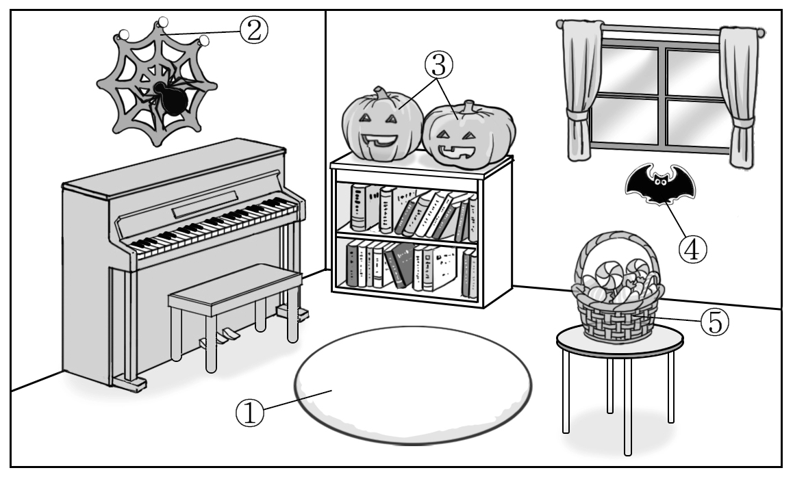

고 2 2021학년도 9월 고영어2 전국연합학력평가영역 문제지 11

# 영어

# 제 3 교시

1번부터 17번까지는 듣고 답하는 문제입니다. 1번부터 15번까지는 한 번만 들려주고, 16번부터 17번까지는 두 번 들려줍니다. 방송을 잘 듣고 답을 하시기 바랍니다.

1. 다음을 듣고, 남자가 하는 말의 목적으로 가장 적절한 것을 고르시오.
  - ① 학교 급식 일정 변경을 알리려고
  - ② 학교 식당 이용 시 주의 사항을 안내하려고
  - ③ 학교 급식 설문 조사 기간 연장을 공지하려고
  - ④ 설문 조사로 선정된 학교 급식 메뉴를 소개하려고
  - ⑤ 학교 급식 개선을 위한 토론회 참석을 요청하려고
2. 대화를 듣고, 여자의 의견으로 가장 적절한 것을 고르시오.
  - ① 꾸준한 독서는 집중력 향상에 효과적이다.
  - ② 학생의 연령에 맞는 도서 추천이 중요하다.
  - ③ 소설을 읽는 것은 공감 능력 향상에 도움이 된다.
  - ④ 학생의 흥미를 유발할 수 있는 독서 교육이 필요하다.
  - ⑤ 창의적인 글쓰기를 위해 다양한 주제의 소설을 읽어야 한다.
3. 대화를 듣고, 두 사람의 관계를 가장 잘 나타낸 것을 고르시오.

① 호텔 직원 – 투숙객	② 음반 제작자 – 밴드 연주자

③ 유치원 교사 – 학부모	④ 파티 플래너 – 의뢰인

⑤ 레크리에이션 강사 - 수강생

4. 대화를 듣고, 그림에서 대화의 내용과 일치하지 <u>않는</u> 것을 고르시오.
5. 대화를 듣고, 여자가 남자에게 부탁한 일로 가장 적절한 것을 고르시오.

① 에어컨 수리 요청하기	② 야구 경기 티켓 구매하기

③ 주문한 음식 찾아오기	④ 박물관 투어 취소하기

⑤ 식사 장소 예약하기

6. 대화를 듣고, 여자가 지불할 금액을 고르시오.

① \$36 ② \$40 ③ \$45 ④ \$50 ⑤ \$63

# 영역

7. 대화를 듣고, 남자가 도서관에 갈 수 <u>없는</u> 이유를 고르시오.
  - ① 독서 토론을 위해 책을 읽어야 해서
  - ② 학생회 회의에 참석해야 해서
  - ③ 병원 진료를 받아야 해서
  - ④ 동아리 면접을 준비해야 해서
  - ⑤ 말하기 대회 대본을 작성해야 해서
8. 대화를 듣고, Electronics Fair에 관해 언급되지 <u>않은</u> 것을 고르시오.

① 프로그램	② 장소	③ 종료일

④ 참가 업체	⑤ 티켓 가격

9. Jump and Grow Together에 관한 다음 내용을 듣고, 일치하지 <u>않는</u> 것을 고르시오.
  - ① 신입생 11명으로 팀을 구성해야 한다.
  - ② 각 팀은 세 번의 점프 기회를 갖는다.
  - ③ 10월 첫 번째 토요일에 열린다.
  - ④ 학교 체육관에서 개최된다.
  - ⑤ 행사 당일에 참가 신청이 가능하다.
10. 다음 표를 보면서 대화를 듣고, 여자가 구입할 Monitor Stand를 고르시오.

Monitor Stand

|  | Model | Price | Material | Storage Drawer | USB Ports |
| --- | --- | --- | --- | --- | --- |
| ① | A | \$ 20 | Plastic | ○ | 2 |
| ② | B | \$ 23 | Metal | × | 2 |
| ③ | C | \$ 25 | Metal | × | 3 |
| ④ | D | \$ 28 | Metal | ○ | 3 |
| ⑤ | E | \$ 35 | Plastic | ○ | 4 |

11. 대화를 듣고, 남자의 마지막 말에 대한 여자의 응답으로 가장 적절한 것을 고르시오.
  - ① Too bad. When did you break your watch?
  - ② Sorry. I couldn’t join the meeting yesterday.
  - ③ Exactly. Should we go back to work right now?
  - ④ Thanks. It was a good opportunity to learn more.
  - ⑤ Sure. Why don’t we go out to get some fresh air?
12. 대화를 듣고, 여자의 마지막 말에 대한 남자의 응답으로 가장 적절한 것을 고르시오.
  - ① We don’t always need a car to travel.
  - ② That’s why I practiced a lot this time.
  - ③ I’m glad you didn’t get stuck in traffic.
  - ④ Make sure to arrive on time for your test.
  - ⑤ I forgot my identification card for the test.

13. 대화를 듣고, 남자의 마지막 말에 대한 여자의 응답으로 가장 적절한 것을 고르시오. [3점]

Woman:

- ① No thanks. I can make my own infographics.
  - ② Of course. I’ll send it to you right away.
  - ③ Sorry. I forgot to download it yesterday.
  - ④ I see. You mean the shorter, the better.
  - ⑤ Okay. I’ll put the graph onto this page.
14. 대화를 듣고, 여자의 마지막 말에 대한 남자의 응답으로 가장 적절한 것을 고르시오. [3점]

Man:

- ① You should have taken more pictures at the top.
  - ② I would have regretted it if I’d missed this view.
  - ③ The trail is flat enough to hike without equipment.
  - ④ The original plan is important, but safety comes first.
  - ⑤ I’ve done this hike before, so I know it isn’t dangerous.
15. 다음 상황 설명을 듣고, Amanda가 Natalie에게 할 말로 가장 적절한 것을 고르시오. [3점]

Amanda:

- ① It’s dangerous to use headphones while riding a scooter.
  - ② I think you should check your scooter regularly.
  - ③ Walking to school is better for your health.
  - ④ A license is required to ride an electric scooter.
  - ⑤ Turning up music might distract you from studying.

### [16\~17] 다음을 듣고, 물음에 답하시오.

16. 남자가 하는 말의 주제로 가장 적절한 것은?
  - ① animals’ abilities to count
  - ② reasons for animals’ migrating
  - ③ hunting habits of wild animals
  - ④ necessity of protecting animal rights
  - ⑤ ways to conserve endangered animals
17. 언급된 동물이 <u>아닌</u> 것은?

① wolves	② frogs

④ snakes	⑤ desert ants

③ chickens

이제 듣기 문제가 끝났습니다. 18번부터는 문제지의 지시에 따라 답을 하시기 바랍니다.

18. 다음 글의 목적으로 가장 적절한 것은?

Dear parents and students of Douglas School,

As you know, our school was built over 150 years ago.

While we are proud of our school’s history, the facilities are

not exactly what they should be for modern schooling. Thanks

to a generous donation to the school foundation, we will be

able to start renovating those parts of our campus that have

become outdated. We hope this will help provide our students

with the best education possible. I’m writing to inform you

that the auditorium will be the first building closed for repairs.

Students will not be able to use the auditorium for about one

month while the repairs are taking place. We hope that you

will understand how this brief inconvenience will encourage

communitywide benefits for years to come.

Sincerely,

Vice Principal Kyla Andrews

- ① 수리로 인한 강당 폐쇄를 안내하려고
  - ② 캠퍼스 투어 프로그램 일정을 조정하려고
  - ③ 강당 사용을 위한 신청 방법을 공지하려고
  - ④ 강당 신축을 위한 기금 모금 행사를 홍보하려고
  - ⑤ 집짓기 행사에 참여할 자원 봉사자를 모집하려고
19. 다음 글에 드러난 Evan의 심경으로 가장 적절한 것은?

Evan’s eyes opened wide and his mouth made the shape of an O, which happened whenever something surprised him. “You don’t mean we’re leaving Sydney?” he asked. His mother had just told him they were leaving Sydney for his father’s work. “But what about school?” said Evan, interrupting her, a thing he knew he was not supposed to do but which he felt he would be forgiven for on this occasion. “And what about Carl and Daniel and Martin? How will they know where I am when we want to do things together?” His mother told him that he would have to say goodbye to his friends for the time being but that she was sure Evan would see them again. “Say goodbye to them? Say goodbye to them?” He kept repeating himself, sounding more and more anxious with every repetition.

① shocked and worried	② excited and pleased

③ grateful and relieved	④ bored and indifferent

⑤ jealous and envious

20. 다음 글에서 필자가 주장하는 바로 가장 적절한 것은?

Without guidance from their teacher, students will not embark on a journey of personal development that recognizes the value of cooperation. Left to their own devices, they will instinctively become increasingly competitive with each other. They will compare scores, reports, and feedback within the classroom environment ― just as they do in the sporting arena. We don’t need to teach our students about winners and losers. The playground and the media do that for them. However, we do need to teach them that there is more to life than winning and about the skills they need for successful cooperation. A group working together successfully requires individuals with a multitude of social skills, as well as a high level of interpersonal awareness. While some students inherently bring a natural understanding of these skills with them, they are always in the minority. To bring cooperation between peers into your classroom, you need to teach these skills consciously and carefully, and nurture them continuously throughout the school years.

- ① 학생의 참여가 활발한 수업 방법을 개발해야 한다.
  - ② 학생에게 성공적인 협동을 위한 기술을 가르쳐야 한다.
  - ③ 학생의 의견을 존중하는 학교 분위기를 조성해야 한다.
  - ④ 학생의 전인적 발달을 위해 체육활동을 강화해야 한다.
  - ⑤ 정보를 올바르게 선별하도록 미디어 교육을 실시해야 한다.
21. 밑줄 친 <u>bringing together contradictory characteristics</u>가 다음 글에서 의미하는 바로 가장 적절한 것은?

The creative team exhibits paradoxical characteristics. It shows tendencies of thought and action that we’d assume to be mutually exclusive or contradictory. For example, to do its best work, a team needs deep knowledge of subjects relevant to the problem it’s trying to solve, and a mastery of the processes involved. But at the same time, the team needs fresh perspectives that are unencumbered by the prevailing wisdom or established ways of doing things. Often called a “beginner’s mind,” this is the newcomers’ perspective: people who are curious, even playful, and willing to ask anything — no matter how naive the question may seem — because they don’t know what they don’t know. Thus, <u>bringing together contradictory characteristics</u> can accelerate the process of new ideas.

\* unencumbered: 방해 없는

- ① establishing shortterm and longterm goals
  - ② performing both challenging and easy tasks
  - ③ adopting temporary and permanent solutions
  - ④ utilizing aspects of both experts and rookies
  - ⑤ considering processes and results simultaneously
22. 다음 글의 요지로 가장 적절한 것은?

Too many officials in troubled cities wrongly imagine that they can lead their city back to its former glories with some massive construction project ― a new stadium or light rail system, a convention center, or a housing project. With very few exceptions, no public policy can slow the tidal forces of urban change. We mustn’t ignore the needs of the poor people who live in the Rust Belt, but public policy should help poor people, not poor places. Shiny new real estate may dress up a declining city, but it doesn’t solve its underlying problems. The hallmark of declining cities is that they have too much housing and infrastructure relative to the strength of their economies. With all that supply of structure and so little demand, it makes no sense to use public money to build more supply. The folly of building - centric urban renewal reminds us that cities aren’t structures; cities are people.

- ① 도시 재생을 위한 공공정책은 건설보다 사람에 중점을 두어야 한다.
  - ② 대중 교통 이용이 편리하도록 도시 교통 체계를 구축해야 한다.
  - ③ 사회기반시설 확충을 통해 지역 경제를 활성화해야 한다.
  - ④ 에너지를 절감할 수 있는 친환경 건물을 설계해야 한다.
  - ⑤ 문화유산 보존을 우선하는 도시 계획을 수립해야 한다.
23. 다음 글의 주제로 가장 적절한 것은?

Many marine species including oysters, marsh grasses, and fish were deliberately introduced for food or for erosion control, with little knowledge of the impacts they could have. Fish and shellfish have been intentionally introduced all over the world for aquaculture, providing food and jobs, but they can escape and become a threat to native species, ecosystem function, or livelihoods. Atlantic salmon are reared in ocean netpens in Washington State and British Columbia. Many escape each year, and they have been recovered in both saltwater and freshwater in Washington State, British Columbia, and Alaska. Recreational fishing can also spread invasive species. Bait worms from Maine are popular throughout the country. They are commonly packed in seaweed which contains many other organisms. If the seaweed is discarded, it or the organisms on it can colonize new areas. Fishing boots, recreational boats, and trailers can pick up organisms at one location and move them elsewhere.

\* aquaculture: 양식(업)

- ① benefits of recreational ocean fishing
  - ② ways to maintain marine biodiversity
  - ③ potential value of the ocean for ecotourism
  - ④ contribution of ocean farming to food supply
  - ⑤ human influence on the spread of invasive species
24. 다음 글의 제목으로 가장 적절한 것은?

Before the fancy high - rises, financial headquarters, tourist centers, and souvenir peddlers made their way to Battery Park City, the area behind the World Trade Center was a giant, gross landfill. In 1982, artist Agnes Denes decided to return that landfill back to its roots, although temporarily. Denes was commissioned by the Public Art Fund to create one of the most significant and fantastical pieces of public work Manhattan has ever seen. Her concept was not a traditional sculpture, but a living installation that changed the way the public looked at art. In the name of art, Denes put a beautiful golden wheat field right in the shadow of the gleaming Twin Towers. For Wheatfield — A Confrontation, Denes and volunteers removed trash from four acres of land, then planted amber waves of grain atop the area. After months of farming and irrigation, the wheat field was thriving and ready. The artist and her volunteers harvested thousands of pounds of wheat to give to food banks in the city, nourishing both the minds and bodies of New Yorkers.

- ① Living Public Art Grows from a Landfill
  - ② Why Does Art Fade Away in Urban Areas?
  - ③ New York: Skyscraper Capital of the World
  - ④ Art Narrows the Gap Between the Old and Young
  - ⑤ How City Expansion Could Affect Food Production
25. 다음 도표의 내용과 일치하지 <u>않는</u> 것은?

The Number of Korean and Foreign Visitors to Korean Palaces

Changgyeonggung Palace Deoksugung Palace

(in thousands) (in thousands)

<table>
<tr><th></th><th>Korean</th><th>Foreign</th><th>Total</th><th></th><th></th><th>Korean</th><th>Foreign</th><th>Total</th></tr>
<tr><td>2018</td><td>1,716</td><td>345</td><td>2,061</td><td></td><td>2018</td><td>767</td><td>77</td><td>844</td></tr>
<tr><td>2019</td><td>874</td><td>94</td><td>968</td><td></td><td>2019</td><td>2,414</td><td>369</td><td>2,783</td></tr>
<tr><td colspan="3">Overall Total</td><td>3,029</td><td></td><td colspan="3">Overall Total</td><td>3,627</td></tr>
</table>

※ Note: Details may not add to totals due to rounding.

The tables above show the number of Korean and foreign visitors to Korean palaces in 2018 and 2019. ① For the twoyear period of 2018 to 2019, the overall total number of visitors to Deoksugung Palace was larger than that to Changgyeonggung Palace. ② While the total number of visitors to Changgyeonggung Palace decreased from 2018 to 2019, the total number of visitors to Deoksugung Palace increased during the same period. ③ During both 2018 and 2019, the two palaces had more Korean visitors than foreign visitors. ④ In 2018, the number of Korean visitors to Deoksugung Palace was less than half the number of Korean visitors to Changgyeonggung Palace. ⑤ In 2019, the number of Korean visitors to Changgyeonggung Palace was more than 10 times the number of foreign visitors.

26. Patricia Bath에 관한 다음 글의 내용과 일치하지 <u>않는</u> 것은?

Patricia Bath spent her life advocating for eye health. Born in 1942, she was raised in the Harlem area of New York City. She graduated from Howard University’s College of Medicine in 1968. It was during her time as a medical intern that she saw that many poor people and Black people were becoming blind because of the lack of eye care. She decided to concentrate on ophthalmology, which is the branch of medicine that works with eye diseases and disorders. As her career progressed, Bath taught students in medical schools and trained other doctors. In 1976, she cofounded the American Institute for the Prevention of Blindness (AiPB) with the basic principle that “eyesight is a basic human right.” In the 1980s, Bath began researching the use of lasers in eye treatments. Her research led to her becoming the first AfricanAmerican female doctor to receive a patent for a medical device.

- ① 뉴욕 시의 Harlem 지역에서 성장했다.
  - ② 1968년에 의과 대학을 졸업했다.
  - ③ 의과 대학에서 학생을 가르쳤다.
  - ④ 1976년에 AiPB를 단독으로 설립했다.
  - ⑤ 의료 장비 특허를 받았다.
27. Bright Future Walkathon에 관한 다음 안내문의 내용과 일치하지 <u>않는</u> 것은?

Bright Future Walkathon

Sunny Side Foundation is hosting the annual Bright Future Walkathon in support of people in need.

## Date & Place

․ Date: Saturday, September 25th (Start Time: 9:00 a.m.)

․ Place: Green Brook Park

Registration

․ Fee: \$10

․ All registration fees will be donated to local charities.

․ Register online at www.ssfwalkathon.com.

Course (Choose one)

․ Course A: 3 km (all ages welcome)

․ Course B: 5 km (for ages 15 and older)

## Details

․ Each participant who completes the course will receive a Tshirt.

․ No refund will be made for cancellations.

- ① 오전 9시에 시작한다.
- ② 모든 등록비는 기부될 것이다.
- ③ B 코스는 15세 이상 참가자가 선택할 수 있다.
- ④ 코스를 완주한 참가자는 티셔츠를 받는다.
- ⑤ 취소 시 환불이 가능하다.
28. South High School Reunion에 관한 다음 안내문의 내용과 일치하는 것은?

South High School Reunion

### Class of 2011

Don’t you miss your old friends from high school? Come meet them and remember your high school days!

◎ When & Where

- Saturday, November 6th, 2021 7:00 p.m. － 10:00 p.m.
- Bay Street Park

◎ Ticket Reservation (per person)

- Ticket price: \$40
- If you reserve by October 15th, the price will be \$30.
- Refunds will only be available until October 31st.

◎ Main Events

- Quiz Show: Answer 50 questions about our old buddies, teachers, and memories. The champion will receive two movie tickets.
- The barbecue party will start at 8:00 p.m.

◎ Notes

- Dress Code: Wear a red jacket to show your South High School spirit.
- Feel free to invite up to three friends.
- ① 오후 7시부터 오후 11시까지 진행된다.
- ② 11월 1일 이후에 티켓 환불이 가능하다.
- ③ 퀴즈 쇼 챔피언은 영화 티켓 두 장을 받는다.
- ④ 정해진 복장 규정은 없다.
- ⑤ 친구는 네 명까지 초대할 수 있다.
  1. 29\. 다음 글의 밑줄 친 부분 중, 어법상 <u>틀린</u> 것은? [3점]

Organisms living in the deep sea have adapted to the high pressure by storing water in their bodies, some ① <u>consisting</u> almost entirely of water. Most deepsea organisms lack gas bladders. They are coldblooded organisms that adjust their body temperature to their environment, allowing them

② <u>to survive</u> in the cold water while maintaining a low metabolism. Many species lower their metabolism so much that they are able to survive without food for long periods of time, as finding the sparse food ③ <u>that</u> is available expends a lot of energy. Many predatory fish of the deep sea are equipped with enormous mouths and sharp teeth, enabling them to hold on to prey and overpower ④ it. Some predators hunting in the residual light zone of the ocean ⑤ <u>has</u> excellent visual capabilities, while others are able to create their own light to attract prey or a mating partner.

\* bladder: (물고기의) 부레

30. 다음 글의 밑줄 친 부분 중, 문맥상 낱말의 쓰임이 적절하지 <u>않은</u> 것은? [3점]

Human innovation in agriculture has unlocked modifications in apples, tulips, and potatoes that never would have been realized through a plant’s natural reproductive cycles. This cultivation process has created some of the recognizable vegetables and fruits consumers look for in their grocery stores. However, relying on only a few varieties of cultivated crops can leave humankind ① <u>vulnerable</u> to starvation and agricultural loss if a harvest is destroyed. For example, a million people died over the course of three years during the Irish potato famine because the Irish relied

② primarily on potatoes and milk to create a nutritionally balanced meal. In order to continue its symbiotic relationship with cultivated plants, humanity must allow for biodiversity and recognize the potential ③ <u>benefits</u> that monocultures of plants can introduce. Planting seeds of all kinds, even if they don’t seem immediately useful or profitable, can ④ <u>ensure</u> the longevity of those plants for generations to come. A ⑤ <u>balance</u> must be struck between nature’s capacity for wildness and humanity’s desire for control.

\* symbiotic: 공생의

### [31\~34] 다음 빈칸에 들어갈 말로 가장 적절한 것을 고르시오.

31.	works as a general mechanism for the
mind, in many ways and across many different areas of life.
For example, Brian Wansink, author of Mindless Eating,
showed that it can also affect our waistlines. We decide how
much to eat not simply as a function of how much food we
actually consume, but by a comparison to its alternatives.
Say we have to choose between three burgers on a menu, at
8, 10, and 12 ounces. We are likely to pick the 10 - ounce
burger and be perfectly satisfied at the end of the meal. But
if our options are instead 10, 12, and 14 ounces, we are
likely again to choose the middle one, and again feel equally
happy and satisfied with the 12 - ounce burger at the end of
the meal, even though we ate more, which we did not need
in order to get our daily nourishment or in order to feel full.
① Originality	② Relativity
③ Visualization	④ Imitation

⑤ Forgetfulness

32. Philosophical activity is based on the	. The philosopher’s thirst for knowledge is shown through attempts to find better answers to questions even if those answers are never found. At the same time, a philosopher also knows that being too sure can hinder the discovery of other and better possibilities. In a philosophical dialogue, the participants are aware that there are things they do not know or understand. The goal of the dialogue is to arrive at a conception that one did not know or understand beforehand. In traditional schools, where philosophy is not present, students often work with factual questions, they learn specific content listed in the curriculum, and they are not required to solve philosophical problems. However, we know that awareness of what one does not know can be a good way to acquire knowledge. Knowledge and understanding are developed through thinking and talking. Putting things into words makes things clearer. Therefore, students must not be afraid of saying something wrong or talking without first being sure that they are right.
  - ① recognition of ignorance
  - ② emphasis on selfassurance
  - ③ conformity to established values
  - ④ achievements of ancient thinkers
  - ⑤ comprehension of natural phenomena
33. The most powerful emotional experiences are those that bring joy, inspiration, and the kind of love that makes suffering bearable. These emotional experiences are the result of choices and behaviors that result in our feeling happy. When we look at happiness through a spiritual filter, we realize that it does not mean the absence of pain or heartache. Sitting with a sick or injured child, every parent gets to know the profound joy that bubbles over when a son or daughter begins to heal. This is a simple example of how we can be flooded with happiness that becomes more intense as we contrast it with previous suffering. Experiences such as this go into the chemical archives of the limbic system. Each time you experience true happiness, the stored emotions are activated as you are flooded with even deeper joy than you remembered. Your spiritual genes are, in a sense,	. [3점]

\* limbic system: 변연계(인체의 기본적인 감정·욕구 등을 관장하는 신경계)

- ① your biological treasure map to joy
  - ② your hidden key to lasting friendships
  - ③ a mirror showing your unique personality
  - ④ a facilitator for communication with others
  - ⑤ a barrier to looking back to your joyful childhood
34. Deep - fried foods are tastier than bland foods, and children and adults develop a taste for such foods. Fatty foods cause the brain to release oxytocin, a powerful hormone with a calming, antistress, and relaxing influence, said to be the opposite of adrenaline, into the blood stream; hence the term “comfort foods.” We may even be genetically programmed to eat too much. For thousands of years, food was very scarce. Food, along with salt, carbs, and fat, was hard to get, and the more you got, the better. All of these things are necessary nutrients in the human diet, and when their availability was limited, you could never get too much. People also had to hunt down animals or gather plants for their food, and that took a lot of calories. It’s different these days. We have food at every turn ― lots of those fast - food places and grocery stores with carry - out food. But that ingrained “caveman mentality” says that we can’t ever get too much to eat. So craving for “unhealthy” food may . [3점]
  - ① actually be our body’s attempt to stay healthy
  - ② ultimately lead to harm to the ecosystem
  - ③ dramatically reduce our overall appetite
  - ④ simply be the result of a modern lifestyle
  - ⑤ partly strengthen our preference for fresh food
35. 다음 글에서 전체 흐름과 관계 <u>없는</u> 문장은?

Nurses hold a pivotal position in the mental health care structure and are placed at the centre of the communication network, partly because of their high degree of contact with patients, but also because they have welldeveloped

relationships with other professionals. ① Because of this, nurses play a crucial role in interdisciplinary communication.

② They have a mediating role between the various groups of professionals and the patient and carer. ③ Mental healthcare professionals are legally bound to protect the privacy of their patients, so they may be, rather than unwilling, unable to talk about care needs. ④ This involves translating communication between groups into language that is acceptable and comprehensible to people who have different ways of understanding mental health problems.

⑤ This is a highly sensitive and skilled task, requiring a high level of attention to alternative views and a high level of understanding of communication.

### [36\~37] 주어진 글 다음에 이어질 글의 순서로 가장 적절한 것을 고르시오.

36.

When trying to sustain an independent ethos, cultures face a problem of critical mass. No single individual, acting on his or her own, can produce an ethos.

(A) They manage this feat through a combination of trade, to support their way of life, and geographic isolation. The Inuit occupy remote territory, removed from major population centers of Canada. If cross - cultural contact were to become sufficiently close, the Inuit ethos would disappear.

(B) Rather, an ethos results from the interdependent acts of many individuals. This cluster of produced meaning may require some degree of insulation from larger and wealthier outside forces. The Canadian Inuit maintain their own ethos, even though they number no more than twenty - four thousand.

(C) Distinct cultural groups of similar size do not, in the long run, persist in downtown Toronto, Canada, where they come in contact with many outside influences and pursue essentially Western paths for their lives. [3점]

\* ethos: 민족(사회) 정신 \*\* insulation: 단절

① (A) - (C) - (B)	② (B) - (A) - (C)

③ (B) - (C) - (A)	④ (C) - (A) - (B)

⑤ (C) - (B) - (A)

37.

Heat is lost at the surface, so the more surface area you have relative to volume, the harder you must work to stay warm. That means that little creatures have to produce heat more rapidly than large creatures.

(A) Despite the vast differences in heart rates, nearly all mammals have about 800 million heartbeats in them if they live an average life. The exception is humans. We pass 800 million heartbeats after twentyfive years, and just keep on going for another fifty years and 1.6 billion heartbeats or so.

(B) They must therefore lead completely different lifestyles. An elephant’s heart beats just thirty times a minute, a human’s sixty, a cow’s between fifty and eighty, but a mouse’s beats six hundred times a minute — ten times a second. Every day, just to survive, the mouse must eat about 50 percent of its own body weight.

(C) We humans, by contrast, need to consume only about 2 percent of our body weight to supply our energy requirements. One area where animals are curiously uniform is with the number of heartbeats they have in a lifetime. [3점]

① (A) - (C) - (B)

③ (B) - (C) - (A)

⑤ (C) - (B) - (A)

② (B) - (A) - (C)

④ (C) - (A) - (B)

### [38\~39] 글의 흐름으로 보아, 주어진 문장이 들어가기에 가장 적절한 곳을 고르시오.

38.

It is possible to argue, for example, that, today, the influence of books is vastly overshadowed by that of television.

Interest in ideology in children’s literature arises from a belief that children’s literary texts are culturally formative, and of massive importance educationally, intellectually, and socially. ( ① ) Perhaps more than any other texts, they reflect society as it wishes to be, as it wishes to be seen, and as it unconsciously reveals itself to be, at least to writers. ( ② ) Clearly, literature is not the only socialising agent in the life of children, even among the media. ( ③ ) There is, however, a considerable degree of interaction between the two media. ( ④ ) Many so - called children’s literary classics are televised, and the resultant new book editions strongly suggest that viewing can encourage subsequent reading. ( ⑤ ) Similarly, some television series for children are published in book form.

\* resultant: 그 결과로 생긴

39.

There isn’t really a way for us to pick up smaller pieces of debris such as bits of paint and metal.

The United Nations asks that all companies remove their satellites from orbit within 25 years after the end of their mission. This is tricky to enforce, though, because satellites can (and often do) fail. ( ① ) To tackle this problem, several companies around the world have come up with novel solutions. ( ② ) These include removing dead satellites from orbit and dragging them back into the atmosphere, where they will burn up. ( ③ ) Ways we could do this include using a harpoon to grab a satellite, catching it in a huge net, using magnets to grab it, or even firing lasers to heat up the satellite, increasing its atmospheric drag so that it falls out of orbit. ( ④ ) However, these methods are only useful for large satellites orbiting Earth. ( ⑤ ) We just have to wait for them to naturally re - enter Earth’s atmosphere. [3점]

\* harpoon: 작살

40. 다음 글의 내용을 한 문장으로 요약하고자 한다. 빈칸 (A), (B)에 들어갈 말로 가장 적절한 것은?

Music is used to mold customer experience and behavior. A study was conducted that explored what impact it has on employees. Results from the study indicate that participants who listen to rhythmic music were inclined to cooperate more irrespective of factors like age, gender, and academic background, compared to those who listened to less rhythmic music. This positive boost in the participants’ willingness to cooperate was induced regardless of whether they liked the music or not. When people are in a more positive state of mind, they tend to become more agreeable and creative, while those on the opposite spectrum tend to focus on their individual problems rather than giving attention to solving group problems. The rhythm of music has a strong pull on people’s behavior. This is because when people listen to music with a steady pulse, they tend to match their actions to the beat. This translates to better teamwork when making decisions because everyone is following one tempo.

↓

According to the study, the music played in workplaces can lead employees to be <u>(A)</u>	because the beat of the music creates a <u>(B)</u>	for working.

(A) (B)

① uncomfortable …… competitive mood

② cooperative …… shared rhythm

③ distracted …… shared rhythm

④ attentive …… competitive mood

⑤ indifferent …… disturbing pattern

### [41\~42] 다음 글을 읽고, 물음에 답하시오.

(B)

Disappointed, they returned home, tears rolling down Melanie’s cheeks. With her confidence and ego hurt, Melanie never danced again. (b) <u>She</u> completed her studies and became a schoolteacher. One day, the ballet instructor at her school was running late, and Melanie was asked to keep an eye on the class so that they wouldn’t roam around the school. Once inside the ballet room, she couldn’t control herself. She taught the students some steps and kept on dancing for some time. Unaware of time or the people around her, (c) <u>she</u> was lost in her own little world of dancing.
In this day and age, it is difficult to imagine our lives without email. But how often do we consider the environmental impact of these virtual messages? At first glance, digital messages appear to (a) <u>save</u> resources. Unlike traditional letters, no paper or stamps are needed; nothing has to be packaged or transported. Many of us tend to assume that using email requires little more than the electricity used to power our computers. It’s easy to (b) <u>overlook</u> the invisible energy usage involved in running the network ― particularly when it comes to sending and storing data. Every single email in every single inbox in the world is stored on a server. The incredible quantity of data requires huge server farms ― gigantic centres with millions of computers which store and transmit information. These servers consume (c) <u>minimum</u> amounts of energy, 24 hours a day, and require countless litres of water, or air conditioning systems, for cooling. The more messages we send, receive and store, the (d) <u>more</u> servers are needed ― which means more energy consumed, and more carbon emissions. Clearly, sending and receiving electronic messages in an environmentally conscious manner is by no means enough to stop climate change. But with a few careful, mindful changes, (e) <u>unnecessary</u> CO2 emissions can easily be avoided.

(C)

Just then, the ballet instructor entered the classroom and was surprised to see Melanie’s incredible skill. “What a performance!” the instructor said with a sparkle in her eyes. Melanie was embarrassed to see the instructor in front of her. “Sorry, Ma’am!” she said. “For what?” the instructor asked. “You are a true ballerina!” The instructor invited Melanie to accompany (d) <u>her</u> to a ballet training center, and Melanie has never stopped dancing since. Today, she is a world‑renowned ballet dancer.

(D)

The following day, Melanie accompanied her mother to a local dance institute. Upon meeting the dance teacher, Mr. Edler, her mother requested to admit Melanie to his institute. The teacher asked Melanie to audition. (e) <u>She</u> was happy and showed him some of her favorite dance steps. However, he wasn’t interested in her dance. He was busy with other tasks in the dance room. “You can leave now! The girl is just average. Don’t let her waste her time aspiring to be a dancer,” he said. Melanie and her mother were shocked to hear this.

43. 주어진 글 (A)에 이어질 내용을 순서에 맞게 배열한 것으로 가장 적절한 것은?

① (B) - (D) - (C)	② (C) - (B) - (D)

③ (C) - (D) - (B)	④ (D) - (B) - (C)

⑤ (D) - (C) - (B)

41. 윗글의 제목으로 가장 적절한 것은?
  - ① Recycling Makes Your Life Even Better
  - ② Eco-friendly Use of Email Saves the Earth
  - ③ Traditional Letters: The Bridge Between Us
  - ④ Email Servers: Records of Past and Present
  - ⑤ Technicians Looking for Alternative Energy
42. 밑줄 친 (a)\~(e) 중에서 문맥상 낱말의 쓰임이 적절하지 <u>않은</u>
것은?	44. 밑줄 친 (a)\~(e) 중에서 가리키는 대상이 나머지 넷과 <u>다른</u> 것은?
① (a)	② (b)	③ (c)	④ (d)	⑤ (e)	① (a)	② (b)	③ (c)	④ (d)	⑤ (e)
45. 윗글에 관한 내용으로 적절하지 <u>않은</u> 것은?
- ① 엄마는 Melanie가 발레리나의 열정을 가지고 춤추는 것을 보았다.
  - ② Melanie는 학생들에게 스텝을 가르쳤다.
  - ③ Melanie는 세계적으로 유명한 발레 댄서이다.
  - ④ Melanie는 지역 댄스 학원에 엄마와 동행했다.
  - ⑤ Mr. Edler는 Melanie의 춤에 관심을 보였다.

### [43\~45] 다음 글을 읽고, 물음에 답하시오. (A)

There once lived a girl named Melanie. She wanted to be a ballet dancer. One day, Melanie’s mother saw her dancing with the flawless steps and enthusiasm of a ballerina. “Isn’t it strange? Melanie is dancing so well without any formal training!” her mother said. “I must get (a) <u>her</u> professional lessons to help her polish her skill.”

\* 확인 사항

◦ 답안지의 해당란에 필요한 내용을 정확히 기입(표기)했는지 확인 하시오.