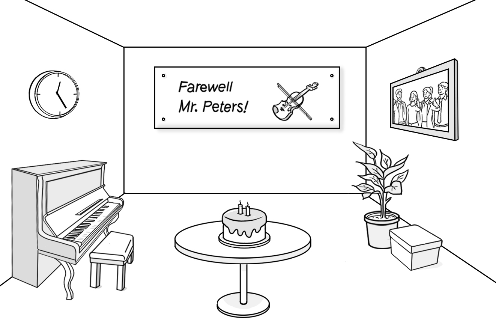
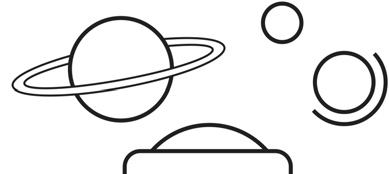
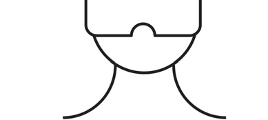

# 제 3 교시

# 2022학년도 4월 고3 전국연합학력평가 문제지

# 영어 영역

# 성명

# 수험 번호	3

# 겨울이 길면 봄은 더욱 따뜻하리

# 경기도교육청

2022학년도 4월 고3 전국연합학력평가 문제지

# 영어 영역

# 제 3 교시

1번부터 17번까지는 듣고 답하는 문제입니다. 1번부터 15번까지는 한 번만 들려주고, 16번부터 17번까지는 두 번 들려줍니다. 방송을 잘 듣고 답을 하시기 바랍니다.

1. 다음을 듣고, 여자가 하는 말의 목적으로 가장 적절한 것을 고르시오.
  - ① 자선 경매 행사를 위한 자원봉사자를 모집하려고
  - ② 지역 아동을 위한 자선 물품 기부를 독려하려고
  - ③ 봉사 활동 확인서 발급 절차를 안내하려고
  - ④ 아동 병원 설립의 필요성을 강조하려고
  - ⑤ 자원봉사 사전 교육 일정을 공지하려고
2. 대화를 듣고, 남자의 의견으로 가장 적절한 것을 고르시오.
  - ① 교사의 칭찬은 학생의 불안감을 낮출 수 있다.
  - ② 예술 교육은 학생의 사회성 발달을 촉진시킨다.
  - ③ 어휘를 배우는 것은 독해력 향상에 필수적이다.
  - ④ 노래는 학생이 어휘를 쉽게 기억하도록 도와준다.
  - ⑤ 음악 감상을 통해 학생의 창의력을 향상시킬 수 있다.
3. 대화를 듣고, 두 사람의 관계를 가장 잘 나타낸 것을 고르시오.

① 운전자 - 주차 관리 요원 ② 동물 보호소 직원 - 기부자

③ 인테리어 디자이너 - 의뢰인 ④ 건물 관리인 - 청소업체 직원

⑤ 애견용품 판매점 주인 - 손님

4. 대화를 듣고, 그림에서 대화의 내용과 일치하지 않는 것을 고르시오.

②

①

⑤

④

③

5. 대화를 듣고, 남자가 할 일로 가장 적절한 것을 고르시오.

① 테이블 설치하기

③ 포스터 제작하기

⑤ 무선 마이크 가져오기

② 스피커 점검하기

④ 배지 배송 확인하기

6. 대화를 듣고, 여자가 지불할 금액을 고르시오.

① \$108 ② \$110 ③ \$120 ④ \$162

⑤ \$180

1

7. 대화를 듣고, 남자가 영화를 보러 갈 수 없는 이유를 고르시오.
  - ① 면접 준비를 해야 해서
  - ② 아르바이트를 해야 해서
  - ③ 요가 수업을 들어야 해서
  - ④ 건강 검진을 받아야 해서
  - ⑤ 동아리 모임에 참석해야 해서
8. 대화를 듣고, Spring Walking Challenge에 관해 언급되지 않은 것을 고르시오.

① 운영 기간

④ 주최 기관

② 참가 대상

⑤ 신청 방법

③ 우승 상금

9. International Beatbox Championship에 관한 다음 내용을 듣고, 일치하지 않는 것을 고르시오.
  - ① 5월 10일부터 시작한다.
  - ② 단독 공연과 단체 공연이 있다.
  - ③ 전년도 우승자들이 심사 위원으로 참여한다.
  - ④ 결승전은 온라인으로 생중계된다.
  - ⑤ 표는 현장 구매가 가능하다.
10. 다음 표를 보면서 대화를 듣고, 두 사람이 대여할 정수기를 고르시오. Water Purifiers

| Product | Monthly Rental Fee | Hot Water | Filter Replacement | Color |
| --- | --- | --- | --- | --- |
| A | \$25 | X | self | black |
| B | \$30 | O | self | black |
| C | \$35 | O | self | white |
| D | \$38 | O | service visit | white |
| E | \$42 | X | service visit | gray |

- ①
- ②
- ③
- ④
- ⑤
  1. 11\. 대화를 듣고, 여자의 마지막 말에 대한 남자의 응답으로 가장 적절한 것을 고르시오.
- ① It wasn’t easy to discover my new hobby.
- ② I began taking drum lessons in middle school.
- ③ It was very hard to practice drums every day.
- ④ I brought them from my home for this festival.
- ⑤ I used to enjoy listening to modern rock music.
  1. 12\. 대화를 듣고, 남자의 마지막 말에 대한 여자의 응답으로 가장 적절한 것을 고르시오.
- ① No worries. His school grades will get better.
- ② Sure. I’ll adjust my schedule to join the event.
- ③ Wonderful. Your parents must be proud of you.
- ④ Hurry up. You’re really late for the school event.
- ⑤ Absolutely. I’m happy to invite your teacher here.

2

13. 대화를 듣고, 여자의 마지막 말에 대한 남자의 응답으로 가장 적절한 것을 고르시오. [3점]

Man:

- ① No problem. I can help him find his future career.
- ② I got it. I’ll send you the website about promising jobs.
- ③ Don’t worry. I won’t be late for the counseling next time.
- ④ Of course. I’ll keep the appointment with my homeroom teacher.
- ⑤ Thanks. I’ll check it out and book a meeting with the counselor.

# 영어 영역

14. 대화를 듣고, 남자의 마지막 말에 대한 여자의 응답으로 가장 적절한 것을 고르시오. [3점]

Woman:

- ① I’m sorry. I can’t imagine living without new technology.
  - ② Cheer up. You’ll find more information from digital resources.
  - ③ You get it. I’m sure it’ll help reduce your digital device usage.
  - ④ That makes sense. We’re more productive using smartphones.
  - ⑤ I agree. You can get more rest by giving up your painting time.
15. 다음 상황 설명을 듣고, Amy가 Terry에게 할 말로 가장 적절한 것을 고르시오. [3점]

Amy:

- ① We’ll do great since we’ve worked so hard.
  - ② I signed up for the contest, so don’t worry.
  - ③ We need more practice to win the dance contest.
  - ④ If you’re nervous, I’ll cancel the rehearsal for you.
  - ⑤ You should follow my moves to correct your mistakes.

[16 \~ 17] 다음을 듣고, 물음에 답하시오.

16. 남자가 하는 말의 주제로 가장 적절한 것은?
  - ① methods of obtaining nutrition by marine creatures
  - ② causes of dramatic decrease in sea animal populations
  - ③ ways for creatures in the ocean to protect themselves
  - ④ difficulties in observing ocean animals’ hunting patterns
  - ⑤ importance of adapting to new surroundings for sea creatures
17. 언급된 해양 생물이 아닌 것은?

① penguins

④ whales

② sea horses

⑤ oysters

③ jellyfish

이제 듣기 문제가 끝났습니다. 18번부터는 문제지의 지시에 따라 답을 하시기 바랍니다.

18. 다음 글의 목적으로 가장 적절한 것은?

To whom it may concern,

I sometimes travel to Summerland to visit friends. One of

the first landmarks to captivate me there years ago was the

Mackenzie-Brown House. Last week, I visited again after a

long time away, and I was shocked at the state of the house

― yard overgrown and stains on the beautiful walls. I am

particularly sensitive to historic sites falling into disrepair. I

certainly can’t understand why you have neglected such a

landmark, and I ask that you please restore the

Mackenzie-Brown House. I cannot imagine how heartbreaking

it must be for the residents of Summerland to witness the

decline of this historic building.

With kind regards,

Holly Bebernitz

- ① 역사적 건축물 견학 프로그램을 홍보하려고
  - ② 관광객 유치를 위한 아이디어를 제안하려고
  - ③ 지역의 역사적 건축물 복원을 요청하려고
  - ④ 박물관 보수 공사 일정 조정을 부탁하려고
  - ⑤ 유적지 관리 실태 조사 결과를 공유하려고
19. 다음 글에 드러난 Karim의 심경 변화로 가장 적절한 것은?

Karim was deep within the dense forest alone. He began to notice the strangeness of his surroundings. Scared, he hid under a tree, and he heard the “thump-thump” sound. Moments later, he saw a large elephant running toward him! He trembled uncontrollably and could hardly move. Suddenly, he remembered what he had read about elephants: Elephants are scared of loud noises. He also thought of the firecrackers in his pack. Quick as a flash, he lit them. The firecrackers burst with a loud noise, scaring away the elephant. Then, Karim ran away as fast as he could. By the time he reached his campsite, he was sure there was nothing dangerous around him. He could finally breathe easily. He put his hand on his chest, feeling his heartbeat slow back to its normal pace.

① hopeful → nervous	② fulfilled → regretful

③ jealous → satisfied	④ ashamed → grateful

⑤ terrified → relieved

20. 다음 글에서 필자가 주장하는 바로 가장 적절한 것은?

We try to avoid uncertainty by overanalyzing. But we don’t have complete control over how the future will play out. You may feel that if you can just answer your “worry question” once and for all, you will be satisfied and you can finally drop your rumination, but has this ever actually happened to you? Has there ever been an answer that allowed you to stop worrying? There is only one way out of this spiral, and that is not to try to gain control, but to give it up. Instead of pushing back against uncertainty, embrace it. Instead of trying to answer your worry question, deliberately practice leaving it unanswered. Don’t ask others and don’t think about it. Tell yourself that analysis is not the solution, but really just more of the same problem.

\* rumination: 반추(反芻) \*\* spiral: 소용돌이

- ① 분석을 통해 미래의 불확실성을 통제하기보다 수용해야 한다.
  - ② 타인에게 의존하기보다는 스스로 문제 해결력을 길러야 한다.
  - ③ 걱정을 유발하는 문제 상황을 객관적으로 판단해야 한다.
  - ④ 문제의 해결책을 찾기 전에 원인을 먼저 분석해야 한다.
  - ⑤ 만일의 상황에 대비하여 꼼꼼하게 계획을 세워야 한다.

23. 다음 글의 주제로 가장 적절한 것은?

3

By the start of the 16th century, the Renaissance movement had given birth to the Protestant Reformation and an era of profound religious change. The art of this period reflected the disruption caused by this shift. Appropriately named the Baroque, meaning irregular or distorted, European painting in the 16th century largely focused on capturing motion, drama, action, and powerful emotion. Painters employed the strong visual tools of dramatic composition, intense contrast of light and dark, and emotionally provocative subject matter to stir up feelings of disruption. Religious subjects were often portrayed in this era through new dramatic visual language, a contrast to the reverential portrayal of religious figures in earlier traditions. In order to capture the social disruption surrounding Christianity and the Roman Catholic Church, many artists abandoned old standards of visual perfection from the Classical and Renaissance periods in their portrayal of religious figures.

\* Protestant Reformation: 종교 개혁 \*\* reverential: 경건한

- ① characteristics of Baroque paintings caused by religious disruption
  - ② impacts of the Baroque on the development of visual perfectionism
  - ③ efforts of Baroque painters to imitate the Renaissance style
  - ④ roles of Baroque artists in stabilizing the disrupted society
  - ⑤ reasons of idealizing religious figures in Baroque paintings

# 영어 영역

21. 밑줄 친 news ‘happens’가 다음 글에서 의미하는 바로 가장 적절한 것은? [3점]

Journalists love to report studies that are at the “initial findings” stages — research that claims to be the first time anyone has discovered a thing — because there is newsworthiness in their novelty. But “first ever” discoveries are extremely vulnerable to becoming undermined by subsequent research. When that happens, the news media often don’t go back and inform their audiences about the change — assuming they even hear about it. Kelly Crowe, a CBC News reporter writes, quoting one epidemiologist, “There is increasing concern that in modern research, false findings may be the majority or even the vast majority of published research claims.” She goes on to suggest that journalists, though blameworthy for this tendency, are aided and abetted by the scientists whose studies they cite. She writes that the “conclusions” sections in scientific abstracts can sometimes be overstated in an attempt to draw attention from prestigious academic journals and media who uncritically take their bait. Even so, Crowe ends her piece by stressing that there is still an incompatibility between the purposes and processes of news and science: Science ‘evolves,’ <u>but news ‘happens.’</u>

\* epidemiologist: 전염병학자 \*\* aid and abet: 방조하다

- ① News follows the process of research more than the outcome.
  - ② News focuses not on how research changes but on the novelty of it.
  - ③ News attracts attention by criticizing false scientific discoveries.
  - ④ Reporters give instant feedback to their viewers, unlike scientists.
  - ⑤ Reporters create and strengthen trust in the importance of science.
22. 다음 글의 요지로 가장 적절한 것은?

To overcome death as the obstacle that was hindering the evolution of human intelligence, our ancestors developed the killer app that propelled our species forward, ahead of all others: namely, spoken and written language in words and maths. I believe communication was, and still is, our most valuable invention. It has helped us preserve the knowledge, learning, discoveries and intelligence we have gained and pass them on from person to person and from generation to generation. Imagine if Einstein had had no way of telling the rest of us about his remarkable understanding of the theory of relativity. In the absence of our incredible abilities to communicate, each and every one of us would need to discover relativity on his or her own. Leaps of human intelligence have happened, then, as a response to the way human society and culture developed. A lot of our intelligence resulted from our interaction with each other, and not just in response to our environments.

- ① 인간의 언어는 환경과의 상호 작용을 통해 발달한다.
  - ② 인간의 지능 발달은 상호 간 의사소통의 결과물이다.
  - ③ 과학의 발전은 인간 사회의 문화 보존에 필수적이다.
  - ④ 언어의 변화가 세대 간 의사소통의 단절을 초래한다.
  - ⑤ 기술에 대한 의존이 인간의 학습 능력 발달을 저해한다.
24. 다음 글의 제목으로 가장 적절한 것은?

Chimpanzees are known to hunt and eat red colobus monkeys. Although a solo male typically initiates a hunt, others often join in, and hunting success is much higher when chimps hunt as a group rather than individually. During the hunt, chimpanzees adopt different roles: one male might flush the monkeys from their refuge, while another blocks the escape route. Somewhere else, an ambusher hides, ready to make his deadly move. Although this sounds a lot like teamwork, recent work offers a simpler interpretation. Chimps are more likely to join others for hunts because larger hunting groups increase each individual’s chance of catching a monkey — they aren’t interested in collective goals. The appearance of specialised roles in the hunt may also be an illusion: a simpler explanation is that each chimp places himself where his own chance of catching a monkey is highest, relative to the positions the others have already taken. Collaboration in chimps seems to emerge from an ‘every chimp for himself’ mentality.

\* refuge: 은신처 \*\* ambusher: 복병

- ① Chimps’ Group Hunt: It’s All about Myself, Not Ourselves
  - ② Obstacles to Chimps in Assigning Roles for Group Hunting
  - ③ How One Selfish Chimp Can Ruin a Cooperative Group Hunt
  - ④ Hunting in Concert with Other Chimps Determines Social Status!
  - ⑤ Which Are Better Hunters, Cooperative or Competitive Chimps?

4

25. 다음 표의 내용과 일치하지 않는 것은?

New Cars in the EU by Fuel Type in 2018 and in 2020

# 영어 영역

<table>
<tr><th rowspan="2">Type</th><th colspan="2">Share of New Cars (%)</th><th rowspan="2">Gap (B-A)</th></tr>
<tr><td>2018 (A)</td><td>2020 (B)</td></tr>
<tr><td>Gasoline</td><td>55.6</td><td>47.5</td><td>-8.1</td></tr>
<tr><td>Diesel</td><td>36.7</td><td>28</td><td>-8.7</td></tr>
<tr><td>Hybrid Electric</td><td>4</td><td>11.9</td><td>7.9</td></tr>
<tr><td>Alternative Fuels</td><td>1.8</td><td>2.1</td><td>0.3</td></tr>
<tr><td>Battery Electric</td><td>1</td><td>5.4</td><td>4.4</td></tr>
<tr><td>Plug-in Hybrid</td><td>0.9</td><td>5.1</td><td>4.2</td></tr>
</table>

The table above shows the share of new cars in the EU by fuel type in 2018 and in 2020. ① Compared to 2018, the share of both gasoline and diesel cars decreased in 2020. ② However, gasoline cars still held the largest share of new cars in 2020, followed by diesel vehicles, which made up more than a quarter of new cars in the same year. ③ Hybrid electric cars increased by 7.9 percentage points in the share of new cars from 2018 to 2020. ④ In 2018, the share of new cars powered by alternative fuels was larger than that of battery electric cars, but in 2020, the share of battery electric cars was more than twice that of cars using alternative fuels. ⑤ Plug-in hybrid vehicles were the only type of vehicle which accounted for less than 1% of new cars in 2018, and their share remained the smallest among all types of vehicle in 2020.

26. Antonia Brico에 관한 다음 글의 내용과 일치하지 않는 것은?

Antonia Brico was born in the Netherlands in 1902 and immigrated to the United States at the age of six. After attending a park concert when she was young, she was so inspired that she made up her mind to study music and become a conductor. In 1927, she entered the Berlin State Academy of Music and became the first American to graduate from its master class in conducting. In 1930, Brico made her debut as a professional conductor, for which she received positive reviews. She made an extensive European tour, and during the tour she was invited by Jean Sibelius to conduct the Helsinki Symphony Orchestra. Brico settled in Denver, where she continued to work as a conductor of the Denver Businessmen’s Orchestra, later renamed the Brico Symphony Orchestra. In 1974, her most famous student, folk singer Judy Collins, made a documentary film about her, which was nominated for an Academy Award.

- ① 네덜란드에서 태어나 6살에 미국으로 이주했다.
  - ② 공원 콘서트에 참석한 후 지휘자가 되기로 결심했다.
  - ③ 전문 지휘자로서의 데뷔에서 부정적인 평가를 받았다.
  - ④ Denver에 정착해서 지휘자로 계속 일했다.
  - ⑤ 그녀에 관한 영화가 아카데미상 후보에 올랐다.
27. Summer Metaverse Course에 관한 다음 안내문의 내용과 일치하지 않는 것은?

Summer Metaverse Course

Fairview Public Library is offering a four-week summer metaverse course for high school students who want to learn about and experience the metaverse.

When: Every Saturday for four weeks from June 4, 2022 (1:00 p.m. - 3:00 p.m.)

Where: Fairview Public Library Computer Room

Class Contents

- · Week 1: What is the metaverse?
- · Week 2: Experiencing virtual reality
- · Week 3: Creating the metaverse
- · Week 4: Future of the metaverse

Registration

- · Registration fee is \$50.
- · The deadline for registration is May 28.

Note

- · A permission form signed by a parent or guardian must be submitted to the library in person.
- · Participants who attend all classes will receive a certificate of completion.

For more information, please visit our website www.fairviewpubliclibrary.org.

- ① 고등학생을 위한 강좌이다.
  - ② 4주간 토요일마다 2시간씩 운영된다.
  - ③ 등록 마감일은 5월 28일이다.
  - ④ 보호자가 서명한 허가서를 온라인으로 제출해야 한다.
  - ⑤ 모든 수업에 참석하면 수료증을 받는다.
28. Bow Wow School for Dogs에 관한 다음 안내문의 내용과 일치하는 것은?

Bow Wow School for Dogs

Are you looking for a place where your dog can play, learn, and socialize? Then bring your dog to Bow Wow School for Dogs. Hours: 9:00 a.m. to 5:00 p.m. (closed on weekends)

Location: 197 Herford Ave, Cornwall

Age of dog: 6 months and older

Programs

- · Group Activities: Socializing games, Ball time, Water play
- · Individual Training: Basic manners like toilet training and no-bite training

Registration

- · Tuition Fee: \$20 a day (Tax is not included.)
- · To register your dog at our school, vaccinate him/her in advance. Vaccination records must be provided.
- ※ Note: We provide snacks, but you’re always welcome to bring your dog’s own snacks.

Contact us at 811-333-7877 for more information.

- ① 주중과 주말에 모두 운영된다.
  - ② 기본예절 교육에 배변 훈련은 제공되지 않는다.
  - ③ 수업료에는 세금이 포함되어 있다.
  - ④ 개를 등록하려면 사전에 백신 접종을 시켜야 한다.
  - ⑤ 개의 개별 간식을 허용하지 않는다.

5

[31\~34] 다음 빈칸에 들어갈 말로 가장 적절한 것을 고르시오.

31. Not only was Eurasia by chance blessed with biological abundance, but the very	of the continent greatly promoted the spread of crops between distant regions. When the supercontinent Pangea fragmented, it was torn apart along rifts that just so happened to leave Eurasia as a broad landmass running in an east-west direction — the entire continent stretches more than a third of the way around the world, but mostly within a relatively narrow range of latitudes. As it is the latitude on the Earth that largely determines the climate and length of the growing season, crops domesticated in one part of Eurasia can be transplanted across the continent with only minimal need for adaptation to the new locale. Thus wheat cultivation spread readily from the uplands of Turkey throughout Mesopotamia, to Europe, and all the way round to India, for example. The twin continents of the Americas, by contrast, lie in a north-south direction. Here, the spreading of crops originally domesticated in one region to another led to a much harder process of re-adapting the plant species to different growing conditions. [3점]

\* fragment: 조각나다 \*\* rift: 갈라진 틈

① isolation

③ diversity

⑤ instability

② orientation

④ conservation

# 영어 영역

29. 다음 글의 밑줄 친 부분 중, 어법상 틀린 것은?

The actual problems with monopolies are caused by statism, not capitalism. Under a statist social system, taxes, subsidies, tariffs, and regulations often serve to protect existing large players in the marketplace. Those players often use crony tactics to retain or expand the protections: a new tariff preventing foreign competition, a subsidy making it harder for new players ① to compete with them, or a regulatory measure that a large company has the resources to comply with. Under a capitalist social system, on the other hand, the government has no say in how ② dominantly a company may become in its industry or how companies take over and merge with one another. Furthermore, a capitalist society doesn’t have rights-violating taxes, tariffs, subsidies, or regulations ③ favoring anybody nor does it have antitrust laws. Under capitalism, dominance can only be achieved by becoming really good at ④ what you’re doing. And to maintain dominance, you have to continue to stay ahead of the competition, which sees your dominance and profits as a sign ⑤ that there is money to be made by others as well.

\* statism: 국가 통제주의 \*\* crony: 정실(사사로운 정에 이끌리는 일) \*\*\* antitrust law: 독점 금지법

30. 다음 글의 밑줄 친 부분 중, 문맥상 낱말의 쓰임이 적절하지 않은 것은?

One of the most productive strategies to build customer relationships is to increase the firm’s share of customer rather than its market share. This strategy involves abandoning the old notions of ① acquiring new customers and increasing transactions to focus instead on more fully serving the needs of existing customers. Financial services are a great example of this. Most consumers purchase financial services from ② different firms. They bank at one institution, purchase insurance from another, and handle their investments elsewhere. To <u>③ solidify</u> this purchasing pattern, many companies now offer all of these services under one roof. For example, Regions Financial Corporation offers retail and commercial banking, trust, mortgage, and insurance products to customers in a network of more than 1,500 offices. The company tries to more fully serve the financial needs of its ④ current customers, thereby acquiring a larger share of each customer’s financial business. By creating these types of relationships, customers have ⑤ little incentive to seek out competitive firms to fulfill their financial services needs.

32. When you are born, your neocortex knows almost nothing. It doesn’t know any words, what buildings are like, how to use a computer, or what a door is and how it moves on hinges. It has to learn countless things. The overall structure of the neocortex is not random. Its size, the number of regions it has, and how they are connected together is largely determined by our genes. For example, genes determine what parts of the neocortex are connected to the eyes, what other parts are connected to the ears, and how those parts connect to each other. Therefore, we can say that the neocortex is structured at birth to see, hear, and even learn language. But it is also true that the neocortex doesn’t know what it will see, what it will hear, and what specific languages it might learn. We can think of the neocortex as starting life

but knowing nothing in particular. Through experience, it learns a rich and complicated model of the world.

\* neocortex: (대뇌의) 신피질

- ① having some built-in assumptions about the world
  - ② causing conflicts between genes and environments
  - ③ being able to efficiently reprocess prior knowledge
  - ④ controlling the structure and processing power of the brain
  - ⑤ fighting persistently against the determined world of genes

6

33. While early clocks marked only the hour or quarter-hour, by 1700 most clocks had acquired minute hands, and by 1800 second hands were standard. This unprecedented ability to measure time precisely	, which became a prime weapon of the Industrial Revolution. As the historian of technology Lewis Mumford argued, “the clock, not the steam engine, is the key-machine of the modern industrial age.” Soon factory workers were clocking in, filling out timesheets, and being punished for lateness. With time sliced into smaller and smaller periods, business owners could measure the speed of their workers down to the second, and gradually increase the pace of the production line. Workers who tried to reject this strict control by “going slow” were swiftly fired. The cruel power of the clock fed the growing culture of utilitarian efficiency, so brilliantly depicted by Charles Dickens in his 1854 novel Hard Times, where the office of Mr. Gradgrind contained “a deadly statistical clock in it, which measured every second with a beat like a rap upon a coffin-lid.” [3점]

\* rap: 두드림 \*\* coffin-lid: 관 뚜껑

- ① allowed workers to climb up the ladder of social class
  - ② liberated workers but imprisoned employers in a time trap
  - ③ found its most authoritarian expression in the factory clock
  - ④ veiled the violent nature and the discipline of measured time
  - ⑤ paved the way for workers to control manufacturing machines

# 영어 영역

34. Imagine some mutation appears which makes animals spontaneously die at the age of 50. This is unambiguously disadvantageous — but only very slightly so. More than 99 per cent of animals carrying this mutation will never experience its ill effects because they will die before it has a chance to act. This means that it’s pretty likely to remain in the population — not because it’s good, but because the ‘force of natural selection’ at such advanced ages is not strong enough to get rid of it. Conversely, if a mutation killed the animals at two years, striking them down when many could reasonably expect to still be alive and producing children, evolution would get rid of it very promptly: animals with the mutation would soon be outcompeted by those fortunate enough not to have it, because the force of natural selection is powerful in the years up to and including reproductive age. Thus, problematic mutations can accumulate, just so long as	. [3점]

\* mutation: 돌연변이

- ① the force of natural selection increases as animals get older
  - ② their accumulation is largely due to their evolutionary benefits
  - ③ evolution operates by suppressing reproductive success of animals
  - ④ animals can promptly compensate for the decline in their abilities
  - ⑤ they only affect animals after they’re old enough to have reproduced 6
35. 다음 글에서 전체 흐름과 관계 없는 문장은?

What characterizes philosophy and science in early modern Europe and marks a break from earlier traditions is the concern to tailor theories to evidence rather than authority or tradition.

① Galileo Galilei, Francis Bacon, René Descartes, and others formulated explanations of the heavens, of the natural world around them, and of human nature and society not by appealing to the proclamations of earlier thinkers. ② Nor were religious principles and ecclesiastic dogma their guiding lights. ③ Rather, they took their lead from reason ― what some thinkers called “the light of nature” ― and experience. ④ The fierce debates on the superiority of reason or experience continued, but all serious thinkers ultimately abandoned experience in the development of modern science and philosophy. ⑤ Whether they proceeded according to the logic of deduction or through the analysis of empirical data, the modern scientific method they developed consists in testing theories according to reason and in light of the available evidence.

\* ecclesiastic dogma: 교회의 교리 \*\* deduction: 연역

[36 \~ 37] 주어진 글 다음에 이어질 글의 순서로 가장 적절한 것을 고르시오.

36.

What are some characteristics of cities that must be maintained even if the population decreases? If this question can be answered, a new city model can be proposed based on the concept. Here, we focus on productivity and diversity as characteristics of cities.

(A) Given that gold mining cities and coal mining cities have risen and fallen, their vulnerability is obvious. A city where various people gather in various industries is secure against social changes. The same is true in the natural world, and the importance of biodiversity is essential for the sustainability of the species.

(B) This is because ensuring productivity and diversity is the driving force for sustainability. For example, if there is a place to work, people gather and work there, and the population gradually accumulates to form a city. However, the industrial structure that depends on a single industry is vulnerable to social changes.

(C) The same is true in cities. In a society where people of all ages and income levels live together, and diverse industries coexist while depending on each other, cities will continue to exist overcoming environmental changes such as population decline.

① (A) - (C) - (B)

③ (B) - (C) - (A)

⑤ (C) - (B) - (A)

② (B) - (A) - (C)

④ (C) - (A) - (B)

7

# 39. 영어 영역

37.

Both ancient farmers and foragers suffered seasonal food shortages. During these periods children and adults alike would go to bed hungry some days and everyone would lose fat and muscle.

(A) Typically, in complex ecosystems when weather one year proves unsuitable for one set of plant species, it almost inevitably suits others. But in farming societies when harvests fail as a result of, for example, a sustained drought, then catastrophe emerges.

(B) This is firstly because foragers tended to live well within the natural limits imposed by their environments, and secondly because where farmers typically relied on one or two staple crops, foragers in even the harshest environments relied on dozens of different food sources and so were usually able to adjust their diets to align with an ecosystem’s own dynamic responses to changing conditions.

(C) But over longer periods of time farming societies were far more likely to suffer severe, existentially threatening famines than foragers. Foraging may be much less productive and generate far lower energy yields than farming but it is also much less risky. [3점]

\* forager: 수렵 채집인 \*\* catastrophe: 참사 \*\*\* staple: 주요한

① (A) - (C) - (B)

③ (B) - (C) - (A)

⑤ (C) - (B) - (A)

② (B) - (A) - (C)

④ (C) - (A) - (B)

[38 \~ 39] 글의 흐름으로 보아, 주어진 문장이 들어가기에 가장 적절한 곳을 고르시오.

38.

At the same time, the lack of knowledge proved to be important for stabilizing political and social order.

Power and knowledge, as well as ignorance, are interconnected in a productive and constitutive relationship. ( ① ) Rulers know that power cannot be executed without knowledge — mortality tables, tax data, and the like are crucial to running an effective public administration — and conquerors have understood that information is essential for dominating a territory. ( ② ) Since the twentieth century, Western societies have defined themselves as knowledge societies, where knowledge is essential for social organization and productivity. ( ③ ) For instance, secrets were essential to creating legitimacy in the early modern period, when individuals believed the world was created and ruled by divine power. ( ④ ) By concealing the circumstances of their decisions, rulers cultivated a special aura that set them apart from ordinary people and made them seem more like unknowable gods. ( ⑤ ) The complementary relationship between knowledge and ignorance is perhaps most exposed in transitional societies seeking to first disrupt and then stabilize social and political order. [3점]

By a fortunate coincidence, elements and materials that we use in large amounts need less natural concentration than those that we use in small amounts.

Ore deposits represent work that nature does for us. ( ① ) For instance, Earth’s crust contains an average of about 55 ppm (parts per million) of copper, whereas copper ore deposits must contain about 5,000 ppm (0.5%) copper before we can mine them. ( ② ) Thus, geologic processes need to concentrate the average copper content of the crust by about 100 times to make a copper ore deposit that we can use. ( ③ ) We then use industrial processes to convert copper ore into pure copper metal, an increase of about 200 times. ( ④ ) Thus, we are likely to have larger deposits of mineral commodities that we use in large amounts. ( ⑤ ) As long as energy costs remain high, the relation between work that we can afford to do and work that we expect nature to do will control the lower limit of natural concentrations that we can exploit, and this puts very real limits on our global mineral resources. [3점]

\* ore deposit: 광상(광물이 집적된 곳) \*\* Earth’s crust: 지각(地穀) \*\*\* copper: 구리

40. 다음 글의 내용을 한 문장으로 요약하고자 한다. 빈칸 (A), (B)에 들어갈 말로 가장 적절한 것은?

Martin Grunwald, leader of the Haptic Research Laboratory at the University of Leipzig, feels psychologists do not pay nearly enough attention to our sense of touch. With this in mind, he researched the way people spontaneously touch their faces. We all do it. You might be doing it right now while reading this. These movements are not for communication and, in most cases, we are not even aware of them. But that does not mean they serve no purpose, as Grunwald discovered. He measured the brain activity of test subjects while they tried to remember a sequence of haptic stimuli for five minutes. When he disturbed them with unpleasant noises, the subjects dramatically increased the rate at which they touched their faces. When the noises upset the rhythm of their brains and threatened to disrupt the subjects’ concentration, self-touch helped them get their concentration back on track. To put it another way: self-touch grounded their minds.

\* haptic: 촉각의

뾞

Even though touching our own faces seems to serve no special purpose, the research showed that the rate of subjects’ self-touch	(A)	in accordance with the exposure to unpleasant noises, and this behavior helped their minds stay	(B) .

(A)	(B)	(A)	(B)

① escalated …… focused ② escalated …… creative
③ varied …… hopeful ④ normalized …… keen
⑤ normalized …… calm
8

<table>
<tr><th>8</th><th>영어 영역</th></tr>
<tr><td>[41 ~ 42] 다음 글을 읽고, 물음에 답하시오.</td><td>(B)</td></tr>
<tr><td colspan="2">(C)</td></tr>
<tr><td colspan="2">(D)</td></tr>
<tr><td>41. 윗글의 제목으로 가장 적절한 것은?</td><td>43. 주어진 글 (A)에 이어질 내용을 순서에 맞게 배열한 것으로 가장 적절한 것은?</td></tr>
<tr><td colspan="2">① Decreased Trustworthiness of Warning Signals: A Cost of Deception</td></tr>
<tr><td></td><td>② Evolutionary Competition Between Deceiving Vocalizers and Detectors ① (B) - (D) - (C) ② (C) - (B) - (D) ③ (C) - (D) - (B) ④ (D) - (B) - (C)</td></tr>
<tr><td>③ Vocalizers Are Always the Winner in the Jungle of Deception! ④ Only the Strongest Send False Signals in the Animal World</td><td>⑤ (D) - (C) - (B)</td></tr>
<tr><td>⑤ On-going Arms Race in Nature: Major Cause of Migration</td><td>44. 밑줄 친 (a)~(e) 중에서 가리키는 대상이 나머지 넷과 다른 것은? 42. 밑줄 친 (a)~(e) 중에서 문맥상 낱말의 쓰임이 적절하지 않은</td></tr>
<tr><td>것은?</td><td>① (a) ② (b) ③ (c) ④ (d) ⑤ (e) ① (a) ② (b) ③ (c) ④ (d) ⑤ (e) 45. 윗글에 관한 내용으로 적절하지 않은 것은?</td></tr>
<tr><td>[43 ~ 45] 다음 글을 읽고, 물음에 답하시오.</td><td>① 어느 날 James의 오른팔이 부러졌다. ② James는 왼손으로 벽돌을 옮기기 시작했다.</td></tr>
</table>

James looked at the owner of the restaurant suspiciously. But moments later, James started moving bricks with his left hand. It took (b) him two hours to move all the bricks. After that, the owner offered him a meal. James felt that the meal tasted much better than the one (c) he had before. When he finished his meal, the owner handed him \$50. He took the money and said gratefully, “Thank you.” The owner said, “You don’t have to thank me. You earned that money with your own strength.”
Evolutionary biologist Richard Dawkins and zoologist John Krebs, in a now classic 1978 paper, point out that deceptive signaling is, itself, an evolutionary adaptation, a trait that developed in our earliest animal ancestors, to gain survival and reproductive benefits. (Think about how hostile mammalian and avian vocalizations are built upon size bluffing through lowered pitch and noisy growling — a “dishonest signal.”) According to Dawkins and Krebs, such false signaling is (a) found in all animal communication: the colors flashed by butterflies, the calls of crickets, the pheromones released by moths and ants, the body postures of lizards, and our acoustic signals. Nature is deceitful. Creatures will do what they can to not die — at least until they’ve (b) succeeded in winning a mate and passing along their genes. But at the same time, Dawkins and Krebs tell us, the receivers of deceptive signals undergo their own coevolutionary “selection pressure” for detecting false communications. The coevolution of voice and ear initiated a biological “arms race.” The “manipulating” vocalizer evolves, over vast spans of evolutionary time, finer and finer means for faking, by <u>(c) abandoning</u> greater neurological control over the vocal apparatus. Meanwhile, the listener, who has his own survival concerns, gets (d) better at picking out the particular blend of pitch, rhythm, timbre and volume that marks the vocalizer as a deceiver. This (e) compels the sender to further refine his “manipulations,” which creates further pressure on the receiver to improve his acoustic “mindreading.”
\* bluff: 허세 부리다 \*\* vocal apparatus: 발성 기관
James bowed deeply and set off. Several years later, a well-dressed man came to the restaurant to visit the owner. The owner stood still in surprise because the man in front of
(d) him was James! With gratitude, he said, “Without your lesson, I would still be a lazy man. Now, I run a small business, helping other people who struggle to make a living. You taught me how to stand on my own two feet and live a full life.”
Instead of giving James a free meal, the owner of the restaurant took a few seconds to think and pointed at a pile of bricks in front of the door. Then he said to James, “Please help me move this pile of bricks to the back of the restaurant.” James said, “How can (e) I move those bricks with only one hand?” Without replying, the owner bent over to lift a brick and intentionally moved it with only one hand. “You don’t actually have to use two hands to work,” said the owner.

(A)

- ③ 식당 주인은 James에게 50달러를 건넸다.
- ④ 옷을 잘 차려입은 남자가 식당 주인을 찾아왔다.
- ⑤ 식당 주인은 일부러 두 손으로 벽돌을 옮겼다.

A man named James was well known for his laziness and barely made a living even with others’ help. One day, he accidentally broke his right arm and went into a restaurant, asking for a free meal. The owner of the restaurant felt pity for (a) his injury and offered him a free meal. The next day, James came back again and asked him for another free meal.

※ 확인 사항

답안지의 해당란에 필요한 내용을 정확히 기입(표기)했는지 확인하시오.