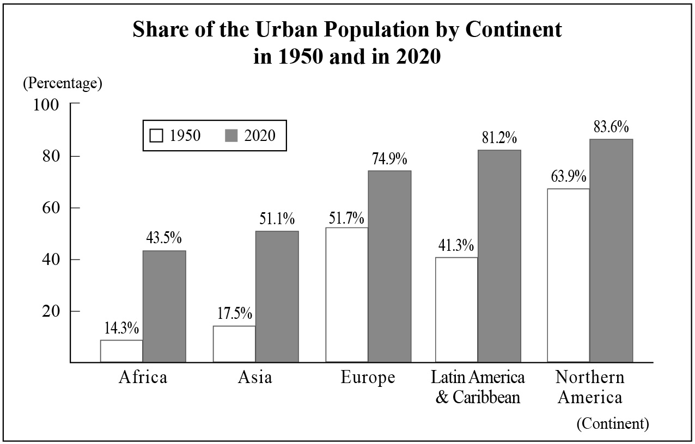

고 1 2022학년도 9월 고영어1 전국연합학력평가영역 문제지 11

# 영어

# 제 3 교시

1번부터 17번까지는 듣고 답하는 문제입니다. 1번부터 15번까지는 한 번만 들려주고, 16번부터 17번까지는 두 번 들려줍니다. 방송을 잘 듣고 답을 하시기 바랍니다.

1. 다음을 듣고, 여자가 하는 말의 목적으로 가장 적절한 것을 고르시오.
  - ① 도서관 확장 이전을 공지하려고
  - ② 도서관 이용 안내 영상을 소개하려고
  - ③ 독서 습관 형성 프로그램을 홍보하려고
  - ④ 독해력 향상 방안에 대한 의견을 구하려고
  - ⑤ 독서 프로그램 만족도 조사 참여를 요청하려고
2. 대화를 듣고, 남자의 의견으로 가장 적절한 것을 고르시오.
  - ① 중고품은 직접 만나서 거래해야 한다.
  - ② 물품 구매 시 여러 제품을 비교해야 한다.
  - ③ 계획적으로 예산을 세워 물품을 구매해야 한다.
  - ④ 온라인 거래 시 개인 정보 유출에 유의해야 한다.
  - ⑤ 중고품 구매 시 세부 사항을 꼼꼼히 확인해야 한다.
3. 대화를 듣고, 두 사람의 관계를 가장 잘 나타낸 것을 고르시오.

① 의사 － 간호사	② 안경사 － 고객

③ 보건 교사 － 학부모	④ 사진사 － 모델

⑤ 앱 개발자 － 의뢰인

4. 대화를 듣고, 그림에서 대화의 내용과 일치하지 <u>않는</u> 것을 고르시오.

③ 2

5. 대화를 듣고, 여자가 할 일로 가장 적절한 것을 고르시오.

① 식료품 주문하기	② 자동차 수리 맡기기

③ 보고서 제출하기	④ 고객 센터에 전화하기

⑤ 냉장고에 식료품 넣기

6. 대화를 듣고, 남자가 지불할 금액을 고르시오. [3점]

① \$27 ② \$30 ③ \$36 ④ \$40 ⑤ \$45

# 영역

7. 대화를 듣고, 여자가 가방을 구입한 이유를 고르시오.
  - ① 유명 연예인들이 착용해서
  - ② 재활용 소재를 사용해서
  - ③ 많은 친구들이 추천해서
  - ④ 디자인이 독특해서
  - ⑤ 가격이 저렴해서
8. 대화를 듣고, Youth Street Dance Contest에 관해 언급되지 <u>않은</u> 것을 고르시오.

① 신청 마감일 ② 심사 기준	③ 우승 상금액

④ 참가 부문	⑤ 신청 방법

9. Lakewoods Plogging에 관한 다음 내용을 듣고, 일치하지 <u>않는</u> 것을 고르시오.
  - ① 참가자는 운동복과 운동화를 착용해야 한다.
  - ② 쓰레기를 담을 봉투가 배부된다.
  - ③ 10월 1일 오전 7시부터 진행될 것이다.
  - ④ 학교 웹사이트에서 신청할 수 있다.
  - ⑤ 참가자 모두 스포츠 양말을 받을 것이다.
10. 다음 표를 보면서 대화를 듣고, 두 사람이 주문할 휴대용 캠핑 히터를 고르시오.

Portable Camping Heater

|  | Model | Weight (kg) | Price | Energy Source | Customer Rating |
| --- | --- | --- | --- | --- | --- |
| ① | A | 4.2 | \$85 | Oil | ★★★ |
| ② | B | 3.6 | \$90 | Oil | ★★★★ |
| ③ | C | 3.4 | \$92 | Electricity | ★★★★★ |
| ④ | D | 3.2 | \$95 | Electricity | ★★★★ |
| ⑤ | E | 2.8 | \$115 | Electricity | ★★★★★ |

11. 대화를 듣고, 여자의 마지막 말에 대한 남자의 응답으로 가장 적절한 것을 고르시오.
  - ① You can join the tour, too.
  - ② The bike wasn’t that expensive.
  - ③ I haven’t decided the place, yet.
  - ④ I’m going to rent a bike in the park.
  - ⑤ Autumn is the best season for the tour.
12. 대화를 듣고, 남자의 마지막 말에 대한 여자의 응답으로 가장 적절한 것을 고르시오.
  - ① Great. I’ll be there at that time.
  - ② Okay. I’ll change my toothbrush.
  - ③ Too bad. I hope you get well soon.
  - ④ No worries. Your painkillers work well.
  - ⑤ Sure. Let me know when he’s available.
13. 대화를 듣고, 여자의 마지막 말에 대한 남자의 응답으로 가장 적절한 것을 고르시오.

Man:

- ① Fantastic! We’ll be a really good team.
  - ② Sorry. I don’t understand why you like it.
  - ③ Good idea! I’ll find another partner for you.
  - ④ No problem. I can use my racket to practice.
  - ⑤ I know. Everyone loves watching sports competitions.
14. 대화를 듣고, 남자의 마지막 말에 대한 여자의 응답으로 가장 적절한 것을 고르시오. [3점]

Woman:

- ① Nice! I’m curious about what you’ll ask.
  - ② Sure. You should study hard for the quiz.
  - ③ Okay. I’ll make some questions right away.
  - ④ All right. I’ll see if I can add more pictures.
  - ⑤ Don’t worry. It won’t take too long to answer.
15. 다음 상황 설명을 듣고, Ms. Olson이 Steven에게 할 말로 가장 적절한 것을 고르시오. [3점]

Ms. Olson:

- ① You can come see me any time you want.
  - ② I’m happy to hear that you’ve met the CEO.
  - ③ Why do you want to run a gaming company?
  - ④ How about going to your role model’s booksigning?
  - ⑤ You should buy more books written by your role model.

## [16\~17] 다음을 듣고, 물음에 답하시오.

16. 남자가 하는 말의 주제로 가장 적절한 것은?
  - ① tips for caring for musical instruments
  - ② ways to choose a good musical instrument
  - ③ effects of the weather on musical instruments
  - ④ benefits of learning musical instruments as a child
  - ⑤ difficulties of making your own musical instruments
17. 언급된 악기가 <u>아닌</u> 것은?

① flutes	② trumpets

④ drums	⑤ guitars

③ pianos

이제 듣기 문제가 끝났습니다. 18번부터는 문제지의 지시에 따라 답을 하시기 바랍니다.

18. 다음 글의 목적으로 가장 적절한 것은?

Dear Parents/Guardians,

Class parties will be held on the afternoon of Friday,

December 16th, 2022. Children may bring in sweets,

crisps, biscuits, cakes, and drinks. We are requesting that

children do not bring in homecooked or prepared food.

All food should arrive in a sealed packet with the

ingredients clearly listed. Fruit and vegetables are

welcomed if they are prepacked in a sealed packet from

the shop. Please DO NOT send any food into school

containing nuts as we have many children with severe

nut allergies. Please check the ingredients of all food

your children bring carefully. Thank you for your

continued support and cooperation.

Yours sincerely,

Lisa Brown, Headteacher

- ① 학급 파티 일정 변경을 공지하려고
  - ② 학교 식당의 새로운 메뉴를 소개하려고
  - ③ 학생의 특정 음식 알레르기 여부를 조사하려고
  - ④ 학부모의 적극적인 학급 파티 참여를 독려하려고
  - ⑤ 학급 파티에 가져올 음식에 대한 유의 사항을 안내하려고
19. 다음 글에 나타난 ‘I’의 심경 변화로 가장 적절한 것은?

It was two hours before the submission deadline and I still hadn’t finished my news article. I sat at the desk, but suddenly, the typewriter didn’t work. No matter how hard I tapped the keys, the levers wouldn’t move to strike the paper. I started to realize that I would not be able to finish the article on time. Desperately, I rested the typewriter on my lap and started hitting each key with as much force as I could manage. Nothing happened. Thinking something might have happened inside of it, I opened the cover, lifted up the keys, and found the problem ― a paper clip. The keys had no room to move. After picking it out, I pressed and pulled some parts. The keys moved smoothly again. I breathed deeply and smiled. Now I knew that I could finish my article on time.

① confident → nervous	② frustrated → relieved

③ bored → amazed	④ indifferent → curious

⑤ excited → disappointed

20. 다음 글에서 필자가 주장하는 바로 가장 적절한 것은?

Experts on writing say, “Get rid of as many words as possible.” Each word must do something important. If it doesn’t, get rid of it. Well, this doesn’t work for speaking. It takes more words to introduce, express, and adequately elaborate an idea in speech than it takes in writing. Why is this so? While the reader can reread, the listener cannot rehear. Speakers do not come equipped with a replay button. Because listeners are easily distracted, they will miss many pieces of what a speaker says. If they miss the crucial sentence, they may never catch up. This makes it necessary for speakers to talk longer about their points, using more words on them than would be used to express the same idea in writing.

- ① 연설 시 중요한 정보는 천천히 말해야 한다.
  - ② 좋은 글을 쓰려면 간결한 문장을 사용해야 한다.
  - ③ 말하기 전에 신중히 생각하는 습관을 길러야 한다.
  - ④ 글을 쓸 때보다 말할 때 더 많은 단어를 사용해야 한다.
  - ⑤ 청중의 이해를 돕기 위해 미리 연설문을 제공해야 한다.

21. 밑줄 친 <u>fire a customer</u>가 다음 글에서 의미하는 바로 가장 적절한 것은?

Is the customer always right? When customers return a broken product to a famous company, which makes kitchen and bathroom fixtures, the company nearly always offers a replacement to maintain good customer relations. Still, “there are times you’ve got to say ‘no,’” explains the warranty expert of the company, such as when a product is undamaged or has been abused. Entrepreneur Lauren Thorp, who owns an ecommerce company, says, “While the customer is ‘always’ right, sometimes you just have to <u>fire a customer</u>.” When Thorp has tried everything to resolve a complaint and realizes that the customer will be dissatisfied no matter what, she returns her attention to the rest of her customers, who she says are “the reason for my success.”

- ① deal with a customer’s emergency
  - ② delete a customer’s purchasing record
  - ③ reject a customer’s unreasonable demand
  - ④ uncover the hidden intention of a customer
  - ⑤ rely on the power of an influential customer
22. 다음 글의 요지로 가장 적절한 것은?

A recent study from Carnegie Mellon University in Pittsburgh, called “When Too Much of a Good Thing May Be Bad,” indicates that classrooms with too much decoration are a source of distraction for young children and directly affect their cognitive performance. Being visually overstimulated, the children have a great deal of difficulty concentrating and end up with worse academic results. On the other hand, if there is not much decoration on the classroom walls, the children are less distracted, spend more time on their activities, and learn more. So it’s our job, in order to support their attention, to find the right balance between excessive decoration and the complete absence of it.

- ① 아이들의 집중을 돕기 위해 과도한 교실 장식을 지양할 필요가 있다.
  - ② 아이들의 인성과 인지 능력을 균형 있게 발달시키는 것이 중요하다.
  - ③ 아이들이 직접 교실을 장식하는 것은 창의력 발달에 도움이 된다.
  - ④ 다양한 교실 활동은 아이들의 수업 참여도를 증진시킨다.
  - ⑤ 풍부한 시각 자료는 아이들의 학습 동기를 높인다.
23. 다음 글의 주제로 가장 적절한 것은?

For creatures like us, evolution smiled upon those with a strong need to belong. Survival and reproduction are the criteria of success by natural selection, and forming relationships with other people can be useful for both survival and reproduction. Groups can share resources, care for sick members, scare off predators, fight together against enemies, divide tasks so as to improve efficiency, and contribute to survival in many other ways. In particular, if an individual and a group want the same resource, the group will generally prevail, so competition for resources would especially favor a need to belong. Belongingness will likewise promote reproduction, such as by bringing potential mates into contact with each other, and in particular by keeping parents together to care for their children, who are much more likely to survive if they have more than one caregiver.

- ① skills for the weak to survive modern life
  - ② usefulness of belonging for human evolution
  - ③ ways to avoid competition among social groups
  - ④ roles of social relationships in children’s education
  - ⑤ differences between two major evolutionary theories
24. 다음 글의 제목으로 가장 적절한 것은?

Many people make a mistake of only operating along the safe zones, and in the process they miss the opportunity to achieve greater things. They do so because of a fear of the unknown and a fear of treading the unknown paths of life. Those that are brave enough to take those roads less travelled are able to get great returns and derive major satisfaction out of their courageous moves. Being overcautious will mean that you will miss attaining the greatest levels of your potential. You must learn to take those chances that many people around you will not take, because your success will flow from those bold decisions that you will take along the way.

\* tread: 밟다

- ① More Courage Brings More Opportunities
  - ② Travel: The Best Way to Make Friends
  - ③ How to Turn Mistakes into Success
  - ④ Satisfying Life? Share with Others
  - ⑤ Why Is Overcoming Fear So Hard?
25. 다음 도표의 내용과 일치하지 <u>않는</u> 것은?

Share of the Urban Population by Continent
in 1950 and in 2020
(Percentage)
10(id:)
1950220 81.2% 83.6%
80 74.9%
63.9%
60
43.5% 51.1% 51.7%
40 41.3%
20 14.3% 17.5%

Africa Asia Europe Latin America Northern
& Caribean America
(Continent)

The graph above shows the share of the urban population by continent in 1950 and in 2020. ① For each continent, the share of the urban population in 2020 was larger than that in 1950.

② From 1950 to 2020, the share of the urban population in Africa increased from 14.3% to 43.5%. ③ The share of the urban population in Asia was the second lowest in 1950 but not in 2020. ④ In 1950, the share of the urban population in Europe was larger than that in Latin America and the Caribbean, whereas the reverse was true in 2020. ⑤ Among the five continents, Northern America was ranked in the first position for the share of the urban population in both 1950 and 2020.

26. Wilbur Smith에 관한 다음 글의 내용과 일치하지 <u>않는</u> 것은?

Wilbur Smith was a South African novelist specialising in historical fiction. Smith wanted to become a journalist, writing about social conditions in South Africa, but his father was never supportive of his writing and forced him to get a real job. Smith studied further and became a tax accountant, but he finally turned back to his love of writing. He wrote his first novel, The Gods First Make Mad, and had received 20 rejections by 1962. In 1964, Smith published another novel, When the Lion Feeds, and it went on to be successful, selling around the world. A famous actor and film producer bought the film rights for When the Lion Feeds, although no movie resulted. By the time of his death in 2021 he had published 49 novels, selling more than 140 million copies worldwide.

- ① 역사 소설을 전문으로 하는 소설가였다.
  - ② 아버지는 그가 글 쓰는 것을 지지하지 않았다.
  - ③ 첫 번째 소설은 1962년까지 20번 거절당했다.
  - ④ 소설 When the Lion Feeds는 영화화되었다.
  - ⑤ 죽기 전까지 49편의 소설을 출간했다.
27. 2022 Springfield Park Yoga Class에 관한 다음 안내문의 내용과 일치하지 <u>않는</u> 것은?

2022 Springfield Park Yoga Class

The popular yoga class in Springfield Park returns! Enjoy yoga hosted on the park lawn. If you can’t make it to the park, join us online on our social media platforms!

◈ When: Saturdays, 2 p.m. to 3 p.m., September

◈ Registration: At least TWO hours before each class starts,	.

◈ Notes

∙For online classes: find a quiet space with enough room for you to stretch out.

∙For classes in the park: mats are not provided, so bring your own!

- ※ The class will be canceled if the weather is unfavorable.

For more information,	.

- ① 온라인으로도 참여할 수 있다.
  - ② 9월 중 토요일마다 진행된다.
  - ③ 수업 시작 2시간 전까지 등록해야 한다.
  - ④ 매트가 제공된다.
  - ⑤ 날씨가 좋지 않으면 취소될 것이다.
28. Kenner High School’s Water Challenge에 관한 다음 안내문의 내용과 일치하는 것은?

### Kenner High School’s Water Challenge

Kenner High School’s Water Challenge is a new contest to propose measures against water pollution. Please share your ideas for dealing with water pollution!

Submission

- How: Submit your proposal by email to admin@khswater.edu.
- When: September 5, 2022 to September 23, 2022

Details

- Participants must enter in teams of four and can only join one team.
- Submission is limited to one proposal per team.
- Participants must use the proposal form provided on the website.

Prizes

- 1st: \$50 gift certificate
- 2nd: \$30 gift certificate

-3rd: \$10 gift certificate

Please visit www.khswater.edu to learn more about the challenge.

- ① 제안서는 직접 방문하여 제출해야 한다.
- ② 9월 23일부터 제안서를 제출할 수 있다.
- ③ 제안서는 한 팀당 4개까지 제출할 수 있다.
- ④ 제공된 제안서 양식을 사용해야 한다.
- ⑤ 2등은 10달러의 상품권을 받는다.

29. 다음 글의 밑줄 친 부분 중, 어법상 <u>틀린</u> 것은? [3점]

The human brain, it turns out, has shrunk in mass by about 10 percent since it ① <u>peaked</u> in size 15,000-30,000 years ago. One possible reason is that many thousands of years ago humans lived in a world of dangerous predators ② <u>where</u> they had to have their wits about them at all times to avoid being killed. Today, we have effectively domesticated ourselves and many of the tasks of survival ― from avoiding immediate death to building shelters to obtaining food ― ③ <u>has</u> been outsourced to the wider society. We are smaller than our ancestors too, and it is a characteristic of domestic animals

④ <u>that</u> they are generally smaller than their wild cousins. None of this may mean we are dumber ― brain size is not necessarily an indicator of human intelligence ― but it may mean that our brains today are wired up differently, and perhaps more efficiently, than ⑤ <u>those</u> of our ancestors.

30. 다음 글의 밑줄 친 부분 중, 문맥상 낱말의 쓰임이 적절하지 <u>않은</u> 것은? [3점]

It is widely believed that certain herbs somehow magically improve the work of certain organs, and “cure” specific diseases as a result. Such statements are unscientific and groundless. Sometimes herbs appear to work, since they tend to ① <u>increase</u> your blood circulation in an aggressive attempt by your body to eliminate them from your system. That can create a ② <u>temporary</u> feeling of a high, which makes it seem as if your health condition has improved. Also, herbs can have a placebo effect, just like any other method, thus helping you feel better. Whatever the case, it is your body that has the intelligence to ③ <u>regain</u> health, and not the herbs. How can herbs have the intelligence needed to direct your body into getting healthier? That is impossible. Try to imagine how herbs might come into your body and intelligently ④ fix your problems. If you try to do that, you will see how impossible it seems. Otherwise, it would mean that herbs are ⑤ <u>less</u> intelligent than the human body, which is truly hard to believe.

\* placebo effect: 위약 효과

## [31\~34] 다음 빈칸에 들어갈 말로 가장 적절한 것을 고르시오.

31. We worry that the robots are taking our jobs, but just as common a problem is that the robots are taking our	. In the large warehouses so common behind the scenes of today’s economy, human ‘pickers’ hurry around grabbing products off shelves and moving them to where they can be packed and dispatched. In their ears are headpieces: the voice of ‘Jennifer’, a piece of software, tells them where to go and what to do, controlling the smallest details of their movements. Jennifer breaks down instructions into tiny chunks, to minimise error and maximise productivity ― for example, rather than picking eighteen copies of a book off a shelf, the human worker would be politely instructed to pick five. Then another five. Then yet another five. Then another three. Working in such conditions reduces people to machines made of flesh. Rather than asking us to think or adapt, the Jennifer unit takes over the thought process and treats workers as an inexpensive source of some visual processing and a pair of opposable thumbs. [3점]

\* dispatch: 발송하다 \*\* chunk: 덩어리

① reliability	② judgment

③ endurance	④ sociability

⑤ cooperation

32. The prevailing view among developmental scientists is that people are active contributors to their own development. People are influenced by the physical and social contexts in which they live, but they also play a role in influencing their development by interacting with, and changing, those contexts. Even infants influence the world around them and construct their own development through their interactions. Consider an infant who smiles at each adult he sees; he influences his world because adults are likely to smile, use “baby talk,” and play with him in response. The infant brings adults into close contact, making oneonone interactions and creating opportunities for learning. By engaging the world around them, thinking, being curious, and interacting with people, objects, and the world around them, individuals of all ages are “	.”
  - ① mirrors of their generation
  - ② shields against social conflicts
  - ③ explorers in their own career path
  - ④ followers of their childhood dreams
  - ⑤ manufacturers of their own development
33. The demand for freshness can	. While freshness is now being used as a term in food marketing as part of a return to nature, the demand for yearround supplies of fresh produce such as soft fruit and exotic vegetables has led to the widespread use of hot houses in cold climates and increasing reliance on total quality control ― management by temperature control, use of pesticides and computer/satellitebased logistics. The demand for freshness has also contributed to concerns about food wastage. Use of ‘best before’, ‘sell by’ and ‘eat by’ labels has legally allowed institutional waste. Campaigners have exposed the scandal of overproduction and waste. Tristram Stuart, one of the global band of antiwaste campaigners, argues that, with freshly made sandwiches, overordering is standard practice across the retail sector to avoid the appearance of empty shelf space, leading to high volumes of waste when supply regularly exceeds demand. [3점]

\* pesticide: 살충제 \*\* logistics: 물류, 유통

- ① have hidden environmental costs
  - ② worsen the global hunger problem
  - ③ bring about technological advances
  - ④ improve nutrition and quality of food
  - ⑤ diversify the diet of a local community
34. In the studies of Colin Cherry at the Massachusetts Institute for Technology back in the 1950s, his participants listened to voices in one ear at a time and then through both ears in an effort to determine whether we can listen to two people talk at the same time. One ear always contained a message that the listener had to repeat back (called “shadowing”) while the other ear included people speaking. The trick was to see if you could totally focus on the main message and also hear someone talking in your other ear. Cleverly, Cherry found it was impossible for his participants to know whether the message in the other ear was spoken by a man or woman, in English or another language, or was even comprised of real words at all! In other words, people could not	. [3점]
  - ① decide what they should do in the moment
  - ② remember a message with too many words
  - ③ analyze which information was more accurate
  - ④ speak their own ideas while listening to others
  - ⑤ process two pieces of information at the same time
35. 다음 글에서 전체 흐름과 관계 <u>없는</u> 문장은?

The fastpaced evolution of Information and Communication Technologies (ICTs) has radically transformed the dynamics and business models of the tourism and hospitality industry.

① This leads to new levels/forms of competitiveness among service providers and transforms the customer experience through new services. ② Creating unique experiences and providing convenient services to customers leads to satisfaction and, eventually, customer loyalty to the service provider or brand (i.e., hotels). ③ In particular, the most recent technological boost received by the tourism sector is represented by mobile applications. ④ Increasing competitiveness among service providers does not necessarily mean promoting quality of customer services.

⑤ Indeed, empowering tourists with mobile access to services such as hotel reservations, airline ticketing, and recommendations for local attractions generates strong interest and considerable profits.

\* hospitality industry: 서비스업(호텔·식당업 등)

[36\~37] 주어진 글 다음에 이어질 글의 순서로 가장 적절한 것을 고르시오.

36.

With nearly a billion hungry people in the world, there is obviously no single cause.

(A) The reason people are hungry in those countries is that the products produced there can be sold on the world market for more than the local citizens can afford to pay for them. In the modern age you do not starve because you have no food, you starve because you have no money. (B) However, far and away the biggest cause is poverty. Seventynine percent of the world’s hungry live in nations that are net exporters of food. How can this be?

(C) So the problem really is that food is, in the grand scheme of things, too expensive and many people are too poor to buy it. The answer will be in continuing the trend of lowering the cost of food.

\* net exporter: 순 수출국 \*\* scheme: 체계, 조직

① (A) - (C) - (B)	② (B) - (A) - (C)

③ (B) - (C) - (A)	④ (C) - (A) - (B)

⑤ (C) - (B) - (A)

37.

Most people have a perfect time of day when they feel they are at their best, whether in the morning, evening, or afternoon.

(A) When your mind and body are less alert than at your “peak” hours, the muse of creativity awakens and is allowed to roam more freely. In other words, when your mental machinery is loose rather than standing at attention, the creativity flows. (B) However, if the task you face demands creativity and novel ideas, it’s best to tackle it at your “worst” time of day! So if you are an early bird, make sure to attack your creative task in the evening, and vice versa for night owls.

(C) Some of us are night owls, some early birds, and others in between may feel most active during the afternoon hours. If you are able to organize your day and divide your work, make it a point to deal with tasks that demand attention at your best time of the day. [3점]

\* roam: (어슬렁어슬렁) 거닐다

① (A) - (C) - (B)	② (B) - (A) - (C)

③ (B) - (C) - (A)	④ (C) - (A) - (B)

⑤ (C) - (B) - (A)

[38\~39] 글의 흐름으로 보아, 주어진 문장이 들어가기에 가장 적절한 곳을 고르시오.

38.

Unfortunately, it is also likely to “crowd out” other activities that produce more sustainable social contributions to our social wellbeing.

Television is the number one leisure activity in the United States and Europe, consuming more than half of our free time. ( ① ) We generally think of television as a way to relax, tune out, and escape from our troubles for a bit each day. ( ② ) While this is true, there is increasing evidence that we are more motivated to tune in to our favorite shows and characters when we are feeling lonely or have a greater need for social connection. ( ③ ) Television watching does satisfy these social needs to some extent, at least in the short run. ( ④ ) The more television we watch, the less likely we are to volunteer our time or to spend time with people in our social networks. ( ⑤ ) In other words, the more time we make for Friends, the less time we have for friends in real life.

\* Friends: 프렌즈(미국의 한 방송국에서 방영된 시트콤)

39.

What we need is a reliable and reproducible method for measuring the relative hotness or coldness of objects rather than the rate of energy transfer.

We often associate the concept of temperature with how hot or cold an object feels when we touch it. In this way, our senses provide us with a qualitative indication of temperature. ( ① ) Our senses, however, are unreliable and often mislead us. ( ② ) For example, if you stand in bare feet with one foot on carpet and the other on a tile floor, the tile feels colder than the carpet even though both are at the same temperature. ( ③ ) The two objects feel different because tile transfers energy by heat at a higher rate than carpet does. ( ④ ) Your skin “measures” the rate of energy transfer by heat rather than the actual temperature. ( ⑤ ) Scientists have developed a variety of thermometers for making such quantitative measurements. [3점]

\* thermometer: 온도계

40. 다음 글의 내용을 한 문장으로 요약하고자 한다. 빈칸 (A), (B)에 들어갈 말로 가장 적절한 것은?

My colleagues and I ran an experiment testing two different messages meant to convince thousands of resistant alumni to make a donation. One message emphasized the opportunity to do good: donating would benefit students, faculty, and staff. The other emphasized the opportunity to feel good: donors would enjoy the warm glow of giving. The two messages were equally effective: in both cases, 6.5 percent of the unwilling alumni ended up donating. Then we combined them, because two reasons are better than one. Except they weren’t. When we put the two reasons together, the giving rate dropped below 3 percent. Each reason alone was more than twice as effective as the two combined. The audience was already skeptical. When we gave them different kinds of reasons to donate, we triggered their awareness that someone was trying to persuade them ― and they shielded themselves against it.

\* alumni: 졸업생 \*\* skeptical: 회의적인

↓

In the experiment mentioned above, when the two different reasons to donate were given (A) , the audience was less likely to be (B) because they could recognize the intention to persuade them.

(A) (B)

① simultaneously …… convinced

② separately …… confused

③ frequently …… annoyed

④ separately …… satisfied

⑤ simultaneously …… offended

## [41\~42] 다음 글을 읽고, 물음에 답하시오.

In a society that rejects the consumption of insects there are some individuals who overcome this rejection, but most will continue with this attitude. It may be very (a) <u>difficult</u> to convince an entire society that insects are totally suitable for consumption. However, there are examples in which this (b) <u>reversal</u> of attitudes about certain foods has happened to an entire society. Several examples in the past 120 years from EuropeanAmerican society are: considering lobster a luxury food instead of a food for servants and prisoners; considering sushi a safe and delicious food; and considering pizza not just a food for the rural poor of Sicily. In Latin American countries, where insects are already consumed, a portion of the population hates their consumption and (c) <u>associates</u> it with poverty. There are also examples of people who have had the habit of consuming them and (d) <u>encouraged</u> that habit due to shame, and because they do not want to be categorized as poor or uncivilized. According to Esther Katz, an anthropologist, if the consumption of insects as a food luxury is to be promoted, there would be more chances that some individuals who do not present this habit overcome ideas under which they were educated. And this could also help to (e) <u>revalue</u> the consumption of insects by those people who already eat them.

41. 윗글의 제목으로 가장 적절한 것은?
  - ① The More Variety on the Table, The Healthier You Become
  - ② Edible or Not? Change Your Perspectives on Insects
  - ③ Insects: A Key to Solve the World Food Shortage
  - ④ Don’t Let Uniqueness in Food Culture Disappear
  - ⑤ Experiencing Various Cultures by Food
42. 밑줄 친 (a)\~(e) 중에서 문맥상 낱말의 쓰임이 적절하지 <u>않은</u> 것은?

① (a) ② (b) ③ (c) ④ (d) ⑤ (e)

## [43\~45] 다음 글을 읽고, 물음에 답하시오.

(A)

(B)

In some schools the children completely ignored the old man and in others, they made fun of (b) <u>him</u>. When this happened, he would turn sadly and go home. Finally, he went onto the tiny playground of a very small school, and leant against the fence, exhausted. The bell rang, and the crowd of children ran out onto the playground. “Sir, are you all right? Shall I bring you a glass of water?” a voice said. “We’ve got a bench in the playground ― come and sit down,” another voice said. Soon a young teacher came out onto the playground.

(C)

The old man greeted (c) <u>him</u> and said: “Finally, I’ve found my grandson the best school in town.” “You’re mistaken, sir. Our school is not the best ― it’s small and cramped.” The old man didn’t argue with the teacher. Instead, he made arrangements for his grandson to join the school, and then the old man left. That evening, the boy’s mom said to (d) <u>him</u>: “Dad, you can’t even read. How do you know you’ve found the best teacher of all?” “Judge a teacher by his pupils,” the old man replied.

＊cramped: 비좁은

(D)

The old man took his grandson firmly by the hand, and led him out of the school gate. “Brilliant, I don’t have to go to school!” the boy exclaimed. “You do, but not this one,” his granddad replied. “I’ll find you a school myself.” Granddad took his grandson back to his own house, asked grandma to look after him, and went off to look for a teacher (e) <u>himself</u>. Every time he spotted a school, the old man went onto the playground, and waited for the children to come out at break time.

43. 주어진 글 (A)에 이어질 내용을 순서에 맞게 배열한 것으로 가장 적절한 것은?

① (B) - (D) - (C)	② (C) - (B) - (D)

③ (C) - (D) - (B)	④ (D) - (B) - (C)

⑤ (D) - (C) - (B)

44. 밑줄 친 (a)\~(e) 중에서 가리키는 대상이 나머지 넷과 <u>다른</u> 것은?

① (a) ② (b) ③ (c) ④ (d) ⑤ (e)

45. 윗글에 관한 내용으로 적절하지 <u>않은</u> 것은?

갈색 머리 소녀가 노인과 소년을 향해 손가락질했다. 노인은 지쳐서 울타리에 기댔다.

노인은 선생님과 논쟁을 벌였다.

노인은 글을 읽을 줄 몰랐다.

소년은 학교에 가지 않아도 된다고 소리쳤다.

<table>
<tr><th colspan="2" rowspan="2">A boy had a place at the best school in town. In the morning, his granddad took him to the school. When (a) he went onto the playground with his grandson, the children surrounded them. “What a funny old man,” one boy smirked. A girl with brown hair pointed at the pair and jumped up and down. Suddenly, the bell rang and the children ran off to their first lesson. ＊smirk: 히죽히죽 웃다</th><th colspan="2">① ② ③ ④ ⑤</th></tr>
<tr><td></td><td>*</td></tr>
<tr><td colspan="4">8 8</td></tr>
</table>

확인 사항

◦ 답안지의 해당란에 필요한 내용을 정확히 기입(표기)했는지 확인 하시오.