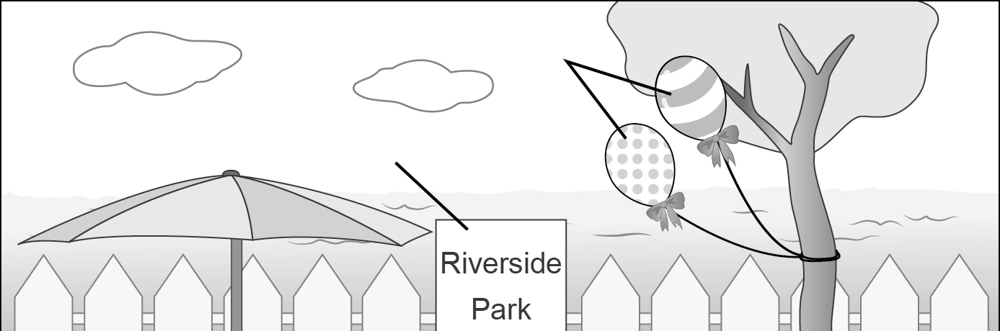
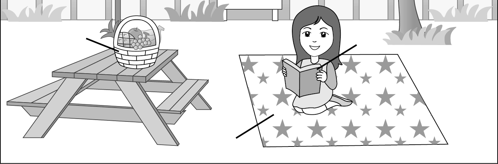
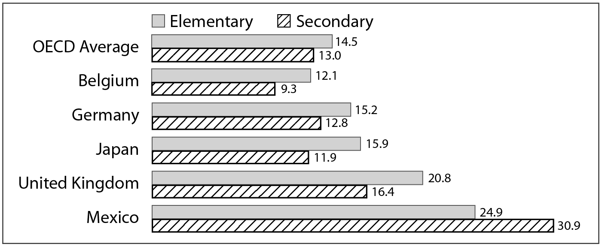

2023학년도 6월 고2 전국연합학력평가 문제지	1

제 3 교시	영어 영역

1번부터 17번까지는 듣고 답하는 문제입니다. 1번부터 15번까지는 한 번만 들려주고, 16번부터 17번까지는 두 번 들려줍니다. 방송을 잘 듣고 답을 하시기 바랍니다.

1. 다음을 듣고, 남자가 하는 말의 목적으로 가장 적절한 것을 고르시오.
  - ① 보고서 작성 시 유의 사항을 안내하려고
  - ② 화학 실험의 중요성을 강조하려고
  - ③ 과제 제출 마감일을 공지하려고
  - ④ 과학 보고서 주제를 소개하려고
  - ⑤ 수강 신청 방법을 설명하려고
2. 대화를 듣고, 여자의 의견으로 가장 적절한 것을 고르시오.
  - ① 아이를 안아주는 것은 아이의 불안감을 덜어준다.
  - ② 수면 시간에 아이에게 우유를 주는 것은 피해야 한다.
  - ③ 아이에게 장난감을 주는 것은 인지 발달을 촉진한다.
  - ④ 올바른 수면 습관 형성을 위해 부모와 아이는 함께 자야 한다.
  - ⑤ 좋아하는 물건을 주는 것은 아이가 혼자 자는 데 도움이 된다.
3. 대화를 듣고, 두 사람의 관계를 가장 잘 나타낸 것을 고르시오.

① 작곡가 - 가수	② 지휘자 - 피아니스트

③ 프로듀서 - 방송 작가	④ 광고 기획자 - 뮤지컬 배우

⑤ 영화 감독 - 음향 기사

4. 대화를 듣고, 그림에서 대화의 내용과 일치하지 <u>않는</u> 것을 고르시오.

②

①

⑤	③

④

5. 대화를 듣고, 여자가 할 일로 가장 적절한 것을 고르시오.

① 학생 사진 찍기	② 동아리 이름 바꾸기

③ 소개 글 작성하기	④ 마스코트 이미지 보내기

⑤ 동아리 활동집 인쇄하기

6. 대화를 듣고, 남자가 지불할 금액을 고르시오. [3점]

① \$80 ② \$90 ③ \$100 ④ \$108 ⑤ \$120

7. 대화를 듣고, 여자가 이사를 가려는 이유를 고르시오.
  - ① 아픈 아버지를 돌보기 위해서
  - ② 회사와 가까운 곳으로 가려고
  - ③ 이웃과 사이가 좋지 않아서
  - ④ 부모님으로부터 독립하려고
  - ⑤ 집 계약 기간이 만료되어서
8. 대화를 듣고, Blueway Spelling Bee Competition에 관해 언급되지 <u>않은</u> 것을 고르시오.

① 주최 기관	② 참가 대상	③ 참가 비용

④ 신청 방법	⑤ 모집 인원

9. Ocean World에 관한 다음 내용을 듣고, 일치하지 <u>않는</u> 것을 고르시오.
  - ① 주제는 심해 탐험이다.
  - ② 오전 10시부터 오후 6시까지 운영된다.
  - ③ 중앙 홀에서 영상을 시청할 수 있다.
  - ④ 물고기 모양의 쿠키를 만들 수 있다.
  - ⑤ 사전 예약제로 운영된다.
10. 다음 표를 보면서 대화를 듣고, 두 사람이 구매할 보안 카메라를 고르시오.

Security Cameras

|  | Model | Price | Connectivity | Placement | Special Feature |
| --- | --- | --- | --- | --- | --- |
| ① | A | \$270 | wired | indoor | motion detection |
| ② | B | \$300 | wireless | indoor | sound detection |
| ③ | C | \$400 | wireless | indoor &outdoor | motion detection |
| ④ | D | \$470 | wireless | indoor &outdoor | sound detection |
| ⑤ | E | \$520 | wired | indoor &outdoor | motion detection |

11. 대화를 듣고, 남자의 마지막 말에 대한 여자의 응답으로 가장 적절한 것을 고르시오. [3점]
  - ① Never mind. I can’t wait to see them speaking in the contest.
  - ② Definitely! I’m sure your message will be clearly delivered.
  - ③ Of course. I’m honored to make a speech as the captain.
  - ④ Oh, no! I can’t come to your graduation ceremony.
  - ⑤ Sure. I’ll add your brilliant idea to my script.
12. 대화를 듣고, 여자의 마지막 말에 대한 남자의 응답으로 가장 적절한 것을 고르시오.
  - ① Why not? I’ll certainly go with you.
  - ② I’m sorry. I can’t find them anywhere.
  - ③ Don’t worry. You can use mine if you want.
  - ④ Not really. I don’t need to use them right now.
  - ⑤ Forget about it. He’ll use my earphones anyway.

2	영어

# 영역

# 고 2

━━━━━━━━━━━━━━━━━━━━━━━━━━━━━━━━━━━━━━━━━━━━━━━━━━━━━━━━━━━━━━━

13. 대화를 듣고, 남자의 마지막 말에 대한 여자의 응답으로 가장 적절한 것을 고르시오.

Woman:

- ① How kind of her! I was worried that I wouldn’t find it.
  - ② Then, I’ll tell her it was my fault, not yours.
  - ③ Could you stop by again when it’s raining?
  - ④ Thanks for lending me your brandnew umbrella.
  - ⑤ Why don’t you ask her what she wants to do next time?
14. 대화를 듣고, 여자의 마지막 말에 대한 남자의 응답으로 가장 적절한 것을 고르시오. [3점]

Man:

- ① Thanks for letting me know. I should try using them.
  - ② It tastes good. I’m curious about the recipe for this juice.
  - ③ Don’t worry. I don’t care about the kinds of straws I use.
  - ④ You’re right. I’d better not use a silicone straw from now on.
  - ⑤ I’ve tried all of them already, but I still prefer paper straws.
15. 다음 상황 설명을 듣고, Nick이 Annie에게 할 말로 가장 적절한 것을 고르시오.

Nick:

- ① I’d like to replace my content with yours right away.
  - ② We’d better ask our professor about which source to trust.
  - ③ Your information is different from what’s on the Internet.
  - ④ You should have done more research for the presentation.
  - ⑤ I believe that Van Gogh started painting in his early teens.

[16\~17] 다음을 듣고, 물음에 답하시오.

16. 여자가 하는 말의 주제로 가장 적절한 것은?
  - ① resources used to design houses
  - ② how to launch a design company
  - ③ types and classifications of colors
  - ④ artistic value of using various colors
  - ⑤ effective use of colors for brand design
17. 언급된 색깔이 <u>아닌</u> 것은?

① red	② yellow

④ green	⑤ blue

③ orange

이제 듣기 문제가 끝났습니다. 18번부터는 문제지의 지시에 따라 답을 하시기 바랍니다.

18. 다음 글의 목적으로 가장 적절한 것은?

Dear parents,

Regular attendance at school is essential in maximizing student potential. Recently, we’ve become concerned about the number of unapproved absences across all grades. I would like to further clarify that your role as a parent is to approve any school absence. Parents must provide an explanation for absences to the school within 7 days from the first day of any period of absence. Where an explanation has not been received within the 7day time frame, the school will record the absence as unjustified on the student’s record. Please ensure that you go to the parent portal site and register the reason any time your child is absent. Please approve all absences, so that your child will not be at a disadvantage. Many thanks for your cooperation.

Sincerely,

Natalie Brown, Vice Principal

- ① 자녀의 결석 사유를 등록해 줄 것을 요청하려고
- ② 학교 홈페이지의 일시적 운영 중단을 공지하려고
- ③ 자녀가 지각하지 않도록 부모의 지도를 당부하려고
- ④ 방과 후 프로그램에 대한 부모의 관심을 독려하려고
- ⑤ 인정 결석은 최대 7일까지 허용된다는 것을 안내하려고
  1. 19\. 다음 글에 드러난 Ester의 심경 변화로 가장 적절한 것은?

Ester stood up as soon as she heard the hum of a hover engine outside. “Mail,” she shouted and ran down the third set of stairs and swung open the door. It was pouring now, but she ran out into the rain. She was facing the mailbox. There was a single, unopened letter inside. She was sure this must be what she was eagerly waiting for. Without hesitation, she tore open the envelope. She pulled out the paper and unfolded it. The letter said, ‘Thank you for applying to our company. We would like to invite you to our internship program. We look forward to seeing you soon.’ She jumped up and down and looked down at the letter again. She couldn’t wait to tell this news to her family.

① anticipating → excited ② confident → ashamed

③ curious → embarrassed ④ surprised → confused

⑤ indifferent → grateful

20. 다음 글에서 필자가 주장하는 바로 가장 적절한 것은?

The introduction of new technologies clearly has both positive and negative impacts for sustainable development. Good management of technological resources needs to take them fully into account. Technological developments in sectors such as nuclear energy and agriculture provide examples of how not only environmental benefits but also risks to the environment or human health can accompany technological advances. New technologies have profound social impacts as well. Since the industrial revolution, technological advances have changed the nature of skills needed in workplaces, creating certain types of jobs and destroying others, with impacts on employment patterns. New technologies need to be assessed for their full potential impacts, both positive and negative.

- ① 기술 혁신을 저해하는 과도한 법률적 규제를 완화해야 한다.
  - ② 기술의 도입으로 인한 잠재적인 영향들을 충분히 고려해야 한다.
  - ③ 혁신적 농업 기술을 적용할 때는 환경적인 측면을 검토해야 한다.
  - ④ 기술 진보가 가져온 일자리 위협에 대한 대비책을 마련해야 한다.
  - ⑤ 기술 발전을 위해서는 혁신적 사고와 창의성이 뒷받침되어야 한다.

# 영어

# 고 2

영역	3

━━━━━━━━━━━━━━━━━━━━━━━━━━━━━━━━━━━━━━━━━━━━━━━━━━━━━━━━━━━━━━━

21. 밑줄 친 <u>have entirely lost our marbles</u>가 다음 글에서 의미하는 바로 가장 적절한 것은? [3점]

North America’s native cuisine met the same unfortunate fate as its native people, save for a few relics like the Thanksgiving turkey. Certainly, we still have regional specialties, but the Carolina barbecue will almost certainly have California tomatoes in its sauce, and the Louisiana gumbo is just as likely to contain Indonesian farmed shrimp. If either of these shows up on a fastfood menu with lots of added fats or HFCS, we seem unable either to discern or resist the corruption. We have yet to come up with a strong set of generalized norms, passed down through families, for savoring and sensibly consuming what our land and climate give us. We have, instead, a string of fad diets convulsing our bookstores and bellies, one after another, at the scale of the national best seller. Nine out of ten nutritionists view this as evidence that we <u>have entirely lost our marbles</u>.

\* relic: 전해 내려오는 풍속 \*\* HFCS: 액상 과당 \*\*\* convulse: 큰 소동을 일으키다

- ① have utterly disrupted our complex food supply chain
  - ② have vividly witnessed the rebirth of our classic recipes
  - ③ have completely denied ourselves access to healthy food
  - ④ have become totally confused about our distinctive food identity
  - ⑤ have fully recognized the cultural significance of our local foods
22. 다음 글의 요지로 가장 적절한 것은?

Perhaps, the advent of Artificial Intelligence (AI) in the workplace may bode well for Emotional Intelligence (EI). As AI gains momentum and replaces people in jobs at every level, predictions are, there will be a premium placed on people who have high ability in EI. The emotional messages people send and respond to while interacting are, at this point, far beyond the ability of AI programs to mimic. As we get further into the age of the smart machine, it is likely that sensing and managing emotions will remain one type of intelligence that puzzles AI. This means people and jobs involving EI are safe from being taken over by machines. In a survey, almost three out of four executives see EI as a “musthave” skill for the workplace in the future as the automatizing of routine tasks bumps up against the impossibility of creating effective AI for activities that require emotional skill.

\* bode: \~의 징조가 되다 \*\* momentum: 추진력

- ① 감성 지능의 결여는 직장 내 대인 관계 갈등을 심화시킨다.
  - ② 미래의 직장에서는 감성 지능의 가치가 더욱 높아질 것이다.
  - ③ 미래 사회에서는 감성 지능을 갖춘 기계가 보편화될 것이다.
  - ④ 미래에는 대부분의 직장 업무를 인공 지능이 대신할 것이다.
  - ⑤ 인간과 인공 지능 간의 상호 작용은 감성 지능의 발달을 저해한다.
23. 다음 글의 주제로 가장 적절한 것은? [3점]

Education must focus on the trunk of the tree of knowledge, revealing the ways in which the branches, twigs, and leaves all emerge from a common core. Tools for thinking stem from this core, providing a common language with which practitioners in different fields may share their experience of the process of innovation and discover links between their creative activities. When the same terms are employed across the curriculum, students begin to link different subjects and classes. If they practice abstracting in writing class, if they work on abstracting in painting or drawing class, and if, in all cases, they call it abstracting, they begin to understand how to think beyond disciplinary boundaries. They see how to transform their thoughts from one mode of conception and expression to another. Linking the disciplines comes naturally when the terms and tools are presented as part of a universal imagination.

- ① difficulties in finding meaningful links between disciplines
  - ② drawbacks of applying a common language to various fields
  - ③ effects of diversifying the curriculum on students’ creativity
  - ④ necessity of using a common language to integrate the curriculum
  - ⑤ usefulness of turning abstract thoughts into concrete expressions
24. 다음 글의 제목으로 가장 적절한 것은?

New words and expressions emerge continually in response to new situations, ideas and feelings. The Oxford English Dictionary publishes supplements of new words and expressions that have entered the language. Some people deplore this kind of thing and see it as a drift from correct English. But it was only in the eighteenth century that any attempt was made to formalize spelling and punctuation of English at all. The language we speak in the twentyfirst

century would be virtually unintelligible to Shakespeare, and so would his way of speaking to us. Alvin Toffler estimated that Shakespeare would probably only understand about 250,000 of the 450,000 words in general use in the English language now. In other words, so to speak, if Shakespeare were to materialize in London today he would understand, on average, only five out of every nine words in our vocabulary.

\* deplore: 한탄하다

- ① Original Meanings of Words Fade with Time
  - ② Dictionary: A Gradual Continuation of the Past
  - ③ Literature: The Driving Force Behind New Words
  - ④ How Can We Bridge the Ever‑Widening Language Gap?
  - ⑤ Language Evolution Makes Even Shakespeare Semi‑literate!

<table>
<tr><th>4</th><th></th><th>영어 영역</th><th></th><th>고 2</th></tr>
<tr><td colspan="5">━━━━━━━━━━━━━━━━━━━━━━━━━━━━━━━━━━━━━━━━━━━━━━━━━━━━━━━━━━━━━━━</td></tr>
<tr><td>25. 다음 도표의 내용과 일치하지 <u>않는</u> 것은?</td><td></td><td></td><td>27. Peace Marathon Festival에 관한 다음 안내문의 내용과 일치</td><td></td></tr>
<tr><td></td><td>The graph above shows the average number of students per teacher in public elementary and secondary schools across selected countries in 2019. ① Belgium was the only country with a smaller number of students per teacher than the OECD average in both public elementary and secondary schools. ② In both public elementary and secondary schools, the average number of students per teacher was the largest in Mexico. ③ In public elementary schools, there was a smaller number of students per teacher on average in Germany than in Japan, whereas the reverse was true in public secondary schools. ④ The average number of students per teacher in public secondary schools in Germany was less than half that in the United Kingdom. ⑤ Of the five</td><td>하지 <u>않는</u> 것은?</td><td></td><td></td></tr>
<tr><td></td><td>countries, Mexico was the only country with more students</td><td>① 출발 시각은 오전 10시이다.</td><td></td><td></td></tr>
<tr><td></td><td>per teacher in public secondary schools than in public</td><td>② 5 킬로미터 코스는 참가에 나이 제한이 없다.</td><td></td><td></td></tr>
<tr><td>elementary schools.</td><td></td><td>③ 참가자는 선착순 1,000명으로 제한된다.</td><td></td><td></td></tr>
<tr><td></td><td></td><td>⑤ 물은 결승선에서만 제공된다.</td><td>④ 모든 참가자들에게 기념품과 메달이 주어진다.</td><td></td></tr>
<tr><td></td><td>26. John Ray에 관한 다음 글의 내용과 일치하지 <u>않는</u> 것은? Born in 1627 in Black Notley, Essex, England, John Ray was the son of the village blacksmith. At 16, he went to Cambridge University, where he studied widely and lectured on topics from Greek to mathematics, before joining the priesthood in 1660. To recover from an illness in 1650, he had taken to nature walks and developed an interest in botany. Accompanied by his wealthy student and supporter Francis Willughby, Ray toured Britain and Europe in the 1660s, studying and collecting plants and animals. He married Margaret Oakley in 1673 and, after leaving Willughby’s household, lived quietly in Black Notley to the age of 77. He spent his later years studying samples in order to assemble plant and animal catalogues. He wrote more than twenty works on theology and his travels, as well</td><td></td><td>28. Out to Lunch에 관한 다음 안내문의 내용과 일치하는 것은?</td><td></td></tr>
<tr><td>as on plants and their form and function.</td><td>* theology: 신학</td><td></td><td></td><td></td></tr>
<tr><td>① 마을 대장장이의 아들이었다.</td><td></td><td>① 일 년 내내 수요일마다 열리는 행사이다.</td><td></td><td></td></tr>
<tr><td></td><td>② 성직자의 길로 들어서기 전 Cambridge 대학에 다녔다.</td><td>② 푸드 트럭에서는 가격을 20% 할인해 준다.</td><td></td><td></td></tr>
<tr><td></td><td>③ 병에서 회복하기 위해 자연을 산책하기 시작했다.</td><td>③ 라이브 음악 공연이 마련되어 있다.</td><td></td><td></td></tr>
<tr><td></td><td>④ Francis Willughby에게 후원받아 홀로 유럽을 여행하였다.</td><td>④ 개인 의자와 담요를 가지고 올 수 없다.</td><td></td><td></td></tr>
<tr><td></td><td>⑤ 동식물의 목록을 만들기 위해 표본을 연구하며 말년을 보냈다.</td><td>⑤ 주류를 포함한 음료를 마실 수 있다.</td><td></td><td></td></tr>
</table>

Average Number of Students per Teacher

in Public Elementary and Secondary Schools across Selected Countries in 2019

Peace Marathon Festival

The Peace Marathon Festival will be held to promote world peace and share compassion for people in need. Join us to enjoy running and make a better world.

When & Where

• Sunday, September 3, 2023

(Start time: 10 a.m.)

• Civic Stadium

Participation Fee & Qualification

• Full & Half: \$30 (20 years or older)

• 10 km & 5 km: \$15 (No age limit)

Registration

• The number of participants is limited to 1,000.

(First come, first served.)

• Online only at ipmarathon.com

Notes

• Souvenirs and medals will be given to all participants.

• Changing rooms will be available at no charge.

• Water will be provided every 2.5 km and at the finish line.

Out to Lunch

Do you want to enjoy an afternoon with tasty food and great music? ‘Out to Lunch’ is the perfect event to meet your needs! Come and enjoy this event held in Caras Park in downtown Missoula!

Dates & Times

• Every Wednesday in June, 12 p.m. 3 p.m.

Highlights

• 10% discount at all food trucks including Diamond Ice Cream

• Live music performance of the new group Cello Brigade

• Facepainting and water balloon fight for kids

Notices

• Bring your own lawn chairs and blankets.

• Dispose of your waste properly.

• Drinking alcoholic beverages is strictly banned.

# 영어

# 고 2

영역	5

━━━━━━━━━━━━━━━━━━━━━━━━━━━━━━━━━━━━━━━━━━━━━━━━━━━━━━━━━━━━━━━

29. 다음 글의 밑줄 친 부분 중, 어법상 <u>틀린</u> 것은? [3점]

Research psychologists often work with selfreport data, made up of participants’ verbal accounts of their behavior. This is the case ① <u>whenever</u> questionnaires, interviews, or personality inventories are used to measure variables. Selfreport methods can be quite useful. They take advantage of the fact that people have a unique opportunity to observe ② <u>themselves</u> fulltime. However, selfreports can be plagued by several kinds of distortion. One of the most problematic of these distortions is the social desirability bias, which is a tendency to give ③ socially approved answers to questions about oneself. Subjects who are influenced by this bias work overtime trying to create a favorable impression, especially when subjects ④ <u>ask</u> about sensitive issues. For example, many survey respondents will report that they voted in an election or ⑤ <u>gave</u> to a charity when in fact it is possible to determine that they did not.

30. 다음 글의 밑줄 친 부분 중, 문맥상 낱말의 쓰임이 적절하지 <u>않은</u> 것은? [3점]

Over the past several decades, there have been some agreements to reduce the debt of poor nations, but other economic challenges (like trade barriers) ① <u>remain</u>. Nontariff trade measures, such as quotas, subsidies, and restrictions on exports, are increasingly prevalent and may be enacted for policy reasons having nothing to do with trade. However, they have a ② <u>discriminatory</u> effect on exports from countries that lack the resources to comply with requirements of nontariff measures imposed by rich nations. For example, the huge subsidies that ③ <u>poor</u> nations give to their farmers make it very difficult for farmers in the rest of the world to compete with them. Another example would be domestic health or safety regulations, which, though not specifically targeting imports, could ④ <u>impose</u> significant costs on foreign manufacturers seeking to conform to the importer’s market. Industries in developing markets may have more ⑤ <u>difficulty</u> absorbing these additional costs.

\* nontariff: 비관세의 \*\* subsidy: 보조금

[31\~34] 다음 빈칸에 들어갈 말로 가장 적절한 것을 고르시오.

31. In the course of his research on business strategy and the environment, Michael Porter noticed a peculiar pattern: Businesses seemed to be profiting from regulation. He also discovered that the stricter regulations were prompting more than the weaker ones. The Dutch flower industry provides an illustration. For many years, the companies producing Holland’s worldrenowned tulips and other cut flowers were also contaminating the country’s water and soil with fertilizers and pesticides. In 1991, the Dutch government adopted a policy designed to cut pesticide use in half by 2000 ― a goal they ultimately achieved. Facing increasingly strict regulation, greenhouse growers realized they had to develop new methods if they were going to maintain product quality with fewer pesticides. In response, they shifted to a cultivation method that circulates water in closedloop systems and grows flowers in a rock wool substrate. The new system not only reduced the pollution released into the environment; it also increased profits by giving companies greater control over growing conditions.

\* substrate: 배양판

① innovation	② resistance

③ fairness	④ neglect

⑤ unity

32. It’s hard to pay more for the speedy but highly skilled person, simply because there’s less effort being observed. Two researchers once did a study in which they asked people how much they would pay for data recovery. They found that people would pay a little more for a greater quantity of rescued data, but what they were most sensitive to was the number of hours the technician worked. When the data recovery took only a few minutes, willingness to pay was low, but when it took more than a week to recover the same amount of data, people were willing to pay much more. Think about it: They were willing to pay more for the slower service with the same outcome. Fundamentally, when we , we’re paying for incompetence. Although it is actually irrational, we feel more rational, and more comfortable, paying for incompetence. [3점]
  - ① prefer money to time
  - ② ignore the hours put in
  - ③ value effort over outcome
  - ④ can’t stand any malfunction
  - ⑤ are biased toward the quality

6	영어

# 영역

# 고 2

━━━━━━━━━━━━━━━━━━━━━━━━━━━━━━━━━━━━━━━━━━━━━━━━━━━━━━━━━━━━━━━

33. In adolescence many of us had the experience of falling under the sway of a great book or writer. We became entranced by the novel ideas in the book, and because we were so open to influence, these early encounters with exciting ideas sank deeply into our minds and became part of our own thought processes, affecting us decades after we absorbed them. Such influences enriched our mental landscape, and in fact our intelligence depends on the ability to absorb the lessons and ideas of those who are older and wiser. Just as the body tightens with age, however, so does the mind. And just as our sense of weakness and vulnerability motivated the desire to learn, so does our creeping sense of superiority slowly close us off to new ideas and influences. Some may advocate that we all become more skeptical in the modern world, but in fact a far greater danger comes from that burdens us as individuals as we get older, and seems to be burdening our culture in general. [3점]

\* entrance: 매료시키다

- ① the high dependence on others
  - ② the obsession with our inferiority
  - ③ the increasing closing of the mind
  - ④ the misconception about our psychology
  - ⑤ the selfdestructive pattern of behavior
34. Many people look for safety and security in popular thinking. They figure that if a lot of people are doing something, then it must be right. It must be a good idea. If most people accept it, then it probably represents fairness, equality, compassion, and sensitivity, right? Not necessarily. Popular thinking said the earth was the center of the universe, yet Copernicus studied the stars and planets and proved mathematically that the earth and the other planets in our solar system revolved around the sun. Popular thinking said surgery didn’t require clean instruments, yet Joseph Lister studied the high death rates in hospitals and introduced antiseptic practices that immediately saved lives. Popular thinking said that women shouldn’t have the right to vote, yet people like Emmeline Pankhurst and Susan B. Anthony fought for and won that right. We must always remember . People may say that there’s safety in numbers, but that’s not always true. [3점]

\* antiseptic: 멸균의

- ① majority rule should be founded on fairness
  - ② the crowd is generally going in the right direction
  - ③ the roles of leaders and followers can change at any time
  - ④ people behave in a different fashion to others around them
  - ⑤ there is a huge difference between acceptance and intelligence
35. 다음 글에서 전체 흐름과 관계 <u>없는</u> 문장은?

Before getting licensed to drive a cab in London, a person has to pass an incredibly difficult test with an intimidating name — “The Knowledge.” ① The test involves memorizing the layout of more than 20,000 streets in the Greater London area — a feat that involves an incredible amount of memory resources. ② In fact, fewer than 50 percent of the people who sign up for taxi driver training pass the test, even after spending two or three years studying for it! ③ And as it turns out, the brains of London cabbies are different from noncabdriving humans in ways that reflect their herculean memory efforts. ④ In other words, they must hold a full driving license, issued by the Driver and Vehicle Licensing Authority, for at least a year. ⑤ In fact, the part of the brain that has been most frequently associated with spatial memory, the tail of the sea horseshaped brain region called the hippocampus, is bigger than average in these taxi drivers.

\* herculean: 초인적인 \*\* hippocampus: 해마

[36\~37] 주어진 글 다음에 이어질 글의 순서로 가장 적절한 것을 고르시오.

36.

When evaluating a policy, people tend to concentrate on how the policy will fix some particular problem while ignoring or downplaying other effects it may have. Economists often refer to this situation as The Law of Unintended Consequences.

(A) But an unintended consequence is that the jobs of some autoworkers will be lost to foreign competition. Why? The tariff that protects steelworkers raises the price of the steel that domestic automobile makers need to build their cars.

(B) For instance, suppose that you impose a tariff on imported steel in order to protect the jobs of domestic steelworkers. If you impose a high enough tariff, their jobs will indeed be protected from competition by foreign steel companies.

(C) As a result, domestic automobile manufacturers have to raise the prices of their cars, making them relatively less attractive than foreign cars. Raising prices tends to reduce domestic car sales, so some domestic autoworkers lose their jobs.

① (A) - (C) - (B)	② (B) - (A) - (C)

③ (B) - (C) - (A)	④ (C) - (A) - (B)

⑤ (C) - (B) - (A)

# 영어

# 고 2

영역	7

━━━━━━━━━━━━━━━━━━━━━━━━━━━━━━━━━━━━━━━━━━━━━━━━━━━━━━━━━━━━━━━

37.

Species that are found in only one area are called endemic species and are especially vulnerable to extinction.

(A) But warmer air from global climate change caused these clouds to rise, depriving the forests of moisture, and the habitat for the golden toad and many other species dried up. The golden toad appears to be one of the first victims of climate change caused largely by global warming.

(B) They exist on islands and in other unique small areas, especially in tropical rain forests where most species are highly specialized. One example is the brilliantly colored golden toad once found only in a small area of lush rain forests in Costa Rica’s mountainous region.

(C) Despite living in the country’s wellprotected

Monteverde Cloud Forest Reserve, by 1989, the golden toad had apparently become extinct. Much of the moisture that supported its rain forest habitat came in the form of moistureladen clouds blowing in from the Caribbean Sea.

\* lush: 무성한, 우거진

① (A) - (C) - (B)	② (B) - (A) - (C)

③ (B) - (C) - (A)	④ (C) - (A) - (B)

⑤ (C) - (B) - (A)

[38\~39] 글의 흐름으로 보아, 주어진 문장이 들어가기에 가장 적절한 곳을 고르시오.

38.

Rather, we have to create a situation that doesn’t actually occur in the real world.

The fundamental nature of the experimental method is manipulation and control. Scientists manipulate a variable of interest, and see if there’s a difference. At the same time, they attempt to control for the potential effects of all other variables. The importance of controlled experiments in identifying the underlying causes of events cannot be overstated. ( ① ) In the realuncontrolledworld, variables are often correlated. ( ② ) For example, people who take vitamin supplements may have different eating and exercise habits than people who don’t take vitamins. ( ③ ) As a result, if we want to study the health effects of vitamins, we can’t merely observe the real world, since any of these factors (the vitamins, diet, or exercise) may affect health. ( ④ ) That’s just what scientific experiments do. ( ⑤ ) They try to separate the naturally occurring relationship in the world by manipulating one specific variable at a time, while holding everything else constant.

39.

These healthful, non‑nutritive compounds in plants provide color and function to the plant and add to the health of the human body.

Why do people in the Mediterranean live longer and have a lower incidence of disease? Some people say it’s because of what they eat. Their diet is full of fresh fruits, fish, vegetables, whole grains, and nuts. Individuals in these cultures drink red wine and use great amounts of olive oil. Why is that food pattern healthy? ( ① ) One reason is that they are eating a palette of colors. ( ② ) More and more research is surfacing that shows us the benefits of the thousands of colorful “phytochemicals” (phyto=plant) that exist in foods. ( ③ ) Each color connects to a particular compound that serves a specific function in the body. ( ④ ) For example, if you don’t eat purple foods, you are probably missing out on anthocyanins, important brain protection compounds. ( ⑤ ) Similarly, if you avoid green‑colored foods, you may be lacking chlorophyll, a plant antioxidant that guards your cells from damage.

\* antioxidant: 산화 방지제

40. 다음 글의 내용을 한 문장으로 요약하고자 한다. 빈칸 (A), (B)에 들어갈 말로 가장 적절한 것은?

People behave in highly predictable ways when they experience certain thoughts. When they agree, they nod their heads. So far, no surprise, but according to an area of research known as “proprioceptive psychology,” the process also works in reverse. Get people to behave in a certain way and you cause them to have certain thoughts. The idea was initially controversial, but fortunately it was supported by a compelling experiment. Participants in a study were asked to fixate on various products moving across a large computer screen and then indicate whether the items appealed to them. Some of the items moved vertically (causing the participants to nod their heads while watching), and others moved horizontally (resulting in a sidetoside head movement). Participants preferred vertically moving products without being aware that their “yes” and “no” head movements had played a key role in their decisions.

↓

In one study, participants responded	<u>(A)</u>	to products on a computer screen when they moved their heads up and down, which showed that their decisions were unconsciously influenced by their <u>(B)</u> .

(A) (B)

① ② ③ ④ ⑤ favorably favorably unfavorably unfavorably irrationally …… …… …… …… …… behavior instinct feeling gesture prejudice

고 2
8	영어 영역
━━━━━━━━━━━━━━━━━━━━━━━━━━━━━━━━━━━━━━━━━━━━━━━━━━━━━━━━━━━━━━━
[41\~42] 다음 글을 읽고, 물음에 답하시오.	(B)
(C)
(D)
41. 윗글의 제목으로 가장 적절한 것은?
43. 주어진 글 (A)에 이어질 내용을 순서에 맞게 배열한 것으로
① Repetition Makes Your Memory Sharp!
가장 적절한 것은?
② How Does Your Memory Get Distorted?
③ What to Consider in Routinizing Your Work	① (B) - (D) - (C)	② (C) - (B) - (D)
④ Merging Experiences: Key to Remembering Details	③ (C) - (D) - (B)	④ (D) - (B) - (C)
⑤ The More Unique Events, the More Vivid Recollection	⑤ (D) - (C) - (B)
44. 밑줄 친 (a)～(e) 중에서 가리키는 대상이 나머지 넷과 <u>다른</u>
42. 밑줄 친 (a)\~(e) 중에서 문맥상 낱말의 쓰임이 적절하지 <u>않은</u> 것은?
것은?
① (a)	② (b)	③ (c)	④ (d)	⑤ (e)
① (a)	② (b)	③ (c)	④ (d)	⑤ (e)
45. 윗글에 관한 내용으로 적절하지 <u>않은</u> 것은?
① Amelia와 Henrietta는 라이벌 관계였다.
[43\~45] 다음 글을 읽고, 물음에 답하시오.
② Henrietta는 모녀의 거처를 찾아내서 그들을 돌보았다.
(A)
③ 숙련된 의사가 Amelia의 시력을 회복시켰다.
④ 불쌍한 여성을 위해 Henrietta는 자선 콘서트를 열었다.
⑤ Henrietta는 눈먼 여성을 데리고 가는 여자 아이와 마주쳤다.

The answer was, “That’s my mother, Amelia Steininger. She used to be a great singer, but she lost her voice, and she cried so much about it that now (b) <u>she</u> can’t see anymore.” Henrietta inquired their address and then told the child, “Tell your mother an old acquaintance will call on her this afternoon.” She searched out their place and undertook the care of both mother and daughter. At her request, a skilled doctor tried to restore Amelia’s sight, but it was in vain.
Events or experiences that are out of ordinary tend to be remembered better because there is nothing competing with them when your brain tries to access them from its storehouse of remembered events. In other words, the reason it can be (a) <u>difficult</u> to remember what you ate for breakfast two Thursdays ago is that there was probably nothing special about that Thursday or that particular breakfast ― consequently, all your breakfast memories combine together into a sort of generic impression of a breakfast. Your memory (b) <u>merges</u> similar events not only because it’s more efficient to do so, but also because this is fundamental to how we learn things ― our brains extract abstract rules that tie experiences together. This is especially true for things that are (c) <u>routine</u>. If your breakfast is always the same ― cereal with milk, a glass of orange juice, and a cup of coffee for instance ― there is no easy way for your brain to extract the details from one particular breakfast. Ironically, then, for behaviors that are routinized, you can remember the generic content of the behavior (such as the things you ate, since you always eat the same thing), but (d) <u>particulars</u> to that one instance can be very difficult to call up (such as the sound of a garbage truck going by or a bird that passed by your window) unless they were especially distinctive. On the other hand, if you did something unique that broke your routine ― perhaps you had leftover pizza for breakfast and spilled tomato sauce on your dress shirt ― you are (e) <u>less</u> likely to remember it.
But Henrietta’s kindness to (c) <u>her</u> former rival did not stop here. The next week she gave a benefit concert for the poor woman, and it was said that on that occasion Henrietta sang as (d) <u>she</u> had never sung before. And who can doubt that with the applause of that vast audience there was mingled the applause of the angels in heaven who rejoice over the good deeds of those below?
Many years later, when Henrietta was at the height of her fame, one day she was riding through the streets of Berlin. Soon she came across a little girl leading a blind woman. She was touched by the woman’s helplessness, and she impulsively beckoned the child to (e) <u>her</u>, saying “Come here, my child. Who is that you are leading by the hand?”
Henrietta is one of the greatest “queens of song.” She had to go through a severe struggle before (a) <u>she</u> attained the enviable position as the greatest singer Germany had produced. At the beginning of her career she was hissed off a Vienna stage by the friends of her rival, Amelia. But in spite of this defeat, Henrietta endured until all Europe was at her feet.
\* hiss off: 야유하여 쫓아내다

＊ 확인 사항

◦ 답안지의 해당란에 필요한 내용을 정확히 기입(표기)했는지 확인 하시오.