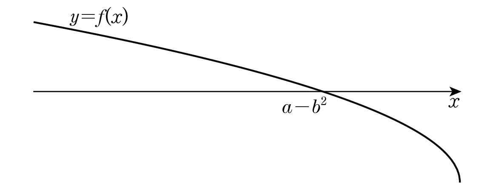
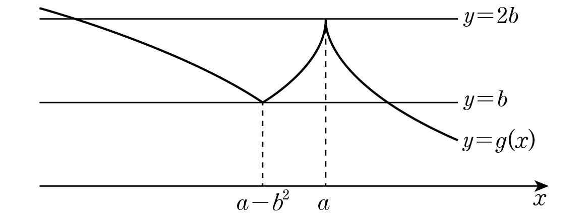
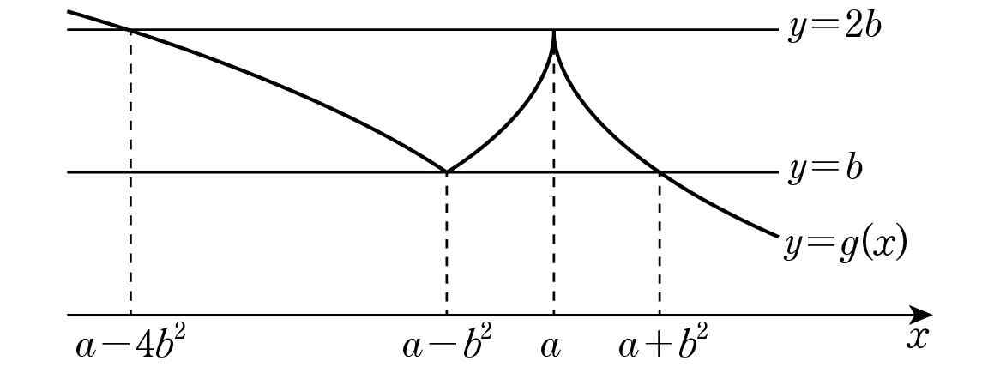

| 그림과 같이 함수 $y=g(x)$ 의 그래프와 직선 $y=t$ |  | you no longer need. Don’t keep your room |
| --- | --- | --- |
| 의 교점의 개수는 항상 $1$ 이므로 $h(t)=1$ | • 영어 영역 • | filled with items untouched for more than six |
| 그러므로 조건 (가)를 만족시키지 않는다. |  | months. If you haven’t used an item in six |
| (ⅱ) $b>0$일 때 | 정 답 | months, it likely means you won’t use it again! If you remove unnecessary items, you can |

$0=\sqrt{-x+a}-b$에서 $x=a-b^{2}$ 이므로 함수 $y=f(x)$
의 그래프는 다음과 같다	.	keep your room nice and neat. effective 효과적인 organized 정돈된
reflect on \~에 대해 곰곰이 생각해 보다
probably 아마도
get rid of 제거하다
untouched 손대지 않은
$x\le a-b^{2}$ 이면 $f(x)\ge 0$ 이므로 4. [출제의도] 그림과 대화의 일치 여부를 파악한다.
$g(x)=f(x)+b=f(x)+b=\sqrt{-x+a}$ W: I’ve just finished setting up my booth to sell
$a-b^{2}<x\le a$ 이면 $f(x)<0$ 이므로 used items. How does it look?
$g(x)=f(x)+b=-f(x)+b=-\sqrt{-x+a}+2b$ M: Wow! Everything looks nice, especially the
해 설
$x>a$ 일 때 banner hanging under the roof. People can see
$g(x)=-f(-x+2a)+b$ it well.
$=-\sqrt{-(-x+2a)+a}+b+b$ W: I think so, too. I also hope people like this
1. [출제의도] 담화의 목적을 추론한다.
$=-\sqrt{x-a}+2b$ striped dress in the corner.
M: Good morning, students. This is your vice
$g(x)$ 그러므로 함수 는 $_{g(x)=}\sqrt{-x+a}_{--\sqrt{-x+a}\sqrt{x-a}++2b2b}$	다음과 같다. $(_{x\le a-b}^{2})$	principal, Mr. Gunning. I have an announcement regarding our ‘Spring Flower Photo Day’ event	M: I bet they will. What about the wooden box here? Is it a used one, too?
W: Yes. To make it look better, I put some
this afternoon. As you know, we planned to
$(a-b^{2}<x\le a)$ flowers in it.
take pictures of beautiful spring flowers as we
M: They really catch the eye. Also, the shoes on
$(x>a)$ walk around our neighborhood. I regret to
the table look almost new.
inform you that the event is canceled due to
W: I haven’t worn them much because they are a
heavy rain. I understand you’ve been looking
bit small for me. So I’ve decided to sell them.
forward to it, but unfortunately it appears we
The guitar beside the table is almost new, too.
won’t be able to get the best photos today.
M: Oh, I like it the most. I hope you can sell
We will reschedule the event for a sunny day
everything you prepared!
in the near future. Please understand that this
banner 배너, 깃발
decision was made to ensure that the event
$h(t)\le 3$ 이고 $h(\alpha )\times h(\beta )=4$ 에서 striped 줄무늬의
will be a success.
$h(\alpha )=h(\beta )=2$이므로 조건 (가)를 만족시키는 실 bet 장담하다, 내기를 걸다
vice principal 교감 수 $\alpha$, $\beta$ 의 값은 $\alpha =b$, $\beta =2b$ 이다.
regarding \~에 관한 5. [출제의도] 대화자가 할 일을 추론한다.
조건 (나)에서 $x$ 에 대한 방정식
W: We’re almost done with our report on climate
$\{g(x)-\alpha \}\{g(x)-\beta \}=0$ 의 서로 다른 실근은 함수 2. [출제의도] 대화자의 의견을 추론한다.
change. Why don’t we check it together to see
$y=g(x)$ 의 그래프와 두 직선 $y=\alpha$, $y=\beta$ 의 교점 W: Liam, what’s that bunch of paper in your
if everything is okay?
의 $x$ 좌표이므로 방정식의 서로 다른 실근의 개수	hand?
M: That’s a good idea. Are you sure we included
는 $4$ 이다. M: It’s a deck of flashcards for memorizing new
every graph we made?
그러므로 $x$ 에 대한 방정식 words, but it doesn’t work well for me.
W: Yes, they are all there in the report. They
$\{g(x)-\alpha \}\{g(x)-\beta \}=0$ 의 서로 다른 실근 중 최솟 W: Really? Why not? I think flashcards are helpful
clearly show the causes of climate change that
값은 함수 $y=g(x)$ 의 그래프와 직선 $y=2b$ 의 교	for learning vocabulary.
we’ve researched.
점의 $x$ 좌표 중 $a$ 가 아닌 값이고, 최댓값은 함수 M: I thought so, too. But looking at the word on
M: Good to hear that. How about the pictures?
$y=g(x)$ 의 그래프와 직선 $y=b$ 의 교점의 $x$ 좌표	one side of the card and the meaning on the
We’ve chosen the five best pictures.
중 $a-b^{2}$ 이 아닌 값이다 . back is too boring.
W: They look very convincing. What do you think
W: Hmm, how about using them in a more
즉, $-30<a-b^{2}<a<15$ $g(-30)=2b$, $g(15)=b$ 이다	이고 .	interesting way?	about the part discussing the students’ awareness? Many of our friends participated in
M: A more interesting way to use flashcards?
our survey.
What do you mean?
M: The survey results show that many students
W: Ask a friend to read the meaning on the back,
know how serious it is. How about the action
and you shout out the word as the answer.
plans?
M: Oh, you mean like asking and answering
W: We have two action plans here, but I think we
questions in a quiz?
need more. Could you send me the data from
W: That’s right. By using flashcards for quizzes,
$g(-30)=2b$ 에서 our research?
you can learn new words while having fun.
$\sqrt{30+a}=2b$, $30+a=4b^{2}$ M: Sure. I’ll send the data this afternoon.
M: I like your idea a lot. I’ll give it a try!
$a-4b^{2}=-30$ …… ㉠ $g(15)=b$ 에서	bunch 묶음	convincing 설득력이 있는 awareness 인식, 의식
deck (카드) 한 벌
$-\sqrt{15-a}+2b=b$, $-\sqrt{15-a}=-b$ , $15-a=b^{2}$ action plan 실천 계획
$a+b^{2}=15$ …… ㉡ 3. [출제의도] 담화의 요지를 추론한다.
6. [출제의도] 수치를 파악한다.
이므로 ㉠, ㉡을 연립하면 $_{g\{g(x(1)5=0)\}2}\sqrt{-x+6}_{--=\sqrt{-x+6}\sqrt{x-6}(-\sqrt{150-6}++66+6)2=36}$	$a=6$, $b=3$ 이고	M: Hello, everyone. I’m Charlie Goodman, your	W: Honey, how about getting a pizza from Toby’s
speaker today. I’ll be discussing the most
$(x\le -3)$ Place for dinner?
effective way to maintain an organized room.
M: Sounds great! Let’s try the new delivery app
$(-3<x\le 6)$ Let’s start by reflecting on the items in your
that I downloaded recently. [Pause] Hmm...
$(x>6)$ room. Do you really use everything every day?
How about a potato pizza?
Probably not. The most important thing to do
W: I like that idea. How much is one large potato
to keep a clean room is to get rid of things
pizza?
10

| 1 | ③ | 2 | ① | 3 | ① | 4 | ④ | 5 | ⑤ |
| --- | --- | --- | --- | --- | --- | --- | --- | --- | --- |
| 6 | ③ | 7 | ② | 8 | ⑤ | 9 | ⑤ | 10 | ① |
| 11 | ① | 12 | ① | 13 | ② | 14 | ② | 15 | ② |
| 16 | ⑤ | 17 | ③ | 18 | ② | 19 | ⑤ | 20 | ① |
| 21 | ④ | 22 | ② | 23 | ⑤ | 24 | ⑤ | 25 | ⑤ |
| 26 | ④ | 27 | ③ | 28 | ④ | 29 | ④ | 30 | ③ |
| 31 | ③ | 32 | ② | 33 | ③ | 34 | ④ | 35 | ③ |
| 36 | ⑤ | 37 | ② | 38 | ③ | 39 | ② | 40 | ① |
| 41 | ① | 42 | ④ | 43 | ④ | 44 | ④ | 45 | ② |

| M: It’s \$25. Oh, we have to order a minimum of | rental 대여, 임대 | up soon. |  |
| --- | --- | --- | --- |
| \$30 for delivery. | absolutely 당연히, 절대적으로 |  | W: Oh, not yet. I’m struggling to think of |
| W: Then we can add some drinks. How much is a | onsite 현장에서 |  | something good for her. What do you think |

cola?	she’ll like?

9. [출제의도] 담화 내용과의 일치 여부를 파악한다.

M: One small can is \$2, and a large one is \$3.	M: I heard her favorite writer published a new W: Then let’s order two large cans.	book recently. How about buying the book as M: Great, one large potato pizza and two large	her birthday present?

cans of cola. Now we can place the order.	W:

W: Is there a delivery fee?	struggle 애쓰다

M: Normally we have to pay \$5, but it’s free now	publish 출판하다

because of the app promotion. So I’ll pay using

the app.	13. [출제의도] 대화에서 적절한 응답을 찾는다.

W: Thank you. I’m starving. I hope it gets here

quickly.

delivery 배달

minimum 최소한, 최소한의

normally 보통은, 정상적으로

7. [출제의도] 이유를 추론한다.

Artificial Intelligence 인공 지능

convention center 컨벤션 센터, 회의장

physical 신체의

adopt 채택하다

portrait 초상화

purchase 구입하다

admission 입장(권)

10. [출제의도] 표를 보고 선택한 것을 찾는다.

M: Hi, Kathy. How was your drama club’s
performance last week?
W: It was a huge success. Everyone liked it.
M: Good to hear that. Then, can I include your
performance video in our school promotion
video? Did anyone record it?
W: Yes, Mark recorded it.
M: Great! Could you send me the video file then?
W: Sorry, I can’t send it to you now.
M: Why not? Is it because you don’t have the
video file?
W: No, that’s not it. Mark sent me the file
yesterday.
M: Then, you don’t want to be on the promotion
video?
W: I’m okay with it. The problem is, without the
club members’ approval, I cannot send the file
to anyone outside the club.
M: Oh, I see. Can you ask your club members
about it?
W: Sure. Once they say it’s fine, I’ll let you
know.

performance 공연

promotion 홍보

approval 동의

8. [출제의도] 세부 사항의 언급 여부를 파악한다.

[Telephone rings.]
W: Green Forest camping site. How can I help
you?
M: Hi, this is Daniel Baker, a teacher from Simon
High School. I’m organizing a class camping
trip for 25 students. Do you have a camping
site available?
W: Certainly, when do you plan on camping?
M: From April 13 to 14.
W: Let me see. [Typing] We have spots available
for your students on that day. Do you want to
reserve them now?
M: Yes, please. Do you provide a tent rental
service as well?
W: Absolutely. We offer tents that are big enough
for six people. We also have sleeping bags for
rent.
M: Sounds good. I’ll rent five tents and 25
sleeping bags.
W: Alright, the total cost would be \$90. You can
pay it in advance or onsite.
M: I’ll pay onsite. Thanks, and see you then.

W: Hello, listeners! Let’s dive into the world of
Artificial Intelligence at the 2024 AI Expo. It
will be held on May 27 and 28 at the city
convention center. This year’s theme is the
use of AI in schools. From language learning
to physical training, AI is widely used in
schools. For just \$20, you can experience new
AI technologies that have been adopted in
more than 50 countries. Come and see the
future of AI! And here’s the best part. You
can get a special portrait drawn by AI used in
art classes. If you purchase the admission
ticket on our website, you will get a 10%
discount. Don’t miss this chance to have an
unforgettable AI experience!

W: Dad, I found a website that provides a service
to make photo albums. How about creating one
with the photos from our winter holiday?
M: Great! Let me see. [Pause] Oh, it says all we
need to do is choose a few options and upload
our photos.
W: Right. First, let’s choose the cover material.
M: Umm... Leather might be too heavy.
W: You’re right. Let’s choose either paper or
fabric.
M: Okay. For the number of pages, is 40 too
many?
W: Yes. Let’s just go for 20 or 30 pages. What
color would be good for the cover?
M: I want it to reflect our winter holiday. How
about white?
W: Perfect. That leaves us with two options.
M: Then, let’s choose the cheaper one.
W: Sounds great. I’ll choose the best pictures and
upload them.

option 선택

material 재료

leather 가죽

fabric 천

reflect 반영하다

11. [출제의도] 대화에서 적절한 응답을 찾는다.

W: How was your weekend? Did you do anything
special?
M: Yes, my older brother and I visited my
grandparents who live on a small island. We
had a great time doing lots of outdoor
activities together.
W: That sounds lovely! What activity did you like
the most there?
M:

M: Hello, welcome to Glow Cosmetics Shop. How
can I help you?
W: Hi, I’m looking for sunscreen.
M: Certainly. Is it for you, or someone else?
W: It’s for my husband. He asked me to buy one
for him.
M: Okay, does your husband spend much time
outdoors, playing sports, or working outside?
W: No, not really. He works in an office and
usually stays at home after work.
M: In that case, he might not need one with
strong sun protection. A mild one is probably
best for him.
W: Okay. I’ll go with that.
M: We have two types of sunscreen, spray and
cream type. Which one would he prefer?
W: I’m not sure but I guess he is used to cream
type.
M:

sunscreen 선크림

protection 보호

mild 순한

14. [출제의도] 대화에서 적절한 응답을 찾는다.

M: Ms. Williams! Do you have a minute?
W: Sure. What is it?
M: I have to write an essay to get a scholarship,
but I don’t know what to write about.
W: Maybe you can start by expressing your
passion for learning and school life.
M: I already wrote about that, but it doesn’t seem
good enough.
W: Umm... How about mentioning a weakness
you’ve worked on?
M: Weakness? Wouldn’t that be a bad idea for an
essay?
W: Not necessarily. If you describe how you’ve
been trying to deal with it, your story will
show your potential.
M: Well, I used to put my work off until the last
minute. But by using a planner, I make my
schedule on an hourly basis. Now I no longer
have any trouble finishing my work on time.
W: That’s perfect! That will be a great story to
include in your essay for the scholarship.
M: Thank you for your help! That actually makes
me feel a lot more confident.
W:

outdoor 야외의

12. [출제의도] 대화에서 적절한 응답을 찾는다.

M: Hey, Jessica. Have you bought a birthday present for Olivia yet? Her birthday is coming

scholarship 장학금

passion 열정

mention 언급하다

weakness 약점

deal with \~을 다루다

potential 잠재력

hourly 한 시간마다

basis 기반

have trouble \~ing \~하는 데 어려움을 겪다

reserve 예약하다

on time 제 시간에

15. [출제의도] 상황에 적절한 말을 찾는다.

W: Lucy is the head of her school’s student
council. She is concerned about the lack of
proper recycling practices among students. She
notices that many students are not aware of
the problem. To address this issue, she
decides to create posters to emphasize the
importance of recycling. However, she lacks
confidence in her drawing skills. Lucy wants
to seek help from her friend James, as he is
talented in art and passionate about the
environment. Lucy thinks collaborating with
him will result in effective poster designs. So,
she wants to suggest to James that they work
together on the recycling posters. In this
situation, what would Lucy most likely say to
James?
Lucy:

student council 학생회

be concerned about \~을 걱정하다 lack 부족; 부족하다

practice 실행

notice 알아채다

address 다루다

emphasize 강조하다

be talented in \~에 재능이 있다 passionate 열정적인

collaborate 협력하다

[16 \~ 17]

M: Hello, students. Today, I’d like to talk about
four great inventions in history. Throughout
history, humans have invented things that have
transformed how we live. One of the most
important inventions is the wheel. This simple
yet powerful invention revolutionized
transportation. The wheel made it possible to
travel far and wide, trade goods, and explore
new lands. Another important invention is the
printing press, which enabled books to be
printed much faster. This change affected how
knowledge and education spread. Next is the
light bulb. It lengthened our days, allowing for
nighttime activities and opened the door to
many other modern technologies. The last
invention I’d like to mention is the telephone.
With the telephone, people could speak to each
other instantly regardless of distance. As a
result of this transformation, people are
connected as never before, in business and
social life. These are just a few examples of
the many inventions that have changed the
course of human history.

invention 발명품

throughout 내내

transform 바꾸다

revolutionize 혁신을 일으키다 transportation 교통수단

16. [출제의도] 담화의 주제를 추론한다.
17. [출제의도] 세부 사항의 언급 여부를 파악한다.
18. [출제의도] 글의 목적을 추론한다.

친애하는 Greenville의 공예가들에게

5월 25일 오후 1시부터 6시까지 열리는 연례 공예품 박람회를 위해서, Greenville 커뮤니티 센터에서는 지난 몇 년간처럼 대여 부스 공간을 제공합니다. 공간을 예약하려면 저희 웹사이트를 방문하여 4월 20일까지 신청서를 작성하시기 바랍니다. 대여 요금은 50달 러입니다. 부스 대여료로 받은 모든 돈은 연중 예정된 활동을 지원하는 데 사용됩니다. 모든 이용할 수 있는 공간이 곧 모두 예약될 것으로 예상되니 놓치지 마세

요. 박람회에서 뵙기를 바랍니다.

annual 연례의

craft 공예품

fair 박람회

registration form 신청서

rental 대여; 대여의

fee 요금

support 지원하다

upcoming 예정된

throughout the year 연중

19. [출제의도] 등장인물의 심경 변화를 추론한다.

그림 그리기를 좋아하는 젊은 예술가 Sarah는 지역 미술 대회에 참가했다. 다른 사람들이 만든 놀라운 예술 작품들을 보면서 그녀의 자신감은 떨어졌다. 그녀는 ‘내가 상을 받지 못할 수도 있겠네.’라고 조용히 생각했다. 심사의 순간이 다가왔고, 심사위원들은 수상자를 한 명씩 발표하기 시작했다. 그녀는 마지막에야 자신의 이름을 들었다. 심사위원장이 “축하해요, Sarah Parker! 당신이 1등을 했습니다. 당신 작품의 독창성이 정말 좋았습니다.”라고 말했다. Sarah는 기쁨에 휩싸였고 미소가 가시지 않았다. 이 경험은 단순한 우승 이상의 의미를 지녔고, 그녀에게 예술가로서의 정체성을 확인해 주었다.

confidence 자신감

judgment 심사

judge 심사위원

announce 발표하다

one by one 한명씩

uniqueness 독창성

confirm 확인해 주다

identity 정체성

20. [출제의도] 필자의 주장을 추론한다.

너무나 많은 경우에, 사람들, 특히 오늘날의 세대는,
일이 하룻밤 사이에 일어나기를 기대한다. 우리가 이 러한 잘못된 기대를 가질 때, 그것은 우리가 계속해서 앞으로 나아가는 것을 방해하는 경향이 있다. 지금은 첨단 기술 사회이기 때문에, 우리가 원하는 모든 것은 편안함과 편리함이라는 제한 내에 있어야 한다. 그 일이 충분히 빨리 일어나지 않으면, 우리는 흥미를 잃게 끔 유혹을 받는다. 그래서 많은 사람들은 성공하는 데 필요한 시간을 들이는 것을 원하지 않는다. 성공은 단순한 욕망의 문제가 아니다. 여러분은 그것(성공)을 이루기 위해 인내심을 길러야 한다. 여러분은 조바심의 먹잇감이 되어 본 적이 있는가? 위대한 일이 이루 어지는 데에는 시간이 걸린다.

mere 단순한

patience 인내심

fall prey to \~의 먹잇감이 되다

impatience 조바심

21. [출제의도] 어구의 함축 의미를 추론한다.

만약 ‘자율 주행’ 자동차를 1950년대에 만들고 싶었다면, 가장 좋은 선택은 가속 페달에 벽돌을 끈으로 묶는 것이었을 것이다. 물론, 자동차가 스스로 앞으로 나아갈 수는 있었겠지만, 속도를 줄이거나 멈추거나 또는 장애물을 피하기 위해 방향을 전환할 수는 없었다. 분명히, 이상적이지는 않다. 그러나 그것이 자율 주행 자동차라는 전체 개념이 추구할 만한 가치가 없다는 의미일까? 아니다, 그것은 단지 우리가 지금은 갖고 있는, 자동차를 자율적이고도 안전하게 작동할 수 있도록 해 주는 도구를, 그 당시에는 우리가 아직 갖고 있지 않았다는 것을 의미할 뿐이다. 한때 멀게만 느껴졌던 이 꿈이 이제 우리의 손이 닿는 곳에 있는 것처럼 보인다. 이는 의학에서도 마찬가지이다. 20년 전에, <u>우리는 여전히 가속 페달에 벽돌을 테이프로 묶</u><u>어 두고 있었다</u>. 오늘날, 우리는 환자를 고유한 개인으로서 이해하는 것을 증진하는 방식에 맞는 적절한 기술을 도입하기 시작하는 지점에 접근하고 있다. 사실,
많은 환자들이 이미 자신의 상태를 실시간으로 관찰하는 장치를 착용하고 있는데, 이는 의사가 구체적이고도 정제되었으며 피드백을 기반으로 하는, 십 년 전에는 전혀 가능하지 않았던 방식으로 환자에게 말할 수 있도록 해 주었다.

selfdriving 자율 주행; 자율 주행의 accelerator 가속 페달

vehicle 자동차, 교통수단

on one’s own 스스로

barrier 장애물

obviously 분명히

entire 전체의

pursue 추구하다

possess 가지고 있다

tape 테이프로 묶다

approach 접근하다

bring \~ to bear \~을 도입하다

appropriate 적절한

advance 증진하다

unique 고유한

refined 정제된

22. [출제의도] 글의 요지를 추론한다.

우리는 새로운 기술의 영향을 과대평가하는 경향이 있는데, 부분적으로 그 이유는 기존 기술이 눈에 거의 보이지 않을 만큼 우리 삶의 일부로 흡수되었기 때문이다. 젖병을 예로 들어 보자. 여기에 수많은 영유아와 엄마들의 인간으로서의 근본적인 경험을 바꿨으나, 기술의 역사에서 그 자리를 찾지 못한 단순한 도구가 있다. 이 기술은 전형적으로 시간을 조절하는 장치라고 여겨지는데 이는 엄마가 수유 시간에 대해 더 많은 통제력을 발휘할 수 있게 하기 때문이다. 또한 젖병 수유는 시간을 절약하는 기능도 하는데, 이는 다른 사람이 엄마의 (수유) 시간을 대신하도록 허락하기 때문이다. 따라서, 잠재적으로 그것(젖병)은 일상 생활의 시간 관리에 큰 영향을 미치지만, 빠른 속도의 사회적 논의에서는 완전히 간과되고 있다.

<table>
<tr><th>far and wide 널리</th><th></th><th>overrate 과대평가하다</th></tr>
<tr><td>explore 탐험하다</td><td>generation 세대</td><td>impact 영향</td></tr>
<tr><td>enable 가능하게 하다</td><td>overnight 하룻밤 사이에</td><td>in part 부분적으로</td></tr>
<tr><td>affect 영향을 미치다</td><td>discourage ~ from …ing ~이 …하는 것을 방해하다</td><td>absorb 흡수하다</td></tr>
<tr><td>lengthen 연장하다</td><td>high tech 첨단 기술</td><td>so as to ~할 만큼</td></tr>
<tr><td>instantly 즉시</td><td>comfort 편안함</td><td>invisible 눈에 보이지 않는</td></tr>
<tr><td>regardless of ~에 관계 없이</td><td>convenience 편리함</td><td>implement 도구</td></tr>
<tr><td>connect 연결하다</td><td>be tempted to ~하게끔 유혹을 받다</td><td>transform 바꾸다</td></tr>
<tr><td></td><td>require 필요로 하다</td><td>fundamental 근본적인</td></tr>
<tr><td colspan="3">12</td></tr>
</table>

classic 전형적인

exercise 발휘하다

function 기능을 하다

bottle feeding 젖병 수유

substitute for \~을 대신하다 potentially 잠재적으로

implication 영향

entirely 완전히

overlook 간과하다

23. [출제의도] 글의 주제를 추론한다.

‘공감’이 무엇을 의미하는지 정확히 밝히지는 않지만, 공감은 고용주나 직원에게 가장 바라는 기술 중 하나로 목록에 종종 오른다. 일부 기업은 인지적 공감을 강조하여 리더가 거래를 협상하고 결정을 내릴 때 직원과 고객의 관점을 이해할 필요성에 중점을 둔다.
다른 기업은 정서적 공감과 공감적 관심을 강조하여 진정한 관심과 동정심으로 직원과 고객을 대함으로써 그들의 신뢰를 얻는 리더의 능력에 중점을 둔다. 일부 자문 위원이 성공하려는 기업은 공감 능력을 길러야 한다고 주장할 때, 그것이 의미하는 바는 기업이 시장 조사를 잘 수행해야 한다는 것이다. 다시 말해, ‘공감적인’ 기업은 고객의 필요와 요구를 이해하고, 그 필요와 요구를 충족시키기 위해 노력한다. 일부 사람들이 공감을 담은 디자인을 말할 때, 그것이 의미하는 바는 회사가 제품을 디자인할 때 시각 장애인, 청각 장애인,
노인, 비영어권 화자, 색맹 등 다양한 사람들의 구체적인 필요 사항을 고려해야 한다는 것이다.

cognitive 인지적인

perspective 관점

negotiate 협상하다

affective 정서적인

concern 관심

consultant 자문 위원

foster 기르다

the blind 시각 장애인

the deaf 청각 장애인

the colorblind 색맹

24. [출제의도] 글의 제목을 추론한다.

아이들이 이야기하는 가장 일반적인 문제는 그들이 항상 연락될 수 있어야 한다고 느낀다는 것이다. 기술이 그것을 허용하기 때문에, 그들은 의무감을 느낀다.
우리 대부분은 공감하기 쉬운데, 아마 여러분도 자신의 삶에서 같은 압박을 느낄 것이다! 우리가 인간이고 항상 즉각적으로 응답할 수 없다는 사실에 대처하는 것은 매우 힘들다. 아직 사회적 상호 작용의 세부적인 것들을 배우고 있는 십대(13 \~ 19세)나 십대 초반(10
\~ 12세)의 아동에게 상황은 훨씬 더 심각하다. 때때로 이 행동이 나타나는 방식은 다음과 같다. 예를 들어,
여러분의 자녀가 친구 중 한 명에게 문자 메세지를 보내고, 그 친구가 즉시 답장을 보내지 않는다면, 이제 여러분의 자녀는 “얘는 더 이상 내 친구가 되기를 원하지 않는구나!”라고 생각하기 쉽다. 그래서 다시, 다시, 그리고 또 다시 문자 메시지를 보내다가, ‘전화기를 폭파하는(과부하 상태로 만드는) 것’이다. 이것은 스트레스를 유발하고, 심지어 공격적인 것으로 읽힐 수 있다. 하지만 여러분은 이것이 얼마나 쉽게 일어날 수 있는지 알 수 있다.

prevalent 일반적인

accessible 연락될 수 있는, 연락 가능한 obligation 의무

relate 공감하다

pressure 압박

ins and outs 세부적인 것들

interaction 상호작용

induce 유발하다

aggressive 공격적인

25. [출제의도] 도표의 내용을 파악한다.

위 그래프는 2020년 3개국의 1인당 일일 평균 공급량으로 측정한 동물성 단백질 섭취량을 나타낸다. ① 미국은 3개국 중 1인당 총 동물성 단백질 섭취량이 가장 많은 것으로 나타났다. ② 계란과 유제품이 미국에서 네 가지 범주 가운데 가장 많은 동물성 단백질 공급원이었고, 육류와 가금류가 각각 22.4g과 20.6g으로 그 뒤를 이었다. ③ 미국과 달리, 브라질은 가장 많은 동물성 단백질을 육류로부터 섭취했고, 계란과 유제품을 두 번째로 많이 섭취했다. ④ 일본은 1인당 50g 미만의 총 동물 단백질을 섭취했고, 이는 세 나라 중 가장 적은 양이었다. ⑤ 생선과 해산물은 미국과 브라질에서 가장 적게 섭취한 동물성 단백질 섭취원이었는 데, 일본에서는 두 번째(→ 첫 번째)로 높은 순위를 차지했다.

protein 단백질

consumption 섭취

average 평균

category 범주

respectively 각각

least 가장 적은

rank (순위를) 차지하다

26. [출제의도] 글의 세부 내용을 파악한다.

Theodore von Kármán은 헝가리계 미국인 공학자로, 20세기의 가장 위대한 지성인 중 한 명이었다. 그는 헝가리에서 태어나 어린 시절 수학과 과학에 재능을 보였다. 1908년, 독일 University of Göttingen에서 공학 박사 학위를 받았다. 1920년대에, 관련 분야의 강연자 겸 자문 위원으로 다니기 시작했다. 미국으로 초청되어 캘리포니아 공과대학(Caltech)에서 공학자들에게 윈드 터널 설계에 관한 조언을 하였다. 1930년에 Caltech의 Guggenheim Aeronautical Laboratory의 소장이 되었다. 나중에는 과학과 공학 분야에서의 리더 십으로 National Medal of Science를 받았다.

mind 지성인

talent 재능

doctoral degree 박사 학위

director 소장

27. [출제의도] 실용문의 세부 내용을 파악한다.

기초 라떼 아트 수업 완벽한 라떼를 만들어 가장 아름다운 방법으로 표현 해 보세요! 이 수업에서, 여러분은 우유를 데우고 따르는 방법을 배울 것입니다. 여러분은 세 가지 라떼 아트 디자인(하트, 튤립, 그리고 나뭇잎)을 직접 만들 것입니다.
날짜: 2024년 4월 27일 시간: 오전 9시 \~ 오후 1시 장소: Camefort 커뮤니티 센터 등록 & 비용
∙ 4월 22일부터 4월 24일까지
www.camefortcc.com에서 온라인으로 등록하세요.
∙ 1인당 60달러 (재료비 포함)
참고
∙ 우유를 마시지 않는 사람은 대체 유제품을 사용할 수 있습니다.
∙ 학생은 10% 할인을 받을 수 있습니다.

present 표현하다

steam 데우다

pour 따르다

registration 등록

ingredient 재료

dairy alternative 대체 유제품

available 사용할 수 있는

28. [출제의도] 실용문의 세부 내용을 파악한다. 가족 야간 하이킹 이벤트

하이킹과 가족 간의 유대로 즐거움이 가득한 밤을 함께하세요!

날짜: 5월 4일, 토요일

시간: 오후 6시 \~ 9시

장소: Skyline 보호 구역

비용

∙ 성인: 20달러

∙ 19세 미만 어린이: 10달러

지침

∙ 어린이는 법적 보호자를 동반해야 합니다.

∙ 손전등과 물 한 병을 가져오세요.

∙ 항상 안내원의 지시를 따라 주세요.

등록

∙ www.familyhiking.com에 방문하여 4월 26일까지 등록하세요.

∙ 4월 12일까지 등록하시는 모든 분께 구급상자가 무료로 제공됩니다.

bonding 유대

preserve 보호 구역

guideline 지침

be accompanied by \~을 동반하다

legal guardian 법적 보호자

instruction 지시

first aid kit 구급상자

29. [출제의도] 어법상 맞지 않는 표현을 찾는다.

수년 동안 많은 심리학자들이 부정적인 건강 습관을 해결하기 위한 열쇠는 행동을 바꾸는 것이라는 믿음을 굳게 갖고 있었다. 가치관이나 태도보다, 이것이 가장 바꾸기 쉬운 성격의 한 부분이다. 흡연, 음주, 그리고 다양한 섭식 행동과 같은 섭취 습관은 행동 변화의 대상이 되는 가장 일반적인 건강 문제이다. 과정 중독 행동(일중독, 쇼핑 중독 등) 또한 이 범주에 속한다.
암시의 힘과 결합된 마음 속 이미지는 사람들이 부정적인 건강 행동을 긍정적인 것으로 바꾸는 데 도움을 주는 행동 의학의 전제가 되었다. 이 기술만으로는 변화를 만들어 내지는 않지만, 다른 행동 수정 기법 및 대응 전략과 함께 사용되면, 행동 변화가 일부 사람들에게는 효과적인 것으로 입증되었다. 마음 속 이미지가 하는 일은 새로운 바람직한 행동을 강화하는 것이다. 이미지의 반복적 사용은 시간이 지남에 따라 그 바람직한 행동을 더욱 강력하게 강화한다.

④ using → used

psychologist 심리학자

personality 성격

target 대상으로 하다

addiction 중독

combined with \~과 결합된

suggestion 암시

alongside \~과 함께

modification 수정

tactic 기법

cope 대응하다

strategy 전략

reinforce 강화하다

30. [출제의도] 문맥에 맞지 않는 낱말을 찾는다.

다른 사람들로부터 감정과 감정을 다루는 방법을 배우는 감정 사회화는 어릴 때부터 시작되며 감정 조절 발달에 기초적인 역할을 한다. 청소년기에는 또래나 미디어와 같은 가족 이외의 영향이 중요해지지만, 부모는 여전히 주된 사회화 주체이다. 예를 들어, 감정적 상황에 대한 부모 자신의 반응이 감정 조절의 롤모델이 되어 자녀가 비슷한 상황에서 유사한 반응을 보일 가능성을 높인다. 자녀가 정서적 어려움에 직면했을 때 부모의 (습관적) 행동 또한 감정 조절 발달에 영향을 미친다. 직접적인 위로와 어떻게 해야 하는지에 대한 지시적 안내가 어린 자녀에게는 도움이 되지만, 청소년의 자율성 추구를 <u>장려할 수(→ 방해할 수)</u> 있다.

| 결과적으로 부모의 행동이 조정되지 않는다면, 청소년 | 청소년 영화가 극장 입장객의 59퍼센트를 끌어모았고 | 측정 기준을 요구하거나, 또는 (이 목표를) 어떤 하나 |
| --- | --- | --- |
| 은 정서적 위기 상황에서 부모에게 의지하기보다 오히 | 2014년에는 독일의 어린이 영화가 전국 극장 흥행 수 | 의 측정 방법만으로 한정(하여 측정)하기가 어렵거나 |
| 려 부모로부터 멀어질 수 있다. 청소년기에 더 적합한 | 익 상위 20개 영화 중 7개를 차지했다는 사실에 의해 | 아마 불가능할 수도 있다. 그리고 우리가 불완전하거 |
| 것은 청소년의 정서적 경험에 대한 인식과 무비판적 | 증명될 수 있다. 이 현상은 다양한 연령대의 관객들 | 나 잘못된 프록시를 가지고 있을 때, 우리는 가치 있 |
| 수용뿐만 아니라 (그에 대한) 관심, 그리고 청소년이 | 사이에서 겉으로는 어린이 문화처럼 보이는 것이 더 | 는 해결책을 향한 진정한 진전을 실제로 이루지 못하 |
| 대화하고 싶을 때 곁에 있어 주는 것과 같은 방법으로 | 광범위하고 국제적으로 수용되는 것과 일치한다. 어린 | 면서 좋은 목적을 위해 문제를 해결하고 있다는 착각 |
| 자율적 감정 조절을 간접적으로 지원하는 것이다. | 이 영화가 성인을 위한 더 제대로 된 영화와는 별개의 | 에 쉽게 빠질 수 있다. 프록시의 문제는 기술자들이 |
| ③ cultivate → intrude on | (그리고 영원히 하위의) 다른 영역이라는 오래된 편견 | 흔히 <u>의미 있는 것을 측정 가능한 것으로 대체하는</u> 결 |
| socialization 사회화 | 은 소비의 실상에 의해 뒷받침되지 않는다. 즉, 어린이 | 과를 낳는다. 흔히 말하듯이, “중요한 모든 것들이 셀 |
| foundational 기초적인 | 영화가 현대 대중문화의 중심에 있다. | 수 있는 것은 아니고, 셀 수 있는 모든 것들이 중요한 |

regulation 조절

explore 탐구하다

것도 아니다.”

| extrafamilial 가족 이외의 | production 제작 | technologist 기술자 |
| --- | --- | --- |
| adolescence 청소년기 | consumption 소비 | on the lookout for \~을 찾고 있는 |
| primary 주된 | imply 암시하다, 의미하다 | quantifiable 정량화할 수 있는 |
| agent 주체, 행위자 | ownership 소유권 | measurable 측정 가능한 |
| likelihood 가능성 | supposedly 소위 | lifeblood 생명줄 |
| comparable 비슷한 | considerable 상당한, 중요한 | identify 식별하다 |
| practice (습관적) 행동 | crossover 넘나듦, 교차 | concrete 구체적인 |
| whereas 반면에 | composition 구성 | assess 평가하다 |
| soothing 위로 | theatrical 극장의 | bias 편향, 편견 |
| directive 지시적인 | comprise 차지하다 | complicated 복잡한 |
| beneficial 도움이 되는 | box office (극장 흥행) 수익 | imperfect 불완전한 |
| autonomy 자율성 | phenomenon 현상 | illusion 환영, 착각 |
| striving 추구 | correspond with \~과 일치하다 | end 목적 |

turn toward \~에 의지하다

adjust 조정하다

suitable 적합한

awareness 인식

nonjudgmental 무비판적인

31. [출제의도] 빈칸에 적절한 표현을 추론한다.

무용수는 종종 자신의 신체 능력의 한계까지 자신을 밀어붙인다. 그러나 그렇게 밀어붙이는 것이 물리적으로 불가능한 것을 달성하는 쪽으로 향하게 된다면, 잘못 이해한 것이다. 예를 들어, 키가 크고 발이 긴 무용수가 공중에서 발끝을 뾰족하게 하고 점프 사이에 발뒤꿈치를 바닥에 내리면서 빠른 음악에 맞춰 반복적인 수직 점프를 수행하고 싶을 수 있다. 무용수가 아무리 힘이 좋을지라도 그것은 불가능할 수 있다. 하지만 발이 짧은 무용수는 전혀 문제가 없을 것이다! 또 다른 무용수는 공중에서 반 회전을 완성하려고 애쓰고 있을 수 있다. 빠른 회전 속도와 회전축에 가깝게 몸을 정렬하는 것의 연관성을 이해하는 것은 그 무용수에게 성공적으로 회전을 해내는 방법을 알려 준다. 이 두 경우 모두에서, 선천적으로 주어지고 물리적 법칙에 의해 설명되는 <u>제약</u>을 이해하고 그 안에서 움직이는 것은 잠재적인 부상 위험을 최소화하면서 무용수가 효율적으로 움직이게 해 준다.

capability 능력, 역량

misguided 잘못 이해한

accomplish 달성하다

repetitive 반복적인

vertical 수직의

embrace 수용

seemingly 겉으로는 \~처럼 보이는

prejudice 편견

realm 영역

legitimate 제대로 된

contemporary 현대의

33. [출제의도] 빈칸에 적절한 표현을 추론한다.

새로운 것을 창작하려는 베토벤의 욕구는 그의 호기심 상태의 반영이다. 우리의 뇌는 우리가 이전에 연주하거나 들어본 적이 없는 악절과 같이 불확실한 것을 탐구하는 과정에서 새로운 것을 창작할 때 보상감을 경험한다. 우리의 호기심이 새로운 것으로 이어지면,
그 결과로 얻어지는 보상은 우리에게 쾌감을 가져다 준다. 많은 연구자들이 음악 작곡에 호기심이 어떻게 영향을 미치는지를 모델링해 왔다. 베토벤의 경우, 13
세 이후로 작곡된 32개의 피아노 소나타에 초점을 맞춘 컴퓨터 모델링에서 베토벤의 모든 음악에서 발견되는 음악 패턴이 후기 소나타에서는 감소한 반면, 특정 소나타에만 나타나는 패턴을 포함한 새로운 패턴은 증가한 것을 보여 주었다. 다시 말해, 베토벤의 호기심이 새로운 음악적 아이디어의 탐구를 이끌게 됨에 따라 그의 음악은 <u>시간이 지날수록 덜 예측 가능하게 되었</u>다. 호기심은 인간의 창의성의 강력한 원동력이다.

drive 욕구; 이끌다

novel 새로운

reflection 반영

curiosity 호기심

reward 보상

genuine 진정한

count 중요하다, (수를) 세다

35. [출제의도] 글의 흐름과 무관한 문장을 추론한다.

우리는 음식에 양념을 하는 유일한 종으로, 허브와 향신료라고 부르는 강한 맛을 내는 식물의 부분을 이용하여 그것(음식)을 의도적으로 바꾼다. 향신료에 대한 우리의 미각은 진화적 뿌리를 가지고 있을 가능성이 높다. 많은 향신료가 항균성을 가지고 있는데, 실제로 마늘, 양파, 오레가노와 같은 흔한 조미료들이 거의 모든 확인된 박테리아의 성장을 억제한다. 그리고 태국 음식의 마늘과 후추, 인도의 생강과 고수, 멕시코의 고추를 생각해 보면, 향신료를 가장 많이 사용하는 문화권은 더 따뜻한 기후에서 유래하는데, 그곳에서는 박테리아에 의한 (음식의) 부패가 큰 문제이다. <u>변화</u><u>하는 기후는 향신료의 생산과 이용 가능성에 많은 영</u><u>향을 미칠 수 있기 때문에, 그들(향신료)의 성장 방식</u><u>에 영향을 주고, 궁극적으로 세계 향신료 시장에 영향</u><u>을 미친다</u>. 반대로, 스칸디나비아와 북유럽의 요리같이 가장 향신료를 적게 쓰는 요리는 더 서늘한 기후에서 유래한다. 맛에 대한 인간 특유의 관심, 이 경우 향신료의 맛은 사느냐 죽느냐의 문제로서 생겨난 것으로 드러난다.

season 양념을 하다

deliberately 의도적으로

alter 바꾸다

flavor 맛; 맛을 내다

spice 향신료

evolutionary 진화적인

| rapid 빠른 | phrase (음악의) 구절 | antibacterial 항균의 |
| --- | --- | --- |
| impose 주다, 부여하다 | resulting 결과로 얻어지는 | property 특성 |
| by nature 선천적으로 | investigator 연구자 | seasoning 조미료 |
| efficiently 효율적으로 | composition 작곡 | inhibit 억제하다 |
| minimize 최소화하다 | reveal 보여 주다 | coriander 고수 |
| potential 잠재적인 |  | spoilage 부패 |

injury 부상

32. [출제의도] 빈칸에 적절한 표현을 추론한다.

우리는 어린이 영화 제작과 소비 습관 사이의 관계

34. [출제의도] 빈칸에 적절한 표현을 추론한다.

기술자들은 항상 정량화할 수 있는 측정 기준을 찾고 있다. 모델에 측정 가능한 입력(을 하는 것)은 그들의 생명줄이며, 사회 과학자와 마찬가지로 기술자는

significant 많은

availability 이용 가능성

ultimately 궁극적으로

arise 생겨나다

<table>
<tr><th>를 탐구해야 한다. ‘어린이 영화’라는 용어는 어린이에</th><th>진척 상황을 평가하기 위한 구체적인 측정 방법, 즉</th><th></th></tr>
<tr><td>의한 소유권, 즉 ‘그들의’ 영화를 암시하지만, 소위 어</td><td>‘프록시’를 식별할 필요가 있다. 이러한 정량화할 수</td><td>36. [출제의도] 글의 순서를 파악한다.</td></tr>
<tr><td>린이를 위해 만들어진 영화는 특히 상업 영화에서, 항</td><td>있는 프록시에 대한 필요성은 정량화하기 쉬운 것들을</td><td>단일 세포로부터 인체가 발달하는 것은 무작위적인</td></tr>
<tr><td>상 <u>모든 연령대의 관객들에게 소비되어 왔다</u>. 어린이</td><td>측정하는 쪽으로 편향을 만든다. 하지만 단순한 측정</td><td>변이의 반복적 생성이 비무작위적인 선택과 결합될 때</td></tr>
<tr><td>영화의 관객 구성에서 상당한 (연령 간의) 넘나듦이</td><td>기준은 우리가 정말로 신경 쓰는 중요한 목표로부터</td><td>가능해지는 구조적 풍부함의 많은 예를 제공한다. (C)</td></tr>
<tr><td>있다는 것은, 2007년에 11개의 덴마크의 어린이 및</td><td>우리를 더 멀어지게 할 수 있는데, 이 목표는 복잡한</td><td>배아에서 성체에 이르기까지 신체 발달의 모든 단계는</td></tr>
<tr><td colspan="3">14</td></tr>
</table>

sensible 분별 있는

40. [출제의도] 글의 요약문을 완성한다.

세포 수준에서는 무작위 활동을 보이고, 신체 형성은 이러한 활동(무작위 활동)에 의해 만들어진 새로운 가능성과 더불어, 이전에 확립된 기준을 만족시키는 결과물의 선택에 달려 있다. 항상 새로운 구조는 오래된 구조를 기반으로 하며, 모든 단계에서 선택은 일부 세포들을 선호하고 다른 세포들은 제거한다. (B) 생존한 세포들은 추가적인 선택의 과정을 거치는 새로운 세포들을 만들어 내는 역할을 한다. 면역계를 제외하면 세포와 세포의 확장은 발달 과정에서 유전적으로 선택되는 것이 아니라 위치에 의해 선택된다. (A) 제 자리에서 제대로 된 연결을 만들어 낸 것(세포)들은 활성화되고, 그렇지 않은 것들은 제거된다. 이 과정은 마치 조각을 하는 것과 같다. 이 전략의 필연적 결과는 전체 구조가 상당히 비슷하더라도 세포와 분자 수준에서 개인마다 큰 변이성이 있다는 것이다.

random 무작위의

variation 변이

stimulate 활성화하다, 자극하다

eliminate 제거하다

sculpting 조각

consequence 결과

variability 변이성

largescale 전체의, 대규모의

serve to \~하는 역할을 하다

undergo 겪다

immune 면역의

extension 확장

genetically 유전적으로

phase 단계

exhibit 보여 주다

criteria 기준

favor 선호하다

37. [출제의도] 글의 순서를 파악한다.

rigid 엄격한

result in \~한 결과를 초래하다 overloaded 너무 많은 부담을 진 demotivated 의욕을 잃은

38. [출제의도] 문장의 위치를 파악한다.

rare 드문

occasion 경우

dramatically 극적으로

population 개체수

reorientate 방향을 다시 잡다 undoubtedly 의심할 여지 없이 perish 죽다

infrequent 드문

timescale 시간

profound 중대한

migration 이동, 이주

wintering location 월동 장소 frequency 빈도

39. [출제의도] 문장의 위치를 파악한다.

노인과 빈곤층을 위한 재택 간호의 계속적으로 증가하는 비용을 통제하기 위해 재택 간호 제공 업체의 관리자는 관리 시스템을 도입했다. (B) 이러한 시스템은 재택 간호 종사자의 업무와 이러한 업무를 수행하는 데 사용할 수 있는 시간과 예산을 명시한다. 전자 보고 시스템은 재택 간호 종사자가 자신의 활동과 소요 시간을 보고하도록 요구하므로 시간과 비용의 분배를 잘 보이게 만들고, 관리자의 입장에서는 통제 가능하게 만든다. (A) 관리자의 관점에서는, 이것이 문제 해결에 기여해 왔다. 반면에, 재택 간호 종사자들은 자신의 업무를 가능한 한 효율적으로 수행되어야 하는 일련의 분리된 업무가 아니라, 그들이 관계를 맺어온 고객에게 제공되는 서비스로 인식할 것이다. (C) 이것은 고객과 대화를 나누고 고객의 안부를 묻는 것을 포함한다. 제한된 시간과 보고를 해야 한다는 요구 사항은 필요한 서비스를 제공하는 것을 불가능하게 하는 장애물로 여겨질 것이다. 만약 관리 시스템이 너무 엄격하면, 이것은 재택 간호 종사자가 너무 많은 부담을 지게 되고 의욕을 잃는 결과를 초래할 것이다.

everincreasing 계속 증가하는 elderly 노인의

needy 빈곤한

contribute 기여하다

resolution 해결책

perceive 인식하다

a set of 일련의, 많은

as \~ as possible 가능한 한 \~하게 specify 명시하다

budget 예산

distribution 분배

visible 잘 보이는

perception 입장, 인식

controllable 통제 가능한

enquire 묻다

무리에서 떨어져 헤매는 대부분의 새들은 방향을 다시 잡고 그들의 일반적인 (서식) 범위로 돌아갈 수 있는 드문 경우의 개체들을 제외하고, 궁극적으로 죽을 운명이라는 것이 일반적인 가정이다. 결국, 무리에서 떨어져 헤매는 것 자체가 비교적 중요하지 않은 생물 학적 현상이라고 일반적으로 여겨지기도 한다. 이것은 의심할 여지 없이 대부분의 경우에 사실인데, 무리에서 떨어져 헤매는 어떤 경우든 가장 가능성 있는 결과는 개체가 충분한 자원을 찾지 못하고/못하거나, 살기 힘든 환경 조건에 노출되어 죽기 때문이다. <u>하지만, 드</u><u>문 경우에, 무리에서 떨어져 헤매는 것이 개체 수, 종,</u>
<u>심지어 생태계 전체의 운명을 극적으로 바꿀 수 있다</u><u>는 것을 시사하는 많은 증거가 있다</u>. 드물기는 하지만,
이러한 경우들은 생태학적이고 진화적인 과정이 진행되는 시간의 관점에서 볼 때 매우 중요할 수 있다. 무리에서 떨어져 헤매는 것의 가장 중대한 결과는 새로운 번식지, 새로운 이동 경로 및 월동 장소의 확보와 관련이 있다. 이들 각각은 서로 다른 메커니즘을 통해,
서로 다른 빈도로 발생할 수 있으며, 각각 고유한 중요성을 가지고 있다.

직관은 탁월할 수 있지만, 힘들여 얻은 것이어야 한다. 예를 들어, 전문가들은 수천 시간을 학습과 경험에 투자하여, 데이터로부터 직관이 얻어졌기 때문에 즉각적으로 생각할 수 있다. <u>그래야만 그들이 내재화된 전</u><u>문 지식과 증거에 기반한 경험에 따라 빠르게 행동할</u>
<u>수 있다</u>. 그러나 대부분의 사람들은 종종 스스로를 전문가라고 생각하지만 실제로는 전문가가 아니다. 우리 중 대부분은, 특히 소셜 미디어에서 다른 사람들과 소통할 때, 전문가와 같은 속도와 확신을 가지고 행동하며, 이를 뒷받침하는 지식의 실체 없이 국제적 위기에 대한 다양한 의견을 제시한다. 그리고 우리의 메시지가 그것을 더 믿으려는 성향이 있는 독자에게 확실히 전달되도록 하는 인공 지능 덕분에, 전문 지식에 대한 우리의 착각은 개인적 필터 버블(자신의 관심사에 맞게 필터링된 정보만을 접하게 되는 현상)에 의해 강화될 수 있다. 우리는 남들이 우리와 똑같이 생각할 때 그들을 더 개방적이고 합리적이며 분별 있다고 여기는 흥미로운 경향을 가지고 있다.

in accordance with \~에 따라 internalized 내재된

expertise 전문 지식

hardearned 힘들여 얻은

on one’s feet 즉각적으로

conviction 확신

crisis(pl. crises) 위기

substance 실체

inclined 성향이 있는

rational 합리적인

빠르게 증가하는 엄청난 양의 데이터는, 크고 많은 데이터 저장소에 수집되고 저장되어, 우리 인간이 효과적인 도구 없이는 이해할 수 있는 능력을 훨씬 뛰어넘었다. 결과적으로, 대규모 데이터 저장소에서 수집된 데이터는 ‘데이터 무덤’, 즉 찾는 사람이 거의 없는 데이터 보관소가 된다. 중요한 의사 결정이 종종 데이터 저장소에 저장된 정보가 풍부한 데이터가 아닌 의사 결정자의 직관에 기반하여 내려지기도 하는데, 이는 단지 의사 결정자가 방대한 양의 데이터에 숨겨진 가치 있는 지식을 추출할 수 있는 도구를 가지고 있지 않기 때문이다. 전문가 시스템과 지식 기반 기술을 개발하려는 노력이 있어 왔는데, 이는 일반적으로 사용 자나 분야(별) 전문가가 지식을 ‘수동으로’ 지식 기반에 입력하는 것에 의존한다. 이 방법은 편견과 오류를 일으키기 쉽고 비용과 시간이 엄청나게 든다. 점점 더 벌어지는 데이터와 정보 간의 격차로 인해 데이터 무덤을 지식의 ‘금괴’로 바꿀 수 있는 도구의 체계적인 개발이 요구된다.
→ 저장소에 저장된 방대한 양의 데이터는 인간의 이해를 <u>압도하기</u> 때문에, 더 나은 의사 결정을 위해 가치 있는 지식을 <u>얻기</u> 위한 효과적인 도구가 요구된다.

tremendous 엄청난

numerous 수많은

exceed 뛰어넘다, 초과하다

tomb 무덤

archive (기록)저장소

instinct 직관

extract 추출하다

typically 일반적으로

domain 분야

manually 수동으로

procedure 방법, 절차

systematic 체계적인

[41 \~ 42]

십대들이 동시에 두 가지 일에 집중할 수 있다는 것은 사실이 아니며, 그들이 하고 있는 것은 한 작업에서 다른 작업으로 주의를 전환하는 것이다. 디지털 시대에, 십대의 뇌는 매우 빠르게 작업을 전환하도록 발달하지만, 여전히 다른 모든 사람들과 마찬가지로 십대들도 한 번에 한 가지씩 순차적으로 주의를 기울이 고 있다. 상식적으로 멀티태스킹이 뇌 활동을 증가시킬 것이라고 생각하지만, Carnegie Mellon 대학의 과학자들은 최신 뇌 영상 기술을 사용하여 그렇지 않다는 것을 발견했다. 사실, 그들은 멀티태스킹이 실제로는 두뇌 활동을 감소시킨다는 것을 발견했다. 어느 작업도 각각 개별적으로 수행될 때만큼 잘 되지 못한다.
우리가 (작업을) 전환할 때마다 시간이 아주 조금씩 낭비되며, 중단된 작업은 완료하기까지 50퍼센트 더 오래 걸리고, 50퍼센트 더 많은 오류가 발생할 수 있다. 최신 뇌 연구가 ‘한 번에 한 가지 일만 하라’는 오래된 조언을 <u>반박하는 (→ 뒷받침하는)</u> 것으로 드러났다.
아이들이 동시에 여러 작업을 할 수 없다는 것은 아니다. 하지만 동시에 두 가지 작업이 수행된다면, 그 중 하나는 익숙한 작업이어야 한다. 우리의 뇌는 익숙한 작업은 ‘자동 조종’ 상태에서 수행하고 실제로는 다른 작업에 주의를 기울인다. 그것이 보험 회사가 휴대 전화로 통화하면서 운전하는 것을 술에 취한 상태에서 운전하는 것만큼 위험한 것으로 간주하는 이유이다.
대화가 실제로 우리의 주의를 끌고 있는 동안 ‘자동 조종’ 상태에서 수행되는 것은 운전이다. 우리 아이들이 정보화 시대에 살고 있을지 모르지만, 우리의 뇌는 아직 (정보화 시대에 맞게) 재설계되지 않았다.

shift 전환하다; 전환

sequentially 순차적으로

fraction 아주 조금, 파편

switch 전환

interrupt 중단시키다

latest 최신의

simultaneously 동시에

automatic pilot 자동 조종

insurance 보험

redesign 재설계하다

41. [출제의도] 글의 제목을 추론한다.
42. [출제의도] 문맥에 맞지 않는 낱말을 찾는다.

④ (d) contradicts → supports

[43 \~ 45]

(A) Christine은 고양이 주인으로 그녀의 털북숭이 반려동물인 Leo를 사랑한다. 어느 날 아침, 그녀는 Leo의 몸 상태가 좋지 않다는 것을 알게 되었다. 사랑하는 고양이가 걱정되어서, Christine은 Leo를 동물병

밑줄 친 ‘만세 운동’은 3ㆍ1 운동이다. 고종의 장례일

• 한국사 영역 •	을 앞두고 탑골 공원에서 시작된 만세 시위가 곳곳으로 확산되었다. 3ㆍ1 운동의 영향으로 일제는 이른바 문화 통치를 시행하였다.

## 정 답

11. [출제의도] 일제의 국권 침탈 과정을 이해한다.

(가)는 을사늑약의 체결, (나)는 고종 황제의 강제 퇴위를 보여 주는 자료이다. 일제는 러일 전쟁 종전 후 대한 제국의 외교권을 박탈하고 황제 밑에 1명의 통감을 두도록 하는 을사늑약을 체결하였다. 고종 황제는 을사늑약이 국제법상 무효임을 국제 사회에 알 리고자 헤이그에 특사를 파견하였으나 일제의 방해로 해 설	성과를 거두지 못하였다. 이후 일제는 헤이그 특사 사건을 빌미로 고종 황제를 강제 퇴위시켰다.

1. [출제의도] 신석기 시대의 생활 모습을 파악한다. 12. [출제의도] 부산 지역의 역사를 이해한다.

(가) 시대는 신석기 시대이다. 신석기 시대에 빗살무

(가) 도시는 부산이다. 강화도 조약이 체결되면서 이늬 토기와 간석기가 제작되었고, 농경이 시작되었다. 곳에 개항장이 설치되었다. 또한 부산은 6ㆍ25 전쟁

2. [출제의도] 고구려의 대외 관계를 이해한다.	당시 임시 수도의 역할을 하였고, 이곳에서 유신 체제에 저항하는 부마 민주 항쟁이 일어났다.

을 가능한 한 빨리 받기를 그녀는 간절히 바랐다.

(D) 대기실은 다른 반려동물의 주인들로 꽉 차 있었다. 마침내, Leo가 수의사를 만날 차례가 되었다. Christine은 수의사가 Leo를 조심스럽게 진찰하는 모습을 지켜보았다. “저는 Leo에게 경미한 감염이 있다

광개토 대왕은 왜가 신라를 침략하자 군대를 보내 왜를 물리쳤다.

3. [출제의도] 신라 말의 상황을 파악한다.

자료의 내용은 신라 말 진성 여왕 재위 시기에 해당

밑줄 친 ‘시기’는 일제의 민족 말살 통치 시기이다. 일제는 중일 전쟁 이후 침략 전쟁을 확대하면서 전시에 필요한 노동력을 강제로 동원하였다. 또한 황국 신민 서사 암송을 강요하였다.

[오답풀이] ① 조선, ② 고려, ③ 발해, ④ 대한 제국 시기에 해당한다.

| 1 | ① | 2 | ④ | 3 | ③ | 4 | ⑤ | 5 | ⑤ |
| --- | --- | --- | --- | --- | --- | --- | --- | --- | --- |
| 6 | ④ | 7 | ② | 8 | ③ | 9 | ① | 10 | ⑤ |
| 11 | ② | 12 | ① | 13 | ⑤ | 14 | ④ | 15 | ⑤ |
| 16 | ① | 17 | ② | 18 | ③ | 19 | ④ | 20 | ④ |

| 원에 데려가기로 결심했다. 그녀가 항상 Leo를 이 병 | (가) 국가는 고구려이다. 당 태종은 고구려의 연개소 |  |
| --- | --- | --- |
| 원에 데려왔기 때문에, 수의사가 Leo에 대해 잘 알고 | 문이 정변을 일으킨 것을 구실로 고구려를 침략하였 | 13. [출제의도] 일제의 민족 말살 통치를 파악한다. |
| 있을 것이라고 그녀는 확신했다. Leo가 필요한 보살핌 | 으나 안시성 공격에 실패하여 철수하였다. 고구려의 |  |
| 고 생각합니다.” 수의사가 말했다. “감염이요? Leo는 | 한다. 당시 국가 기강이 문란해지고 도적들이 일어났 |  |
| 괜찮을까요?” Christine이 물었다. “감염 여부를 알기 |  | 다. 이러한 상황을 배경으로 견훤 등 호족 세력이 지 14. [출제의도] 대한민국 정부의 수립 과정을 파악한다. |
| 위해 우리는 몇 가지 검사를 할 필요가 있습니다. 하 | 방에서 성장하였다. | 자료는 좌우 합작 7원칙이다. 좌우 합작 위원회는 |
| 지만 검사를 위해서 Leo가 여기 머무는 것이 가장 좋 |  | 1946년에 좌우 합작 7원칙을 발표하였다. 8ㆍ15 광 |

습니다.” 수의사가 대답했다. Leo를 동물병원에 두고 가는 것이 Christine에게는 가슴 아팠지만, <u>그녀</u>는 그것이 최선이라는 것을 받아들여야만 했다.

(B) “저희가 뭔가 알게 되는 즉시 <u>당신</u>에게 전화로 새로운 소식을 알려 드리겠습니다.”라고 수의사가 말했다. 그날 내내 Christine은 초조하게 Leo에 대한 소식을 기다렸다. 그날 늦게 전화가 울렸고 그것(전화를 건 사람)은 수의사였다. “검사 결과 경미한 감염이 발견되었습니다. Leo는 약간의 약물 치료와 휴식이 필요하긴 하지만 곧 장난기 넘치는 모습으로 돌아올 거예

요.” 그 소식을 듣고 안도하며, Christine은 Leo를 데 리러 동물병원으로 서둘러 되돌아갔다.

(C) 수의사는 약을 투여하는 방법을 자세히 설명해 주고 빠른 회복을 위한 조언을 했다. 집으로 돌아와서, Christine은 Leo가 쉬고 회복할 수 있는 편안한 공간을 만들었다. <u>그녀</u>는 Leo가 금방 회복할 수 있도록 사랑과 관심으로 Leo를 쓰다듬어 주었다. 며칠이 지나자, Leo는 점차 체력과 장난기 넘치는 활기를 되찾았다.

furry 털북숭이의

4. [출제의도] 공민왕의 개혁 정책을 이해한다.

복은 1945년, 대한민국 정부 수립은 1948년에 이루

(가) 국왕은 공민왕이다. 공민왕은 정동행성 이문소

어졌다.

를 폐지하고, 쌍성총관부를 공격하였다. 또한 전민변

정도감을 설치하여 사회 모순을 개혁하고자 하였다. 15. [출제의도] 조선어 학회의 활동을 이해한다.

[오답풀이] ① 성왕, ② 지증왕, ③ 세종, ④ 정조에

(가) 단체는 조선어 학회이다. 조선어 학회는 한글 해당한다.	맞춤법 통일안과 표준어 제정 등 한글 연구에 앞장섰

5. [출제의도] 임진왜란의 전개 과정을 이해한다.	다. 그리고 우리말(조선말) 큰사전 편찬을 추진하였으나 조선어 학회 사건으로 강제 해산되었다.

밑줄 친 ‘전쟁’은 임진왜란이다. 이 전쟁은 일본의 공

격으로 시작되었으며, 전쟁 중에 이순신이 이끄는 수 16. [출제의도] 광주 학생 항일 운동을 파악한다.

군이 한산도 해전과 명량 해전 등에서 일본군에게 큰 밑줄 친 ‘이 운동’은 광주 학생 항일 운동이다. 한일 승리를 거두었다. 또한 전국에서 의병이 활약하였다.

학생들 간의 집단 충돌을 계기로 시작된 이 운동은 전국으로 확산되었다. 신간회는 진상 조사단을 파견

6. [출제의도] 임오군란의 전개 과정을 이해한다.

하여 광주 학생 항일 운동을 지원하였다.

(가) 사건은 임오군란이다. 별기군과의 차별 대우 등

에 반발하여 임오군란을 일으킨 구식 군인들은 별기 17. [출제의도] 한국광복군의 활동을 이해한다.

군의 일본인 교관을 죽이고 일본 공사관을 습격하였

(가) 군사 조직은 한국광복군이다. 대한민국 임시 정다. 임오군란의 결과 제물포 조약이 체결되었다.	부 산하 한국광복군 소속의 일부 대원들이 인도ㆍ미 얀마 전선에 파견되어 연합군의 일원으로 활약하였

7. [출제의도] 조선 후기 서민 문화의 양상을 이해한다.

다. 또한 이들은 미국 전략 정보국[OSS]의 지원을

(가) 시기는 조선 후기이다. 자료는 조선 후기 김홍

받아 국내 진공 작전을 계획하였다.

| receptionist 접수원 | 도가 그린 그림이다. 이 시기에는 신분 질서가 동요 |  |
| --- | --- | --- |
| symptom 증상 | 하고, 서민의 교육 기회가 확대되었다. 또한 상평통보 | 18. [출제의도] 국채 보상 운동을 파악한다. |
| anxiously 초조하게 | 가 널리 유통되었다. | 밑줄 친 ‘이 운동’은 국채 보상 운동이다. 서상돈, 김 |
| vet(=veterinarian) 수의사 |  | 광제 등은 대한 제국의 국채를 갚고자 대구에서 국채 |

8. [출제의도] 동학 농민 운동을 파악한다.

보상 운동을 시작하였다. 이 운동은 《 대한매일신보 》

(가) 운동은 동학 농민 운동이다. 보국안민과 제폭구

등 언론의 지원을 받아 전국으로 확산되었다.

민의 기치 아래 전봉준 등이 이끄는 농민군이 봉기하

였다. 이들은 농민 자치 기구인 집강소를 설치하고 19. [출제의도] 7ㆍ4 남북 공동 성명을 이해한다.

폐정 개혁을 추진하였다.

닉슨 독트린이 발표되고 냉전 체제가 완화되면서 박정희 정부는 북한과 비밀 회담을 추진하였다. 그 결

9. [출제의도] 병인양요의 배경을 파악한다.

과 최초로 자주ㆍ평화ㆍ민족적 대단결의 통일 원칙에

(가) 사건은 병인양요이다. 흥선 대원군이 프랑스 신

합의한 7ㆍ4 남북 공동 성명이 발표되었다.

부를 비롯해 천주교도를 처형한 병인박해를 일으키

examine 진찰하다

medication 약물 치료, 약물

administer (약을) 투여하다

spirit 활기

infection 감염

heartbreaking 가슴 아픈

43. [출제의도] 글의 순서를 파악한다.

| 44. [출제의도] 지칭하는 대상을 추론한다. | 자, 프랑스가 이를 구실로 강화도를 점령하였다. 이후 | 20. [출제의도] 김영삼 정부의 정책을 파악한다. |
| --- | --- | --- |
|  | 한성근ㆍ양헌수 부대의 항전으로 상황이 불리해진 프 | 밑줄 친 ‘대통령’은 김영삼 대통령이다. 김영삼 정부 |
| 45. [출제의도] 글의 세부 내용을 파악한다. | 랑스군이 퇴각 과정에서 외규장각 의궤 등 문화재를 |  |

약탈하였다.

10. [출제의도] 3ㆍ1 운동의 영향을 이해한다.

는 금융 실명제를 전면 시행하였다. 또한 ‘역사 바로 세우기’의 일환으로 옛 조선 총독부 건물을 해체하였다.