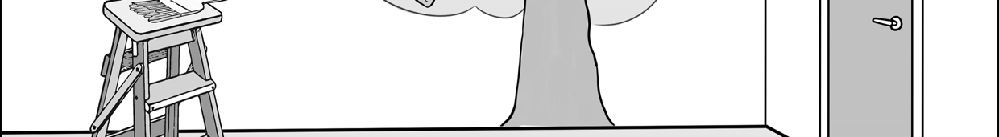
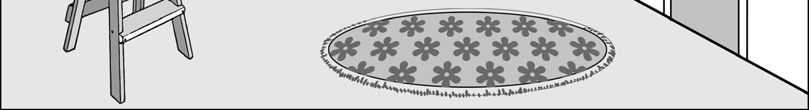
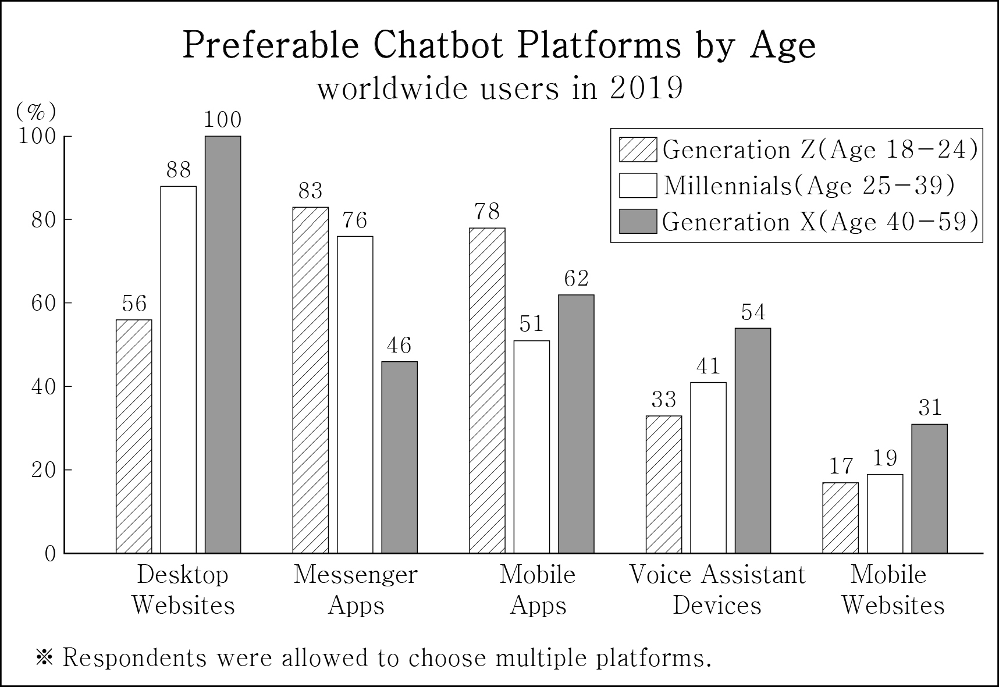

2024학년도 5월 고3 전국연합학력평가 문제지

# 영어 영역

# 제 3 교시

1번부터 17번까지는 듣고 답하는 문제입니다. 1번부터 15번까지는 한 번만 들려주고, 16번부터 17번까지는 두 번 들려줍니다. 방송을 잘 듣고 답을 하시기 바랍니다.

1. 다음을 듣고, 남자가 하는 말의 목적으로 가장 적절한 것을 고르시오.
  - ① 내년에 새로 개설되는 과목을 홍보하려고
  - ② 영상 제작 시 유의해야 할 사항을 안내하려고
  - ③ 교육 과정 박람회의 변경된 일정을 공지하려고
  - ④ 학교 홍보 영상의 온라인 제출 방법을 설명하려고
  - ⑤ 교육 과정 박람회를 위한 자원봉사자를 모집하려고
2. 대화를 듣고, 여자의 의견으로 가장 적절한 것을 고르시오.
  - ① 서늘한 곳에 화장품을 보관해야 한다.
  - ② 유효 기간 내 화장품을 사용해야 한다.
  - ③ 화장품 구매 시 성분을 확인해야 한다.
  - ④ 화장 도구를 정기적으로 세척해야 한다.
  - ⑤ 자외선 차단제를 사계절 내내 발라야 한다.
3. 다음을 듣고, 남자가 하는 말의 요지로 가장 적절한 것을 고르시오.
  - ① 어려운 일을 먼저 처리하면 생산성을 향상시킬 수 있다.
  - ② 적절한 휴식은 업무 진행의 효율성을 증진시킬 수 있다.
  - ③ 성공을 위해서는 과제를 완수하려는 태도가 필요하다.
  - ④ 매일 실천하는 작은 일이 평생 지속되는 습관이 된다.
  - ⑤ 할 일 목록 작성은 체계적인 일 처리에 도움이 된다.
4. 대화를 듣고, 그림에서 대화의 내용과 일치하지 않는 것을 고르시오.

⑤

④

②

①

③

5. 대화를 듣고, 여자가 할 일로 가장 적절한 것을 고르시오.

① 촬영 자세 검색하기

③ 조원들 분장시키기

⑤ 소품 주문하기

② 문자 메시지 보내기

④ 의상 대여하기

6. 대화를 듣고, 남자가 지불할 금액을 고르시오. [3점]
  - ① \$45
  - ② \$50
  - ③ \$55
  - ④ \$60
  - ⑤ \$65

1

7. 대화를 듣고, 여자가 프리 다이빙 체험을 할 수 없는 이유를 고르시오.
  - ① 물을 무서워해서
  - ② 가족여행을 가야 해서
  - ③ 체육 보고서를 써야 해서
  - ④ 체험권에 당첨되지 않아서
  - ⑤ 야구 경기를 관람해야 해서
8. 대화를 듣고, Fusion of Code and Canvas 전시회에 관해 언급되지 않은 것을 고르시오.

① 작품 수	② 장소	③ 휴관일

④ 전시 기간	⑤ 입장료

9. 2024 May Dog Festival에 관한 다음 내용을 듣고, 일치하지 않는 것을 고르시오.
  - ① 2021년에 처음 개최되었다.
  - ② 시청 앞 광장에서 열릴 것이다.
  - ③ 놀이터 입장 시 주인이 반려견과 함께해야 한다.
  - ④ 무료 셀프 사진 부스가 마련되어 있을 것이다.
  - ⑤ 벼룩시장에서 수제 개 장난감을 구매할 수 없다.
10. 다음 표를 보면서 대화를 듣고, 남자가 주문할 마사지 도구를 고르시오.

Massage Tools

| Product | Price | TargetUse Body Part | Material | Free Gift |
| --- | --- | --- | --- | --- |
| A | \$8 | Head | Metal | Pouch |
| B | \$10 | Face | Ceramic | Aroma oil |
| C | \$12 | Feet | Rubber | Pouch |
| D | \$16 | Back | Wood | Aroma oil |
| E | \$22 | Whole body | Plastic | Massage cream |

- ①
- ②
- ③
- ④
- ⑤
  1. 11\. 대화를 듣고, 여자의 마지막 말에 대한 남자의 응답으로 가장 적절한 것을 고르시오.
- ① No problem. You can leave it to me.
- ② Too late. The meeting is already over.
- ③ Of course. You can use free wifi in the room.
- ④ I’m sorry. We have no record of your reservation.
- ⑤ Not really. It takes two hours for us to get there.
  1. 12\. 대화를 듣고, 남자의 마지막 말에 대한 여자의 응답으로 가장 적절한 것을 고르시오.
- ① Why not? The area is a popular tourist destination.
- ② Not yet. We haven’t decided where to go on a trip.
- ③ My mistake. I’ll change the tickets for the correct date.
- ④ That’s okay. I can get to the train station by myself.
- ⑤ I apologize. All the tickets for today are sold out.

2

13. 대화를 듣고, 여자의 마지막 말에 대한 남자의 응답으로 가장 적절한 것을 고르시오. [3점]

Man:

- ① I agree. I have to make a complaint.
- ② You’re right. Let’s learn to ride a bicycle.
- ③ That’s true. I’m still waiting for it to be found.
- ④ Good idea. I’ll give it a shot and see if it helps.
- ⑤ Absolutely. That’s why you should bike to work.

# 영어 영역

14. 대화를 듣고, 남자의 마지막 말에 대한 여자의 응답으로 가장 적절한 것을 고르시오.

Woman:

- ① Awesome. Let’s go to the shop and get a hanbok.
  - ② Look at me. It seems hanbok really suits me well.
  - ③ One moment. Let’s find out how to download a travel app.
  - ④ No worries. I’ll look for ways to get a discount for the class.
  - ⑤ Right. This is the clothing the royal family wore in the past.
15. 다음 상황 설명을 듣고, Ms. Kim이 Taylor에게 할 말로 가장 적절한 것을 고르시오. [3점]

Ms. Kim:

- ① You need to keep your audience focused during a show.
  - ② You’d better practice harder to be on the school stage.
  - ③ You should apply for an audition on a TV talent show.
  - ④ Why don’t you memorize the song for the audition?
  - ⑤ How about singing in the upcoming school festival?

[16 \~ 17] 다음을 듣고, 물음에 답하시오.

16. 여자가 하는 말의 주제로 가장 적절한 것은?
  - ① impacts of cultural traits on conflict situations
  - ② traits that attract readers in heroic characters
  - ③ strategies for teaching character traits in literature
  - ④ reasons why personality traits matter in writing an epic
  - ⑤ changes to traits that have defined heroes through history
17. 언급된 특성이 아닌 것은?

① courage

④ intelligence

② strength

⑤ selflessness

③ leadership

이제 듣기 문제가 끝났습니다. 18번부터는 문제지의 지시에 따라 답을 하시기 바랍니다.

18. 다음 글의 목적으로 가장 적절한 것은?

My name is Rohan Kaul, the producer of the upcoming film ‘Upagrah.’ I am reaching out to you regarding a matter of importance concerning the shooting of some scenes for our film. We have identified Gulab Park, Mumbai, as an ideal location for these scenes. We are hoping to conduct this shoot on 3rd June 2024, from 1 p.m. to 6 p.m. We have chosen Monday for the shooting day to minimize traffic issues and disruption to the public. During the shoot, our team promises to follow all rules and regulations, ensuring no inconvenience is caused to the public. We would be so grateful if you granted permission for the shoot so that we can put the beautiful scenery of the park in our film. We look forward to your response.

- ① 주말 영화 시사회에 초대하려고
- ② 공원 이용 시간의 연장을 건의하려고
- ③ 촬영을 위한 장비 대여 방법을 문의하려고
- ④ 행사 운영을 위한 교통 통제를 요청하려고
- ⑤ 영화 촬영을 위해 장소 사용 허가를 얻으려고
  1. 19\. 다음 글에 드러난 Charles의 심경 변화로 가장 적절한 것은?

Charles was taking a quiz in his math class. He stared at the questions, but they looked completely unfamiliar. Charles flipped through the pages of the quiz for a while. His palms grew sweaty as he realized that he didn’t know a single answer. A moment later, a few other students began raising their hands. One said, “I don’t think we ever learned about the stuff on this quiz, Mrs. Smith.” The teacher quickly looked over a copy of the quiz and announced, “I’m sorry, class. It appears that I have given you the wrong quiz by mistake. We’ll take the right quiz next class.” As Charles heard what the teacher said, the tension in his shoulders began to melt away.

① nervous → relieved	② relaxed → regretful

③ amazed → annoyed	④ indifferent → satisfied

⑤ shocked → sympathetic

20. 다음 글에서 필자가 주장하는 바로 가장 적절한 것은?

When you are middleaged, the risk of connective tissue

injuries peaks as decreased load tolerance combines with continued high activity levels. The path of least resistance is to stop doing the things that hurt ― avoid uncomfortable movements and find easier forms of exercise. However, that’s the exact opposite of what you should do. There is a path forward. But it doesn’t involve following the typical pain management advice of rest, ice, and medicine, which multiple reviews have shown is not effective for treating agerelated joint pain and dysfunction.

These methods do nothing more than treat superficial symptoms. The only practical solution is to strengthen your body with muscle training. Whether you’ve been training for a few years or a few decades, or haven’t ever stepped foot in the weight room, it’s not too late to restore your body, build real strength, and achieve your physical potential.

- ① 관절의 노화를 늦추기 위해 적절한 체중을 유지해야 한다.
- ② 근육을 강화하기 위해 다양한 강도의 운동을 병행해야 한다.
- ③ 중년층은 근 손실 예방을 위해 식단을 철저히 관리해야 한다.
- ④ 노화와 관련된 관절 질환에는 치료보다 예방이 우선되어야 한다.
- ⑤ 중년에는 통증이 따르더라도 근력 운동으로 신체를 강화해야 한다.

23. 다음 글의 주제로 가장 적절한 것은?

3

During the day, a molecule called adenosine builds up in your brain. Adenosine binds with receptors on nerve cells, or neurons, slowing down their activity and making you feel drowsy. But caffeine is also able to bind with these receptors, and by doing so it blocks adenosine’s effect, making your neurons fire more and keeping you alert. Caffeine also activates a gland at the base of your brain. This releases hormones that tell the adrenal glands on your kidneys to produce adrenaline, causing your heart to beat faster and your blood pressure to rise. If, however, your daily caffeine intake is consistent, your brain will adapt to it. Your brain is like, ‘Okay, every morning I’m getting this caffeine that’s binding to these receptors and blocking adenosine from binding to them.’ So your brain creates extra receptors to give adenosine more of an opportunity to bind with them and have its usual effect. And more adenosine is also produced to counteract the caffeine. That’s why it takes more and more caffeine to have the same effect.

\* drowsy: 나른한 \*\* gland: (분비)선

- ① what your brain does for regular hormone production
- ② consequences of sleep deprivation caused by caffeine
- ③ connection between brain health and hormone balance
- ④ efforts to overcome the constant temptation of caffeine
- ⑤ how your brain adapts to a steady caffeine consumption

# 영어 영역

21. 밑줄 친 <u>Approximate perfection is better than perfect</u> perfection이 다음 글에서 의미하는 바로 가장 적절한 것은? [3점]

Turn the lights out and point the beam of a small flashlight up into one of your eyes. Shake the beam around while moving your gaze up and down. You should catch glimpses of what look like delicate branches. These branches are shadows of the blood vessels that lie on top of your retina. The vessels constantly cast shadows as light streams into the eye, but because these shadows never move, the brain ceases responding to them. Moving the flashlight beam around shifts the shadows just enough to make them momentarily visible. Now you might wonder if you could cause an image to fade just by staring at something unmoving. But that is not possible because the visual system constantly jiggles the eye muscles, which prevents the perfect stabilization of images of the world. These muscle movements are unbelievably small, but their effect is huge. Without them, we would go blind by tuning out what we see shortly after fixating our gaze! It’s an interesting notion: <u>Approximate perfection is better than perfect perfection.</u>

\* retina: 망막 \*\* jiggle: 가볍게 흔들다

- ① What makes your vision blurry actually protects your eyes.
  - ② The more quickly an object moves, the more sensitively eyes react.
  - ③ Eyes exposed to intense light are subject to distortion of images.
  - ④ Constant adjustment of focusing makes your eye muscles tired.
  - ⑤ Shaky eyemuscle movements let us see what the brain might ign ore.
22. 다음 글의 요지로 가장 적절한 것은?

Most opposition to wilderness preservation doesn’t come from environmentalists but from corporate interests and developers. When wild places are designated as wilderness, they are closed to most commercial activities and residential or infrastructure development. There is thus frequently an economic cost to wilderness preservation. Some critics claim that when wilderness and economic interests clash, economic interests should normally prevail. This argument, even if it is sound, won’t exclude all wilderness preservation efforts, because some wilderness areas have little economic value. But a deeper problem with the argument is that it views nature from a humanfocused and

excessively economic point of view. Allowing economic considerations to outweigh all other forms of value is inconsistent with the biocentric reasons that support wilderness preservation. Thus, while it certainly makes sense to weigh the economic costs of wilderness protection, especially when such costs are high, the biocentric values underlying wilderness preservation exclude viewing economic considerations as the most important.

- ① 야생 보호 구역 보존의 생명 중심적 가치는 경제적 고려에 우선한다.
  - ② 자연과의 공존을 고려한 상업 활동이 기업에 경제적 이익을 가져다준다.
  - ③ 야생 보호에 있어 우선적으로 고려하는 가치는 문화에 따라 다양하다.
  - ④ 야생 보호는 경제적 가치와 상관없이 모든 생물에 똑같이 적용된다.
  - ⑤ 야생의 보호와 회복을 위한 비용 부담은 공동체 모두의 몫이다.
24. 다음 글의 제목으로 가장 적절한 것은?

When viewed from space, one of the Earth’s most commanding features is the blueness of its vast oceans. Small amounts of water do not indicate the color of these large bodies of water; when pure drinking water is examined in a glass, it appears clear and colorless. Apparently a relatively large volume of water is required to reveal the blue color. Why is this so? When light penetrates water, it experiences both absorption and scattering. Water molecules strongly absorb infrared and, to a lesser degree, red light. At the same time, water molecules are small enough to scatter shorter wavelengths, giving water its bluegreen color.

The amount of longwavelength absorption is a function of depth ; the deeper the water, the more red light is absorbed. At a depth of 15m, the intensity of red light drops to 25% of its original value and falls to zero beyond a depth of 30m. Any object viewed at this depth is seen in a bluegreen light. For this reason, r ed inhabitants of the sea, such as lobsters and crabs, appear black to divers not carrying a lamp.

\* penetrate: 관통하다 \*\* infrared: 적외선

- ① We Should Go Green with the Ocean Exploration
  - ② Various Tones of Water Our Deceptive Eyes Show Us
  - ③ How DeepSea Microorganisms Affect the Ocean’s Color
  - ④ Why So Blue: The Science Behind the Color of Earth’s Oceans
  - ⑤ The Bigger Volume Water Has, the Lower Temperature It Gets

4	영어 영역
25. 다음 도표의 내용과 일치하지 않는 것은?	27. Scottish Day Trip Package에 관한 다음 안내문의 내용과 일치하지
않는 것은?
The above graph shows the percentage of preferable chatbot
platforms by age categorized by Generation Z, Millennials, and
Generation X. ① Millennials and Generation X had the highest
percentage of respondents who preferred Desktop Websites
while Generation Z had the highest percentage for Messenger
Apps. ② In Generation Z, the percentage of respondents who
preferred Mobile Apps was more than twice that of those who
① 출발하는 장소와 돌아오는 장소가 같다.
preferred Voice Assistant Devices. ③ Messenger Apps was the
② 한 그룹당 40명까지 참여할 수 있다.
only platform where the percentage of respondents’ preference
③ 예약이 확정되면 이메일을 받을 것이다.
for it sank lower and lower from Generation Z, to Millennials, to
④ 환불을 위해서는 출발 하루 전까지 취소해야 한다.
Generation X. ④ The percentage point gap between Millennial	⑤ 출발지에 늦게 도착하는 여행자를 기다려 주지 않는다.
and Generation X respondents who preferred Mobile Apps was
larger than the percentage point gap between the same two
28. Jr. Chef Class에 관한 다음 안내문의 내용과 일치하는 것은?
groups for Voice Assistant Devices. ⑤ The percentage of
respondents who preferred Mobile Websites was the lowest in all
the age groups.
26. José Saramago에 관한 다음 글의 내용과 일치하지 않는 것은?
José Saramago was born in 1922 to a family of farmers in a
little village north of Lisbon. For financial reasons he abandoned
his highschool studies and worked as a mechanic. At this time,
he acquired a taste for reading and started to frequent a public
library in Lisbon in his free time. After trying different jobs in
the civil service, he worked for a publishing company for twelve
years and then as an editor of the newspaper ‘Diário de Notícias.’
Between 1975 and 1980 Saramago supported himself as a
translator, but after his literary successes in the 1980s he
devoted himself to his own writing. He achieved worldwide
recognition in 1982 with the humorous love story Baltasar and
Blimunda, a novel set in 18th century Portugal. Saramago’s
oeuvre totals 30 works, and comprises not only novels but also
poetry, essays and drama.
\* oeuvre: 전체 작품
① 재정적인 이유로 고등학교 공부를 그만두었다.
① 이번 주의 메뉴는 아이들이 택한다.
② 독서에 흥미가 생겨 공립 도서관을 자주 방문하기 시작했다.
② 비용에는 앞치마가 포함되지 않는다.
③ 신문사의 편집자로 일한 후 출판사에서 12년간 일했다.
③ 피자 반죽 밀기는 30분간 진행된다.
④ 포르투갈이 배경인 소설로 세계적인 인정을 받았다.	④ 부모 혹은 보호자는 수업 동안 현장에 머물러야 한다.
⑤ 소설뿐 아니라 시, 수필, 희곡 또한 집필하였다.	⑤ 충분한 주차 공간이 확보되어 있다.
4

Scottish Day Trip Package

Don’t miss the chance to soak up the spirit of Scotland! A fullday trip through the Highlands is waiting for you.

Schedule

∙ Departs at 7 a.m. from the Highland Tours office

∙ Returns around 9 p.m. to the original departure point

Details

∙ Max of 40 people per group

∙ Minimum age: 5 years old

∙ Price: \$150 per person

Booking

∙ Only online booking is available.

∙ You will receive an email once your booking is confirmed.

∙ For a refund, cancel at least two days before the tour departs.

Note

∙ The tour will not hold back for tourists who arrive at the departure point late.

<table>
<tr><th colspan="3">JR. CHEF CLASS with Chef Scott Gomez Professional Chef Scott Gomez offers cooking classes to provide your children with handson experience and happy memories. He has picked pizza for the menu this week. Details 쉞 Date: Tuesday, May 14th, 2024 쉞 Place: Rosehill Community Center Cafeteria 쉞 Available for children ages 6 - 12 Cost 쉞 \$20 per child includes all ingredients, chef hat and apron. Schedule</th></tr>
<tr><td>Time</td><td>Contents</td><td rowspan="4"></td></tr>
<tr><td>5:00 - 5:20 p.m.</td><td>rolling pizza dough</td></tr>
<tr><td>5:20 - 6:00 p.m.</td><td>topping and baking</td></tr>
<tr><td colspan="3">6:00 - 6:30 p.m. plating and serving Note 쉞 Call 876-725-7501 to register. 쉞 A parent or guardian must stay on site during class. 쉞 Since parking space is limited, using public transportation is recommended.</td></tr>
</table>

5

[31 \~ 34] 다음 빈칸에 들어갈 말로 가장 적절한 것을 고르시오.

31. As colors came to take on meanings and cultural significance within societies, attempts were made to	their use. The most extreme example of this phenomenon was the sumptuary laws. While these were passed in ancient Greece and Rome, and examples can be found in ancient China and Japan, they found their fullest expressions in Europe from the midtwelfth century, before slowly disappearing in the early

modern period. Such laws could touch on anything from diet to dress and furnishings, and sought to enforce social boundaries by encoding the social classes into a clear visual system: the peasants, in other words, should eat and dress like peasants; craftsmen should eat and dress like craftsmen. Color was a vital signifier in this social language ― dull, earthy colors like russet were explicitly confined to the poorest rural peasants, while bright ones like scarlet were the preserve of a select few.

① export

③ conceal

⑤ tolerate

② restrict

④ liberate

# 영어 영역

29. 다음 글의 밑줄 친 부분 중, 어법상 틀린 것은?

When a new pathogen emerges, one way it transitions from wherever it has been living into a new host may be the acquisition of new traits. Imagine that in ① its hourly struggle to survive over long periods of time and many generations, a fungus species might acquire a protective capsule ― a bit of coating ― that shields it or even masks it from other microbes or cells. Then it acquires some enzymes that enable it to survive ② whatever chemicals other microbes might throw at it. If it can overcome these chemicals, it may also overcome the same or similar chemicals ③ used as antifungal drugs. Maybe it also evolves to tolerate warmer temperatures. Now we’ve got a yeast that once made its home in an apple tree or in a wetland but ④ that at this point can live quite happily in our body, hide from our immune system, and disarm our drugs. Then some of us carry it from one country to another and then another, and eventually it finds a host in a hospital patient who has recently received an organ transplant or ⑤ are elderly with a weakened immune system.

\* pathogen: 병원균 \*\* enzyme: 효소 \*\*\* yeast: 효모

30. 다음 글의 밑줄 친 부분 중, 문맥상 낱말의 쓰임이 적절하지 않은 것은? [3점]

Memory is shaped by emotions connected to an experience. For this reason, inaccuracies often ① hide the full picture of what happened. For example, a company might decide to hire a consultant to assist with a major project. During this project, the consultant demonstrated some personality traits that clashed with a couple of the executives involved. Through the course of the project, they were able to put aside the personality ② conflicts in order to see their vision become a reality. Ultimately, the project was a success, enabling the company to move forward and profit. At a later date, the company, remembering the previous success, expressed an ③ interest in hiring the same consultant for another large project. The executives who struggled with his personality last time may most vividly remember their difficulty in overcoming his personality and related emotions. In this case, the success of the project fades into the background as they focus on their previous experience, colored by their feelings of ④ discomfort. As a result, they convince the company to ⑤ rehire the consultant, making project completion more difficult.

32. John Douglas Pettigrew, a professor of psychology at the University of Queensland, found that the brain manages the external world by dividing it into separate regions, the peripersonal and the extrapersonal ― basically, near and far. Peripersonal space includes whatever is in arm’s reach; things you can control right now by using your hands. This is the world of what’s real, right now. Extrapersonal space refers to everything else ― whatever you can’t touch unless you move beyond your arm’s reach, whether it’s three feet or three million miles away. This is the realm of possibility. With those definitions in place, another fact follows, obvious but useful: any interaction in the extrapersonal space must occur in the future. Or, to put it another way,	. For instance, if you’re in the mood for a peach, but the closest one is sitting in a bin at the corner market, you can’t enjoy it now. You can only enjoy it in the future, after you go get it.
  - ① distance is linked to time
  - ② the past is out of your reach
  - ③ what is going to happen happens
  - ④ time doesn’t flow in one direction
  - ⑤ our brain is attracted to near objects

6

33. Insecteating plants’ unique strategies for catching live prey

have long captured the public imagination. But even within this strange group, in which foodtrapping mechanisms have evolved

multiple times independently, some unusual ones stand out. According to Ulrike Bauer, an evolutionary biologist, the visually striking pitcher plant Nepenthes gracilis, for example, can. This species’

pitcher has a rigid, horizontal lid with an exposed underside that produces nectar, luring insects to land on it. When a raindrop strikes the lid’s top, the lid jolts downward and throws any unsuspecting visitor into digestive juices below. Researchers used xray scans to analyze cross sections of the pitchers when

the lid is raised, lowered, and in a neutral position. Their results revealed a structural weak point in the pitcher’s neck: when a raindrop hits the lid, the weak spot folds in and forces the lid to quickly move downward, similar to a diving board. The weak point makes the pitcher’s body bend and bounce back in a specific, consistent way, so the lid rises back up without bouncing too far ― unlike a typical leaf’s chaotic vibration when struck by rain. [3점]

\* pitcher: 주머니 모양의 잎 \*\* nectar: (식물의) 꿀 \*\*\* jolt: 덜컹거리다, 흔들리다

- ① exploit external energy for a purpose
  - ② hide itself with help of the environment
  - ③ coordinate with other plants to trap insects
  - ④ change its shape to absorb more rain water
  - ⑤ modify its hunting strategy on a regular basis

# 영어 영역

34. Many fish generate their own light in a biological firework display called bioluminescence. The lanternfish creates beams that sweep the sea like headlamps. The dragonfish produces wavelengths that only it can see, leaving its victims unaware of the approaching threat. In contrast, the anglerfish hopes its prey will notice and be lured toward its rodlike bioluminescent

barbel; its fierce jaws stay hidden in the shadows. Bioluminescence is also used to frustrate predators. A species from the spookfish family relies on a bellyful of symbiotic, glowing bacteria to save it from becoming a meal. It uses the same concept developed by the US Navy during World War II to make bomber aircraft difficult to see. Just as Project Yehudi designed planes with underwing spotlights, the fish’s glowing

belly conceals its silhouette against sunlight to hide it from watching eyes below. In this fisheatfish world, survival is

. [3점]

\* barbel: (물고기의) 수염 \*\* symbiotic: 공생의

- ① dependent upon communication within the same species
  - ② a game of hideandseek that prioritizes the sense of sight
  - ③ up to the ability to detect the subtle dance of sound waves
  - ④ a competition to imitate the illumination of different species
  - ⑤ a war where wider vision means better chances to catch prey 6
35. 다음 글에서 전체 흐름과 관계 없는 문장은?

The human race traces back to a surprisingly small number of common ancestors. It has been documented that the entire human race can be traced back to only seven different mothers, and one of these women is a common ancestor to roughly 40% of the human species. Why is this? The simple answer is that humans are extremely good at dying and at wiping each other out. ① History has had many successful rulers and conquerors who have got rid of entire populations, and even beyond that, our species has wiped out plenty of similar humanoid lines that existed on this earth. ② Scientific finds have so far discovered a number of other humanoid species that once shared the earth with us, some of which include Neanderthals and Denisovans. ③ There are still no clear examples of Neanderthals attempting to expressively symbolize reallife elements such as animals or people in creat ive works. ④ Yet of these lines, only homo sapiens have survived, only the modern humans. ⑤ That itself shows how difficult it is for a species to survive and thrive longterm on this planet.

\* humanoid: 인간에 가까운

[36 \~ 37] 주어진 글 다음에 이어질 글의 순서로 가장 적절한 것을 고르시오.

36.

Philosophers who seek to understand the nature of time might consider the possibility of time travel. But there are no reallife cases of time travel.

(A) It seems that something must happen to prevent you from doing this, because if you were to succeed, you would not exist and so you would not have been able to go back in time. As a result of thinking through these sorts of cases, some philosophers claim that the very notion of time travel makes no sense.

(B) In situations such as this, philosophers often construct thought experiments ― imagined scenarios that bring out the thoughts and presuppositions underlying people’s judgments. Sometimes these scenarios are drawn from books, movies, and television. Other times, philosophers just make up their own scenarios.

(C) Either way, the point is to put such concepts to the test. In the case of time travel, for example, a common thought experiment is to imagine what would happen if you went back in time and found yourself in a position to interfere in such a way that you were never born.

① (A) ― (C) ― (B)

③ (B) ― (C) ― (A)

⑤ (C) ― (B) ― (A)

② (B) ― (A) ― (C)

④ (C) ― (A) ― (B)

7

# 39. 영어 영역

37.

A universal indicator of sleep is the loss of external awareness. You are no longer conscious of all that surrounds you, at least not explicitly. In actual fact, your ears are still ‘hearing’; your eyes, though closed, are still capable of ‘seeing.’

(A) Should they be granted its permission to pass, they are sent to the cortex at the top of your brain, where they are consciously perceived. By locking its gates shut, the thalamus imposes a sensory blackout in the brain, preventing onward travel of those signals to the cortex.

(B) As a result, you are no longer consciously aware of the information broadcasts being transmitted from your outer sense organs. At this moment, your brain has lost waking contact with the outside world. Said another way, you are now asleep.

(C) All these signals still flood into the center of your brain while you sleep, but they are blocked by a perceptual barricade set up in a structure called the thalamus. The thalamus decides which sensory signals are allowed through its gate, and which are not. [3점]

\* cortex: 대뇌피질 \*\* thalamus: 시상(視床)

① (A) ― (C) ― (B)

③ (B) ― (C) ― (A)

⑤ (C) ― (B) ― (A)

② (B) ― (A) ― (C)

④ (C) ― (A) ― (B)

[38 \~ 39] 글의 흐름으로 보아, 주어진 문장이 들어가기에 가장 적절한 곳을 고르시오.

38.

The norms of objectivity were constructed not because their creators thought most humans could be ‘empty’ of bias.

Emotional response to the world is an inherent part of ethics. In ethics, appeals to compassion and empathy can and should be part of rational arguments about ethical decisions. Moreover, the best practices of objectivity often combine partiality and impartiality. ( ① ) In a trial, the partiality of the prosecutor and the defense attorney (and the parties they represent) occurs within a larger impartial context. ( ② ) A judge or jury puts partial arguments to the test of objective evidence and to the impartial rules of law. ( ③ ) Ideally, what is fair and objective emerges during a trial where partialities make their case and are judged by objective norms. ( ④ ) The reverse is true: the norms were constructed because of an acute awareness of human bias, because it is evident. ( ⑤ ) Rather than conclude that objectivity is impossible because bias is universal, scientists, journalists, and others concluded the opposite: we biased humans need the discipline of objectivity to reduce the ineliminable presence of bias.

\* prosecutor: 검사(檢事), 검찰관

Cats ‘pay’ for this nighttime accuracy with less accurate daytime vision and an inability to focus on close objects.

The fact that cats’ eyes glow in the dark is part of their enhanced lightgathering efficiency; there is a reflective laye r behind the retina, so light can hit the retina when it enters the eye, or when it is reflected from behind the retina. ( ① ) Light that manages to miss the retina exits the eye and creates that ghostly glow. ( ② ) When cats’ lightgathering ability is combined with

the very large population of rods in their eyes, the result is a predator that can see exceptionally well in the dark. ( ③ ) This may seem counterproductive; what is the point of seeing a mouse in the dark if, in that final, close moment, the cat can’t focus on it? ( ④ ) Tactile information comes into play at this time; cats can move their whiskers forward and use them to get information about objects within the grasp of their jaws. ( ⑤ ) So the next time you see a cat seeming to nap in the bright sunlight, eyes halfclosed, remember that it may simply be shielding its retin a from a surplus of light. [3점]

\* rod: (시신경의) 간상체(杆狀體) \*\* tactile: 촉각의 \*\*\* whisker: (고양이의) 수염

40. 다음 글의 내용을 한 문장으로 요약하고자 한다. 빈칸 (A), (B)에 들어갈 말로 가장 적절한 것은?

In one study, researchers gave more than five hundred visitors to an art museum a special glove that reported their movement patterns along with physiological data such as their heart rates. The data showed that when people were not distracted by chatting with companions, they actually had a stronger emotional response to the art. Of course, there’s nothing wrong with chatting and letting the art slide past, but think of the inspiration those museum visitors missed out on. Then apply that to life in general. When we surround ourselves with other people, we’re not just missing out on the finer details of an art exhibition. We’re missing out on the chance to reflect and understand ourselves better. In fact, studies show that if we never allow ourselves to be alone, it’s just plain harder for us to learn. Other research found that young people who cannot stand being alone were less likely to develop creative skills like playing an instrument or writing because the most effective practice of these abilities is often done while alone.

\* physiological: 생리적인

뾞

The study above shows	(A)	conversation with companions while exploring an art museum intensifies emotional response to art, suggesting that absence of alone time may	(B)	personal growth and learning.

(A)	(B)

① avoiding …… inhibit

③ preventing …… enhance

⑤ dominating …… minimize

(A)	(B)

② recalling …… restrain

- ④ facilitating …… nurture

<table>
<tr><th>8</th><th>영어 영역</th></tr>
<tr><td>[41 ~ 42] 다음 글을 읽고, 물음에 답하시오.</td><td>(B)</td></tr>
<tr><td colspan="2">(C)</td></tr>
<tr><td colspan="2">(D)</td></tr>
<tr><td>41. 윗글의 제목으로 가장 적절한 것은?</td><td>43. 주어진 글 (A)에 이어질 내용을 순서에 맞게 배열한 것으로 가장 적절한 것은?</td></tr>
<tr><td>① Genetic Code: The Key to Conquering Disorders ② Ancient People’s Challenges from Genetic Weaknesses</td><td>① (B) ― (D) ― (C) ② (C) ― (B) ― (D) ③ (C) ― (D) ― (B) ④ (D) ― (B) ― (C)</td></tr>
<tr><td>③ What Makes a Great Hunter: An Ability to Move Quickly</td><td>⑤ (D) ― (C) ― (B) ④ In Evolution, Disadvantageous Doesn’t Mean Destined to Vanish ⑤ Various Biological Factors Causing RedGreen Color Blindness 44. 밑줄 친 (a)~(e) 중에서 가리키는 대상이 나머지 넷과 다른 것은? 42. 밑줄 친 (a)~(e) 중에서 문맥상 낱말의 쓰임이 적절하지 않은 것은? ① (a) ② (b) ③ (c) ④ (d) ⑤ (e) [3점] ① (a) ② (b) ③ (c) ④ (d) ⑤ (e) 45. 윗글에 관한 내용으로 적절하지 않은 것은? ① 자매는 외모를 제외한 모든 면에서 서로 달랐다. ② Rachel은 두 딸의 언쟁을 끝내기로 결심했다.</td></tr>
<tr><td>[43 ~ 45] 다음 글을 읽고, 물음에 답하시오.</td><td>③ Pamela는 판자가 흰색이라고 대답했다. ④ Maggie는 상쾌한 아침 공기를 좋아했다.</td></tr>
</table>

Tired of the endless arguments, their mother Rachel decided to put an end to them. She would make them understand that each of their points of view could be correct. One day, the twins were brought to the dining table where a big board stood in the middle. Pamela sat on one side of the board and (b) her twin on the other. Rachel asked Pamela what the color of the board was. “Black,” she said.
There are a number of human characteristics that would seem to be disadvantageous yet continue to survive, generation after generation. One example is color blindness. Most color blindness is associated with genes on the X chromosome. Women have two X chromosomes, so if this problem occurs on one of them, the other can <u>(a) compensate.</u> But men have only one X chromosome. If the mutation occurs there, that male is color blind. We might ask why such a (b) deficiency would survive and not die out. To understand this, we can consider ancient huntergatherers, with the men doing most of the hunting for meat and the women doing most of the gathering of fruits and nuts. Gathering fruits, especially berries, and nuts is much more productive if it is easy to distinguish the red or purple fruit from the green leaves of the plant. If redgreen color blindness were common among women, the resulting (c) lack of productivity would likely cause this trait to die out relatively quickly. On the other hand, the men out hunting don’t much rely on being able to contrast red from green. Most of the animals they are hunting have fur or feathers that help them hide. Rather than relying on color, the hunter relies on an acute ability to detect motion. It is conceivable that a (d) reduction in color contrast in these circumstances might actually enhance one’s ability to detect subtle motions. Given that a hunted animal blends into its surroundings, less background color variation would be (e) more of a visual distraction.
\* chromosome: 염색체 \*\* mutation: 돌연변이
For example, Pamela was always upset at her sister waking up early in the morning. (c) She didn’t understand why her sister couldn’t finish what she needed to do at night and sleep peacefully the next morning. To Maggie, staying up past the time (d) she began to feel sleepy was exhausting. Besides, she loved the fresh morning air. They had fights about simple things like this every day.
After hearing Pamela’s answer, Rachel asked the same question to (e) the other daughter. She replied it was white. Predictably, they began arguing. Rachel then asked them to switch seats. Each sitting on a new chair, they were surprised to realize the board was black on one side and white on the other. Understanding what their mother wanted to say, they promised they would never insist the other was wrong again.

- ⑤ Rachel은 두 딸이 자리를 바꾸도록 요청했다. (A)

Pamela and Maggie were identical twins. Even their parents found it hard to tell them apart. But although they looked identical, they were different in every other way. They didn’t have anything in common, so they fought all the time. Pamela thought that (a) her sister was weird and incomprehensible, and of course Maggie felt the same way.

※ 확인 사항

◦ 답안지의 해당란에 필요한 내용을 정확히 기입(표기)했는지 확인 하시오.