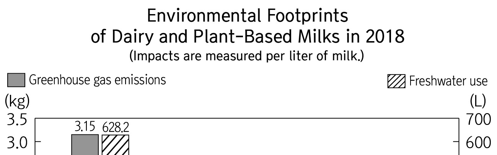
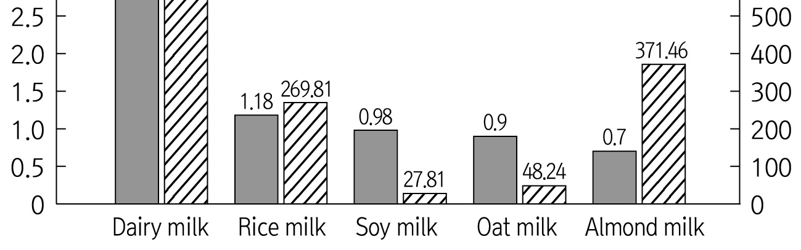

제 3 교시 영어 영역

고 3 2024학년도 7월 고영어3 전국연합학력평가영역 문제지 11

1번부터 17번까지는 듣고 답하는 문제입니다. 1번부터 15번까지는 한 번만 들려주고, 16번부터 17번까지는 두 번 들려줍니다. 방송을 잘 듣고 답을 하시기 바랍니다.

1. 다음을 듣고, 남자가 하는 말의 목적으로 가장 적절한 것을 고르시오.
  - ① 교내 방송 모니터단 선정 결과를 발표하려고
  - ② 교내 방송을 위한 사연 제출을 요청하려고
  - ③ 방송부의 소셜미디어 계정을 알리려고
  - ④ 교내 선행상 수상자를 공지하려고
  - ⑤ 방송부원 모집을 홍보하려고
2. 대화를 듣고, 남자의 의견으로 가장 적절한 것을 고르시오.
  - ① 다양한 해조류 간식을 개발해야 한다.
  - ② 건강을 위해 균형 잡힌 영양 섭취가 중요하다.
  - ③ 기후 변화가 해양 생태계에 영향을 미칠 수 있다.
  - ④ 농작물 경작 시 비료와 농약 사용을 자제해야 한다.
  - ⑤ 해조류를 재배하는 것은 지구 환경 보호에 도움이 된다.
3. 다음을 듣고, 여자가 하는 말의 요지로 가장 적절한 것을 고르시오.
  - ① 공기 정화 장치 설치를 의무화해야 한다.
  - ② 규칙적인 환기는 건강에 도움을 줄 수 있다.
  - ③ 면역력 증진을 위해 알맞은 습도 유지가 중요하다.
  - ④ 적절한 실내 온도 유지는 에너지 절약에 필수적이다.
  - ⑤ 30초 손 씻기를 통해 호흡기 질환을 예방할 수 있다.
4. 대화를 듣고, 그림에서 대화의 내용과 일치하지 <u>않는</u> 것을 고르시오.

①
Daisy’s Yard Sale
②
③
5

5. 대화를 듣고, 여자가 할 일로 가장 적절한 것을 고르시오.

① 썰매 구입하기

③ 지도 다운로드 하기

⑤ 타이어 공기압 점검하기

② 숙소 예약 확인하기

④ 식료품 주문하기

6. 대화를 듣고, 남자가 지불할 금액을 고르시오. [3점]
  - ① \$170
  - ② \$192
  - ③ \$200
  - ④ \$220
  - ⑤ \$240
7. 대화를 듣고, 여자가 전자책 구독을 해지한 이유를 고르시오.
  - ① 신작 업데이트가 자주 이루어지지 않아서
  - ② 가족 공유 요금제가 종료되어서
  - ③ 구독료가 인상되어서
  - ④ 오래된 희귀 만화책이 없어서
  - ⑤ 독서를 위한 여가 시간이 줄어들어서
8. 대화를 듣고, London Afternoon Tea Bus Tour에 관해 언급되지 <u>않은</u> 것을 고르시오.

① 투어 장소

④ 탑승 장소

② 소요 시간

⑤ 이용 후기

③ 참가비

9. Surf Camp Australia에 관한 다음 내용을 듣고, 일치하지 <u>않는</u> 것을 고르시오.
  - ① 각각의 서핑 코스는 3일 동안 진행된다.
  - ② 한 번에 최대 100명을 수용할 수 있다.
  - ③ 음식을 제공한다.
  - ④ 수강자의 서핑 수준에 따라 비용이 다르다.
  - ⑤ 홈페이지를 통해서 예약할 수 있다.
10. 다음 표를 보면서 대화를 듣고, 남자가 주문할 Standing Desk를 고르시오.

Standing Desks

|  | Model | Price | Height | Number of drawers | Wheels |
| --- | --- | --- | --- | --- | --- |
| ① | A | \$249 | 115 cm | 1 | × |
| ② | B | \$289 | 121 cm | 2 | ○ |
| ③ | C | \$369 | 127 cm | 1 | ○ |
| ④ | D | \$439 | 123 cm | 3 | × |
| ⑤ | E | \$529 | 128 cm | 3 | × |

11. 대화를 듣고, 여자의 마지막 말에 대한 남자의 응답으로 가장 적절한 것을 고르시오.
  - ① These lenses go well with your skin tone.
  - ② I’ve already had black ones, so I’ll get another color.
  - ③ I’m not sure where to buy my glasses around my house.
  - ④ Go see a doctor if your eyesight is getting worse.
  - ⑤ Rectangular ones would look good on your face.
12. 대화를 듣고, 남자의 마지막 말에 대한 여자의 응답으로 가장 적절한 것을 고르시오.
  - ① Okay. I’ll take my medicine regularly.
  - ② No worries. I’ll take out the recycling myself.
  - ③ I see. I’ll drop by there and place it in the box.
  - ④ Great. But you’ll need a prescription for the medicine.
  - ⑤ Hold on! You should go to the hospital if you are sick.
13. 대화를 듣고, 여자의 마지막 말에 대한 남자의 응답으로 가장 적절한 것을 고르시오. [3점]

Man:

- ① I’ll wake up early so I don’t miss the bus.
  - ② Just tell them when you need the newspaper.
  - ③ I’ll let them know the deadline for the assignment.
  - ④ I forgot to put the newspaper back after reading it.
  - ⑤ I’ll explain why there should be a bus stop in front of our school.
14. 대화를 듣고, 남자의 마지막 말에 대한 여자의 응답으로 가장 적절한 것을 고르시오.

Woman:

- ① After you record yourself, it provides instant feedback.
  - ② There’re no available language courses at this time.
  - ③ Feel free to learn new languages in my class.
  - ④ Why don’t you try learning something else?
  - ⑤ Let’s start by creating your new app.
15. 다음 상황 설명을 듣고, Eric이 Anna에게 할 말로 가장 적절한 것을 고르시오. [3점]

Eric:

- ① You should avoid overwatering the plant.
  - ② Growing plants can help keep the air cleaner.
  - ③ I recommend growing plants to lift your spirits up.
  - ④ Why don’t you provide your plant with more nutrients?
  - ⑤ Our science club needs an interesting topic for our project.

### [16\~17] 다음을 듣고, 물음에 답하시오.

16. 여자가 하는 말의 주제로 가장 적절한 것은?
  - ① animal - related festivals from around the world
  - ② different perspectives on the status of animals
  - ③ economic benefits of hosting local festivals
  - ④ policies aiming to promote animal rights
  - ⑤ jobs satisfying the needs of pet owners
17. 언급된 나라가 <u>아닌</u> 것은?

① India	② Thailand

④ Spain	⑤ France

③ Canada

이제 듣기 문제가 끝났습니다. 18번부터는 문제지의 지시에 따라 답을 하시기 바랍니다.

18. 다음 글의 목적으로 가장 적절한 것은?

Dear Staff,

My name is Laura Miller, the Human Resources

Manager. As part of our efforts to reduce traffic on

newly built area roadways, we are starting to offer

flextime working hours to eligible employees. Under the

plan, staffers could begin work 60 to 90 minutes before

or after ordinary business hours, adjusting their scheduled

departure time accordingly. All requests for flextime must

be submitted to departmental supervisors and will be

approved if they do not conflict with the staffing needs

of the company. In addition, flextime schedules will be

reviewed every four months to assure that they do not

adversely affect company goals.

Best regards,

Laura Miller

- ① 유연 근무제 실시 계획을 안내하려고
  - ② 직장 내 갈등 조정 기구 신설을 홍보하려고
  - ③ 유연 근무제의 만족도 조사 참여를 독려하려고
  - ④ 부서별 유연 근무 신청 승인 결과를 통보하려고
  - ⑤ 교통량 감소를 위한 대중교통 이용을 장려하려고
19. 다음 글에 드러난 Joshua의 심경 변화로 가장 적절한 것은?

Joshua had spent ten weeks crafting a presentation for an upcoming meeting. He had worked very hard on analyzing data, making beautiful plots and projections, and he had often stayed in the office past midnight polishing his presentation. He was delighted with the outcome and happily e - mailed the presentation to his boss, who was going to make the presentation at the all - important meeting. His boss e - mailed him back a few hours later: “Sorry, Joshua, but just yesterday we learned that the deal is off. I did look at your presentation, and it is an impressive and fine piece of work. Well done.” Joshua realized that his presentation would never see the light of day. The fact that all his effort had served no ultimate purpose created a deep rift between him and his job. He’d quickly gone from feeling useful and happy in his work to feeling dissatisfied and that his efforts were in vain.

① isolated → optimistic	② curious → bored

③ anxious → thrilled	④ terrified → relieved

⑤ pleased → discouraged

20. 다음 글에서 필자가 주장하는 바로 가장 적절한 것은?

Walk into a bookstore and you’ll see some authors have a whole shelf. Authors with just one book are hard to find and it’s the same for digital shelf - space. Look at the most loved and top - selling authors and they all have a lot of books. One book is not enough to build a career as a fiction author if that is a goal of yours. So, don’t obsess over that one book, consider it just the beginning, and get writing on the next one. Of course, first - time authors don’t want to hear this! I certainly didn’t when I put my first book out. I’ve tried every single marketing tool possible and I still continue to experiment with new forms. But after 27 books, writing more books is what I personally keep coming back to as the best marketing tool and the best way to increase my income as a writer. Because every time a new book comes out, more readers discover the backlist. You also have another chance to ‘break out’.

- ① 작가로 성공하려면 계속해서 출간해야 한다.
  - ② 좋은 글을 쓰려면 먼저 글을 많이 읽어야 한다.
  - ③ 자신의 경험을 글쓰기 소재로 적극 활용해야 한다.
  - ④ 책을 홍보하기 위해 다양한 마케팅 수단을 마련해야 한다.
  - ⑤ 작가별 전시에서 벗어나 새로운 도서 전시 방식을 시도해야 한다.
21. 밑줄 친 <u>the breadcrumbs of the conversation</u>이 다음 글에서 의미하는 바로 가장 적절한 것은? [3점]

In improv, the actors have no control of the conversation or the direction it takes. They can only react to the other actors’ words or nonverbal communication. Because of this, the actors become experts at reading body language and reading between the lines of what is said. If they are unable to do this, they are left in the dark and the performance crumbles. This applies to our daily conversations, but we’re usually too self - centered to notice. Just like the improv actors become adept at picking up on <u>the breadcrumbs of</u> <u>the conversation</u>, we need to do the same. When people want to talk about something specific, rarely will they come out and just say it. 99 percent of people won’t say, “Hey, let’s talk about my dog now. So....” Instead, they will hint at it. When they bring up a topic unprompted, or ask questions about it, they want to talk about it. Sometimes, when the other person seems to not pick up on these signals, they will keep redirecting the conversation to that specific topic. If they seem excited whenever the topic comes up, they want to talk about it.

\* improv: 즉흥 연극 \*\* crumble: 무너지다 \*\*\* adept: 능숙한

- ① roundabout hints revealing the speaker’s intention
  - ② opening words to make the topic more interesting
  - ③ part of the conversation that distracts the listeners
  - ④ characteristics that are unique to the actors themselves
  - ⑤ unexpected reactions of the audience to the performance
22. 다음 글의 요지로 가장 적절한 것은?

The relevance of science in understanding organizational behavior can start with asking this question: Why do good managers make bad decisions? Too often managers make mistakes when it comes to fostering conditions that inspire positive outcomes in the workplace, such as performance, satisfaction, team cohesion, and ethical behavior. Why does this happen? Part of the reason is that rather than relying on a clearly validated set of scientific discoveries, managers use less reliable sources of insight such as gut feel, intuition, the latest trend, what a highly paid consultant might say, or what is being done in another company. Like most of us, managers tend to rely on their own strengths and experiences when making choices about how to get the best from others. But what works for one manager may not work for another. In the absence of a scientific approach, managers tend to make mistakes, offer ill - conceived incentives, misinterpret employee behavior, and fail to account for the many possible explanations for why employees might perform poorly.

- ① 직원들의 성과에 대한 다양한 평가 기준이 필요하다.
  - ② 성공적인 관리자는 실패로부터 교훈을 이끌어 낸다.
  - ③ 직원 간의 목표 공유가 조직을 결속하는 데 효과적이다.
  - ④ 조직 문화의 혁신적 변화를 위해서는 관리자의 경험에 의한 직관이 중요하다.
  - ⑤ 조직 행동 이해에서 관리자가 과학적 접근법을 활용하지 않으면 잘못된 판단을 할 수 있다.
23. 다음 글의 주제로 가장 적절한 것은? [3점]

Natural disasters and aging are two problems that societies have been dealing with for all of human history. Governments must respond to both, but their dynamics are entirely different and this has profound consequences for the nature of the response. Simply by plotting the aging slope, policy makers go a long way toward understanding the problem: People get older at a constant and reliable rate. There can be disagreements over how to solve the aging problem (this is political complexity), but the nature of the problem is never in dispute. Plotting the number of people killed in natural disasters does very little to advance understanding of this problem other than emphasizing the randomness of natural disasters. Preparing a policy response is, therefore, much easier in some areas than in others. When inputs are reliable and easy to predict, it greatly facilitates information processing and allows for anticipatory problem - solving. When problems are causally complex and multivariate, determining the appropriate response is a reactionary endeavor.

- ① risks of hasty decision - making during natural disasters
  - ② reasons for governmental concern about aging populations
  - ③ significance of studying the comprehensive history of policy making
  - ④ different approaches of governments depending on the nature of the problem
  - ⑤ advantages of anticipatory problemsolving in dealing with social problems
24. 다음 글의 제목으로 가장 적절한 것은?

A scholar Eve Tuck urges researchers to move away from what she calls “damage - based research,” or “research that operates, even benevolently, from a theory of change that establishes harm or injury in order to achieve reparation.” Citing studies in education that sought to increase resources for marginalized youths by documenting the “illiteracies” of indigenous youths and youths of color, Tuck explains that damage - based research is a popular mechanism by which “pain and loss are documented in order to obtain particular political or material gains.” While damage - based studies have proven successful in attaining political or material gains in the form of funding, attention, and increased awareness related to the struggles of marginalized communities, Tuck points researchers to the ongoing violence damage - based research inflicts on marginalized communities, even under benevolent or perceivably beneficial circumstances. Among the many issues associated with damage - based research are the underlying assumptions this type of work makes and sustains about marginalized people; namely, that marginalized communities lack communication, civility, intellect, desires, assets, innovation, and ethics.

\* reparation: 보상 \*\* marginalized: 소외된 \*\*\* indigenous: 토착의

- ① Marginalized Yesterday, Privileged Today
  - ② How Damage- B ased Research Can Backfire
  - ③ Research: An Endless Journey to the Truth
  - ④ Different Era, Different Education for Minority Youth
  - ⑤ The Growth of Diversity Among Younger Generations
25. 다음 도표의 내용과 일치하지 <u>않는</u> 것은?

The above graph shows the environmental footprints in terms of greenhouse gas emissions (measured per kilogram) and freshwater use (measured per liter) of dairy and the four plant - based milks in 2018. ① Dairy milk had the largest environmental footprint of both greenhouse gas emissions and freshwater use. ② Rice milk used more than ten times the amount of fresh water that soy milk did. ③ Oat milk ranked fourth in both environmental footprint categories.

④ In the category of greenhouse gas emissions, the gap between soy milk and oat milk was less than the gap between oat milk and almond milk. ⑤ Among plant - based milks, almond milk consumed the largest amount of freshwater, yet emitted the least amount of greenhouse gas.

26. John Carew Eccles에 관한 다음 글의 내용과 일치하지 <u>않는</u> 것은?

John Carew Eccles was born on 27 January 1903 in Melbourne, Australia. Both his parents were school teachers, who home - schooled him until he was 12. In 1915, Eccles began his secondary schooling and after four years, prior to entering the University of Melbourne, he studied science and mathematics for another year at Melbourne High School. He completed his medical course in February 1925, and left Melbourne for Oxford the same year. From 1928 to 1931 he was a research assistant to Sir Charles Sherrington, and published eight papers conjointly. Returning to Australia with his family in 1937, he gave lectures to third - year medical students at the University of Sydney from 1938 to 1940. Eccles was the co - winner of the Nobel Prize in Physiology or Medicine along with A.L. Hodgkin and A.F. Huxley in 1963. In 1975, he voluntarily retired and moved to Switzerland to dedicate himself to work on the mind - brain problem.

- ① 12세까지 홈스쿨링을 받았다.
  - ② Melbourne High School에서 과학과 수학을 공부했다.
  - ③ Sir Charles Sherrington의 연구 조교였다.
  - ④ 1963년에 노벨 생리·의학상을 단독으로 수상했다.
  - ⑤ 은퇴하고 Switzerland로 이주했다.
27. Dolphin Tours에 관한 다음 안내문의 내용과 일치하지 <u>않는</u> 것은?

### Dolphin Tours

Come join Dolphin Tours sailing from Golden Bay and dive into the enchanting world of marine life.

Daily Tour Times

∙ 11 a.m., 2 p.m., & Sunset

- ※ Each tour lasts two hours.

Tickets & Booking

∙ Adult (ages 12 and over): \$20

∙ Child (ages 11 and under): Free

∙ Reserve your tickets on our website at www.dolphintourgb.com. Activities

∙ Dolphin watching guided by a marine biologist

∙ Swimming with dolphins (Optional)

Notices

∙ Reservations are required for all activities.

∙ Children must be accompanied by a parent or guardian.

∙ In the case of cancellation due to bad weather, a full refund will be provided.

- ① 각 투어는 2시간이 소요된다.
- ② 11세 이하의 어린이는 무료로 참가할 수 있다.
- ③ 해양 생물학자가 돌고래 관찰을 안내한다.
- ④ 일부 활동은 예약 없이 참여할 수 있다.
- ⑤ 어린이는 부모나 보호자를 동반해야 한다.
  1. 28\. 2024 Celton Math Night에 관한 다음 안내문의 내용과 일치하는 것은?

### 2024 Celton Math Night

Celton High School invites students to experience how math connects to the real world! Students will search supermarket aisles for answers to math questions on their activity sheets.

Who: Teams of 10th and 11th Grade Students

Where: Jay Supermarket

When: July 26th, 5 p.m. - 7 p.m.

Event Information

∙ Each team should consist of 3 students.

∙ Bringing a calculator is allowed.

∙ A prize will not be given to the first team to finish the activity sheet. It’s not a race.

∙ Sign up for the event at www.celtonmath.com no later than July 24th.

- ※ For more information, please contact us at (512)1654-9783 or visit our website.
- ① 오후 5시에 종료된다.
- ② 각 팀은 3명의 학생으로 구성되어야 한다.
- ③ 계산기 반입이 허용되지 않는다.
- ④ 가장 먼저 활동지를 완성하는 팀이 상을 받는다.
- ⑤ 7월 26일까지 등록해야 한다.

29. 다음 글의 밑줄 친 부분 중, 어법상 <u>틀린</u> 것은?

When we assess potential, we make the cardinal error of focusing on starting points — the abilities that are immediately visible. In a world obsessed with innate talent, we assume the people with the most promise ① <u>are</u> the ones who stand out right away. But high achievers vary dramatically in their initial aptitudes. If we judge people only by what they can do on day one, their potential remains hidden. You can’t tell ② <u>where</u> people will land from where they begin. With the right opportunity and motivation

③ to learn, anyone can build the skills to achieve greater things. Potential is not a matter of where you start, but of how far you travel. We need to focus less on starting points and more on distance ④ <u>traveled</u>. For every Mozart who makes a big splash early, there are multiple Bachs who ascend slowly and ⑤ <u>blooming</u> late. They’re not born with invisible superpowers; most of their gifts are homegrown or homemade.

\* cardinal: 아주 중요한

30. 다음 글의 밑줄 친 부분 중, 문맥상 낱말의 쓰임이 적절하지 <u>않은</u> 것은? [3점]

The outcomes of want - should conflicts are affected not only by what we think our future self will choose but also by how close we feel to our future self. Want - should conflicts fundamentally involve tradeoffs between options that satisfy the present self’s desires (wants) and options that benefit the future self (shoulds). As a result, when we do not feel psychologically connected to our future self, we should be

① <u>less</u> interested in taking actions to benefit this self and thus shy away from should options. Indeed, an emerging stream of research suggests that people are more ② <u>impatient</u> the more disconnected they feel from their future self. For example, people prefer smaller - sooner rewards over larger - later rewards at a higher rate when they anticipate experiencing life - changing events (rather than events that are unlikely to change their identity and beliefs), since life - changing events induce a greater ③ <u>disassociation</u> between their image of their present self and their image of their future self. More generally, when people are told that their identity will change considerably over time, they are more likely to ④ <u>abandon</u> immediate benefits (wants) and forsake larger deferred benefits (shoulds). On the other hand, ⑤ <u>farsighted</u> decision making can be facilitated by making people feel closer to their future self.

\* defer: 미루다

### [31\~34] 다음 빈칸에 들어갈 말로 가장 적절한 것을 고르시오.

31. Motivation doesn’t have to be accidental. For example, you don’t have to wait for hours until a certain song that picks up your spirits comes on the radio. You can control what songs you hear. If there are certain songs that always lift you up, make a mix of those songs and have it ready to play in your car. Go through all of your music

and create a “greatest motivational hits” playlist for
yourself. Use the movies, too. How many times do you
leave a movie feeling inspired and ready to take on the
world? Whenever that happens, put the name of the movie
in a special notebook that you might label “the right
buttons.” Six months to a year later, you can watch the
movie and get the same inspired feeling. Most movies that
inspire us are even better the second time around. You
have much more control over your environment than you
realize. You can begin	yourself
consciously to be more and more focused and motivated.
① isolating	② denying	③ programming
④ silencing	⑤ questioning

32. We are	than we are of visual ones. We notice and dislike breaks in audio, defects in audio, and static in audio. A bit less so for things on the visual side. For example, if a video has some scan lines in it, within a short period, you will start to ignore them. If the visual signal streams in 1080 instead of 4k, eventually you’ll get used to it. However, if there is static in the audio, you will want to shut it off rather than endure the whole program. Or if the audio continues to drop out, you also will barely be able to tolerate it. In fact, probably more than any other aspect of filmmaking, it is via the audio that people determine silently to themselves, “Good, professional quality” or “lowbudget student production” as soon as the film begins. These reactions are not just from seasoned filmmakers and educators, but the instinctual, natural reaction of all audiences.
  - ① less aware of the sound techniques in film
  - ② less forgiving of technical sound mistakes
  - ③ more forgetful of auditory experiences
  - ④ less desirous of sound effects
  - ⑤ more in need of hearing aids
33. Businesses are realizing that the way they operate and the impact they have on the environment greatly impacts their ability to maintain customers. Transitioning from a linear way of producing products to a circular one won’t be necessary only from an environmental perspective, but from a social and economic perspective as well. To minimize the negative impact on the environment, businesses will need to adjust the relationship they have with customers to maximize the value of the products they create. Rather than businesses viewing success as the number of products made per year, they will instead base their bottom line on the number of products kept in use per year. Though waste certainly creates a demand for companies to continue selling new products, eliminating waste doesn’t have to eliminate demand. By prolonging the ownership of a product rather than selling it, new business opportunities emerge in the world of maintenance and repair. Though eliminating waste minimizes the need for new products, it certainly increases the need to service existing products. The circular economy will demand that new business models focus on .
  - ① returning much of their profits back to society
  - ② producing userfriendly items to meet customers’ needs
  - ③ maintaining products rather than on making new products
  - ④ creating a new demand at the expense of the environment
  - ⑤ encouraging consumers to express their opinions frequently
34. The term Mother Tree comes from forestry. It has been clear for centuries that tree parents play such an important role in raising their offspring that they can be compared to human parents. A mother tree identifies which neighboring seedlings are hers using her roots. She then, via delicate connections, supports the seedlings with a solution of sugar, a process similar to a human mother nursing her child. Shade provided by parents is another form of care, as it curbs the growth of youngsters living under their crowns. Without the shade and exposed to full sunlight, the young trees would shoot up and expand the width of their trunks so quickly they’d be exhausted after just a century or two. If, however, the young trees stand strong in the shadows for decades — or even centuries — they can live to a great age. Shade means less sunlight and therefore considerably less sugar. e slo w pace of life gently imposed b t	e , as generations of foresters have observed. To this day, they talk of what is known in German as erzieherischer Schatten or “instructive shade.” [3점]

\* crown: 수관(나무의 가지와 잎이 있는 부분)

- ① One can pleasantly cool down under the shade of large trees
  - ② The trees manage to extend their roots towards the water source
  - ③ The attempts to outgrow neighboring seedlings are likely to succeed
  - ④ Mother trees provide shade to accelerate the growth of their offspring
  - ⑤ The slow pace of life gently imposed by the mother tree is no accident 6
35. 다음 글에서 전체 흐름과 관계 <u>없는</u> 문장은? [3점]

In a context in which the cultural obligation to produce the self as a distinctive, authentic individual is difficult to fulfill, the burdensome work of individualizing the self is turned over increasingly to algorithms. ① The “personalization” that is promised on every front — in the domains of search, shopping, health, news, advertising, learning, music, and entertainment ― depends on ever more refined algorithmic constructions of individuality. ② As it becomes more difficult to produce our digital selves as unique individuals, we are increasingly being produced as unique individuals from the outside. ③ When AI algorithms learn more about our identities, it becomes essential to safeguard this information and ensure that individuals have control and consent over the data collected about them. ④ Individuality is redefined from a cultural practice and reflexive project to an algorithmic process. ⑤ Our unique selfhood is no longer something for which we are wholly responsible; it is algorithmically guaranteed.

### [36\~37] 주어진 글 다음에 이어질 글의 순서로 가장 적절한 것을 고르시오.

36.

Technocracy can be thought to influence technological decisionmaking in one of two ways.

(A) This is because policymakers work within the constraints set by the experts and choose from the options those experts provide. The technocratic element is clear: experts set the agenda and political judgements are parasitic on the judgements of experts.

(B) An idealized science and technology replaces politics and technical experts become the decisionmakers, planning and organizing societies according to whatever scientific principles the evidence supports. This form of technocracy is rarely found in practice.

(C) In contrast, a more moderate form in which experts advise and politicians decide is found in many democratic societies. Also called the ‘decisionist model’, this form of technocracy institutionalizes a division of labour based on the distinction between facts and values and allows specialist experts to wield significant power. [3점]

\* parasitic: 기생하는

① (A) - (C) - (B)

③ (B) - (C) - (A)

⑤ (C) - (B) - (A)

② (B) - (A) - (C)

④ (C) - (A) - (B)

37.

Land use change can be good or bad for the climate. Plants use photosynthesis to convert carbon dioxide from the air and water to carbohydrates.

(A) In those conditions microorganisms consume carbon that has been stored in the soil and in plants and animals, and respire that stored carbon back to atmosphere as CO2. If the original ecosystem was a forest, much of the carbon stored in the trees may also be converted to CO2 through burning.

(B) That extra carbon is stored in living biomass like tree trunks and soil bacteria and fungi, and as carbon compounds in the soil. But when actions like deforestation or plowing severely disturb a plant community, the remaining plants cannot photosynthesize enough to feed themselves, plus all the animals and microorganisms that depend on them.

(C) Those carbohydrates provide the energy plants need to live, and the building blocks for plant growth, as well as food for animals and microorganisms. In healthy ecosystems the plants pull more carbon out of the atmosphere than they, and the animals and microorganisms that consume them, need.

① (A) - (C) - (B)	② (B) - (A) - (C)

③ (B) - (C) - (A)	④ (C) - (A) - (B)

⑤ (C) - (B) - (A)

### [38\~39] 글의 흐름으로 보아, 주어진 문장이 들어가기에 가장 적절한 곳을 고르시오.

38.

Following this pathway, we act altruistically when we feel empathy for a person and can truly imagine a situation from their perspective.

Prosocial behavior — that is, behavior that is intended to help another person — can be motivated by two different pathways, according to Daniel Batson at the University of Kansas. ( ① ) One pathway, the egoistic pathway, is largely self - focused: we provide help if the rewards to us outweigh the costs. ( ② ) This pathway is the one that is operating if we hand a homeless person a dollar to make ourselves feel better. ( ③ ) Doing so costs us very little — only a dollar — and the reward of doing so — avoiding the guilt we’d feel from simply walking by — is greater. ( ④ ) But according to Batson’s hypothesis, there is another pathway, which is other - focused — it’s motivated by a genuine desire to help the other person, even if we incur a cost for doing so. ( ⑤ ) This ability to see the world from someone else’s perspective can lead us to help, even if there are considerable costs.

39.

Without the anchor of intrinsic motivation however, even

a small bump in the road may reset you back; we may

go back to eating meat in February when the social

support has disappeared.

Our behaviour can be modified externally without there being strong personal motivation. Everything from our supermarket shopping and online browsing choices are examples of how our actions are shaped without our conscious choice or motivation. ( ① ) However, when processes police us but fail to truly influence us, we do not continue with the behaviours after the processes are removed. ( ② ) This is passive engagement rather than ownership. ( ③ ) A better way in which we can be externally supported to take action is by having friends who encourage us. ( ④ ) You may not be sold on going vegan, but yet give veganism a try at the start of the year because some of your friends suggest you do it together. ( ⑤ ) Resonance helps us connect to our internal motivation to change rather than being ‘pushed’ from the outside, and in turn helps us form a habit, where our self - concept makes a shift from ‘someone who does not like cycling’ to ‘someone who cycles’.

<table>
<tr><th></th><th></th><th></th><th></th><th></th><th>40. 다음 글의 내용을 한 문장으로 요약하고자 한다. 빈칸 (A),</th><th></th><th>* resonance: 울림, 의의</th></tr>
<tr><td></td><td></td><td></td><td></td><td>(B)에 들어갈 말로 가장 적절한 것은? [3점]</td><td>Communication is decisively influenced by how the partners define their relationship with each other at every</td><td></td><td></td></tr>
<tr><td></td><td>moment</td><td>of</td><td>the</td><td>communication</td><td>process.</td><td>If</td><td>the</td></tr>
<tr><td></td><td>communication</td><td></td><td></td><td></td><td>communication partners strive for equality and interact accordingly. They behave as mirror images of each other, so to speak. Strength is mirrored with strength, weakness is mirrored with weakness, or hardness is mirrored with hardness, etc. Complementary communication shows a matching difference in behaviour. It is not a matter of up and down, strong and weak, or good and bad, but of matching and expected difference. Such complementary relationships occur between teachers and students, mother and child, or managers and employees, etc. What the expectations are in such relationships depends, among</td><td>is symmetrical, this means that both</td><td></td></tr>
<tr><td>other</td><td>things,</td><td>on</td><td>the</td><td>cultural</td><td>background.</td><td>If</td><td>the</td></tr>
<tr><td></td><td>expectations</td><td></td><td>of</td><td>complementarity</td><td>are communication breakdowns occur. For example, if an older person in Japan is not treated with a certain respect by a younger person, this circumstance can</td><td>not</td><td>met,</td></tr>
<tr><td></td><td>significantly</td><td></td><td></td><td>impair communication</td><td>or</td><td>even make</td><td>it</td></tr>
<tr><td></td><td>impossible.</td><td></td><td></td><td></td><td>↓</td><td></td><td></td></tr>
<tr><td></td><td></td><td></td><td></td><td>The way the communication partners</td><td></td><td><u>(A)</u></td><td>their</td></tr>
<tr><td></td><td>relationship</td><td></td><td></td><td>determines</td><td>the symmetrical communication revolves around the pursuit of</td><td>types of</td><td>communication;</td></tr>
<tr><td></td><td></td><td>equality and the</td><td></td><td><u>(B)</u></td><td>whereas complementary communication involves aligning with matching and expected differences based on cultural</td><td>interaction between them,</td><td></td></tr>
<tr><td colspan="8">background.</td></tr>
<tr><td></td><td>(A)</td><td></td><td></td><td>(B)</td><td></td><td></td><td></td></tr>
<tr><td></td><td>① perceive</td><td></td><td></td><td>…… corresponding</td><td></td><td></td><td></td></tr>
<tr><td></td><td>② describe</td><td></td><td>③ manipulate …… transactional</td><td>…… postponed</td><td></td><td></td><td></td></tr>
<tr><td></td><td>④ regulate</td><td></td><td></td><td>…… intimate</td><td></td><td></td><td></td></tr>
<tr><td></td><td>⑤ develop</td><td></td><td></td><td>…… lasting</td><td></td><td></td><td></td></tr>
<tr><td colspan="8">8</td></tr>
</table>

### [41\~42] 다음 글을 읽고, 물음에 답하시오.

(B)

Living out his days in the zoo, Mr. Magoo became a beloved figure. His daily routine included enjoying an egg, sipping tea, and charming zoo workers with his friendly nature. Popular among visitors, especially children, he received numerous letters and Christmas cards. When Mr. Magoo died peacefully in January 1968, his obituary in the Duluth Herald read: “OUR MR. MAGOO OF ZOO IS DEAD.” The new zoo director, Basil Norton, vowed not to replace
(c) <u>him</u>: “Another mongoose could never take his place in the hearts and affections of Duluth people,” he said.
We have seen a clear rise in something called ‘shrinkflation’. A basket of products is measured for inflation by price, not by volume or weight. If the products shrink in size but the price stays the same, technically no price (a) <u>increase</u> has occurred. But people aren’t stupid, they know what that means. You can see this in everything from the reduced amount of cereal in a box to smaller - sized chocolate bars. You can see it in the form of ever - larger apertures in toothpaste tubes and powders of various sorts. The purpose of these changes is to make the consumer use up the product (b) <u>faster</u> and to pay more per weight. Toilet paper and paper towel rolls have ever - larger tube centres and ever - fewer sheets, while the price remains the same. There are
(c) <u>fewer</u> potato crisps in the bag and cookies in the box. Bottles of liquids such as perfumes have ever - larger dimples on the bottom that displace the product and
(d) <u>prevent</u> the illusion of more inside than there is. Shrinkflation is not restricted to retail products. Apartments are shrinking, too. Micro apartments are smaller than anything we lived in before but cost more per square foot. Shrinkflation is a signal that tells us that companies are facing higher costs. It is a signal that price pressures are starting to (e) <u>build</u>.
\* aperture: 입구 \*\* dimple: 움푹 들어간 곳

(C)

The citizens of Duluth were not taking the death sentence lying down. It was pointed out that, as the only mongoose in the country, Mr. Magoo was never going to be able to reproduce, so the country was unlikely to be overrun by the species. They demanded he be allowed to live out his days in peace. Petitions were signed and sent to powerful figures like the U.S. Secretary of the Interior Stewart Udall, U.S. Senator Hubert Humphrey, and Duluth Mayor George Johnson. A campaign, brilliantly nicknamed No Noose for the Mongoose, was backed by more than 10,000 citizens. There were even suggestions that the zoo director should take (d) <u>him</u> into hiding.

\* noose: 올가미

(D)

Thanks to the efforts of the citizens of Duluth, Mr. Magoo was pardoned. A statement from Udall read, “Acting on the authority that permits importation of prohibited mammals — including mongooses — for zoological, education, medical and scientific purposes, I recommend that Mr. Magoo be granted non - political asylum in the United States.” He added that it was dependent upon Mr. Magoo maintaining (e) his “bachelor existence.” The News Tribune joyfully proclaimed, “MAGOO TO STAY. U.S. Asylum Granted.” President Kennedy declared: “Let the story of the saving of Magoo stand as a classic example of government by the people.”

\* asylum: 망명

43. 주어진 글 (A)에 이어질 내용을 순서에 맞게 배열한 것으로 가장
41. 윗글의 제목으로 가장 적절한 것은?
  - ① Small Sizes Win Consumers Over in the Era of Shrinkflation
  - ② Hidden Inflation: Paying the Same for Shrunken Goods
  - ③ Business Marketing Strategy: Stand Out, Don’t Shrink
  - ④ Innovative Changes in Smaller- S ized Daily Products
  - ⑤ Buy One, Get One Free: How Companies Attract You
42. 밑줄 친 (a)～(e) 중에서 문맥상 낱말의 쓰임이 적절하지 <u>않은</u>

것은?	적절한 것은?
① (B) - (D) - (C)	② (C) - (B) - (D)
① (a) ② (b) ③ (c) ④ (d) ⑤ (e)
③ (C) - (D) - (B)	④ (D) - (B) - (C)
⑤ (D) - (C) - (B)
[43\~45] 다음 글을 읽고, 물음에 답하시오.	44. 밑줄 친 (a)\~(e) 중에서 가리키는 대상이 나머지 넷과 <u>다른</u> 것은?
(A)	① (a) ② (b) ③ (c) ④ (d) ⑤ (e)
45. 윗글에 관한 내용으로 적절하지 <u>않은</u> 것은?
① 몽구스 한 마리가 배를 타고 Duluth로 왔다.
② Mr. Magoo는 사형을 선고받았다.

On the northwestern coastline of Lake Superior is the city of Duluth, the westernmost port for transatlantic cargo ships. A lot of cargo comes into Duluth: coal, iron ore, grain, clothing and, in November 1962, a mongoose from India. The merchant seamen had enjoyed his company on the long journey and had sat drinking tea with him, but they decided he deserved a life on dry land so they presented (a) <u>him</u> as a gift to the city’s Lake Superior Zoo. Lloyd Hackl, the director of the zoo, was delighted and named (b) his new mongoose Mr. Magoo. His fate took an unexpected turn when, labeled an invasive species, federal agents sentenced him to death.

- ③ Mr. Magoo는 수많은 편지와 카드를 받았다.
- ④ 10,000명이 넘는 시민들이 No Noose for the Mongoose 캠페인을 지지했다.
- ⑤ Mr. Magoo의 미국 망명이 허가되지 않았다.

\* 확인 사항

◦ 답안지의 해당란에 필요한 내용을 정확히 기입(표기)했는지 확인하시오.

