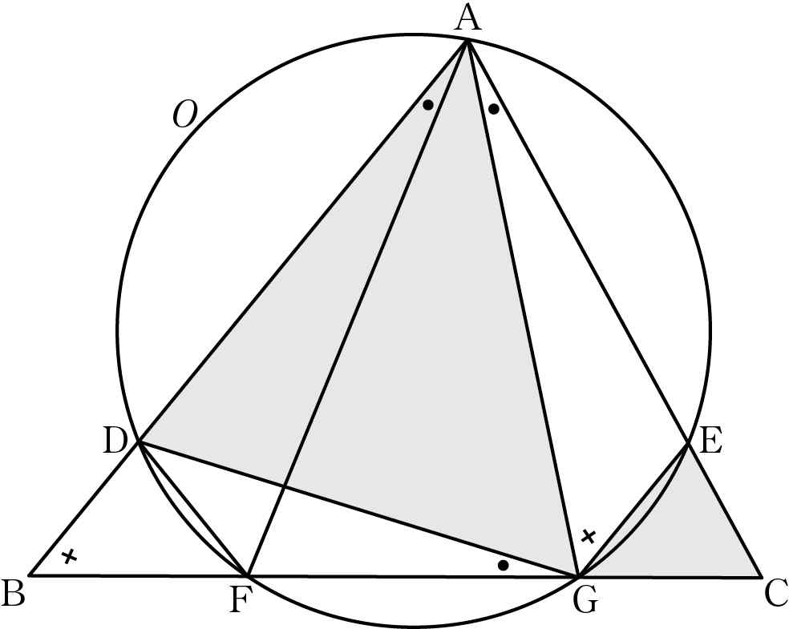

$a-b=-\frac{9}{2}\cdots \cdots$ ㉡

allows your body to heal and recharge, while

|  | • 영어 영역 • | also helping your mind relax and improving |
| --- | --- | --- |
| ㉠과 ㉡을 변끼리 더하면 |  | focus. That’s why I want to emphasize how |
| $4a=-4$, $a=-1$ |  | important rest is for your health. Taking time |
| $a=-1$ 을 ㉡에 대입하면 | 정 답 | to rest can prevent stress and boost your |
| $-1-b=-\frac{9}{2}$ , $b=\frac{7}{2}$ |  | overall wellness. So, don’t skip those breaks! |

$f(x)=-x^{2}+\frac{7}{2}x+\frac{9}{2}^{=-}(x^{-}\frac{7}{4})^{2+}\frac{121}{16}$

함수 $y=f(x)$의 그래프의 꼭짓점의 좌표가 $(\frac{7}{4},\frac{121}{16})$

$k=\frac{121}{16}$

이므로

$16k=16\times \frac{121}{16}=121$

30. [출제의도] 원의 성질과 삼각형의 닮음을 이용하여 두 삼각형의 넓이를 구하는 문제를 해결한다.

해 설

$DF=EG$ 이므로 호 $DF$ 의 길이와 호 $GE$ 의 길이가 같다. 원주각의 성질에 의하여

$\angle DAF=\angle GAE$

사각형 $ADGE$ 가 원 $O$ 에 내접하므로

$\angle GDA+\angle AEG=180$

$\angle AEG+\angle GEC=180$

그러므로 $\angle GDA=\angle GEC$

사각형 $AFGE$ 가 원 $O$ 에 내접하므로

$\angle FAE+\angle EGF=180$

$\angle EGF+\angle CGE=180$

그러므로 $\angle FAE=\angle CGE$

$\angle FAE=\angle FAG+\angle GAE$

1. [출제의도] 담화의 목적을 추론한다.

M: Good morning, students. This is your vice principal Richard Simpson. As you know, our school drone club was awarded first prize at the Drone Show Contest. Actually, I asked the drone club to perform the show again for you. And they said, “Yes”. So I would recommend you watch the performance at the school field tomorrow. Please come and see the club’s drone performance, and show your support. Thank you.

drone 드론, 무인 항공기

award 수여하다

recommend 권하다

support 지지, 응원

2. [출제의도] 대화자의 의견을 추론한다.

W: Ryan, did you enjoy the musical “Tigers” yesterday?

M: Yes, I loved it. I can’t believe we got tickets for such a popular show.

podcast 팟캐스트, 인터넷 방송

crucial 중요한, 결정적인

maintain 유지하다, 지속하다

overall 전반적인

recharge 재충전하다

emphasize 강조하다

prevent 방지하다

boost 촉진하다

wellness 건강

skip 건너뛰다

4. [출제의도] 그림과 대화의 일치 여부를 파악한다.

W: Hi, Jayden, you know what? I visited the Dream Gallery with my mom yesterday.

M: Oh, I’ve always wanted to visit there. Did you take any pictures?

W: Sure. Look at this.

M: Is the person wearing a stripeddress your mom?

W: Yes, it is. She really loved the painting on the left side of the wall.

M: Oh, the painting of flowers? That’s nice. I also like the other painting.

W: You mean the painting of umbrellas in the round frame?

M: Yes, it caught my eye. I can see a person sitting on the right side of the picture. Who’s the person?

W: The man wearing glasses, right? He’s the manager of the gallery.

M: I see. What’s the arrow sign on the right wall?

W: It shows the direction to the next area.

M: Oh, the gallery must be huge!

| 1 | ④ | 2 | ⑤ | 3 | ② | 4 | ③ | 5 | ⑤ |
| --- | --- | --- | --- | --- | --- | --- | --- | --- | --- |
| 6 | ③ | 7 | ② | 8 | ④ | 9 | ③ | 10 | ② |
| 11 | ② | 12 | ④ | 13 | ① | 14 | ④ | 15 | ④ |
| 16 | ⑤ | 17 | ③ | 18 | ③ | 19 | ③ | 20 | ② |
| 21 | ① | 22 | ① | 23 | ⑤ | 24 | ① | 25 | ④ |
| 26 | ④ | 27 | ② | 28 | ② | 29 | ④ | 30 | ⑤ |
| 31 | ① | 32 | ③ | 33 | ④ | 34 | ① | 35 | ② |
| 36 | ⑤ | 37 | ⑤ | 38 | ③ | 39 | ⑤ | 40 | ① |
| 41 | ① | 42 | ② | 43 | ④ | 44 | ③ | 45 | ② |

| $=\angle FAG+\angle DAF$ | W: Yes, we were lucky. By the way, it reminded | gallery 화랑 |
| --- | --- | --- |
| $=\angle DAG$ | me of the class musical that we have to | stripeddress 줄무늬 드레스 |
| 두 삼각형 $EGC$, $DAG$ 에서 | prepare for the next month’s school festival. | frame 액자 |
| $\angle GEC=\angle ADG$, $\angle CGE=\angle GAD$ 이므로 | M: You read my mind! I think we should look for | arrow 화살 |
| 두 삼각형 $EGC$, $DAG$ 는 서로 닮음이다. | a musical with a variety of music. | direction 방향 |
| $AG=3\times GC$ 이므로 두 삼각형 $EGC$, $DAG$ 의 닮음비는 | W: Well, there might be something even more |  |

|  |  |  |  | 5. [출제의도] 대화자가 할 일을 파악한다. |
| --- | --- | --- | --- | --- |
| $1:3$ 이고, 넓이의 비는 $1:9$ 이다. |  | important than that. |  | W: Honey, the flowers are really beautiful these |
| 삼각형 $EGC$ 의 넓이가 $8$ 이므로 |  | M: Should we give the audience a meaningful |  | days. Why don’t we take a walk this |
| ∆$EGC:$ ∆$DAG=8:$ ∆$DAG=1:9$ | lesson? |  |  |  |
| ∆$DAG=72$ |  | W: Not necessarily. Do you remember what we | weekend? |  |
|  | did last year? |  |  | M: Wow, that sounds great. Do you have any |

$DF=EG$ 이므로 호 $DF$ 의 길이와 호 $GE$ 의 길이가

particular place in mind?

M: Yes. We focused on preparing a musical that

같다. 원주각의 성질에 의하여	W: Yes, I’d like to visit the Grand Forest. I’ve was easy to perform.

$\angle DGF=\angle GAE$	already downloaded the map of the forest.

W: Right. But not everyone participated. I think

$\angle GDA=\angle GEC$ 에서	M: That’s nice. Do we have to buy entrance everyone should have a role for the class

$\angle BDG=180-\angle GDA$, $\angle AEG=180-\angle GEC$ 이므로	tickets?

musical.

$\angle BDG=\angle AEG$	W: Yes. We can buy tickets online. I’ll buy two M: That’s a good point.

두 삼각형 $DBG$, $EGA$ 에서	tickets in the afternoon.

musical 뮤지컬

$\angle DGB=\angle EAG$, $\angle BDG=\angle GEA$ 이고	M: Great. Let’s have a nice lunch there, too. remind 상기시키다, 떠올리게 하다

삼각형의 세 내각의 크기의 합은 $180$이므로	There’s a restaurant called Treehouse Pasta in a variety of 다양한

$\angle GBD=\angle AGE$	the Grand Forest.

audience 관객, 청중

$DB=EG$, $\angle BDG=\angle GEA$ , $\angle GBD=\angle AGE$ 이므로	W: Nice. Do we have to make a reservation?

participate 참여하다, 참가하다

두 삼각형 $DBG$, $EGA$ 는 서로 합동이다.	M: Yes. I’ll make the reservation right away.

그러므로 ∆$DBG=$ ∆$EGA$	3. [출제의도] 담화의 요지를 추론한다.	W: Then, I’ll look up the menu of the restaurant.

$ADG+$ $DBG$	M: Thanks.

<table>
<tr><th>$S=$ ∆</th><th>∆</th><th>M: Welcome to the Healing Tip Podcast. I’m Dr.</th></tr>
<tr><td>$=72+$ ∆$DBG$</td><td>Smith. In our busy lives, what do you think is</td><td>particular 특정한</td></tr>
<tr><td>$T=$ ∆$EGC+$ ∆$EGA$</td><td>just as important as exercising or eating well</td><td>entrance 입장</td></tr>
<tr><td>$=8+$ ∆$EGA$</td><td>for your health? It’s rest. Rest plays a crucial</td><td>reservation 예약</td></tr>
<tr><td>따라서 $S-T=72-8=64$</td><td>role in maintaining your overall wellbeing. It</td><td></td></tr>
<tr><td colspan="3">10</td></tr>
</table>

online?

W: No. There’s no live streaming service. But if you go there, you can ask questions directly to Professor Johnson.

M: Great. I can go in person. Can we go together?

W: Sure! I’ll text you the details of the talk show right now.

generation 세대

hold 개최하다

topic 주제

birth rate 출생률

affect 영향을 미치다

live streaming 실시간 스트리밍, 생중계

in person 직접, 몸소

detail 세부 사항

9. [출제의도] 담화 내용과의 일치 여부를 파악한다.

presentation 발표, 프레젠테이션

slide 슬라이드, 발표 자료

12. [출제의도] 대화에서 적절한 응답을 찾는다.

waste 쓰레기

upload 올리다

social media 사회 관계망 서비스

exactly 맞아

cafeteria 구내식당

13. [출제의도] 대화에서 적절한 응답을 찾는다.
6. [출제의도] 수치를 파악한다.

M: Hello. How can I help you today?
W: Hi. I’m here to buy some decorations for my
sister’s shoes.
M: Great. We have those over here. They are
five dollars each.
W: She would love the decorations with this frog
character, so I’ll take two of them.
M: Wonderful. Do you need anything else?
W: Oh, I’ve just noticed this cute bracelet for her.
How much is it?
M: It’s ten dollars.
W: I’ll buy it. And I’d like them giftwrapped,
please.
M: We charge for giftwrapping. It costs three
dollars. Would that be okay with you?
W: Yes, that’s fine.
M: Then, I’ll giftwrap two decorations and one
bracelet together in one box.
W: Okay. Here’s my credit card.

decoration 장식품

bracelet 팔찌

giftwrap 선물 포장하다

charge (요금을) 청구하다

credit card 신용카드

7. [출제의도] 화자가 특정 행동을 하지 못한 이유를 파악한다.

W: Hi, Brian. Why didn’t you answer my text
message yesterday? I wanted to ask about the
math exam.
M: Hi, Sarah. I’m really sorry. I broke my cell
phone yesterday, so I couldn’t read it.
W: Oh, no! What happened to it?
M: Well, I dropped it while getting off the bus.
And now, it doesn’t work at all.
W: Why didn’t you get it fixed?
M: I wanted to, but I couldn’t.
W: Was it because you couldn’t find a repair
shop? There’s one right by the bus stop near
our school.
M: I went there to get it fixed, but I couldn’t.
W: Oh, did you have to wait too long?
M: No, I didn’t. Actually, I didn’t know I had to
make a reservation in advance. So I just went
back home.
W: Ah! That’s too bad!

break 고장 내다

get off \~에서 내리다

repair 수리, 수선

reservation 예약

in advance 미리, 사전에

8. [출제의도] 세부 사항의 언급 여부를 파악한다.

[Cell phone rings.]

M: Hi, Kelly. What’s up?

W: Hey, Robert. Do you have time on Friday?

M: Sure.

W: Have you heard about the Future Generation Talk Show?

W: Hello, students! This is your science teacher
Jane Brown. I have some good news. This
Saturday we’re having Science Day at our
school. In the morning, coding experts will
teach you how to make a computer program.
You can also operate some robots by yourself
in the school hall. In the afternoon, your
science teachers will run some experimental
booths for you. It’s a good chance to
experiment with what you’ve learned from the
textbooks. You can sign up for Science Day by
scanning the QR codes on the school board.
For the participants, lunch will be provided.
Come and enjoy Science Day!

coding 코딩, 프로그램 작성

operate 작동하다

experimental 실험의

participant 참가자, 참여자

10. [출제의도] 대화의 내용을 표에서 확인한다.

M: Sweetie, what are you doing?
W: I’m looking at the schedule for exercise
classes. Would you like to help me choose?
M: Sure. What’s your budget for it?
W: Well, I don’t want to spend more than forty
dollars.
M: Okay. Then, forget about this one. What about
class time?
W: As you know, I have things to do in the
afternoon.
M: In that case, let’s cross this one out. Now you
have dancing and tennis left.
W: I heard the tennis class is held outside. I don’t
like outdoor sports.
M: Okay. Then, we have only two exercise
classes left. Which level is good for you?
W: Since I’ve already taken the beginner’s class,
I’ll take the other one this time.

schedule 시간표

budget 예산

cross out 지우다, 삭제하다

outdoor 야외의

M: Ashley, do you remember the digital poster we made to upload on social media?

W: Yes, of course. It was about food waste, right?

M: Exactly. Let’s print it out and put it on the wall in our school cafeteria.

W:

W: Chris, you’ve been looking so tired these days.
M: Yeah, Mom. I’m studying for my first high
school exam. I really want to do well.
W: I understand, but I’m worried about you. Have
you had any trouble managing your time?
M: Well, I don’t have enough of it. I’ve been
staying up late studying these days.
W: Staying up late won’t help you much, Chris.
M: But I have so much to do, Mom.
W: I see your point, but staying up too late might
actually hurt your chances of doing well.
M: Maybe you’re right, but I thought studying
would be more helpful to me than sleeping.
W: Not if you’re too tired. If you don’t sleep
enough, it’ll hurt your focus and memory.
M:

have trouble -ing \~하는 데 어려움을 겪다

manage 관리하다

focus 집중

14. [출제의도] 대화에서 적절한 응답을 찾는다.

M: Hi, Cindy! What are you doing this weekend?
W: I’m going to play badminton with my friends.
M: You play badminton quite often.
W: It’s my new hobby. It helps me reduce stress.
M: How nice! I’ve been looking for something to
reduce stress.
W: Well, you don’t have to think too hard. Just
think of something that makes you happy.
M: Hmm.... But nothing comes to mind right away.
W: Then, why don’t you come and play badminton
with me this Saturday? You’ll like it, too, I
think.
M: Really? Is it okay if I join you?
W: Of course, it is! We meet at the sports center
every Saturday morning.
M: Thanks a lot! Do I need to prepare anything?
W:

badminton 배드민턴

hobby 취미, 여가 활동

reduce 줄이다

prepare 준비하다

<table>
<tr><th></th><th>M: Oh, you mean the talk show that will be held</th><th>beginner 초보자, 초급 단계</th><th>15. [출제의도] 상황에 적절한 말을 찾는다.</th></tr>
<tr><td>at Southern University?</td><td></td><td>11. [출제의도] 대화에서 적절한 응답을 찾는다.</td><td>M: Kevin is the president of the Starlight Club in</td></tr>
<tr><td></td><td>W: Yes, that’s right. Professor Peter Johnson is</td><td></td><td>the school. For weeks, the club has been</td></tr>
<tr><td>coming to talk.</td><td>M: The famous Peter Johnson? What’s the topic</td><td></td><td>preparing the starviewing campnight at the school yard with the club teacher, Ms. Tyler.</td></tr>
<tr><td>of the talk show?</td><td>W: It’s about the low birth rate issue and how it’s</td><td></td><td>They expected that the sky would be clear on campnight. But today, there’s a sudden change</td></tr>
<tr><td>affecting the future.</td><td>M: Sounds interesting. Can I watch the talk show</td><td></td><td>in the weather forecast, and it says it’s going to rain during campnight. It means the camp</td></tr>
<tr><td colspan="4">11</td></tr>
</table>

W: Hi, Daniel. Are you ready for your presentation tomorrow?

M: Hi, Tina. Not really. I’ve finished my slides, but I haven’t practiced my speech yet.

W: How do you usually practice it?

M:

cannot go on as planned. Kevin wants to ask 이 다가오고, 나의 심장은 점점 빠르게 뛰고 있다. 그 인간의 본성에 거의 자연스러워 보이지만, 만약 우리
Ms. Tyler if they can change the camp date to 때, 벽 틈새로 새어 들어온 희미한 빛줄기 속으로 그 가 <u>이 미끄러운 경사 길을 내려가기 시작한다면</u>, 우리
another day. In this situation, what would 형체가 들어선다. 토끼다. 그것이 크고 호기심 가득한 는 결국 놓일 곳이 마음에 들지 않을 수도 있다.
Kevin most likely say to Ms. Tyler? Kevin: view 보다 expect 예상하다, 기대하다 weather forecast 일기 예보	눈으로 나를 바라볼 때, 웃음이 내 입술에서 새어 나 온다. “너 때문에 놀랐잖아.” 훨씬 나아진 기분을 느끼 며, 나는 말한다. 토끼는 잠시 멈칫하더니, 이내 깡충 뛰어 그림자 속으로 다시 사라진다. 나는 미소지으며 남아 있다. 나의 마음이 편안해지기 시작한다.	assume 가정하다 gene editing 유전자 편집 prove 입증되다 preferable 바람직한
transform 변형하다, 바꾸다
sudden 갑작스러운 as planned 계획대로 [16 \~ 17]	damp 습기 찬 thick (공기가) 짙은 make out 알아보다, 식별하다 shadow 그림자 shaking 떨리는 figure 형상	temptation 유혹 superior 우수한 unborn 태어나지 않은 beneficial 유익한 pursuit 추구
22. [출제의도] 글의 요지를 추론한다.
faint 희미한 beam 빛줄기 crack 틈새
escape (웃음 등이) 새어 나오다
stare at \~을 바라보다
hop 깡충 뛰다
at ease 편안한
20. [출제의도] 필자의 주장을 추론한다.

W: Hello! Everyone. I’m Jasmine, a travel
photographer, and I’m excited to share some
wonderful places to take photos around the
world. The first place is Times Square in New
York. It is full of energy, with its tall
buildings and busy sidewalks. Next, Rome
amazed me with its famous historical places,
like the Colosseum. It made me feel like
traveling back in time! And when you visit
London, you shouldn’t miss Buckingham Palace.
It’s a perfect place for onceinalifetime
photos. Lastly, in Sydney, the Opera House
was great for taking beautiful sunset photos.
Traveling with a camera is such a joy, and I
can’t wait to share more travel places with
you. Now let’s take a look at the photos of
these places.

몸짓을 사용하는 의사소통을 개선하는 것은 단순히 고개를 끄덕이거나 악수를 해야 할 때를 아는 것 이상을 포함한다. 이는 여러분의 말로 전하는 메시지를 보완하기 위해 여러분의 말에 여러 겹의 의미를 더하면서 몸짓을 사용하는 것에 대한 것이다. 예를 들어 손바닥을 보이는 동작은 정직함을 나타내어 신뢰의 분위기를 만든다. 손바닥을 위로 향한 채로 이야기할 때 여러분은 개방성과 협력을 끌어낸다. 이 간단하지만 강력한 몸짓은 상대방이 더 편안함을 느끼고 대화에 더 기꺼이 참여하고 싶도록 만들 수 있다. 하지만 과도한 몸짓의 함정에 주의하라. 너무 많은 손동작은 여러분의 말로부터 (사람들의) 관심을 돌리게 해서 (그들을) 여러분의 메시지에 집중이 안되게 한다. 손이 마치 새처럼 빠르게 움직여서 자신의 메시지가 몸짓의 혼돈 속에 사라져 버린 발표자를 상상해 보라. 균형이 핵심이다. 여러분의 몸짓은 여러분의 말을 강조해야지,
말을 가려서는 안 된다.

우리가 초등학교에서 배우는 과학은 자연계에 대한 확실함의 모음인데, 즉 지구는 태양 주위를 돌고, DNA는 유기체의 정보를 담고 있다는 것 등이다. 여러분이 과학의 실제를 배우기 시작할 때만, 이러한 각각의 ‘사실’이 많은 관찰이나 실험을 바탕으로 한 연속적인 논리적 추론을 통해 어렵게 얻어졌다고 깨닫게 된다. 과학의 과정은 지식의 조각을 모으는 것보다는 우리가 알고 있는 것에서 불확실함을 줄이는 것에 대한 것이다. 그 과정에서 우리가 지금 있는 곳에 따라 주어진 어떤 지식의 조각에 대해서 우리의 불확실함이 더 크거나 더 적을 수 있는데, 즉 오늘날 우리는 사과가 나무에서 어떻게 떨어질지 꽤 확신하지만, 난류 유동에 대한 우리의 이해는 한 세기가 넘는 노력 후에도 여전히 진행 중인 연구로 남아 있다.

photographer 사진작가

sidewalk 보도, 인도

amaze 놀라게 하다

historical 역사적인

onceinalifetime 일생에 한 번 있는

sunset 일몰

16. [출제의도] 담화의 주제를 추론한다.
17. [출제의도] 세부 사항의 언급 여부를 파악한다.
18. [출제의도] 글의 목적을 추론한다.

gestural 몸짓의

involve 포함하다, 수반하다

nod 고개를 끄덕이다

complement 보완하다

layer 겹

indicate 나타내다, 보여 주다

atmosphere 분위기

collaboration 협력

engage in \~에 참여하다

overgesturing 과도한 몸짓

distract from \~에 집중이 안되게 하다

overshadow 가리다

introduce 소개하다

21. [출제의도] 어구의 함축 의미를 추론한다.

unique 독특한, 특별한

handmade basket 수공예 바구니	인간 유전자 편집이 안전하고 효과적이라고 입증된 organize 조직하다	다고 가정한다면, 해로운 유전자가 심각한 문제를 일 exhibition plan 전시 배치도	으키기 ‘전에’ 생애의 가능한 한 가장 이른 단계에서 inform 알리다	질병을 유발하는 돌연변이를 교정하는 것이 합리적이 located 위치한	고, 심지어 바람직해 보일 수도 있다. 하지만 일단 배 requirement 요구 사항	아의 돌연변이가 된 유전자를 ‘정상적인’ 유전자로 변 further 추가적인	형하는 것이 가능해지면, 정상적인 유전자를 더 우수 assistance 도움	한 버전으로 업그레이드하려는 유혹이 분명히 있을 것이다. 우리가 심장병이나 암과 같은 질병에 대한 평생

19. [출제의도] 등장인물의 심경 변화를 추론한다.

위험을 낮추기 위해 태어나지 않은 아이들의 유전자를 헛간은 춥고 습기가 차 있고, 공기에 오래된 나무와 편집하는 것을 시작해야 할까? 더 강한 체력이나 향상 흙냄새가 짙다. 어두워서, 나는 그림자 속에서 움직이 된 인지 능력 같은 유익한 특성을 태어나지 않은 아이는 무언가를 알아볼 수 없다. “거기 누구세요?” 목소리 들에게 부여하거나 또는 눈이나 머리카락 색 같은 신가 두려움에 떨리며, 나는 묻는다. 그림자가 점점 가까 체적 특징을 바꾸는 것은 어떨까? 완벽에 대한 추구는

grade school 초등학교

certainty 확실함, 확실한 것 carry 담고 있다

organism 유기체

practice 실제

realize 깨닫다

succession 연속

logical 논리적

observation 관찰

process 과정

uncertainty 불확실함

depending upon \~에 따라

remain 남아 있다

23. [출제의도] 글의 주제를 추론한다.

a wealth of 수많은

evidence 증거

supervisor 상사

perceive 여기다, 인식하다

motivate 동기를 부여하다

relatedness 관계성

internalization 내면화

Miranda님께,

우리의 Crafts Art Fair에 참여해 주셔서 감사합니다. 우리가 당신을 ‘올해의 예술가들’ 중 한 명으로 선정했기에, 당신의 독창적인 수공예 바구니를 우리 지역 사회에 소개하기를 기대하고 있습니다. 전시 배치도를 조직하는 것의 일환으로, 우리는 당신의 작품이 지정된 7번 테이블에 전시될 예정임을 알려 드리게 되어 기쁩니다. 방문객들이 입구 근처에 위치한 당신의 작품을 쉽게 찾을 수 있습니다. 특별한 요구 사항이 있거나 추가적인 도움이 필요하시면, 편히 미리 연락해 주시기 바랍니다.

진심을 담아,

Helen Dwyer

부모, 교사, 상사, 그리고 코치가 관여되어 있고 배려한다고 여겨질 때, 사람들은 더 행복하고 더 동기가 부여된다는 수많은 증거가 있다. 그리고 그것이 단지 권력을 가진 사람들만은 아닌데, 즉 우리는 또래와 직장 동료들에게서도 소중히 여겨지고 존중받는다는 느낌을 받을 필요가 있다. 따라서, 관계성에 대한 욕구가 충족될 때, 그리고 자율성과 유능함에 대한 지원 또한 제공된다면, 동기와 내면화는 자극된다. 만약 우리가 다른 사람들에게 동기를 부여하려고 한다면, 배려하는 관계는 그곳에서 시작할 수 있는 중요한 기반이 된다.
그리고 우리가 스스로 동기를 부여하려고 할 때, 타인과의 유대감을 강화하기 위한 일을 하는 것은 장기적인 지속에 중요할 수 있다. 그러니 친구와 함께 운동하라, 당신이 어려운 결정을 내려야 할 때 누군가에게 전화하라, 그리고 다른 사람들이 도전에 맞설 때 그들을 위한 버팀목으로 그곳에 있어라.

fuel 자극하다, 연료를 공급하다 competence 유능함, 능숙함

enhance 향상시키다

a sense of connectedness 유대감

다. University of Chicago로 돌아와 경제학 교수가 되기 전에, 그는 1963년부터 1974년까지 Carnegie Mellon University에서 가르쳤다. 그는 매우 영향력 있는 경제학자로 알려졌으며, 1995년에, 경제학에서

stuffed toy 봉제 인형

transform 변형하다, 바꾸다

decorative 장식의

flowerpot 화분

|  |  | take on 맞서다 |  | 노벨상을 수상했다. | prepare 준비하다 |
| --- | --- | --- | --- | --- | --- |
|  |  | 24. [출제의도] 글의 제목을 추론한다. |  | major 전공하다 | participation fee 참가비 |
|  |  | fMRI(기능적 자기 공명 영상)와 같은 현대의 뇌 스 |  | interest 흥미 | material 재료 |
|  |  | 캐닝 기법은 소리 내어 읽는 것이 두뇌의 여러 영역을 |  | earn 받다 | include 포함하다 |
|  |  |  |  | doctoral degree 박사 학위 | detail 세부 사항 |
|  |  | 밝힌다는 것을 드러냈다. 발음과 발화된 반응의 소리 |  | economics 경제학 |  |
|  |  | 를 듣는 것과 연관된 영역에서 강렬한 활동이 있으며, |  |  | 29. [출제의도] 어법상 맞지 않는 표현을 찾는다. |
|  |  | 이는 더 많은 두뇌 능력을 위한 여러분의 뇌세포의 결 |  | professor 교수 |  |
|  |  | 합 구조를 강화시킨다. 이것은 전반적인 집중력 향상 |  | influential 영향력 있는 | 루틴은 운동선수가 경기 조건을 평가할 수 있도록 |
|  |  |  |  | award 수여하다 | 해 준다. 예를 들어, 배구 서브 루틴에서 공을 튕기는 |
|  |  | 으로 이어진다. 소리 내어 읽는 것은 여러분의 대중 |  |  | 것은 서브를 하는 선수에게 공, 바닥, 그리고 자신의 Economic Sciences 경제학 |
|  |  | 말하기 능력을 발전시키는 좋은 방법인데, 왜냐하면 |  |  | 근육 상태에 대한 정보를 제공한다. 그다음 이 정보는 |
|  |  | 그것은 여러분으로 하여금 하나도 빠짐없이 단어를 읽 |  |  | 27. [출제의도] 실용문의 세부 내용을 파악한다. |
|  |  | 게 강제하기 때문인데, 이는 사람들이 빨리 읽거나 조 |  |  | 자신의 서브를 적절히 준비하기 위해 사용될 수 있다. |
|  |  | 용히 읽을 때 자주 하지 않는 일이다. 특히 어린이는 |  | Blackwood 동물원에 오신 것을 환영합니다 | 루틴은 또한 그러한 평가에 기반하거나 또는 특정 경 |
|  |  | 뇌가 노래 부르기, 만지기, 소리 내어 읽기와 같은 긍 |  |  | 쟁 목표를 추구하여 선수가 준비 상태를 조절하고 미 |
|  |  | 정적인 자극에 의해 만들어진 결합을 통한 학습에 대 |  | 탐험할 준비를 하세요! 여러분은 10 km의 보행로에 | 세하게 조정할 수 있게 해 준다. 이러한 적응은 수행 |
|  |  |  |  | 서 놀라운 동물들을 볼 수 있습니다. | 에 영향을 미칠 수 있는 조건, 경쟁 상대, 경기 상황, |
|  |  | 해 연결되어 있기 때문에 소리 내어 읽도록 장려되어 |  |  | 또는 내적 영향에 대한 조정을 포함할 수 있다. 경주 |
| 야 한다. |  |  |  |  |  |
|  |  |  |  | 운영 시간 | 용 자동차 엔진을 트랙, 기온, 그리고 날씨의 조건에 |
|  |  | modern 현대의 |  | • 매일, 1년 내내! | 맞게 조정하는 것과 마찬가지로, 루틴은 적절한 수행 |
|  |  | technique 기술 |  | • 오전 9:30 \~ 오후 4:30 (오후 3:30에 마지막 입 | 을 해내기 위해 경기의 모든 구성 요소를 조정한다. |
|  |  | fMRI (functional Magnetic Resonance Imaging) 기 | 장) |  | ④ (what → that) |
|  |  | 능적 자기 공명 영상 |  | 티켓 가격 | routine 루틴, 일상의 과정 |
|  |  | reveal 드러내다 |  | • 13세 \~ 64세: 30달러 | enable 가능하게 하다 |
|  |  | light up 밝히다 |  | • 3세 \~ 12세: 20달러 | athlete 운동선수 |
|  |  | intense 강렬한 |  | • 그 외: 무료 | evaluate 평가하다 |
|  |  | associated with \~과 연관된 |  |  | competition 경기, 경쟁 |
|  |  | pronunciation 발음 |  | 계절에 따른 안내 | condition 조건 |
|  |  | response 반응 |  |  | 날씨가 여전히 추워서, 뱀과 거북이 같은 일부 동물 bounce (공을) 튀기다 |
|  |  | strengthen 강화시키다 |  | 은 실내에만 머무를 것입니다. | supply 제공하다 |
|  |  | connective structure 결합 구조 |  |  | properly 적절히 ※ 무료 셔틀버스는 30분마다 Blackwood 지하철역 |
|  |  | overall 전반적인 |  |  | prepare for \~을 준비하다 |
|  |  | concentration 집중력 |  | 에서 출발합니다. | adjust 조절하다, 조정하다 |
|  |  | public speaking skills 대중 말하기 능력 |  | explore 탐험하다 | finetune 미세하게 조정하다 |
|  |  | in particular 특히 |  | amazing 놀라운 | in pursuit of \~을 추구하여 |
|  |  | encourage 장려하다 |  | walking path 보행로 | adaptation 적응 |
|  |  | 25. [출제의도] 도표의 내용을 파악한다. |  | operation 운영 | involve 포함하다 |
|  |  |  |  | admission 입장 | internal 내적 |
|  |  | 위 그래프는 2023년 미국에서 사람들이 얼마나 자 |  | seasonal 계절에 따른 | influence 영향 |
|  |  | 주 패스트푸드를 먹었는지를 빈도 순에 따라 보여 준 |  | indoors 실내에 |  |
|  |  | 다. 50퍼센트가 넘는 사람들은 패스트푸드를 일주일에 |  |  | affect 영향을 미치다 |
|  |  | 한 번 또는 더 자주 먹었다. 가장 많이 응답된 섭취 |  | depart 출발하다 | performance 수행 |
|  |  | 패턴은 일주일에 몇 번이었고, 이는 전체의 36퍼센트 |  | 28. [출제의도] 실용문의 세부 내용을 파악한다. | achieve 해내다 |
|  |  | 였다. 두 번째로 가장 많이 응답된 패턴은 한 달에 몇 |  |  | 양말 DIY 워크숍 |
|  |  | 번이었으며, 이는 전체의 18퍼센트를 차지했다. <u>패스</u> |  |  | 30. [출제의도] 문맥상 적절하지 않은 어휘를 찾는다. |
|  |  | 트푸드를 두 달에 한 번 먹었던 사람들의 비율은 패스 |  | 모든 연령대를 위한 재미있고 창의적인 양말 DIY | 프로모션은 소비자 심리를 다룬다. 우리가 사람들을 |
|  |  | 트푸드를 매일 먹었던 사람들의 비율보다 많았다. 패 |  | (손수 만들기) 워크숍에 함께하세요! | 어떤 한 방식으로 생각하도록 강요할 수는 없으며, 현 |
|  |  | 스트푸드를 거의 혹은 전혀 먹지 않았던 사람들을 합 |  |  | 명한 마케팅 담당자는 프로모션이 가능한 한 가장 명 |
|  |  | 친 몫은 10퍼센트 미만이었다. |  | 일시 및 장소 | 확하고 정직하며 단순한 방식으로 정보를 제공하기 위 |
|  |  | consume 먹다 |  | • 4월 19일 토요일, 오후 1시부터 오후 3시까지 | 해 사용된다는 것을 알고 있다. 그렇게 함으로써, 매출 |
|  |  | frequency 빈도 |  | • 커뮤니티 홀, Clanton Center | 증가의 가능성이 높아진다. 무언가를 구매하도록 소비 |
|  |  | account for \~를 차지하다 |  |  | 자를 속이기 위해 프로모션이 행해지던 시대는 갔다. |
|  |  | percentage 비율 |  | 워크숍 프로그램 | 소비자가 정말로 원하지 않았거나 필요로 하지 않았던 |
|  |  | combine 합치다 |  |  | 물건을 구매하도록 하는 것의 장기적인 효과는 좋지 |
|  | share 몫 |  |  |  | 않았다. 사실, 한 번 속은 소비자는 자신의 경험을 다 |
|  |  | rarely 거의 \~ 않다 |  |  | 른 사람에게 전하기 때문에 판매에 손해를 끼칠 수 있 다. 대신, 마케팅 담당자들은 상품이나 서비스의 진가 |
|  |  | 26. [출제의도] 글의 세부 내용을 파악한다. |  |  | 를 가장 인정할 것 같은 소비자를 확인하고, 그 소비 |
|  |  | Robert E. Lucas, Jr.는 1937년 9월 15일 |  |  | 자에게 그 상품이나 서비스의 가치를 명확하게 하는 |
|  |  | Washington주 Yakima에서 태어났다. 제2차 세계대전 |  |  | 참가자가 준비해야 할 것 방식으로 홍보하는 것이 목표가 되어야 한다는 것을 |
|  |  | 중에, 그의 가족은 Seattle로 이주했고, 그곳에서 그는 |  |  | • 사용했지만 깨끗한 양말 이제 알고 있다. 그러므로, 마케팅 담당자는 그 <u>무관심</u> |
|  |  | Roosevelt High School을 졸업했다. 그는 University |  |  | <u>한 (→ 잠재적인)</u> 소비자가 어디에 있는지, 그리고 어 |
|  |  | of Chicago에서 역사를 전공했다. University of |  | 참가비 | 떻게 그들에게 도달해야 하는지 알아야 한다. • 1인당 5달러(재료비를 포함함) |
|  |  | California, Berkeley에서 경제사를 수강한 후, 그는 경 |  |  | ⑤ (uninterested → potential) ※ 세부 사항은 Clanton Center 웹사이트를 방문하 |
|  |  | 제학에 대한 흥미를 키웠다. 그는 1964년에 |  |  | promotion 프로모션, 홍보 |
|  |  | University of Chicago에서 경제학 박사 학위를 받았 |  |  | 거나 555 - 123 - 4567로 전화하세요. |

| 시간 | DIY 품목 | 할 일 |
| --- | --- | --- |
| 오후 1시 \~ 오후 2시 | 장난감 | 양말로 봉제 인형 만들기 |
| 오후 2시 \~ 오후 3시 | 화분 커버 | 양말을 소형 화분용 장식 커버로 변형하기 |

deal with \~을 다루다

|  | consumer 소비자 | roll 굴러가다 | 인 행위일 가능성이 더 크다. 식물은 살아 있는 유기 |
| --- | --- | --- | --- |
|  | psychology 심리 | have a clue 짐작하다 | 체이며, 그들의 주요 목표는 살아남는 것이다. 냄새와 |
|  | one way or another 어떤 한 방식으로 | on the tip of one’s tongue 당장 떠오르지 않는, 혀 | 소리는 <u>자신에게 해를 끼칠 수도 있는 것에게서 지키</u> |
|  | marketer 마케팅 담당자 | 끝에서 맴도는 | 기 위한 그들의 도구이다. |
|  | provide 제공하다 | argument 말다툼, 논쟁 | communicate 의사소통을 하다 |
|  | fashion 방식, 방법 | overtired 극도로 지친 | express 표현하다 |
|  | possibility 가능성 | recital 연주회 | discontent 불만 |
|  | sales 매출, 판매 | explain 설명하다 | frequency 주파수 |
| fool 속이다 |  | justify 정당화하다 | researcher 연구자 |
|  | purchase 구매하다 | circumstances 상황, 환경 | experiment 실험하다 |
|  | longterm 장기적인 | a series of 연속된 | microphone 마이크 |
|  | damage 손해, 피해 | notice 인지하다, 알아차리다 | record 녹음하다 |

relate 전하다

experience 경험

identify 확인하다

appreciate 진가를 인정하다

reach 도달하다

31. [출제의도] 빈칸에 적절한 표현을 추론한다.

Plato는 여러분이 자신에게 아름답다는 인상을 주는 무언가를 볼 때, 마치 그림이나 사진조차 실재하는 것의 일부만을 포착하는 것처럼, 여러분은 실제로는 진정한 아름다움의 부분적인 반영을 보고 있을 뿐이라고 주장했다. 진정한 아름다움, 즉, Plato가 미(美)의 형상(Form of Beauty)이라고 부르는 것은 특정한 색상, 모양, 혹은 크기를 갖고 있지 않다. 오히려, 그것은 숫자 5처럼, <u>추상적</u>인 관념이다. 여러분은 숫자 5의 그림을 파란색이나 빨간색 잉크로, 크거나 작게, 만들 수 있지만, 숫자 5 자체는 그런 것들 중 어느 것도 아니다. 그것은 구체적인 형태를 가지고 있지 않다. 예를 들어, 삼각형이라는 관념을 생각해 보라. 그것은 특정한 색상이나 크기가 없을지라도, 당신이 보는 각각의 모든 삼각형 속에 어떻게든 존재한다. Plato는 아름다움도 마찬가지라고 생각했다. 미의 원형은 당신이 보는 각각의 모든 아름다운 것 속에 어떻게든 존재한다.

frown 찡그리다

mention 얘기를 꺼내다

33. [출제의도] 빈칸에 적절한 표현을 추론한다.

우리의 피부는 우리의 감정에 따라, 전기를 꽤 효율적으로 전도한다. 우리가 감정적으로 자극되었을 때,
즉, 정말로 스트레스를 받거나, 슬프거나, 어떤 강렬한 감정일 때, 우리 몸은 땀을 아주 약간 흘리는데, 너무 적어서 알아차리지도 못할 정도이다. 그리고 이 작은 땀방울이 나타날 때, 우리의 피부는 전기적으로 더 전도력이 있는 상태가 된다. 이러한 땀샘 활동의 변화는 여러분의 의식이 그 상황에 그다지 관여하지 않은 채 일어난다. 만약 여러분이 감정적으로 강렬하게 느낀다면, 여러분은 땀샘 활동의 증가를 알아차릴 것이다. 이는 특히 과학적 관점에서 유용한데, 그것이 우리가 객관적인 값을 주관적인 마음 상태에 부여할 수 있게 해 주기 때문이다. 우리는 실제로 여러분의 신체가 의식하지 못한 채 어떻게 땀을 흘리는지를 추적함으로써,
그리고 피부를 통해 약간의 전류를 흐르게 함으로써
<u>여러분의 감정적 상태를 측정할</u> 수 있다. 그다음에 여러분의 피부가 전류를 얼마나 잘 전달하는지를 계산함으로써 우리는 감정적 강도의 주관적이고, 잠재의식적인 경험을 객관적인 숫자로 바꿀 수 있다.

expert 전문가

organism 유기체

survival 살아남기 위한

objective 목표

35. [출제의도] 글의 흐름과 무관한 문장을 파악한다.

등장인물이 악당과 대비되는 영웅이라는 것은 무슨 의미인가? 예술적이고 오락적인 묘사에서, 작가가 주인공과 관객 사이에 긍정적인 관계를 수립하는 것이 필수적이다. 비극 또는 불행이 관객에게서 감정적 반응을 끌어 내기 위해서, 등장인물은 친구 또는 적 둘 중의 하나로 인식될 수 있도록 조정되어야 한다. (마찬가지로, 친구와 적 사이의 선이 현실에서는 명확하지 않다.) 묘사가 허구적이든 사실을 기록하든 간에,
주인공은 행동이 우리에게 이로움을 주는 누군가이며,
주인공은 가치 있는 동료나 소중한 협력자이고, 혹은 그렇게 될 (존재일) 것이라고 우리는 느껴야 한다. 폭력적인 액션 영화는 흔히 관객들에게서 반응을 거의 끌어내지 않는 비중이 적은 등장인물의 많은 부수적인 죽음으로 가득 차 있다. 강한 감정을 느끼기 위해, 관객은 협력자 또는 적둘중 하나로 등장인물에게 감정적으로 깊이 연관되어 있어야 한다.

conduct 전도하다, 전달하다

electricity 전기

more or less 꽤, 다소

efficiently 효율적으로

drop 방울

electrically 전기적으로

conscious mind 의식(적 마음)

intense 강렬한

viewpoint 관점

objective 객관적인

subjective 주관적인

track 추적하다

subconscious 잠재의식의

intensity 강도

figure out 계산하다

transfer 전달하다

electrical current 전류

34. [출제의도] 빈칸에 적절한 표현을 추론한다.

우리가 하는 방식과 같지는 않을지라도, 식물은 의사소통을 할 수 있다. 몇몇은 냄새를 통해 자신들의 불만을 표현한다. 여러분은 잔디를 깎고 난 후 공기 중에 감도는 냄새를 알고 있는가? 그렇다, 그것은 사실 일종의 SOS 신호다. 어떤 식물은 소리를 사용한다. 그렇다, 우리는 들을 수 없는 주파수에 있지만, 소리다. 연구자는 식물이 곤경에 처했음을 알리는 소리를 녹음할 수 있는지 알아 보기 위해 식물과 마이크를 사용해 실험했다. 그들은 식물이 스트레스를 받을 때 고주파수의 딸깍거리는 소리를 내며, 스트레스 요인에 따라 다른 소리를 낼 수 있다는 사실을 알아냈다. 식물이 물을 공급받지 못하고 있을 때 내는 소리와 잎이 잘릴 때 낼 소리가 다르다. 하지만, 전문가가 식물이

as opposed to \~와 대비되는

essential 필수적인

establish 수립하다

positive 긍정적인

audience 관객

tragedy 비극

misfortune 불행

draw out 끌어내다

recognizable 알아볼 수 있는, 인식할 수 있는

portrayal 묘사

fictional 허구의, 가상의

documentary 사실을 기록한, 사실적인

companion 동료

valued 소중한, 가치 있는

ally 협력자

dozens of 많은, 수십의

incidental 부수적인

36. [출제의도] 글의 순서를 파악한다.

적어도 일부 동물은 언어가 부족함에도 불구하고 사고할 수 있다고 가정해 보자. (C) 이것이 그들이 개념을 가지고 있다고 반드시 의미하지는 않는데, 왜냐하면 사고의 어떤 형태는 비(非)개념적일 수도 있기 때문이다. 예를 들어, 우리는 현재 서 있는 나뭇가지에서 앞쪽 나무의 나뭇가지로 가는 방법을 계획하고 있는 다람쥐를 상상해 볼 수 있다. (B) 이것을 하기 위해서, 원칙적으로 다람쥐는 나뭇가지의 개념이 필요하지 않고 또한 나무의 개념도 필요하지 않다. 예를 들어, 다람쥐가 이미지로 생각하는 능력, 즉, 다람쥐가 다양한 경로를 상상하고 시도해 볼 수 있는 나무에 대한 머릿속 지도를 만드는 능력만 가지고 있는 것으로 충분할 수도 있다. (A) 이것은 다람쥐가 개념이 부족하다는 것을 의미하는 것이 아니라, 단지 다람쥐가 이

argue 주장하다

strike 인상을 주다

partial 부분적인

reflection 반영

capture 포착하다, 담아내다

idea 관념

particular 특정한

each and every 각각의 모든

somehow 어떻게든

32. [출제의도] 빈칸에 적절한 표현을 추론한다.

여러분이 어떤 감정적인 순간에 놓인 자녀의 말을들을 때, 대화가 계속 굴러가게 하기 위해 질문을 하는 것보다 <u>단순한 관찰 결과를 공유하는 것</u>이 대개는 더 효과적임을 인식해라. 여러분이 자녀에게 “왜 슬픈 기분이 드니?”라고 물으면 그녀는 짐작조차 못 할 수도 있다. 아이라서, 그녀는 답이 당장 떠오르지 않을지도 모른다. 어쩌면 그녀는 부모님의 말다툼에 대해 슬픔을 느끼고 있거나, 혹은 그녀가 극도로 지쳤기 때문이거나, 혹은 피아노 연주회를 걱정할지도 모른다. 그러나 그녀는 이것에 대해 설명할 수도 있고 어떤 것도 설명하지 못할 수도 있다. 그리고 그녀가 정말로 답이 떠오를 때조차도 그 대답이 그 감정을 정당화하기에는 충분하지 않다고 걱정할 수도 있다. 이러한 상황에서는 연속된 질문들이 그저 자녀를 침묵하게 만들 수 있다. 여러분이 인지한 것을 단순히 나타내는 것이 더 낫다. “너 오늘 조금 피곤해 보이네.” 혹은 “내가 연주회 얘기를 꺼냈을 때 네가 얼굴을 찡그린 것을 알아챘
어.”라고 말하고, 그녀의 반응을 기다려 볼 수 있다.

emotional 감정적인

be aware \~을 인식하다

<table>
<tr><th></th><th>conversation 대화</th><th>고통으로 울부짖고 있다고 보지는 않는다는 것에 주목</th><th>사고의 구체적인 형태를 위해 그것들이 필요하지 않다</th></tr>
<tr><td></td><td></td><td>할 가치가 있다. 이러한 반응은 살아남기 위한 자동적</td><td>는 것을 의미한다. 우리가 동물이 개념을 가지고 있다</td></tr>
<tr><td colspan="4">14</td></tr>
</table>

고 말할 수 있기 위해서, 그 동물이 사고할 수 있다는 것뿐만 아니라 어떤 특정한 능력을 가지고 있다는 것 을 우리는 보여 주어야 한다. assume 가정하다	morality 도덕(성) reach 도달하다 fairness 공평함	는 데에 불완전한 도구로 여긴다. 그들은 숫자가 묘사 의 가장 중립적인 언어를 나타낸다고 생각한다. 그러 나, 우리의 묘사의 언어가 숫자로 바뀔 때, 우리가 더 큰 정확성으로 나아가지는 않는다. 숫자가 말, 음악,
39. [출제의도] 문장의 위치를 파악한다.
capable 능력이 있는 despite 불구하고 lack 부족하다	또는 그림보다 더 적절한 ‘세상의 묘사’는 아니다. 특 정한 목적(예를 들어, 인구 조사, 소득 분포)에는 유용 하지만, 숫자는 엄청난 가치를 지닌 정보를 <u>포함한다</u>
<u>(→ 제거한다)</u>. 예를 들어, 어린 학생들의 미래의 삶은
imply 의미하다 그들의 전국 단위 시험 점수에 매여 있다. 사실상, 그
concept 개념들이 교육을 지속할 수 있는지, 어디에서일지, 그리고
concrete 구체적인 얼마의 비용일지가 한 줌의 숫자에 중대하게 달려 있
specific 특정한
다. 이들 숫자는 그들이 다닌 학교의 질, 그들이 개인
in principle 원칙적으로 교습을 받아 오는지, 지지적인 부모가 있는지, 시험 불
possess 가지고 있다, 소유하다 안이 있는지 등의 여부를 설명하지 않는다. 마지막으
nonconceptual 비(非)개념적인로, 통계 결과가 조작될 수 있는 많은 방식을 제쳐 두
currently 현재더라도, 사람들의 삶을 숫자로 바꾸는 것이 도덕적으
37. [출제의도] 글의 순서를 파악한다. 로 차단하는 측면이 있다. 범죄, 노숙자 문제, 질병의
확산에 관한 통계는 사람들의 고통에 대해 아무것도 말하지 않는다. 우리는 그 통계를 멀리 있는 사건에 대한 보고서처럼 읽는데, 그러므로 이것은 우리가 동 요되지 않고 도망갈 수 있도록 해준다. 통계는 눈물이 닦인 인간이다. 수량화할 때는 신중해라.
represent 나타내다, 표현하다
airconditioning 냉방 설비 accelerate 가속화하다	accuracy 정확성
census taking 인구 조사
box 구조물 airflow 공기 흐름	income distribution 소득 분포
in effect 사실상
breeze 산들바람 unit 장치	test anxiety 시험 불안
put aside 제쳐 두다
joint 관절 bear 지탱하다	architect 건축가 comfort 안락	way 방식, 측면 morally 도덕적으로 homelessness 노숙자 문제
40. [출제의도] 글의 요약문을 완성한다.
weight 체중 squeeze 압착하다 respond 반응하다 offandon 반복적인 soak 흡수하다	spread 확산 suffering 고통 disturb 동요시키다 wipe off 닦아 내다 quantify 수량화하다
transfer 옮기다, 이동하다
41. [출제의도] 글의 제목을 추론한다.
look into \~을 들여다보다
shift 옮기다 42. [출제의도] 문맥상 적절하지 않은 어휘를 찾는다.
pressure 압력 ② (b) include → eliminate
release 풀다 [43∼45]
38. [출제의도] 문장의 위치를 파악한다.
(A) Arkansas주의 농부인 Jack은 자신의 농장에서 충분한 돈을 벌지 못해 불행했다. 여러 해 동안 열심 히 일했지만, 상황은 나아지지 않았다. 그는 자신의 농 장을 자신의 이웃인 Victor에게 팔았는데, 그는 결코 부유하지 않았다. 새로운 출발을 기대하며, 그는 더 나은 기회를 찾아 대도시로 떠났다. 몇 년이 흘렀지만,
Jack은 여전히 자신이 찾고 있던 부를 얻지 못했다.
지치고 무일푼이 되어서, 그는 자신의 옛 농장이 있던 지역으로 돌아왔다.
(D) 어느 날, 그는 자신의 옛 땅을 운전해 지나가다
invention 발명품 가 그가 본 것에 깜짝 놀랐다. 아주 적은 돈으로 농장
encounter 맞닥뜨리다, 직면하다을 샀던 Victor가 이제는 대단한 성공을 거둔 삶을 살
resistance 저항 고 있는 것처럼 보였다. 그는 농가를 허물었고 그것이
logically 논리적으로 있던 자리에 거대한 집을 지었다. 새 건물들, 나무들,
reasoning 추론 그리고 꽃들이 잘 관리된 소유지를 꾸몄다. Jack은 자
viewpoint 관점 신이 예전에 이 똑같은 땅에서 일했던 것을 도저히 믿
by definition 정의상을 수 없었다. 궁금해서, 그는 Victor에게 말을 걸기
application 적용 conception 구상	위해 멈췄다.
(B) “어떻게 이 모든 걸 해냈어요?”라고 그가 물었
effective 효과적인
다. 그리고 그는 계속해서 “당신이 농장을 샀을 때, 당
amount 양 narrow 좁은 level 높이 volume 부피 selfconstructed 스스로 구성해 낸	nonlinear 비선형적 manner 방식 state 말하다 [41∼42]	신은 돈이 거의 없었잖아요. 어떻게 그렇게 부자가 되 었죠?”라고 물었다. Victor는 미소를 지으며, “그 모든 것이 다 <u>당신</u> 덕분이에요. 이 땅에는 다이아몬드가, 대 량의 다이아몬드가 있었어요! 제가 부자가 된 것은 그 다이아몬드를 발견했기 때문이에요.”라고 말했다. “다 일부 연구자는 발화된 언어를 정확한 차이를 포착하
argue 주장하다	15	이아몬드요?”라고 Jack은 믿지 못하며 말했다. 그리고

연골은 관절의 건강한 기능에 아주 중요하며, 특히 그 관절이 당신의 무릎처럼 무게를 지탱한다면 그렇다. (C) 당신이 길을 걸으며 왼쪽 무릎의 내부 작동 방식을 들여다본다고 잠시 상상해 봐라. 당신이 왼쪽 다리에서 오른쪽 다리로 체중을 옮길 때, 당신의 왼쪽 무릎의 압력이 풀린다. (B) 그러면 당신의 왼쪽 무릎의 연골은 스펀지가 물에 담겼을 때 액체를 흡수하는 것과 거의 같은 방식으로 윤활액을 ‘흡수’한다. 당신이 또 다른 한 걸음을 내딛어 체중을 다시 왼쪽 다리로 옮길 때, 윤활액의 상당 부분이 압착되어 연골 밖으로 나간다. (A) 이러한 관절 윤활액의 연골 안팎으로의 압착은 연골이 걷는 것의 반복적인 압력에 부서지지 않고 반응할 수 있도록 돕는다.

Piaget는 똑같은 양의 물을 키가 크고 폭이 좁은 유리잔과 넓은 유리잔, 두 개의 서로 다른 유리잔에 넣고 다음 아이들에게 두 유리잔을 비교하라고 요청했다. 6세 혹은 7세보다 더 어린 아이들은 키가 크고 폭이 좁은 유리잔에 물이 더 많이 담겨 있다고 대개 말하는데, 왜냐하면 수위가 더 높기 때문이다. 그리고 아이들이 준비가 되어 있을 때, 그들은 물이 든 컵들을 갖고 놂으로써 부피의 보존을 스스로 알아낸다. <u>Piaget</u><u>는 도덕성에 대한 아이들의 이해는 그런 물잔에 대한</u>
<u>이해와 같은데, 즉 우리가 그것이 타고났다거나 혹은</u>
<u>아이들이 어른들로부터 직접 그것을 배운다고 말할 수</u>
<u>없다고 주장했다</u>. 오히려 그것은 아이들이 다른 아이들과 놀면서 스스로 구성해 낸 것이다. 게임을 순서대로 돌아가며 하는 것은 물잔 사이를 왔다 갔다 하며 물을 붓는 것과 같다. 일단 아이들이 5세 혹은 6세에 이르면, 함께 게임을 하고 문제를 해결해 나가는 것이 어른들로부터의 그 어떤 가르침보다 그들이 훨씬 더 효과적으로 공평함에 대해 배우는 데 도움이 될 것이다.

냉방 설비의 부상은 밀폐된 구조물의 건설을 가속화 했는데, 그곳에서 건물의 유일한 공기 흐름은 냉방 설비 장치의 여과된 배관을 통해서 이루어진다. 그것이 이러한 방식일 필요는 없다. Sicily에 있든 Marrakesh에 있든 Tehran에 있든 간에, 더운 기후에 있는 오래된 아무 건물이나 보아라. 건축가들은 그늘, 공기 흐름, 밝은 색상의 중요성을 이해했다. 그들은 시원한 산들바람을 잡아 두고 오후의 가장 혹독한 열기를 막을 수 있도록 건물을 향하게 했다. 그들은 공기 흐름을 촉진하기 위해서 두꺼운 벽과 흰색 지붕과 문 위의 채 광창을 가지고 있는 건물을 지었다. Tucson의 진흙 벽돌 집에서 몇 분을 보내 봤거나, 옛 Seville의 좁은 길을 걸어 본 어느 누구든 이 건설 방법이 얼마나 잘 작동하는지 안다. <u>그러나 열을 다루는 방법에 대한 이</u>
<u>모든 지혜는, 수 세기의 실제적인 경험을 하면서 축적</u>
<u>됐는데, 너무 자주 간과된다</u>. 이러한 의미에서, 냉방 설비는 개인적인 안락의 기술일 뿐만 아니라, 이것은 망각의 기술이다.

어떤 발명품이 가진 문제를 해결하려고 하는 과정에서, 여러분이 문제를 논리적으로 생각해 나가려고 애쓸 때 저항이라는 벽돌 벽에 맞닥뜨릴지도 모른다. 그러한 논리적 사고는 선형적 과정으로, 우리의 추론 능력을 활용한다. 이는 우리가 알고 있거나 경험해 본 영역에서 작업할 때는 잘 작동한다. 그러나 우리가 새로운 정보, 아이디어, 관점을 다뤄야 할 때 선형적 사고로는 흔히 충분하지 않을 것이다. 반면, 창의성은 정의상 기존 문제에 대한 새로운 정보의 적용과 새로운 관점과 아이디어의 구상을 포함한다. 이를 위해서 여러분이 비선형적 방식으로 작업하는 법, 즉, 창의적인 뇌를 사용하는 법을 배운다면 여러분은 가장 효과적이 될 것이다. 다시 말해, 여러분이 선형적인 방식으로 사고하면, 보수적으로 되고 이미 알려진 기술을 계속 떠올리려 할 것이다. 이것이 물론 여러분이 원하지 않는 바로 그것이다.

→ <u>논리적</u> 사고는 익숙한 문제에서는 잘 작동하지만, 새로운 아이디어를 다루는 데에는 불충분한데, 이를 위해서는 창의적 사고가 <u>혁신적인</u> 해결책을 생각해내는 데에 필요하다.

그는 “제가 그 땅에 대해 전부 아는데, 다이아몬드는	경이 되었다.
없었어요!”라고 말했다. • 한국사 영역 •
10. [출제의도] 고려와 원의 관계를 이해한다.
(C) Victor는 자신의 주머니로 손을 뻗어 조심스럽 자료는 고려와 원의 관계에 대한 것이다. 원이 설치 게 작고 반짝이는 것을 꺼냈다. 그것을 <u>자신</u>의 손가락 정답한 정동행성은 고려의 내정을 간섭하였고, 이 시기 사이에 잡고, 그는 그것이 빛을 받도록 했다. 그는 “이 것이 다이아몬드입니다.”라고 말했다. Jack은 놀라서 “저는 그런 돌을 많이 봤는데 그것들이 쓸모가 없다고	고려에서는 변발 등 몽골풍이 유행하였다. 또한 많은 여성이 원에 공녀로 끌려가 어려움을 겪었다.
생각했어요. 그것들이 농사짓는 걸 너무 힘들게 만들
11. [출제의도] 서원의 기능과 역사를 이해한다.
었어요!”라고 말했다. Victor는 웃으며 “<u>당신</u>은 다이아
(가) 교육 기관은 서원이다. 16세기 이후 전국 각지
몬드가 어떻게 생겼는지 몰랐군요. 때때로 보물은 바에 설립된 서원은 선현에 대한 제사와 성리학 교육로 우리 앞에 숨겨져 있으니까요.”라고 말했다.
등을 담당하였고 사림의 성장에 기여하였으나, 영조
by no means 결코 \~ 않다 해설때그 일부가 정리되었다.
barely 거의 \~ 않다
owe 덕분이다 12. [출제의도] 조광조의 개혁을 파악한다.
disbelief 믿지 않음, 불신 1. [출제의도] 신석기 시대의 사회 모습을 파악한다. 조선 중종의 신임을 받은 조광조는 현량과 도입 및
treasure 보물 반정 공신의 위훈 삭제 등 개혁을 추진하였다. 그러
(가) 시대는 신석기 시대이다. 농경과 목축이 시작된
tear down 허물다 나 훈구 세력의 거센 반발에 부딪혀 기묘사화로 제거 신석기 시대에 사람들은 빗살무늬 토기와 간석기를
massive 거대한 property 소유지	사용하였다.	되었다.
13. [출제의도] 조선 후기 실학의 특징을 파악한다.
2. [출제의도] 백제의 문화를 이해한다.
43. [출제의도] 글의 순서를 파악한다. (가)에 들어갈 내용은 ‘조선 후기 실학의 대두’이다.
(가) 국가는 백제이다. 백제에서는 중국 남조 문화의
조선 후기 사회 문제의 해결을 모색하는 과정에서 실 가 만들어졌다. 였다.
3. [출제의도] 신라의 발전 과정을 파악한다.
14. [출제의도] 임진왜란의 전개 과정을 파악한다.
(가) 국가는 신라이다. 신라는 6세기 지증왕 때 우산
국을 복속시켰으며 진흥왕 때 화랑도를 국가적인 조 (가) 전쟁은 임진왜란이다. 부산에 상륙한 일본군이 한성을 함락하였고, 선조는 의주로 피란하였다. 전쟁 직으로 개편하였다.
[오답풀이] ① 고구려, ② 고구려 및 고려, ③, ④ 조 당시 이순신이 이끄는 수군이 한산도에서 대승을 거 선에 해당한다.	두었다.
15. [출제의도] 정조의 탕평 정치를 이해한다.
4. [출제의도] 이자겸의 활동을 이해한다.
(가) 국왕은 조선 정조이다. 영조의 뒤를 이은 정조
(가) 인물은 이자겸이다. 고려의 대표적인 문벌인 이
자겸은 자신의 셋째 딸과 넷째 딸을 인종과 혼인시켰 는 탕평 정치를 추진하였으며, 수원 화성을 건설하였
다.
으며, 이후 척준경과 함께 대궐을 침범하는 등 난을
[오답풀이] ① 신라 진흥왕, ② 신라 법흥왕, ④ 고려 일으켰다.
성종, ⑤ 고려 공민왕이다.
5. [출제의도] 발해의 발전을 파악한다.
16. [출제의도] 대동법의 영향을 이해한다.
(가) 국가는 발해이다. 대조영이 고구려 옛 땅에 세
밑줄 친 ‘이 법’은 대동법이다. 조선 시대 공납의 폐 운 발해는 고구려 계승 의식을 표방하였다. 넓은 영 단이 극심해지자 공물을 토산물로 징수하는 대신 토 토를 차지한 발해는 지방 행정 구역으로 5경 15부 지 결 수에 따라 쌀 등으로 거두는 대동법이 광해군
62주를 설치하였으며, 중국으로부터 해동성국이라 불 때부터 시행되었다. 대동법에 따라 등장한 공인은 국 리었다.
가에 필요한 물품을 대량으로 조달하였고 이 과정에
[오답풀이] ① 고조선, ② 고려, ④ 조선, ⑤ 백제에서 상품 화폐 경제가 발달하였다.
해당한다.
17. [출제의도] 임술 농민 봉기가 일어난 시기의 상황
6. [출제의도] 신문왕의 정책을 파악한다.
을 파악한다.
(가) 국왕은 신문왕이다. 삼국을 통일한 신라 문무왕
의 뒤를 이은 신문왕은 김흠돌의 난을 진압하여 왕권 밑줄 친 ‘난’은 1862년 진주에서 일어났다. 세도 정치가 전개되던 이 시기에 진주를 비롯한 전국 각지에서을 강화하였고, 녹읍을 폐지하였다. 또한 6두품을 정 치적 조언자로 등용하여 왕권을 뒷받침하게 하였으 농민 봉기가 일어났다. 이를 임술 농민 봉기라고 한
다.
며, 중앙군을 9서당으로 편성하였다.
7. [출제의도] 세종의 업적을 이해한다. 18. [출제의도] 갑오개혁의 내용을 이해한다.
(가)는 갑오개혁이다. 1894년부터 실시된 갑오개혁으
(가) 국왕은 조선 세종이다. 세종은 학문과 정책 연
구를 위해 집현전을 설치하였고, 백성들이 누구나 쉽 로 신분제와 과거제가 폐지되고, 과부의 재혼이 허용되었다.
게 문자를 배우고 쓸 수 있도록 훈민정음을 창제하였
다.
19. [출제의도] 3ㆍ1 운동의 영향을 파악한다.
[오답풀이] ② 고려 광종, ③ 통일 신라 원성왕, ④
3ㆍ1 운동은 일제의 식민 통치에 저항하여 1919년에 대한 제국 고종, ⑤ 신라 진흥왕에 해당한다.
일어난 만세 운동이다. 3ㆍ1 운동을 전후하여 국내외
8. [출제의도] 고려의 문화유산을 파악한다. 여러 지역에서 임시 정부가 수립되었으며, 이를 통합
한 대한민국 임시 정부가 상하이에 수립되었다.
자료는 고려 시대의 문화유산이다. 개성 경천사지 십 층 석탑은 고려 후기 원의 영향을 받아 세워졌다. 20. [출제의도] 6ㆍ25 전쟁의 특징을 이해한다.
9. [출제의도] 무신 정변의 배경을 이해한다. 밑줄 친 ‘전쟁’은 6ㆍ25 전쟁이다. 1950년 북한군의
남침으로 6ㆍ25 전쟁이 발발하였다. 유엔 안전 보장 밑줄 친 ㉠은 고려 시대에 일어난 무신 정변이다. 고 이사회는 이러한 북한의 행위를 침략으로 규정하였 려 전기 무신들은 문신에 비해 많은 차별을 받았고,
고, 유엔군이 한국을 지원하기 위해 참전하였다.
이는 이의방, 정중부 등이 무신 정변을 일으키는 배
16

| 1 | ① | 2 | ④ | 3 | ⑤ | 4 | ④ | 5 | ③ |
| --- | --- | --- | --- | --- | --- | --- | --- | --- | --- |
| 6 | ② | 7 | ① | 8 | ③ | 9 | ⑤ | 10 | ② |
| 11 | ② | 12 | ② | 13 | ⑤ | 14 | ③ | 15 | ③ |
| 16 | ④ | 17 | ① | 18 | ③ | 19 | ⑤ | 20 | ① |

| 44. [출제의도] 지칭하는 대상을 추론한다. | 영향을 받은 벽돌무덤 양식의 무령왕릉이 축조되었으 |  |
| --- | --- | --- |
|  | 며, 불교와 도교의 사상이 반영된 백제 금동 대향로 | 학이 대두하였다. 대표적인 실학자인 정약용은 여전 |
| 45. [출제의도] 글의 세부 내용을 파악한다. |  | 론 등을 주장하였고, 박제가는 상공업 진흥을 강조하 |