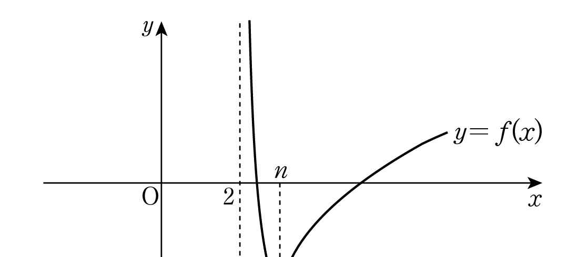
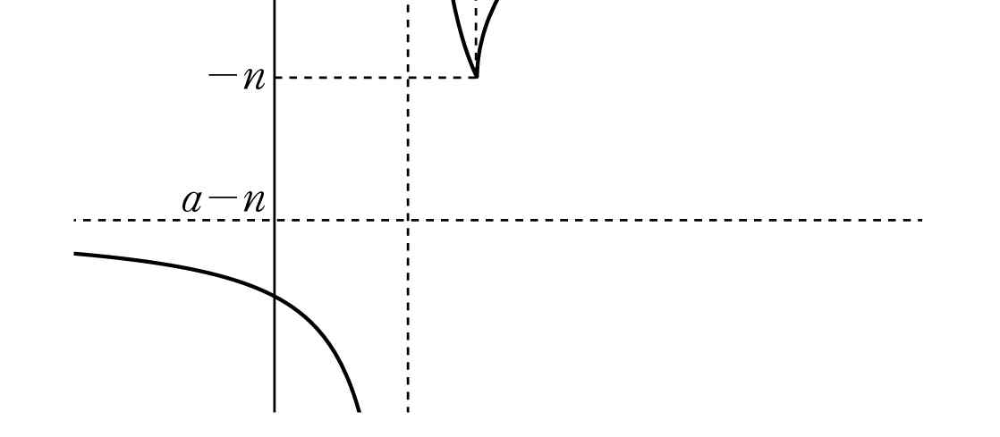

$g_{g}(_{(}t_{t})_{)}=_{=2}02_{43}((_{((}tt_{t0}<=_{=<}00_{nt})_{<n)}$또는 $n<t\le n-a)$

# • 영어 영역 •

reflect 반사하다

definitely 분명히

| 또는 $t>n-a)$ | $\cdots \cdots$ ㉠ | sense of openness 개방감 |
| --- | --- | --- |
|  | 정 답 | 3. [출제의도] 담화의 요지를 추론한다. |
| 를 만족시키는 실수 $t$의 최솟값은 $0$, 최댓 |  | M: Hello, everyone. Today, I am going to talk |

값은 $n-a$ 이다. 조건 (가)에서 $n-a=\frac{3}{2}n$이므로

$a=-\frac{1}{2}n$ 이고

$_{f(x)=}\frac{^{2}-2n}{_{\frac{n_{12}}{2}}^{x}_{n}\sqrt{x-n}^{-4}}-_{\frac{3}{2_{-}}nn}$ $(x<2$ 또는 $2<x<n)$

$(x\ge n)$

조건 (나)에서 $g(n)=3$ 이므로 $g(f(5))=2$

| 1 | ⑤ | 2 | ① | 3 | ① | 4 | ③ | 5 | ② |
| --- | --- | --- | --- | --- | --- | --- | --- | --- | --- |
| 6 | ② | 7 | ③ | 8 | ④ | 9 | ⑤ | 10 | ② |
| 11 | ① | 12 | ② | 13 | ⑤ | 14 | ④ | 15 | ③ |
| 16 | ② | 17 | ② | 18 | ⑤ | 19 | ① | 20 | ③ |
| 21 | ④ | 22 | ① | 23 | ⑤ | 24 | ⑤ | 25 | ② |
| 26 | ③ | 27 | ③ | 28 | ④ | 29 | ④ | 30 | ④ |
| 31 | ① | 32 | ⑤ | 33 | ② | 34 | ① | 35 | ③ |
| 36 | ② | 37 | ④ | 38 | ③ | 39 | ③ | 40 | ① |
| 41 | ② | 42 | ④ | 43 | ⑤ | 44 | ④ | 45 | ④ |

해 설

1. [출제의도] 담화의 목적을 추론한다.

M: Good morning, students. This is the head of the student council and I have an important announcement today. Recently, our school has

about how we can support senior citizens in the digital age. You may have heard that many seniors are struggling with digital technologies in their daily lives, such as ordering food at kiosks or using mobile banking apps. Because they are not familiar with these digital services, seniors may find it difficult to keep up with all the changes in today’s world. That’s why we need to provide them with digital education. By teaching seniors how to utilize digital skills, we can help them navigate modern life smoothly and they won’t feel left behind.

struggle with 고군분투하다

utilize 활용하다

navigate 항해하다

smoothly 부드럽게

|  | installed vending machines in the dormitory. | 4. [출제의도] 그림과 대화의 일치 여부를 파악한다. |
| --- | --- | --- |
|  | But many students have complained that the | W: I’ve just finished setting up the band rehearsal |
|  | items in the vending machines do not fully | room. How does it look? |
|  | meet their tastes. To address this, we are | M: Wow! I like that banner on the wall. It’s |
| $f(5)<0$ 인 경우 $-n<f(5)<0$이므로 ㉠에서 | conducting an online survey to gather your | really eyecatching. |
|  | suggestions on what products you’d like to see | W: I agree. What do you think about the position |

$g(f(5))=4$ 가 되어 조건 (나)를 만족시키지 않는다. 그러므로 $f(5)\ge 0$

즉, ㉠에서 $f(5)=0$ 또는 $n<f(5)\le \frac{3}{2}n$

in the vending machines. The survey link will be sent to you in a text message after this

of the drum set below the banner?

M: It looks good. In that position, the drummer

|  | announcement. Please take a few minutes to | can lead our band easily. |
| --- | --- | --- |
| ① $f(5)=0$ 인 경우 | answer the survey by this Friday. Your opinion | W: That’s what I intended. |
| $2<n\le 5$ 이면 | is important, and we’re looking forward to | M: I also see you’ve set up three microphones. |
| $f(5)=_{\frac{1}{2}}n\sqrt{5-n}-n=0$ | receiving your ideas. Thank you! | That should be perfect when many singers |
|  | student council 학생회 | want to sing together. |

$2n=n\sqrt{5-n}$

$2=\sqrt{5-n}$

$n=1$ 이므로 조건을 만족시키지 않는다. $n>5$ 이면

$f(5)=\frac{n^{2}-2n}{6}-\frac{3}{2}n=\frac{1}{6}n(n-11)=0$ 이므로

조건을 만족시키는 자연수 $n$의 값은 $11$

② $n<f(5)\le \frac{3}{2}n$인 경우

$2<n\le 5$이면

install 설치하다

vending machine 자판기

dormitory 기숙사

address 다루다

conduct an online survey 온라인 설문 조사를 하다

2. [출제의도] 대화자의 의견을 추론한다.

W: Mr. Johnson, we’re almost done with the major decisions about the interior design of your house. Now you just need to choose the color

W: Exactly. And check out this triangleshaped

guitar. Isn’t it cool?

M: It sure is! I’ve never seen a guitar like that before. It really stands out.

W: I think so, too. And I placed the keyboard next to the guitar so that our band members can communicate easily.

M: That’s smart. This setup is perfect for our band.

stand out 눈에 띄다

| $_{f}(_{5})=_{\frac{1}{2}n}\sqrt{5-n}-_{n}$ 이므로 | for your living room wall paper. |  |
| --- | --- | --- |
|  | M: That’s right. I’ve seen the color samples | 5. [출제의도] 대화자가 할 일을 추론한다. |
| $n<_{\frac{1}{2}}n\sqrt{5-n}-n\le _{\frac{3}{2}}n$ | you’ve sent, but I can’t decide which one to | M: Ms. Anderson, are we all set for the culture |
|  | choose. Do you have any advice? | exchange program with the French students? |
| $1<_{\frac{1}{2}}\sqrt{5-n}-1\le _{\frac{3}{2}}$ | W: Well, there’s one important thing you need to | W: It’s going well, Mr. Grant. Do you want to go |
| $_{4}<\sqrt{5-n}_{\le 5}$ | consider when you choose a wall color. | over what we’ve done so far? |
|  | M: One important thing? What is it? | M: Sure. I’ve been teaching our students some |

그런데 $2<n\le 5$에서 $\sqrt{5-n}<\sqrt{3}$ 이므로 조건을 만족시키지 않는다.

$n>5$ 이면

$f(5)=\frac{n^{2}-2n}{6}-\frac{3}{2}n$

$=\frac{1}{6}n^{2}-\frac{11}{6}n$

$n<\frac{1}{6}n^{2}-\frac{11}{6}n\le \frac{3}{2}n$

W: If you go with light colors, they will make the space look larger and more open.

M: Interesting. So, dark colors make a space appear smaller?

W: Exactly. This is because light colors reflect natural light and make a space appear larger to the eyes.

basic French greetings, and they’ve been practicing their welcome speech.

W: That sounds nice. Your efforts will definitely help the exchange students feel welcome. I’ve prepared all the traditional craft materials for them.

M: It would be great if the students could work

<table>
<tr><th></th><th>M: Hmm... Since my living room is a bit small,</th><th>in pairs for the traditional crafts session.</th></tr>
<tr><td>$1&lt;\frac{1}{6}n-\frac{11}{6}\le \frac{3}{2}$</td><td>I’ll go with white.</td><td>W: Exactly. I’ve already made a list of pairs. I</td></tr>
<tr><td></td><td>W: That’s a great choice! It’s always important to</td><td>paired one student from our school with a</td></tr>
<tr><td>$6&lt;n-11\le 9$</td><td>consider the size of the space when choosing</td><td>student from France.</td></tr>
<tr><td>$17&lt;n\le 20$</td><td>a wall paper color. A light color like white</td><td>M: Good. And I’ve ordered keyrings to use as</td></tr>
<tr><td>이므로 조건을 만족시키는 자연수 $n$의 값은</td><td>will definitely create a sense of openness in</td><td>souvenirs. They should arrive this afternoon.</td></tr>
<tr><td>$18$, $19$, $20$</td><td>your living room.</td><td>W: Let me know if you need any help.</td></tr>
<tr><td>(ⅰ), (ⅱ), (ⅲ)에서 조건을 만족시키는 모든 $n$의</td><td>M: Thank you for helping me.</td><td>M: Actually, there is one thing. Could you wrap</td></tr>
<tr><td>값은 $11$, $18$, $19$, $20$ 이고 그 합은 $68$이다.</td><td>go with 선택하다</td><td>the keyrings when they arrive? I think I won’t</td></tr>
<tr><td colspan="3">10</td></tr>
</table>

| have time for that. | W: When is the event? |  | match 어울리다 |
| --- | --- | --- | --- |
| W: Of course, I’d be happy to help you with that. | M: It’s on May 24th. |  | suit 어울리다 |
| be all set 만반의 준비를 하다 |  | W: I’d like to join, too. Have you completed the | fabric 천 |

registration process?

M: Not yet. I heard we need to register online by filling out a form. Let’s sign up together.

W: Sounds good. How about training together before the event?

M: Great idea. The competition will be held at Blue River. Why don’t we find a similar place to practice?

W: I know the best place. Let’s get started this weekend!

competition 대회, 경기

combine 결합시키다, 합치다

registration 등록

9. [출제의도] 담화 내용과의 일치 여부를 파악한다.

budget 예산

11. [출제의도] 대화에서 적절한 응답을 찾는다.
12. [출제의도] 대화에서 적절한 응답을 찾는다.

so far 지금까지

greeting 인사말

craft 공예품

souvenir 기념품

6. [출제의도] 수치를 파악한다.

W: Welcome to Gardener’s! How can I help you?
M: Hi! I’d like to add some new flowers to my
garden.
W: That’s wonderful! What flowers do you have
in mind?
M: I like lilies. How much are they?
W: They’re \$4 each.
M: I’ll take five lilies. Can you recommend any
other flowers? I was thinking of mixing a few
different types.
W: In that case, how about pairing them with
some tulips?
M: Oh, that sounds great. How much are the
tulips?
W: They’re half the price of lilies — just \$2 each.
M: Great. I’ll take five tulips, then.
W: Five lilies and five tulips, right? When you
buy 10 flowers or more, we offer a 10%
discount.
M: Thank you. Here’s my credit card.

7. [출제의도] 이유를 추론한다.

M: Hey, Betty. Did you get the result of the
class photo contest?
W: Unfortunately, my class couldn’t even take part
in the contest.
M: No way! What happened? Your classmates love
taking photos.
W: Yeah, we often take pictures together.
M: Then you could have submitted one of your
existing photos. Was there any unexpected
problem like the size requirement of the
photo?
W: No, the size met the requirements. And we
were okay with the fact that we should submit
a photo taken outdoors.
M: Hmm... Then what was the problem? You
didn’t accidentally delete the photo for the
contest, did you?
W: No. The truth is I thought the deadline was
17th but it was 12th.
M: Oh, no. I’m sorry to hear that. But don’t beat
yourself up about it too much. Everyone
makes mistakes sometimes.
W: Thanks. But I still feel so bad about it.

take part in \~에 참여하다

submit 제출하다

requirement 필요조건

accidentally 우연히

beat oneself up 자책하다

8. [출제의도] 세부 사항의 언급 여부를 파악한다.

M: Have you heard about the 2025 Aquathlon?

W: No, I haven’t. What is it?

M: It’s a competition that combines swimming and running. It’s coming up soon.

W: That sounds great! I’ve competed in several swimming events, but never anything like this. Are you going to participate?

M: Absolutely. I’ve been training for both swimming and running.

W: Hello, listeners. I’m Hannah Carter from the
Sunnyville Pet Fair organizing committee. I’m
excited to announce that this year’s pet fair
will take place on Saturday, April 19th, at the
Sunnyville Community Park. During the event,
there will be a dog training program by Mike
Harris, a wellknown pet behavior expert. We
will also host a pet costume contest, where
pets can show off their best outfits and
compete for prizes. Additionally, there will be
booths selling healthy snacks and handmade
toys for your pets. Tickets cost \$5 per
person, and all the profits will be donated to
local animal shelters. Please note that tickets
are available online only, so be sure to book
in advance. If you’re a pet lover, don’t miss
out on this exciting event!

fair 박람회

committee 위원회

show off 자랑하다, 뽐내다

outfit 의상

handmade 수제의

profit 수익

donate 기부하다

animal shelter 동물 보호소

available 이용할 수 있는

10. [출제의도] 표를 보고 선택한 것을 찾는다.

M: Wow! Where did you buy this cute bunny bag
charm on your bag? I want to get one, too.
W: Oh, I bought this on a shopping app. I’ll show
you. [Tapping Sound] Do you want to pick
one together?
M: Sure! My bag is small, so I want to pick
something that matches it.
W: No problem. As you can see, there are three
size options here. I don’t think the large size
would suit your bag.
M: You’re right. A small or medium size would be
great.
W: Next, you have to choose the color of the
bunny. What’s your favorite color?
M: Well, I’m okay with anything except green.
W: I get it. How about the material?
M: Between fabric and plastic, I’ll go with plastic.
It won’t get wet easily.
W: Excellent choice! Then, we have two options
left. What’s your budget?
M: I’d like to keep it under \$15. So I’ll take this
one.
W: Perfect! It’ll look great on your bag.

M: Olivia, did you hear the news about the music festival this weekend? W: No, I didn’t. Is there anything special about it? M: Actually, I heard your favorite band will be playing music live at the festival on Sunday. I thought you might like it. W:
W: I can’t find my science textbook anywhere! I really need it now for my science project. M: That sounds frustrating. Maybe you left it in your desk drawer or in your school locker. W: I already checked both places, but I couldn’t find it. What should I do? M:

frustrating 좌절하는

13. [출제의도] 대화에서 적절한 응답을 찾는다.

M: Jenny, I’m having trouble sticking to my study
plans these days. How do you handle it?
W: For me, things have improved a lot since I
started using a scheduling app.
M: Really? I’d love to hear more.
W: It’s called “Study Detector,” and it has several
useful features that help me stay on track.
M: What features does it have?
W: First of all, it tracks how much time I study
each day, week, and month, and then provides
me with a report of my progress.
M: That’s amazing!
W: It is! It also sends me reminders that help me
stay focused on my schedule.
M: That sounds great! Are there any other
features?
W: Yes. It even sends me famous quotes that
motivate me to study.
M: Oh, I think I really need to try that app. Do
you think it will help me too?
W:

have trouble \~ing \~하는 데 어려움을 겪다

handle 다루다

feature 특징

progress 진척

reminder 생각나게 하는 것

quote 인용구

motivate 동기를 부여하다

14. [출제의도] 대화에서 적절한 응답을 찾는다.

W: I’ve been feeling down lately about my art.

M: Really? What’s wrong?

W: I keep posting my drawings online, but only a few people view my blog to look at them. It’s so disappointing.

M: I understand how you feel, but isn’t it great to create something meaningful for yourself?

W: Of course it is. But I’d like to share my art with other people and hear from them about my work.

M: Then how about finding another way to connect with people and share your work?

W: Another way? Like what?

M: You can join an art community or local art club and discuss your work with others at

팬인 자신에게 (운동) 선수가 무엇을 해 주어야 하는지 생각하는 데 많은 시간을 보내는 성향이 있는 팬은 ‘팬으로서’ 가지고 있는 상응하는 의무에 대해서도 생각해야 한다. 자신이 친구에게 무엇을 해 주어야 하는지에 대해서는 잠시도 생각하지 않고 친구로부터 무엇을 받을 자격이 있는지에 대해서만 생각하는 사람은, 부드럽게 말하자면, 그리 좋은 친구가 아니다. 마찬가지로, 자신이 선수에게 무엇을 해 주어야 하는지에 대해서는 전혀 생각하지 않으면서 선수가 자신에게 무엇을 해 주어야 하는지에 대해서만 생각하는 팬은 팬-선수의 관계를 그다지 진지하게 받아들이지 못한 것이다. 인간의 삶의 거의 모든 다른 영역에서처럼, 팬이 가질 수 있는 어떠한 특별한 권리도 (이에) 상응하는 일련의 의무에 의해 제한되며, 선수가 자신에게 무엇을 해 주어야 하는지는 확신에 차 말하면서도 자신이 어떻게 더 나은 팬이 될 수 있는지에 대해서는 전혀 생각하지 않는 팬은 자신의 의무를 다하고 있다고 하기 어렵다.

offline meetings.

W: That’s a good idea. I’ve never thought about connecting with people in person. I think I’ll look into it.

M:

in person 대면하여

look into 주의 깊게 살피다

15. [출제의도] 상황에 적절한 말을 찾는다.

projection 투사, 투영

fascinating 매혹적인

enhance 향상시키다

display 전시하다

accurate 정확한

delicate 깨지기 쉬운

be exposed to \~에 노출되다

accessible 접근하기 쉬운

interactive 상호 작용을 하는

16. [출제의도] 담화의 주제를 추론한다.
17. [출제의도] 세부 사항의 언급 여부를 파악한다.
18. [출제의도] 글의 목적을 추론한다.

M: Emma is the captain of her school badminton
team. Her team is planning to participate in
the upcoming tournament, but one of the team
members recently got injured. Emma feels a
strong responsibility to find a replacement as
the team leader. Then she thinks of Anthony,
who used to be a badminton team member. So
she asks Anthony to join the team once again.
However, Anthony is very busy preparing for
an important presentation next week. He
thinks he cannot accept Emma’s request and
thinks of another way to help her. He decides
to recommend one of his close friends instead.
His friend is not only good at badminton, but
has always wanted to join the badminton team.
In this situation, what would Anthony most
likely say to Emma?
Anthony:

Hilltop 아파트 주민 대상 공지

소방 안전 규정에 따라 모든 복도에는 자전거, 상자, 작은 가구와 같은 개인 물품이 없도록 하는 것이 중요 합니다. 복도는 비상시에 중요한 대피 통로 역할을 하며, 그곳에 놓여 있는 것은 무엇이든 길을 막아 심각한 안전상의 위험을 야기할 수 있습니다. 모든 주민들의 안전을 보장하기 위해, 복도에 놓인 모든 개인 물품들을 4월 14일 월요일까지 다 치워 주시기를 요청 드립니다. 이를 따르지 않는 것은 벌금으로 이어질 수 있다는 점을 유의해 주시기 바랍니다. 안전한 환경을 유지하는 데 협조해 주셔서 감사합니다.

be inclined to \~하는 성향이 있다

athlete (운동) 선수

owe (보답으로 무언가를) 해 주어야 한다 corresponding 상응하는

obligation 의무, 책임

entitled 자격이 있는

to put it mildly 부드럽게 말하자면

|  |  |  | resident 주민 | all that 그다지 |
| --- | --- | --- | --- | --- |
|  | upcoming 예정된 |  | in accordance with \~에 따라 | possess 가지다, 소지하다 |
|  |  |  | regulation 규정 | fulfill one’s end of the bargain \~의 의무를 다하다 |
|  |  | replacement 대신할 사람 |  | hallway 복도 21. [출제의도] 어구의 함축 의미를 추론한다. |
| [16 \~ 17] |  |  |  | belonging 물품, 소지품 critical 중요한 evacuation 대피 emergency 비상 block 막다 pose a risk 위험을 야기하다 ensure 보장하다 note 유의하다 penalty 벌금 appreciate 감사하다, 감상하다 cooperation 협조 maintain 유지하다 19. [출제의도] 등장인물의 심경 변화를 추론한다. |

W: Hello, students. Have any of you visited a
museum recently? If so, you may have noticed
some remarkable changes taking place. Today,
I’d like to share some insights about the
changes happening in museums. Now,
traditional museums are being transformed by
modern technologies. The first technology I
want to introduce is virtual reality. Museums
around the world are adopting virtual reality to
change how visitors interact with historical
objects. For instance, visitors can now explore
ancient buildings as if they were real. Another
technology being used in museums is 3D
animation. This brings historical scenes to life,
showing how people lived in the past.
Animated displays allow visitors to experience
historical events in a more engaging way.
Also, laser projection creates dynamic effects
on gallery walls. Using this technology,
museums can highlight specific artworks and
create fascinating environments that enhance
the viewing experience. Finally, 3D printing
has opened up new possibilities for museums.
This technology makes it possible to display
accurate copies of delicate or rare items that
cannot be exposed to the public. These
technological innovations are making museum
collections more accessible, interactive, and
engaging than ever before.

remarkable 주목할 만한

insight 통찰

transform 변형시키다

innovation 혁신

virtual 가상의

adopt 채택하다

ancient 고대의

animated 살아 있는 듯한

engaging 매력적인

Nathan은 토요일 저녁에 기차에 탔다. 그가 자리로 다가갔을 때, 이미 누군가가 그곳에 앉아 있는 것을 발견했다. 당황하며, 그는 자신의 표를 확인했고 실수를 깨달았다. 토요일이 아닌 일요일 표였던 것이다!
그의 얼굴이 당황하여 화끈거렸다. 그는 서둘러 기차 승무원에게 다가가 상황을 설명했다. “이 문제를 해결하기 위해 제가 할 수 있는 일이 있을까요?” Nathan이 물었다. “걱정 마세요, 손님. 아직 이용 가능한 자리가 있습니다,” 승무원이 안심시키는 미소를 지으며 말했다. Nathan은 이전의 표를 새 표로 교환하였고, 그의 걱정은 사라졌다. 그의 자리에 앉으며, 그는 깊은 숨을 내쉬었고, 기차가 움직이기 시작하자 어깨의 긴장이 풀리는 것을 느꼈다.

board 타다, 탑승하다

confused 당황한

flush 화끈거림

approach 다가가다

train attendant 기차 승무원

resolve 해결하다

reassuring 안심시키는

exchange 교환하다

melt away 사라지다

tension 긴장

ease (느슨하게) 풀리다

20. [출제의도] 필자의 주장을 추론한다.

생태계 상태라는 개념은 가정용 텃밭이 있는 사람이 라면 누구나 익숙할 것이다. 텃밭은 재배자가 특정한 상태, 즉 과일과 채소 생산의 극대화를 유지하려고 애쓰는 작은 생태계이다. 이를 달성하기 위해, 재배자는 거의 항상 생태계의 역학 관계에 개입한다. 즉, 자라나기 시작하는 원치 않는 식물을 제거하고, 곤충과 다른 동물들이 채소를 먹는 것을 막기 위해 어쩌면 살충제를 뿌리고 밭에 울타리를 칠 수도 있다. 채소의 성장을 극대화하는 것은 생태계에게는 본질적으로 불안정한 상태이기 때문에, 재배자는 사실상 <u>경사면 위에 공</u><u>을 잡아 두고 있는 것이다</u>. 만약, 단 하루만이라도, 재배자가 개입을 멈춘다면, 그 생태계, 즉 그 땅의 작은 밭은 자연히 더 안정된 상태로 변화하기 시작할 것이다. 채소는 여전히 자라겠지만, 다른 식물이 채소를 밀어내고 야생 동물이 작물을 먹기 때문에 수확량은 거의 틀림없이 더 적을 것이다.

ecosystem 생태계

attempt to \~하려고 애쓰다

namely 즉

maximization 극대화

intervene 개입하다

dynamics 역학 관계

fence off 울타리를 치다

patch (작은) 밭

consume 먹다, 소비하다

inherently 본질적으로

unstable 불안정한

effectively 사실상, 효과적으로

slope 경사면

yield 수확(량)

crowd out 밀어내다

wildlife 야생 동물

produce 작물

22. [출제의도] 글의 요지를 추론한다.

약속은 사회생활에서의 인간 특유의 형태를 결속하는 접착제이다. 약속은 개인의 욕망과 관심이 동요하는 상황에서 그들의 행동을 예측 가능하게 만들고, 그 렇게 함으로써 여러 주체가 참여하는 공동 행동의 계

1950년대 초반에 시작된 이래로, 미국의 텔레비전시트콤은 미국 사회의 많은 사회 갈등을 보여 주었는 데, (점점) 진화하는 가족 개념뿐만 아니라 시민권, 가정과 직장에서의 여성 권리, 아동권, 이민과 다문화주의와 같은 것들이다. 이 각각의 쟁점은 유머를 통해 보다 진보적인 가치들이 이전보다 더 수용 가능하도록 하는 데 도움을 주는 방식으로 다루어져 왔다. 종종 등장인물 한 명, 대개는 편견이 아주 심한 사람이라고 특징지어졌던 누군가가 이러한 발전 중 하나 이상에 저항하고 나서 (그가) 어리석어 보이게 되었다. 이들은 자신의 어리석음이나 다른 사람들의 짧은 비난, 또는 이 두 가지 모두에 의해 배제되었다. 이러한 방식으로, 시트콤의 유머는 더 다원적이고 관용적인 사회의 수용을 장려하는 비용 효율적인 수단으로 작용했다.

attribute 속성, 특성

conventional 전통적인, 관습적인

appoint 임명하다

27. [출제의도] 실용문의 세부 내용을 파악한다.

획과 조정을 용이하게 한다. 게다가, 약속은 사람들이

그렇지 않으면 수행하지 않을 행동을 기꺼이 수행하도

록 만든다. 예를 들어, 택시 기사는 고객이 나중에 서

비스에 대해 비용을 지불하겠다고 약속했기 때문에 고

객을 태워 (고객이) 원하는 목적지로 운송하고, 건설

노동자는 고용주가 월말에 (급여를) 지불하겠다는 신

뢰할 만한 약속을 했기 때문에 매일 업무를 수행한다.

사실, 택시 기사와 건설 노동자가 돈을 보수로 기꺼이

받아들이는 것은 오로지 다른 주체(특히 중앙은행)들

의 네트워크가 해당 통화를 유지하기 위한 다양한 조

치를 취할 것을 약속했기 때문이다. 따라서 일자리,

돈, 정부, 과학적 협력, 그리고 결혼과 같은 사회적 대

상(객체)과 제도는 그 시작과 안정성을 위해 약속의

신뢰성에 의존한다.

commitment 약속

| hold together 결속하다, 결합하다 | chart 보여 주다, 나타내다 |
| --- | --- |
| predictable 예측 가능한 | right 권리 |
| thereby 그렇게 함으로써 | workplace 직장 |
| facilitate 용이하게 하다 | immigration 이민 |
| coordination 조정 | multiculturalism 다문화주의 |
| joint 공동의 | evolve 진화하다 |
| agent 주체, 행위자 | conception 개념 |
| transport 운송하다, 운반하다 | progressive 진보적인 |
| destination 목적지 | acceptable 수용 가능한 |
| afterwards 나중에 | previously 이전에 |
| construction 건설 | mark 특징짓다 |
| credible 신뢰할 만한 | resist 저항하다 |
| be willing to 기꺼이 \~하다 | ridiculous 어리석은, 우스운 |
| notably 특히 | cut down 무시하다, 깎아내리다 |
| take a measure 조치를 취하다 | stupidity 어리석음 |
| sustain 유지하다 | scold 비난하다 |
| currency 통화 | costeffective 비용 효율적인 |
| in question 해당하는 | tolerant 관용적인 |

institution 제도

25. [출제의도] 도표의 내용을 파악한다.collaboration 협력

stability 안정성

23. [출제의도] 글의 주제를 추론한다.

뇌가 이미 누군가의 얼굴과 이름을 저장했다면, 왜 우리는 여전히 하나는 기억하고 다른 하나는 기억하지 못하게 되는 것일까? 이는 기억을 생각해 내는 것에 있어서 뇌가 2단계의 기억 시스템을 가진 무언가를 작동하도록 만들기 때문이며, 이것이 누군가를 알아볼 수는 있지만 어떻게, 왜 (아는지) 또는 그 사람의 이름이 무엇인지는 기억하지 못하는, 흔하지만 짜증 나는 감정을 유발한다. 이는 뇌가 친숙함과 회상을 구별하기 때문에 발생한다. 명확하게 하자면, 친숙함(또는 인식)은 누군가 또는 무언가를 마주쳤고 이전에 그런 적이 있다는 것을 아는 경우이다. 하지만 그 이상으로는, 당신이 아는 것이 없고, 당신이 말할 수 있는 것은이 사람/사물이 이미 기억 속에 있다는 것뿐이다. 회상은 이 사람을 어떻게, 왜 알고 있는지에 대한 원래의 기억에 접근할 수 있는 경우이며, 인식은 단지 기억이 존재한다는 사실만을 표시해 줄 뿐이다.

end up \~ing (결국) \~하게 되다

twotier 2단계의

at work 작동하는

when it comes to \~에 있어서, \~에 관해서 give rise to \~을 유발하다

sensation 감정, 기분

recognise 알아보다

differentiate 구별하다

familiarity 친숙함

recall 회상

clarify 명확하게 하다

encounter 마주치다

flag up 표시하다

24. [출제의도] 글의 제목을 추론한다.

위 그래프는 2022년 다섯 개 유럽 국가에서의 전기 자전거 구매의 주요 이유의 비율을 보여 준다. 독일에서는 레크리에이션 목적이 전기 자전거 구매 이유로 가장 높은 비율을 차지했고, 이는 네덜란드와 벨기에에서도 마찬가지였다. <u>오스트리아에서는, 스포츠 활동</u><u>의 비율이 41%로 가장 높았고, 이것은 통근의 비율보</u><u>다 세 배 높았다</u>. 스위스는 레크리에이션 목적의 비율이 30%보다 낮은 유일한 나라였다. 레크리에이션 목적의 비율과 스포츠 활동의 비율 간의 차이는 네덜란드에서보다 독일에서 더 작았다. 네덜란드와 벨기에는 전기 자전거 구매 이유에 대해 같은 순위를 보였는데, 레크리에이션 목적이 1위이고, 통근이 그 뒤를 이었으며, 스포츠 활동이 가장 낮았다.

primary 주요한

purchase 구매

commute 통근; 통근하다

account for 차지하다, 설명하다

ranking order 순위

26. [출제의도] 글의 세부 내용을 파악한다.

잘 알려진 광물학자인 Friedrich Mohs는 1773년 1월 29일 독일의 Gernrode에서 태어났다. 그는 어린 시절 과학에 뚜렷한 흥미를 보였다. 그는 University of Halle에서 화학, 수학, 물리학을 공부했고, 또한 Mining Academy에서 광물학을 공부했다. 20대 후반에, 그는 오스트리아로 가서 물리적 속성에 따라 광물을 분류했다. 그의 이러한 새로운 분류 체계는 전통적인 방식을 따르는 많은 광물학자들과의 갈등으로 이어졌다. 1812년에, Mohs는 Joanneum의 광물학 교수로 임명되었고, 그곳에서 모스 굳기계를 개발했다. 그는 Leoben의 Mining University에서 그의 훌륭한 경력을 마무리했고 이탈리아에서 66세의 나이로 사망했다.

physics 물리학

classify 분류하다

영화 엑스트라 모집 공고 영화계에 발을 내딛고, 곧 개봉할 흥미진진한 영화의 엑스트라가 되어 보세요!
촬영 일시: 2025년 4월 20일 일요일, 오전 8시 \~ 오후
4시 장소: Golden 영화 제작 스튜디오 장면
∙ 복도에서 대화하기
∙ 레스토랑에서 식사하기 보수: \$100 (점심 식사 제공)
지원 자격
∙ 지원자는 18세 이상이어야 합니다.
∙ 이전의 연기 경험이 있는 지원자를 우대합니다.
지원 방법: 지원서를 2025년 4월 10일 목요일까지
goldenstudio@movie.com에 이메일로 보내 주세요.

dine 식사하다

applicant 지원자

priority 우대, 우선권

28. [출제의도] 실용문의 세부 내용을 파악한다.

Bearford 에코 패션 워크숍 여러분의 헌 옷을 이용해 특별한 패션 소품을 직접 만드는 행사에 참여해 보세요.
날짜: 4월 12일, 토요일 시간: 오전 9시 \~ 11시 장소: Bearford 시청 등록: 4월 1일부터 5일까지, 웹사이트에서만 가능 참가비: \$5 (12세 이하는 무료)
프로그램
∙ 지속 가능한 패션 경향에 관한 특별 강연을 듣는다.
∙ 헌 옷을 이용해 친환경 가방을 만드는 법을 배운다.
참고: 가방을 만들기에 충분히 큰 헌 옷을 가져 와야 합니다. (다른 재료들은 제공됩니다.)

handson 직접 해 보는, 실습의

entry 참가

sustainable 지속 가능한

ecofriendly 친환경적인

29. [출제의도] 어법상 맞지 않는 표현을 찾는다.

음식에 관한 글에서 사회적 측면이 부각되는 것은 음식의 맛이 뒷전으로 밀려나고 있음을 시사할지도 모른다. 나는 대부분의 사람들이 음식이 제공되는 사교적 상황에서 맛을 부수적인 중요성을 띤 것으로 여긴 다고 생각한다. 우리의 사교 모임이 음식을 중심으로 모인다 하더라도, 이러한 모임의 의의는 맛에 달려 있지 않은 듯하다. 맛은 배를 채운다는 좁은 (의미의)
목적에 도움이 되고, 그 목적이 달성되면 (맛은) 모임을 특징짓는 사회적 역학 관계가 어떤 것이든지 간에 그 배경을 제공한다. 이(사회적 역학 관계)는 제공되는 음식의 맛과는 별개로 이해될 수 있으며, 그것(음식의 맛)에 대한 감상은 개인적이고 주관적인 것으로 이해된다. 이러한 통념에 따르면, 음식을 중심으로 하는 예식과 의식, 즉 음식에 의미를 부여하는 사교 행사는, 음식이 제공하는 감각의 질에 의존하지 않는다.
맛에 지나치게 집중하는 것은 이러한 사회적 관계의 더 큰 중요성을 놓치는 것이다.

② assisting → assists

prominence 부각, 두드러짐

dimension 측면

take a back seat 뒷전으로 밀려나다 suspect 생각하다, 의심하다

secondary 부수적인

independently 별개로

| subjective 주관적인 | secondhand 중고의 | 단어를 제공할 수 없어서 말이 중단되기 때문이다. 손 |
| --- | --- | --- |
| conventional wisdom 통념 | skiffle 스키플(1950년대 영국에서 유행한 기타와 수 | 짓을 할 수 없게 되는 것은 또 다른 해로운 영향을 갖 |
| ritual 의식 | 제 악기를 쓴 민요조 재즈) | 는다. 정신적 과정을 쭉 도와주는 손짓이 없으면, 유용 |
| supply \~ with … \~에 …을 부여하다, 제공하다 | inclusive 포용적인 | 한 정보를 잘 기억하지 못하고, 문제를 잘 해결하지 |
| excessively 지나치게 | ordinary 평범한 | 못하며, 우리의 생각을 잘 설명하지 못한다. 손짓은 말 |
| significance 중요성 | rebellion 저항 | 의 어설픈 동반자로 뒤따라가는 것이 아니라, <u>우리의</u> |
|  | condition 필수 요건 | <u>사고를 선도하는 역할을 나타낸다</u>. |

30. [출제의도] 문맥에 맞지 않는 낱말을 찾는다.

왜 과학이 완전히 신뢰받지 못하는지, 그리고 왜 건강한 회의주의와 비판적 사고가 필수적인지에는 이유가 있다. 전문적인 기준, 객관성에 대한 요구, 동료 검토 과정에도 불구하고, 과학의 실행은 편향적일 수 있다. 모든 전문가가 동일하지 않으며, 그들이 자신의 연구를 동일한 심층 조사를 따르게(거치게) 하는 것도 아니다. 자금 조달의 출처를 아는 것은 과학 (분야)의 주장을 평가할 때 중요할 수 있다. 예를 들어, 1960년대 후반에 식용 지방의 문제점에 관해 주장하여 설탕이 건강 문제의 주요 원인 중 하나라는 인식을 전 국민이 못하게 만든 하버드의 연구자들은 설탕 업계로부터 일부 자금을 지원받았다. 그 저자들은 ‘New England Journal of Medicine’에 자금 출처를 공개하지 않았는데, 거기에 그들의 영향력 있는 논문이 실렸다. 더 많은 설탕의 사용을 <u>저지한(→ 조장한)</u> 것으로 보이는 그들의 논문은 식습관 변화의 시대를 만들어 냈는데, 지금은 (설탕이) 비만과 당뇨병 증가의 원인과 관련이 있음이 널리 알려 졌다. 이와 같은 이야기는 의심을 부채질했을 뿐만 아니라 과학의 절차에 추가적인 안전장치를 이끌어 냈다. 자금 조달의 출처 공개는, 비록 50년 전에는 요구되지 않았지만, 이후 의무화되었다.

④ discouraged → fostered

professional 전문적인

standard 기준

claim 요구, 주장

objectivity 객관성

peer 동료

biased 편향적인

evaluate 평가하다

exclude 배제하다

novelty 참신성

empowerment 자율

in and beyond 안팎에서

32. [출제의도] 빈칸에 적절한 표현을 추론한다.

위대한 과학자가 반짝 스타인 경우는 드물다. 뉴턴이 대표적인 예인데, 그는 뉴턴 역학을 넘어 중력 이론, 미적분학, 운동 법칙 및 최적화를 발전시켰다. 사실, 잘 알려진 과학자들은 종종 여러 발견에 관여하는 데, 이는 아마도 매튜 효과로 설명되는 현상일 것이다.
실제로, 최초의 성공은 과학자에게 정당성을 부여하고,
동료들의 인식을 향상시키며, 어떻게 성과를 내고 성공하는지에 대한 지식을 제공하고, 사회적 지위를 높이며, 자원과 우수한 협력자를 끌어들이는데, 이러한 각각의 보상들은 과학자가 또 다른 성공을 거둘 가능성을 더욱 높여 준다. 그러나, 매력적인 대안이 되는 설명이 있는데, 위대한 과학자들이 여러 번의 성공을 거두고 지속적으로 과학적 노력에서 성과를 이루는 이유는 단지 그들이 유난히 재능이 있기 때문이라는 것이다. 따라서, 미래의 성공이 이전에 성공한 적이 있는 사람에게 다시 돌아가는데, 이는 이전의 성공으로 인해 제공된 이점 때문이 ‘아니라’, 이전의 성공이 <u>숨겨</u><u>진 재능을 나타내는</u> (것이기) 때문이다. 매튜 효과는 성공은 ‘(그) 하나만으로’ 미래의 성공 확률을 높인다고 상정하며, 다음과 같은 의문을 제기한다. 지위가 결과를 좌우하는 것일까, 아니면 그것은 근본적인 재능이나 자질을 단순히 반영하는 것일까? 다시 말하면,
결론적으로 매튜 효과가 정말로 존재하는 것일까?

pause 잠시 멈추다

sequence 순서

notion 개념

conscious 의식적인

prime 준비시키다

term 용어

halt 중단하다

tag along 뒤따라가다

clumsy 어설픈

34. [출제의도] 빈칸에 적절한 표현을 추론한다.

과거와 미래, 즉 이미 일어난 일과 (앞으로) 일어날일 사이의 차이에도 불구하고, 과거에 대한 우리의 인식이 항상 미래에 대한 우리의 관점에 의해 영향을 받아 왔다고 말할 수 있다. 민족주의에서 공산주의에 이르는 예시에 의해 충분히 입증되는 것처럼, 혁명가들은 자신들의 미래 대의를 구성하기 위해 항상 과거를 참고해 왔다. 미래는 종종 잊힌 시간의 회복, (이
미) 확립된 것의 복제, 또는 오래 전에 없어진 영웅시대에 의해 후세에 전해진 모델로 다양하게 여겨져 왔다. 역사의 서술은 동시대의 사람들에게는 알려지지
않은 미래의 결과를 이해하거나 설명하는 데 기초하고 있는데, 그 이유는 역사가는 (지난 일에 대한) 통찰력의 이점을 가지고 있고 과거란 지금은 우리의 과거가 된 미래의 축적에 불과하기 때문이다. 따라서 과거의 손길이 항상 미래를 형성한다고 보기보다는, 오히려 그 반대인 것으로, 즉 과거가 - 그것(과거)에 대한 우리의 이해라는 의미에서 - <u>미래에 대한 우리의 방향성</u><u>에 의해 형성된다</u>고 볼 수도 있을 것이다.

onehit wonder 반짝 스타(단 한번의 성공만을 이룬 사람)

revolutionary 혁명가

look to 참고하다

| dietary 식용의 | mechanics 역학 | frame 구성하다 |
| --- | --- | --- |
| perceive 인식하다 | gravitation 중력 | cause 대의(명분) |
| article 논문 | calculus 미적분학 | illustrate 입증하다, 분명히 보여 주다 |
| obesity 비만 | law of motion (뉴턴의) 운동 법칙(관성, 가속도, 작 | nationalism 민족주의 |
| diabetes 당뇨병 | 용 반작용의 법칙) | communism 공산주의 |
| fuel 부채질하다, 연료를 공급하다 | optimization 최적화 | long gone 오래 전에 없어진 |
| safeguard 안전장치 | phenomenon 현상 | contemporary 동시대의 사람 |
| disclosure 공개 | legitimacy 정당성 | accumulation 축적 |
| compulsory 의무적인 | score and win 성과를 내고 성공하다 | reverse 반대 |

status 지위

payoff 보상

odds 가능성

alternative 대안이 되는

consistently 지속적으로

endeavor 노력

exceptionally 유난히

probability 확률

dictate 좌우하다, 명령하다

underlying 근본적인

33. [출제의도] 빈칸에 적절한 표현을 추론한다.

우리가 무언가를 잘못 말한 것을 깨닫고 다시 수정하려고 돌아가기 위해 말을 잠시 멈출 때, 우리는 말을 멈추기 수백 밀리세컨드(0.001초) 전에 손짓을 멈춘다. 이러한 순서는 우리의 손이 의식적인 마음이 알아채기 전에 (먼저) 우리가 무엇을 말할 것인지 ‘알고’ 있다는 놀라운 개념을 암시하며, 실제로 이런 경우가

orientation 방향성

35. [출제의도] 글의 흐름과 무관한 문장을 추론한다.
31. [출제의도] 빈칸에 적절한 표현을 추론한다.

창작 산업계의 전 세계적 음악 유통과 보급뿐만 아니라 20세기 후반의 대중음악의 폭발적 증가는 음악과 관련된 <u>접근성</u>에 대한 새로운 이해를 촉진했다. 갑자기, 1950년대에, 누구나 숟가락, 냄비 몇 개, 중고 기타를 집어 들고 밴드를 시작할 수 있었다. 이는 스키플(skiffle)과 같은 특정 장르로 이어졌을 뿐만 아니라, 또한, 더 일반적으로는, 음악 제작에 대한 훨씬 더 여유롭고 포용적인 태도를 반영했다. 평범한 사람들이 항상 노래를 부르고 음악을 만들어 왔었지만, 대중음악 운동은 저항과 자유의 정신에 의해 촉진되었다. 이러한 접근 방식은 펑크 운동으로 이어졌으며, 1970년대에 이 음악가들은 심지어 자신들의 음악이 전문성이 높지 않고 누구나 접근할 수 있는 것을 필수 요건으로 삼았다. 음악에서 완전히 배제되었던 집단들이 창작의 기회를 만끽했다. 이는 음악계 안팎에서 참신성과 자율성이라는 인식으로 이어졌다.

사전은 단어가 무슨 의미인지를 찾는 데 관심이 있는 모든 사람에게 비교적 좋은 자료이다. 하나의 단어 집합을 사용하여 다른 단어를 정의하는 것을 ‘어휘적 정의’라고 한다. 하지만 사전적 정의의 한계를 이해하는 것이 중요하다. 대부분, 사전 속의 정의는 독자가 이미 자유롭게(마음대로) 사용할 수 있는 언어에 대해 상당히 탄탄한 이해력을 가지도록 요구한다. 다시 말해, 사전은 많은 경우 아는 단어와 아직 모르는 단어 사이의 상호 참조 또는 번역기 역할을 한다. (하지만,
다른 단어를 통해서가 아니라 우리 경험 속에 있는 무언가를 가리키는 것에 의해서만 정의될 것 같은 단어가 있다.) 사전에서 가장 난해한 단어, 말하자면, 예를 들어, ‘pulchritudinous’나 ‘kalokagathia’조차도, 독자가 이미 알고 이해하고 있는 단어를 사용하여 정의되어야 한다. 그렇지 않으면, 사전은 그다지 도움이 되지 않는다.

<table>
<tr><th>explosion 폭발적 증가, 폭발</th><th>종종 있다. 손짓은 정신적으로 단어를 준비시켜 정확</th><th></th></tr>
<tr><td>circulation 유통</td><td>한 용어가 입술에 도달하도록 할 수 있다. 사람들은</td><td>relatively 비교적</td></tr>
<tr><td>propel 촉진하다</td><td>손짓을 하지 못하게 되면 덜 유창하게 말하게 되는데,</td><td>define 정의하다</td></tr>
<tr><td>in relation to ~에 관련된</td><td>(이는) 그들의 손이 더 이상 다음 단어와 또 그 다음</td><td>more often than not 대부분, 종종</td></tr>
<tr><td colspan="3">14</td></tr>
<tr><td>fairly 상당히</td><td>cortisol 코르티솔(부신 피질에서 생성되는 스테로이</td><td>터 사회적으로 종속된 집단의 언어가 더 강한 권력을</td></tr>
<tr><td>at one’s disposal ~의 마음대로 (사용)할 수 있는</td><td>드 호르몬)</td><td>가진 집단의 화자들이 전에 잘 몰랐던 물건이나 관습</td></tr>
<tr><td>function 역할을 하다</td><td>constant 지속적인</td><td>에 대한 용어를 제공할 수도 있지만, 그런 방향으로의</td></tr>
<tr><td>crossreference 상호 참조</td><td>flight 달아남, 회피</td><td>접촉의 결과는 이것 이상 진전되지는 않을 수도 있다.</td></tr>
<tr><td>translator 번역기</td><td>freeze 꼼짝 못 함, 정지 상태</td><td>호주 토착 언어에서 영어로의 몇몇 최초의 차용 출처</td></tr>
<tr><td>otherwise 그렇지 않으면</td><td>go through ~을 겪다</td><td>인 호주 시드니의 Dharug 언어와 같은 몇몇 경우에는,</td></tr>
<tr><td></td><td>demonstrate 보여 주다</td><td>화자들 중 다수가 소멸되고 나면 그러한 언어 체계(사</td></tr>
<tr><td>36. [출제의도] 글의 순서를 파악한다.</td><td></td><td>회적으로 종속된 집단의 언어 체계)의 운명은 멸종하</td></tr>
</table>

longlasting 지속적인

38. [출제의도] 문장의 위치를 파악한다.

사실상 전 세계 모든 국가의 정부는 식량 안보를 달성하는 것에 큰 중요성을 부여하며, 이 목표를 실현하기 위해 다양한 메커니즘이 개발되었다. (B) 정부가 국가 식량 안보를 달성하는 데 있어 직면하는 첫 번째 문제는 거주민에게 충분한 양의 식량이 제공되도록 보장하는 것이다. 일부 정부는 식량 자급자족이라는 목표를 설정했는데, 이는 한 국가에서 구할 수 있는 식량의 전부는 아니더라도 대부분이 국내 농업 시스템에서 나온다는 것을 의미한다. (A) 그러나, 식량 안보는 식량 자급자족을 (반드시) 필요로 하지 않는데 이는 국가가 자국 내에서 쉽게 생산되지 않는 식품을 수입할 수 있기 때문이다. 어쨌든, 농산물은 전 세계적으로 국가에 따라 달라지는 기후, 토양, 그 외 다른 조건에 매우 민감하다. (C) 매우 생산성이 높은 농경 지역을 보유한 국가도 모든 식품에서 완전히 자급자족할 수 있는 것은 아니다. 예를 들어, 미국은, 커피, 차, 바나나 및 다른 열대 지역 (농)산물의 공급을 수입품에 의존한다. 일반적으로, 적절한 식량 공급을 보장하는 문제는 국내 생산과 수입에 모두 의존함으로써 해결된다.

비록 과학은 규칙에 기반한 절차이지만, 매우 창의적인 과정임을 인식하는 것이 중요하다. 추론은 철학적 발명으로, 우리가 신중한 숙고라 부르는 머릿속 계산을 거쳐 사고를 통해 다소 신비롭게 만들어진 것이다. 그러나, 가설이 현실에 비추어 검증되기 전에는,
그것은 아직 진정한 지식이 아니며, 그것은 단지 추측을 나타내는 정보에 불과하다. <u>지식은 자신의 유용성</u><u>을 입증한 정보이다.</u> 그것(지식)은 수차례의 실험적 검증을 통해 잘못된 이론들을 제거한 후 남은 것이다.
과학자들이 끊임없이 가설을 검증하고 새롭고 놀라운 데이터를 설명하기 위해 그들의 모델을 수정함에 따라, 통계학자들이 ‘베이지안 업데이팅’이라고 부르는 일종의 ‘학습 루프’가 나타난다. 18세기 영국의 통계학자이자 철학자였던 Thomas Bayes가 개발한 베이즈 정리에 기초하여, 베이지안 업데이팅은 수용된 이론이나 예측 모델이 그 이론의 다양한 변형을 반복적으로 검증하는 과정을 통해 점점 더 정확해지는 수학적 과정을 일컫는다.

는 것이었다. 남은 사람들은 그들을 억압했던 사람들의 언어인 영어의 다양한 변종으로 (사용 언어를) 전환했다.

→ 지배 집단으로부터 종속 집단으로의 언어 차용은 사회적 <u>불평등</u>을 반영하는데, 호주의 Dharug 언어의 예시에서 보이듯이, 후자의 언어 체계는 몇몇 용어를 제공하기도 했지만 종종 <u>사라진다</u>.

entirely 완전히

terminology 용어

practice 관습

loan 차용

fate 운명

extinction 멸종

remainder 남은 사람

shift 전환하다

suppress 억압하다

dominant 지배적인

vanish 사라지다

exemplify 예를 들어 보여 주다

| virtually 사실상 | cook up 만들다 | [41 \~ 42] |
| --- | --- | --- |
| attach 부여하다, 붙이다 | mystically 신비롭게 |  |
| security 안보 | computation 계산 |  |
| selfsufficiency 자급자족 | hypothesis 가설 |  |
| import 수입하다; 수입(품) | eliminate 제거하다 |  |
| agricultural 농업의, 농경의 | modify 수정하다 |  |
| sensitive 민감한 | emerge 나타나다 |  |
| insure 보장하다, 보증하다 | statistician 통계학자 |  |

adequate 충분한

domestic 국내의

productive 생산성이 높은

sector 구역

tropical 열대 지역의

assure 보장하다

rely on \~에 의존하다

37. [출제의도] 글의 순서를 파악한다.
39. [출제의도] 문장의 위치를 파악한다.

일반적으로, 당신의 (용어) 정의가 자신의 주장과 관련 있는 종류의 논의들에서 일반적으로 사용되는 방식에 가능한 비슷하게 일치하면 더 좋다. 그러나, 철학자들이 ‘자극하는 정의’라고 부르는 것을 통해 ‘특별한 용법’을 만드는 것이 적절하고, 심지어 필요한 경우도 있을 것이다. 현재의 어휘로는 당신이 철학적으로 중요하다고 생각하는 구분을 할 수 없는 경우가 이에 해당한다. <u>예를 들어, 그것(기억)을 가진 사람이 경험한</u>
<u>무언가에 대한 기억이, 반드시 (경험한) 기억이 아닐</u>
<u>수도 있다는 것을 설명하는 용어는 일반 언어에 없다.</u>
예를 들어, 내가 어떻게든 당신의 기억을 공유할 수 있다면 그러한 상황이 생길 수 있다. 즉, 나는 기억 유형의 경험을 갖고 있지만, 이것이 내가 실제로 경험했던 것이 아닐 수도 있다. 이것을 기억이라고 부르는 것은 오해의 소지가 있다. 이러한 이유로, 철학자들은 기억과 유사한 이러한 가상의 경험을 지칭하기 위해
‘유사 기억’이라는 특별한 용어를 만들어 냈다.

전력 체계가 제조업자를 위한 실용적인 대안으로 자리 잡은 첫 10년이 끝날 무렵인 1900년에, 공장에서 사용되는 동력의 5% 미만이 전기에서 왔다. 그러나
(전력) 공급자의 기술적인 진보가 전력 체계와 전기
모터를 유례없이 저렴하면서도 신뢰할 만하도록 만들었고, 공급자의 집중적인 홍보 활동 또한 이 새로운 기술의 수용을 촉진시켰다. 변화를 더욱 가속화한 것은 숙련된 전기 기술자 수의 급격한 증가였는데, 이들은 새로운 (전력) 체계를 설치하고 운영하는 데 필요한 전문 지식을 제공했다. 순식간에, 전력은 생소한 것에서 일상적인 것으로 바뀌었다.
하지만 한 가지는 변하지 않았다. 공장들은 계속해서 공장 부지에 자체 전력 공급 시스템을 구축했다.
소규모 중앙 발전소에서 전기를 구매하는 것을 고려하는 제조업자는 거의 없었다. 지역의 가정과 상점에 조명을 공급하기 위해 설계되었기 때문에, 중앙 발전소는 대규모 공장의 수요를 충족시킬 만한 규모도 기술도 갖추지 못했다. 그리고 공장 소유주들은, 항상 자체적으로 동력을 공급해 왔기 때문에, 그런 중요한 기능을 외부인에게 <u>맡기려고 했다(→ 맡기는 것을 꺼렸</u>
다). 그들은 전력 공급에서의 결함 하나가 운영을 중
지시킬 수 있으며, 많은 결함은 반드시 파산을 초래한 다는 것을 알고 있었다. 새로운 세기가 시작될 때, 한 조사에서 이미 50,000개의 민간 발전소가 운영되고 있었으며, (이는) 중앙 발전소 3,600개를 훨씬 초과한다는 것이 밝혀졌다.

스트레스는 신체 질환뿐만 아니라 뇌의 구조 자체에도 영향을 미쳐, 우리가 피로한 뇌를 경험할 가능성이 훨씬 더 높아지도록 만든다. (C) 건강한 사람들이 스트레스를 겪을 때 그들의 뇌에서 어떤 일이 일어나는 지 밝혀내기 위해 많은 연구가 진행되었다. 한 연구는 줄어든 해마와 지속적인 스트레스를 경험했던 사람들 간의 관련성을 보여 주었다. (A) 이것이 왜 중요할까?
뇌의 이 부분(해마)은 스트레스에 직면했을 때 회복력을 유지하는 데 도움을 주며 기분 조절에 관여한다.
그것은 또한 당신의 주변이 안전한지를 감시하고 위험한 이미지들을 장기 기억에 저장하여 미래에 그것들을 피할 수 있도록 도와준다. (B) 그것(해마)은 이 모든 것들을 교감 신경계와 부교감 신경계를 조절하는 임무의 일환으로 수행한다. 하지만 만성적 스트레스는 해마를 혼란스럽게 하고 코르티솔의 신호를 ‘끄는’ 대신
‘켜는’ 쪽으로 바꾸어, 당신이 싸우거나, 달아나거나,
꼼짝 못 하는 지속적인 상태에 갇히도록 만들 수 있다.

physical 신체의

structure 구조

drained 피로한

longterm memory 장기 기억 duty 임무

chronic 만성적인

occasion 경우

appropriate 적절한

coin 만들다

stimulative 자극하는

distinction 구분

misleading 오해의 소지가 있는

quasimemory 유사 기억

40. [출제의도] 글의 요약문을 완성한다.

종종 집단 간의 상호 작용은 사회적으로 불평등하며, 이는 많은 경우에 단어 또는 구조의 차용이 대부분 혹은 완전히 한 방향, 즉 더 강하거나 권력을 가진 집단에서 혜택을 덜 받는 집단 쪽으로 이동한다는 사실에 반영된다. (집단 간) 접촉의 상당히 이른 시기부

electric 전기의, 전력의

practical 실용적인

manufacturer 제조업자

advance 진보

supplier 공급자

affordable 저렴한

reliable 신뢰할 만한

intensive 집중적인

expansion 증가

expertise 전문 지식

exotic 생소한, 이국적인

commonplace 일상적인

serve the needs 수요를 충족시키다

assign 맡기다

bring \~ to … \~에게 …의 결과를 초래하다

operation 운영

may well 반드시 \~하다

bankruptcy 파산

private 민간의

surpass 초과하다

41. [출제의도] 글의 제목을 추론한다.
42. [출제의도] 문맥에 맞지 않는 낱말을 찾는다.

④ (d) willing → loath(꺼리는)

[43 \~ 45]

(A) Ms. Blake는 Eva가 연습 후 그녀의 짐을 싸는 것을 지켜보면서, 축구장의 가장자리를 따라 걸었다.

# • 한국사 영역 •

정 답

해 설

1. [출제의도] 신석기 시대의 생활 모습을 이해한다.
10. [출제의도] 동학 농민 운동을 이해한다.

밑줄 친 ‘저들’은 동학 농민군이다. 동학 농민 운동 당시 전주성을 점령한 동학 농민군은 정부와 전주 화약을 체결한 뒤 전라도 각지에 집강소를 설치하여 폐정 개혁을 추진하였다.

11. [출제의도] 국채 보상 운동의 특징을 파악한다.

대화의 소재가 된 민족 운동은 국채 보상 운동이다. 국채 보상 운동은 국민의 성금을 모아 나라의 빚을 갚고 국권을 지키자는 운동으로, 대한매일신보 등 언론의 지원을 받았다.

[오답풀이] ① 형평 운동, ② 6ㆍ10 만세 운동 등,

③ 광주 학생 항일 운동, ④ 위정척사 운동에 해당한다.

| 1 | ④ | 2 | ② | 3 | ① | 4 | ⑤ | 5 | ① |
| --- | --- | --- | --- | --- | --- | --- | --- | --- | --- |
| 6 | ③ | 7 | ③ | 8 | ⑤ | 9 | ① | 10 | ① |
| 11 | ⑤ | 12 | ④ | 13 | ③ | 14 | ④ | 15 | ④ |
| 16 | ③ | 17 | ③ | 18 | ⑤ | 19 | ② | 20 | ② |

| 그녀는 잠시 멈춰 섰다가 큰 소리로 말했다. “이봐, | (가)에는 신석기 시대 문화와 관련한 체험 활동이 들 12. [출제의도] 3ㆍ1 운동의 배경을 파악한다. |
| --- | --- |
| Eva! 조금 더 있다 가는 건 어때? 우리 연습 좀해보 | 어가야 한다. 농경과 목축을 시작한 신석기 시대에는 밑줄 친 ‘만세 시위’는 3ㆍ1 운동이다. 일제 강점기 |
| 자. 우리 둘이서만.” Eva는 망설였다. “글쎄요, 코치님. | 음식을 조리하거나 저장하는 용도로 빗살무늬 토기가 최대 규모의 민족 운동인 3ㆍ1 운동은 1919년 일본 |
| 저 좀 피곤해요.” Ms. Blake는 그녀에게 따뜻한 미소 제작되었다. | 도쿄에서 한국인 유학생들이 발표한 2ㆍ8 독립 선언 |
| 를 지었다. “딱 10분만. 재미있을 거야. 약속해.” <u>그녀</u> | 의 영향을 받았다. |

는 여전히 마음이 내키지는 않았지만, 결국 Eva는 수 락했다. 그들은 함께 공을 패스하는 것을 연습했다.

(D) Ms. Blake는 Eva의 움직임이 느리고 정신이 다른 곳에 있다는 것을 알아차렸다. 침묵을 깨며, Ms. Blake가 물었다. “너 작년 결승전 기억나니?” “네, 기억나요.” Eva는 자신이 세 골을 넣었던 경기를 떠올렸다. “그땐 제가 꽤 잘했어요.” “너 아직도 그래,” Ms. Blake가 답했다. “글쎄요. 지금은 골을 못 넣고 심지어 패스조차 제대로 못할까 봐 너무 걱정돼요. 실수하는 게 두려워요,” Eva가 말했다.

(C) Ms. Blake는 더 가까이 다가가 Eva의 어깨에 손을 얹어 안심시켰다. 그녀가 넌지시 말했다. “완벽할 필요는 없어. 축구는 완벽함이 아니라 열정에 관한 거

야. 그리고 너는 항상 그것(열정)을 많이 갖고 있었

어.” Eva의 시선이 Ms. Blake의 시선과 마주쳤다. “코<u>치님</u>은 정말 그렇게 생각하세요?” Ms. Blake는 단호하게 말했다. “그럼. 네가 경기하는 방식, 네가 주는 에너지, 그게 너를 특별하게 만드는 거야. 득점한 골이나 획득한 트로피가 아니고, 네가 가진 이 경기에 대한 사랑하는 마음 말이야.” Eva는 깊은 생각에 잠기며 고개를 끄덕였다.

(B) 다음 경기에서, Ms. Blake는 사이드라인에서 Eva가 경기하는 것을 지켜보았다. 이전에는 없었던 새로운 자신감이 있었다. Eva는 비록 득점하지는 못했지

2. [출제의도] 고려의 문화를 파악한다.

(가) 국가는 고려이다. 고려 시대에는 팔만대장경판 13. [출제의도] 조선 태형령 적용 시기의 상황을 이해 이 만들어졌고 《 직지심체요절 》이 간행되었으며, 《 삼 한다.

국유사 》가 편찬되었다.	조선 태형령은 1912년에 제정되어 1920년에 폐지되었다. 일제 강점기에는 조선 총독부가 식민 통치를

3. [출제의도] 임진왜란과 병자호란 시기 사이에 있었던

자행하였다.

사실을 파악한다.

(가)는 임진왜란(1592 \~ 1598), (나)는 병자호란 14. [출제의도] 산미 증식 계획의 실상을 파악한다.

(1636 \~ 1637) 당시의 상황이다. 1627년에 정묘호란 (가)에는 산미 증식 계획과 관련된 주제가 들어가야 이 발발하였다.	한다. 일제는 한반도에서 산미 증식 계획을 실시하여 자국 내 부족한 쌀을 확보하려고 하였다.

4. [출제의도] 임오군란의 영향을 이해한다.

밑줄 친 ‘난’은 임오군란이다. 구식 군인들은 별기군 15. [출제의도] 대한민국 임시 정부의 활동을 이해한다. 과의 차별 대우와 개화 정책 등에 반발하여 임오군란 (가)는 대한민국 임시 정부이다. 대한민국 임시 정부을 일으켰다. 임오군란의 결과 조선은 청과 조청 상 는 1940년 충칭에서 중국 국민당의 도움을 받아 한민 수륙 무역 장정을 체결하였다.	국광복군을 창설하였다. 한편 1941년 삼균주의에 기초한 건국 강령을 발표하였다.

5. [출제의도] 흥선 대원군의 활동을 파악한다.

(가) 인물은 흥선 대원군이다. 조선 고종의 아버지인 16. [출제의도] 의열단의 활동을 파악한다.

흥선 대원군은 왕실의 권위 회복을 위해 경복궁을 중 밑줄 친 ‘본 단체’는 의열단이다. 의열단은 1919년 만건하였다.	주 지린에서 김원봉 등을 중심으로 결성된 비밀 단체 [오답풀이] ② 조선 세종, ③ 조선 정조, ④ 고려 묘 이다. 의열단은 일제의 식민 통치 기관 파괴와 요인 청 등, ⑤ 고려 공민왕에 해당한다.	암살 등의 활동을 전개하였다. 한편 의열단은 신채호가 작성한 ｢ 조선 혁명 선언 ｣을 활동 지침으로 삼았

6. [출제의도] 고려 광종이 시행한 정책을 파악한다.

다.

| 만, 팀을 성공적으로 이끌었다. 경기가 끝난 후 <u>그녀</u>는 | (가)에는 고려 광종이 시행한 정책이 들어가야 한다. |
| --- | --- |
| (코치에게) 달려왔고, “저를 믿어 주셔서 감사해요, 코 | 광종은 ‘광덕’, ‘준풍’ 등의 연호를 사용하였으며, 노비 17. [출제의도] 미군정 시기의 사실을 파악한다. |
| 치님.”이라고 말했다. Ms. Blake도 미소로 화답했다. | 안검법을 시행하고 관리들의 공복을 제정하였다. 또 자료는 유엔 소총회가 남한만의 단독 선거를 결의한 |
| “너는 항상 그 능력을 갖고 있었어. 난 단지 그걸 네게 | 과거제를 시행하여 유교적 소양을 갖춘 신진 세력을 지한달 뒤인 1948년 3월에 발표된 것이다. 8ㆍ15 |
| 상기시켜 주기 위해 여기 있는 거야.” 자기 자신에게 등용하였다. | 광복은 1945년, 대한민국 정부 수립은 1948년 8월의 |
| 너무 엄격했다는 것을 깨달으며, Eva의 얼굴이 부드러 | 사실이다. |

워졌다. 그리고 혼잣말로 말했다. “중요한 건 완벽한 7. [출제의도] 영조의 업적을 파악한다.

(가) 국왕은 조선의 영조이다. 영조는 균역법을 제정 18. [출제의도] 김대중 정부 시기의 통일 정책을 파악 것이 아니라, 최선을 다하는 거야.”

하였고 일부 서원을 정리하였다. 또 붕당 정치의 폐 한다.

drill (반복) 연습

단을 해소하고 국왕 중심의 국정 운영을 강화하기 위 (가) 정부는 김대중 정부이다. 김대중 정부 시기에 hesitate 망설이다

해 탕평 정치를 실시하였다.	분단 이후 최초로 남북 정상 회담이 개최되었고, 이 reluctant 마음이 내키지 않는

[오답풀이] ① 고려 태조, ② 신라 진흥왕 등, ④ 고 후 남북의 경의선 철도 연결을 합의하였다. 또 금강 confidence 자신감

려 공민왕, ⑤ 조선 태조에 해당한다.	산 관광 사업이 시작되었다.

hard on oneself 자신에게 엄격한

suggest 넌지시 말하다	19. [출제의도] 6월 민주 항쟁의 배경을 이해한다.

8. [출제의도] 백제의 특징을 이해한다.

perfection 완벽함	자료는 박종철 고문치사 사건을 풍자한 시사만화이

(가) 국가는 백제이다. 백제 금동 대향로는 불교와

plenty of 많은	다. 1987년 박종철 고문치사 사건, 4ㆍ13 호헌 조치 도교의 요소를 모두 담고 있는 문화유산이다. 한편

gaze 시선	등을 배경으로 6월 민주 항쟁이 일어났다.

백제는 22담로에 왕족을 파견하였다.

firmly 단호하게

[오답풀이] ① 고조선, ② 조선, ③ 통일 신라, ④ 대

nod 고개를 끄덕이다	20. [출제의도] 박정희 정부 시기의 사실을 파악한다.

한 제국에 해당한다.

<table>
<tr><th></th><th>properly 제대로</th><th></th><th>밑줄 친 ‘정부’는 박정희 정부이다. 박정희 정부 시기</th></tr>
<tr><td></td><td>43. [출제의도] 글의 순서를 파악한다.</td><td>9. [출제의도] 을사늑약의 결과를 파악한다.</td><td>인 1972년에는 유신 헌법이 제정되어 대통령에게 긴</td></tr>
<tr><td></td><td></td><td>(가) 조약은 을사늑약이다. 을사늑약의 결과 일제는</td><td>급 조치권이 부여되었다. 한편 박정희 정부는 1970년</td></tr>
<tr><td></td><td>44. [출제의도] 지칭하는 대상을 추론한다.</td><td>대한 제국의 외교권을 박탈하였고, 외교권을 관할한</td><td>부터 농촌 환경 개선과 소득 증대를 목표로 새마을</td></tr>
<tr><td></td><td>45. [출제의도] 글의 세부 내용을 파악한다.</td><td>다는 명목으로 통감부를 설치하였다.</td><td>운동을 추진하였다.</td></tr>
<tr><td colspan="4">16</td></tr>
</table>