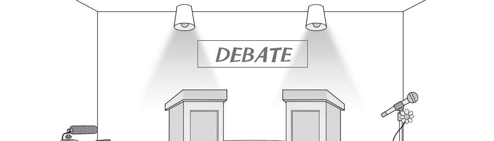
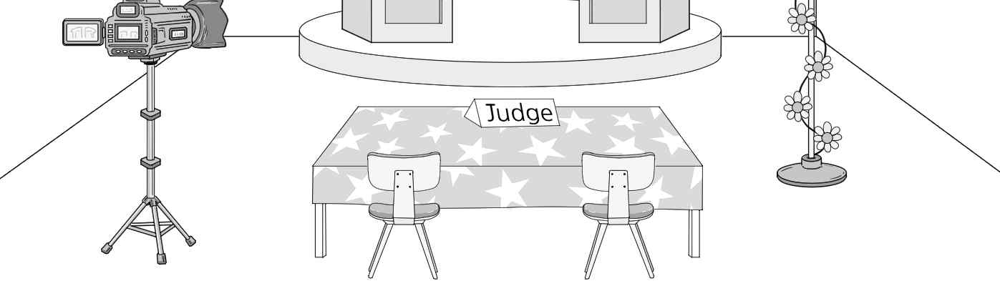
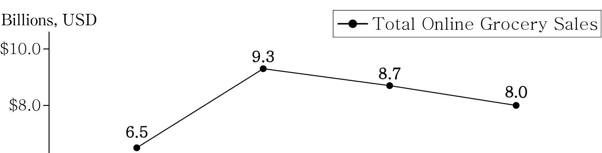
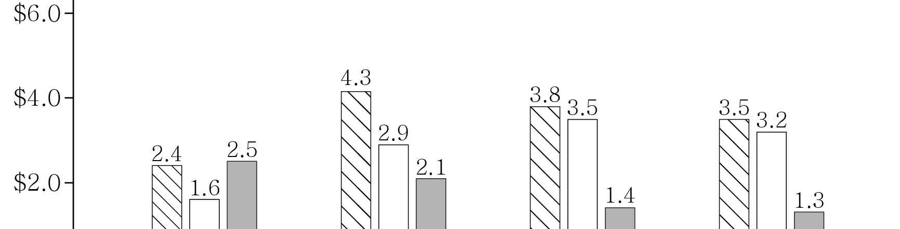
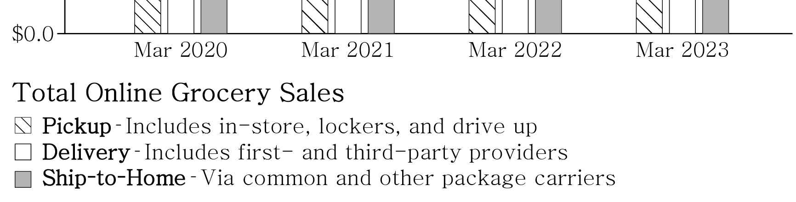

2025학년도 3월 고3 전국연합학력평가 문제지

제 3 교시	영어 영역

1번부터 17번까지는 듣고 답하는 문제입니다. 1번부터 15번까지는 한 번만 들려주고, 16번부터 17번까지는 두 번 들려줍니다. 방송을 잘 듣고 답을 하시기 바랍니다.

1. 다음을 듣고, 남자가 하는 말의 목적으로 가장 적절한 것을 고르시오.
  - ① 문자로 투표하는 방법을 설명하려고
  - ② 오디션 프로그램 지원자를 모집하려고
  - ③ 오디션 프로그램 최종 우승자를 발표하려고
  - ④ 오디션 프로그램 투표 방식의 변경을 알리려고
  - ⑤ 공식 모바일 앱 서비스의 일시적 중단을 공지하려고
2. 대화를 듣고, 여자의 의견으로 가장 적절한 것을 고르시오.
  - ① 여러 구독 서비스를 통해 다양한 콘텐츠를 즐길 수 있다.
  - ② 스트리밍 서비스를 연간 결제하면 구독료를 아낄 수 있다.
  - ③ 여러 기기에서 로그인할 때는 계정 보안에 유의해야 한다.
  - ④ 구매 목록을 미리 작성하면 불필요한 소비를 줄일 수 있다.
  - ⑤ 사용하지 않는 구독 서비스를 해지해서 돈을 절약해야 한다.
3. 다음을 듣고, 남자가 하는 말의 요지로 가장 적절한 것을 고르시오.
  - ① 아침을 챙겨 먹으면 체중 관리에 도움이 된다.
  - ② 규칙적인 운동으로 혈액 순환을 개선할 수 있다.
  - ③ 잠들기 전 따뜻한 목욕은 편안한 수면을 돕는다.
  - ④ 식사 중 지나친 수분 섭취는 소화에 방해가 된다.
  - ⑤ 아침에 가장 먼저 따뜻한 물을 마시면 건강에 좋다.
4. 대화를 듣고, 그림에서 대화의 내용과 일치하지 <u>않는</u> 것을 고르시오.

①

⑤

- ②
  - ③
  - ④
5. 대화를 듣고, 여자가 할 일로 가장 적절한 것을 고르시오.

① 전단지 인쇄하기	② 기념품 포장하기

③ 기념품 주문하기	④ 동물 보호소에 연락하기

⑤ 입양 신청서 준비하기

6. 대화를 듣고, 남자가 지불할 금액을 고르시오. [3점]

① \$90 ② \$110 ③ \$120 ④ \$210 ⑤ \$240

7. 대화를 듣고, 여자가 이번 주에 춤 영상을 업로드하지 <u>못하는</u> 이유를 고르시오.
  - ① 몸 상태가 좋지 않아서
  - ② 동영상 편집이 오래 걸려서
  - ③ 장소 예약을 하지 못해서
  - ④ 파트너와 일정이 맞지 않아서
  - ⑤ 곡을 선정하지 못해서
8. 대화를 듣고, Harmony Rental Shop에 관해 언급되지 <u>않은</u> 것을 고르시오.

① 취급 악기	② 위치	③ 악기 대여 비용

④ 악기 수령 방법 ⑤ 영업 시간

9. DNA Discovery Program에 관한 다음 내용을 듣고, 일치하지 <u>않는</u> 것을 고르시오.
  - ① 16세부터 18세까지의 학생들이 참여할 수 있다.
  - ② 4월 7일에 시작하여 8주 동안 운영된다.
  - ③ 모든 실험은 숙련된 강사들의 도움으로 진행된다.
  - ④ 이번 달 말까지 등록한 사람은 10% 할인을 받는다.
  - ⑤ 웹사이트에서 추가 학습 자료를 받을 수 있다.
10. 다음 표를 보면서 대화를 듣고, 여자가 주문할 전자책 단말기를 고르시오.

eBook Reader

|  | Model | Price | Screen Size (inches) | Memory Storage (GB) | Waterproof |
| --- | --- | --- | --- | --- | --- |
| ① | A | \$110 | 6 | 8 | ○ |
| ② | B | \$130 | 14 | 16 | × |
| ③ | C | \$210 | 7 | 32 | × |
| ④ | D | \$240 | 8 | 32 | ○ |
| ⑤ | E | \$330 | 10 | 64 | ○ |

11. 대화를 듣고, 남자의 마지막 말에 대한 여자의 응답으로 가장 적절한 것을 고르시오.
  - ① Thanks. I’ll have to take the stairs during that time.
  - ② Good. I’m glad the elevator maintenance is finally over.
  - ③ Okay. I’ll call and ask when they’re fixing the elevator.
  - ④ Yeah. They should’ve put up the notice in the elevator.
  - ⑤ Great. I’m happy they’re fixing it in the afternoon.
12. 대화를 듣고, 여자의 마지막 말에 대한 남자의 응답으로 가장 적절한 것을 고르시오.
  - ① Not really. I wonder where the exhibition is held.
  - ② That’s not right. I haven’t seen the exhibition yet.
  - ③ Not sure. I hope his paintings will be exhibited someday.
  - ④ You’d better not. The museum wasn’t crowded at all.
  - ⑤ I think so. If I were you, I would go on weekdays.

13. 대화를 듣고, 남자의 마지막 말에 대한 여자의 응답으로 가장 적절한 것을 고르시오. [3점]

Woman:

- ① Sure. Let me check if there are any empty bottles to bring.
  - ② Certainly. The store sells items in packs, not by weight.
  - ③ Of course. I always buy items without plastic packaging.
  - ④ Maybe next time. We already have plenty of shampoo.
  - ⑤ I see. That’s why zerowaste stores are hard to find.
14. 대화를 듣고, 여자의 마지막 말에 대한 남자의 응답으로 가장 적절한 것을 고르시오. [3점]

Man:

- ① You’re right. I’ll suggest the teamwork idea to council members.
  - ② That works. I’ll make sure they participate individually.
  - ③ I’d rather not. I’m not really into treasure hunting.
  - ④ No worries. I heard the students enjoyed the event.
  - ⑤ Cool. I hope many freshmen will join the student council.
15. 다음 상황 설명을 듣고, Emma가 Luke에게 할 말로 가장 적절한 것을 고르시오.

Emma:

- ① Let’s participate as volunteers in the marathon event.
  - ② It’d be great if you could give me some running tips.
  - ③ How about signing up for a marathon to stay motivated?
  - ④ You need proper running shoes to reduce the risk of injury.
  - ⑤ Begin with a steady pace and slowly build up your distance.

## [16 \~ 17] 다음을 듣고, 물음에 답하시오.

16. 여자가 하는 말의 주제로 가장 적절한 것은?
  - ① importance of visual communication among animals
  - ② truths behind common misconceptions about animals
  - ③ ways animals recognize members of their own species
  - ④ strategic uses of colors animals employ for survival
  - ⑤ how animals’ perceptions exceed those of humans
17. 언급된 동물이 <u>아닌</u> 것은?

① bulls	② bats

④ leopards	⑤ polar bears

③ dogs

이제 듣기 문제가 끝났습니다. 18번부터는 문제지의 지시에 따라 답을 하시기 바랍니다.

18. 다음 글의 목적으로 가장 적절한 것은?

Dear School Officials,

Thank you for deciding to participate in the upcoming 2025 Student Art Exhibition. Our organization’s event has been a platform for showcasing the artistic talents of young students for a decade. After reviewing the applications we’ve received, we can’t wait to exhibit your students’ work. However, please note that there has been a change to the submission deadline for your students’ work. The deadline is April 15th instead of March 28th. Please send the work to the address of which we have already notified you. Thank you.

- ① 전시회 운영 기간을 안내하려고
  - ② 작품 제출 마감일 변경을 알리려고
  - ③ 학생 예술 단체 가입을 독려하려고
  - ④ 전시회에 공개할 작품을 발표하려고
  - ⑤ 전시되는 작품의 선정 기준을 공지하려고
19. 다음 글에 드러난 Sam의 심경 변화로 가장 적절한 것은?

Sam had always dreamed of becoming a musical actor, and today was his big chance — a lifechanging audition. He had practiced endlessly and was perfectly ready. He couldn’t even think of not getting the role. When his name was called, Sam stepped onto the stage, with his head held high and his shoulders held back. The judges’ eyes were fixed on him as he appeared on the stage. But then, without warning, his mind went completely blank. The opening line he had rehearsed so many times didn’t come to him. He opened his mouth, but no sound came out. Frustration started to set in. In the end, Sam couldn’t believe that he couldn’t say a single line.

① excited → jealous	② confident → frustrated

③ nervous → relieved	④ exhausted → refreshed

⑤ indifferent → grateful

20. 다음 글에서 필자가 주장하는 바로 가장 적절한 것은?

People have an antipersuasion radar or defense system that goes off when someone is trying to persuade them. The more something or someone disagrees with them, the less likely they are to listen. Consequently, one reason change is so hard is that people are unwilling to even consider information that goes against their beliefs. As a result, when dealing with opposing viewpoints, being a bit more indirect can often be more effective. Rather than starting with information, start by encouraging people to be more open minded and receptive. This is why expressing doubt can help. Showing that we’re conflicted or uncertain makes us seem less threatening. Expressing doubt about one’s own view acknowledges that conflicting beliefs are valid, making the other side feel validated and more willing to listen. It recognizes that issues are complicated or nuanced, which increases receptiveness. Uncertainty signals an openness to other perspectives. So particularly when issues are controversial or people are dug in, expressing a little doubt can actually be more persuasive.

- ① 불확실한 상황을 피하려면 계획을 철저히 세워야 한다.
  - ② 상대를 변화시키려면 정확한 정보를 먼저 제공해야 한다.
  - ③ 누군가 자신을 일방적으로 설득하려 하면 이를 경계해야 한다.
  - ④ 자신의 주장을 관철하고자 할 때는 본론으로 바로 들어가야 한다.
  - ⑤ 나와 다른 의견에 설득력이 있으려면 간접적인 태도를 보여야 한다.
21. 밑줄 친 <u>the tree was cut in the middle</u>이 다음 글에서 의미하는 바로 가장 적절한 것은? [3점]

The unity of science and philosophy in the old classical sense was perhaps best described by the famous tree of Descartes: The roots of this tree corresponded to metaphysics (the intelligible principles), the trunk to physics (statements of intermediate generality), and the branches and fruit to what we would call applied science. He regarded the whole system of science and philosophy as we today regard science alone; he felt that the metaphysical principles were ultimately justified by their “fruits,” not merely by their selfevidence. What we today call applied science consisted for him not only in mechanics but also in medicine and ethics. The difficulty was that from the general principles of Cartesian or Aristotelian sciencephilosophy

no results could be derived which were precisely in agreement with observation, but these principles seemed to be intelligible and plausible. So <u>the tree was cut in the middle</u>. For the derivation of technical results, it was necessary to start from the physical principles in the trunk. Science in the new sense was to think only of how the fruits would develop from the trunk without regard to the roots.

\* Cartesian: 데카르트의 \*\* plausible: 그럴듯한

- ① Science detached itself from philosophical foundations and shifted to deriving outcomes based on physical principles.
  - ② Metaphysics became the first priority above all as practical results took precedence over intelligible theory.
  - ③ Results consistent with the observation were the utmost priority in Cartesian sciencephilosophy.
  - ④ Applied science moved toward being less reliant on both metaphysical and physical principles.
  - ⑤ Science deemphasized ethical considerations in favor of raw observations.
22. 다음 글의 요지로 가장 적절한 것은?

Good narrative writing is often as much technique as it is talent, sometimes more. The best narrative nonfiction writers often turn to timehonored tools of fiction writers for effect: plot and pacing, character and drama, and, yes, suspense. And they understand that a good story just can’t spread out in all directions like a serving of spaghetti. The story needs form, shape, a structure designed to pull the reader from start to finish. “The craftsmanship of the writer is no less beautiful than that of the cabinet maker or the builder of temples or fine violins,” writes Jon Franklin. Yes, this may sound grandiose, but the emphasis on craftsmanship is pure pragmatism: a knowledge of the basic structures that narrative science writers use to build an effective story. I think of this approach as journalistic architecture. Once a writer has the story blueprints in hand, so to speak, then he or she can decide which structure best fits the facts of the story — and where to slot them into place.

\* grandiose: 거창한 \*\* pragmatism: 실용주의

- ① 모든 위대한 작가는 천부적인 감각과 솜씨를 타고난다.
  - ② 다양한 문장 구조를 사용하면 독자의 관심을 끌 수 있다.
  - ③ 글의 완성도를 높이려면 준비에 오랜 시간을 들여야 한다.
  - ④ 다양한 장르의 글을 많이 읽으면 작문 실력을 키울 수 있다.
  - ⑤ 좋은 논픽션을 쓸 때 기술적 접근과 구조적 설계가 필요하다.
23. 다음 글의 주제로 가장 적절한 것은? [3점]

If you want to bring something into shared reality for the purpose of social coordination, you have to describe it, or at the very least label it. Even the ideally objective pursuit of science is unable to escape the framing effects of language. Like all collective culture, science is constructed on report, reason, debate, negotiation, justification, consensus, and, most important, coordination. And all of these things depend on language. Even something as fundamental as particle physics depends on language in a particular way. I don’t mean that particle physics wouldn’t exist if we didn’t describe it. Particle physics is part of brute reality and so it will carry on independent of any human agreement or understanding of what it is. But consider this remark by Michael I. Jordan, referring to the “infinite potential well” model, which studies how a single particle behaves in a small, enclosed space: “A particle in a potential well is optimizing a function called the Lagrangian function. The particle doesn’t know that. There’s no algorithm running that does that. It just happens. It’s a description mathematically of something that helps us understand as analysts what’s happening.”

- ① necessity of language in framing and interpreting reality
  - ② role of word choices in science to avoid misinterpretation
  - ③ ways to establish scientific facts without linguistic framing
  - ④ impact of social coordination on setting priorities in science
  - ⑤ difficulty of naming complex social phenomena with simple terms
24. 다음 글의 제목으로 가장 적절한 것은?

In fact, humans are known to have the largest and most visible sclera — the “whites” of the eyes — of any species. This fact intrigues scientists, because it would seem actually to be a considerable obstacle: imagine, for example, the classic war movie scene where the soldier dresses in camouflage and paints his face with green and brown color —

but can do nothing about his noticeably white sclera, beaming bright against the jungle. There must be some reason humans developed it, despite its obvious costs. In fact, the advantage of visible sclera — so goes the “cooperative eye hypothesis” —

is precisely that it enables humans to see clearly, and from a distance, which direction other humans are looking. Michael Tomasello showed in a 2007 study that chimpanzees, gorillas, and bonobos — our nearest cousins — follow the direction of each other’s heads, whereas human infants follow the direction of each other’s eyes. So the value of looking someone in the eye may in fact be something uniquely human.

\* sclera: (눈의) 공막(鞏膜) \*\* camouflage: 위장복

- ① Adaptive Strategies for Animals with Poor Vision
  - ② The Uniqueness of Human’s Visible Sclera
  - ③ The Human Eye: A Window to Our Soul
  - ④ Why Human Eyes Evolved Various Colors
  - ⑤ How Nonhuman Species Use Sclera in Communication
25. 다음 도표의 내용과 일치하지 <u>않는</u> 것은?

U.S. Online Grocery Sales: March 2020 - 2023

The above graph shows U.S. online grocery sales recorded in the month of March, from 2020 to 2023. ① Total online grocery sales peaked at \$9.3 billion in March 2021, showing an increase of \$2.8 billion since March 2020. ② In March 2022, total online grocery sales decreased to \$8.7 billion, but they were still the secondhighest in the timeframe observed. ③ Sales of shiptohome services recorded the lowest in March 2023, and were exactly half the sales of delivery services recorded in the same year. ④ Although sales of pickup services declined after their peak in March 2021, they consistently outnumbered those of delivery services throughout the following years. ⑤ While sales of shiptohome services outperformed those of delivery services in March 2020, sales of delivery services exceeded those of shiptohome services in March 2021.

26. Hans Hofmann에 관한 다음 글의 내용과 일치하지 <u>않는</u> 것은?

Hans Hofmann was one of the most influential art teachers of the 20th century. Born on March 21, 1880 in Germany, he moved to Munich with his family. When he was a teenager, Hofmann produced scientific inventions, including a radar device. In 1904, he moved to Paris, where he was deeply affected by the expressive use of color that distinguished the paintings of Henri Matisse and Robert Delaunay. He opened his first school, the Schule für Bildende Kunst(School of Fine Art), in Munich in 1915. In 1930 Hofmann moved to the United States, where he taught at the Art Students League in New York City and later opened his own Hans Hofmann School of Fine Arts. By 1939, he was able to break away from the Expressionistic landscapes and still lifes he had painted in the early 1930s. At the age of 85, he was still very active in his studio, and completed approximately 45 paintings.

- ① 십 대였을 때 과학 발명품들을 만들었다.
  - ② 1904년에 파리로 이주했다.
  - ③ 첫 번째 학교를 뉴욕시에서 열었다.
  - ④ 1930년대 초에는 표현주의적 풍경화와 정물화를 그렸다.
  - ⑤ 85세의 나이에 대략 45점의 그림을 완성했다.
27. Primm Reading Marathon Event에 관한 다음 안내문의 내용과 일치하지 <u>않는</u> 것은?

Primm Reading Marathon Event

In this event, each page of a book is converted into 5 meters. Participants will reach the target distance by reading.

Event Period

• From March 28th to June 28th

Qualification

• Only open to members of the Primm library

How to Participate

• Visit Primm library to receive the reading log.

• Complete the reading log and submit it to the librarian.

Target Distance and Benefits

• Half marathon (4,200 pages): Completion certificate

• Full marathon (8,400 pages): Completion certificate & Ecofriendly book stand

- ① 도서 한 페이지는 5미터로 환산된다.
- ② 행사 기간은 3월 28일부터 6월 28일까지이다.
- ③ Primm 도서관 회원이 아니어도 참여가 가능하다.
- ④ 독서 일지를 완성하고 사서에게 제출한다.
- ⑤ 4,200페이지를 읽으면 완료 인증서를 받는다.
  1. 28\. 2025 Dream to Screen에 관한 다음 안내문의 내용과 일치하는 것은?

2025 Dream to Screen

Do you dream of seeing your story come to life in the theater? Here’s your chance!

Guidelines

• All genres are welcome but submissions must be original works.

• The maximum length of your synopsis is 1,000 words.

Details

• Submissions will be accepted from April 30th to May 15th.

• Email your synopsis to drscreen@cinevision.org.

• The winner will be announced through the official website and via email.

Benefits

• All the participants will receive professional feedback from famous production companies.

• The synopsis receiving the most votes will be adapted into a screenplay!

- ① 시놉시스의 최소 길이는 1,000 단어이다.
- ② 제출은 5월 15일부터이다.
- ③ 수상자는 공식 웹사이트를 통해서만 발표될 것이다.
- ④ 수상자만 유명 제작사로부터 전문적인 피드백을 받을 것이다.
- ⑤ 가장 많은 표를 받은 시놉시스는 영화 대본으로 각색될 것이다.

29. 다음 글의 밑줄 친 부분 중, 어법상 <u>틀린</u> 것은? [3점]

We lack a sufficient vocabulary for ① <u>making</u> sense of the sources of error. The more scientific knowledge we accumulate, the better we understand that the ignorance

② <u>over which</u> the knowledge enterprise is built is shockingly deep. For instance, it turned out that psychoanalysis’s attempt to delimit the sources of error by categorizing the kinds of mistakes to which humans are subject in light of the therapeutic situation in the talking cure ③ <u>draw</u> on misguided assumptions about the normalcy conditions for subjects. Digging deeper into the structure of the human mind as well as into the specific embodiment of human knowers equipped with a complex nervous system ④ showed that our mental life is filled with illusions on all levels of knowledge acquisition, from sensation to perception, from scientific discourse to the use of technology based on the latest scientific discovery. Yet, once again, we cannot make sense of this picture of ourselves as immersed in the area of ignorance and illusion without at the same time relying on a huge background of shared, objective knowledge that makes our ignorance ⑤ <u>available</u> to us. Subjectivity and objectivity are interwoven with our fallibility.

\* embodiment: 화신(化身) \*\* be immersed in: \~에 깊이 빠지다 \*\*\* fallibility: 불완전성, 틀릴 가능성

30. 다음 글의 밑줄 친 부분 중, 문맥상 낱말의 쓰임이 적절하지 <u>않은</u> 것은?

Surely one reason that copies have lost their sense of human connection, abundance, and intimate relation is that modern technology has made copying so easy. The methods of copying available to us have never been more powerfully

① abundant. This seems true even as a sense of loss has attended our ever more powerful means to ② <u>reproduce</u> what we care about. Walter Benjamin has famously formulated this loss as an “aura”: that which is ③ <u>lost</u> in mechanical reproduction. The aura of a work of art, he suggests, cannot be copied by mechanical technology. By around 1900, he writes, “technical reproduction had reached a standard that not only permitted it to reproduce all transmitted works of art and thus to cause the most profound change in their impact upon the public.” The ④ <u>ability</u> to copy mechanically “substituted a plurality of copies for a unique existence,” Benjamin argued. In addition to transforming art and the public’s relation to it, Benjamin asserted that mechanical reproduction has the power to rend traditions by interfering with the authority of objects “embedded in the fabric of tradition.” This ⑤ <u>devotion</u> to tradition was twofold and concerned the presence of objects, Benjamin believed.

\* rend: 분열시키다, 찢다 \*\* embed: 깊이 새겨두다

## [31 \~ 34] 다음 빈칸에 들어갈 말로 가장 적절한 것을 고르시오.

31. Life is insecure and human wellbeing is fragile. If we are honest with ourselves, we realize that, despite our best efforts, we often cannot control the vicissitudes of human existence. We go through life in fear and trembling, fearing what may happen, while hoping for the best. Most of us get anxious in the face of an indeterminate or ambiguous situation. We don’t handle uncertainty very well. We are easily tempted to settle for quick “solutions,” in order to eliminate our anxiety and doubt, even though these quick fixes may not, in the long run, actually be adequate solutions. It is natural, therefore, and even somewhat necessary, for us to seek	in a sea of change and indeterminacy. We want a fixed star to guide us on our journey through hazardous waters. If only we could have knowledge of what is fixed, unchanging, and ultimately reliable, then, we assume, that would be knowledge most worth having.

\* vicissitude: 우여곡절

- ① reputation
  - ② stability
  - ③ fluidity
  - ④ challenge
  - ⑤ interdependency
32. In one of the most famous passages of Being and Nothingness, “The Look,” JeanPaul Sartre describes the peculiar vulnerability that develops when someone goes from seeing (being a self with a perspective on the world) to being seen (having to confront the perspective of another on one’s self). He illustrates it with the example of someone looking through a keyhole who suddenly finds himself caught by someone watching him. The look of the other is always unnerving, Sartre argues, not only because we momentarily recognize ourselves in it through our imagination of their judgment of us but also because we don’t. We can always step back, challenge our perception of others’ perceptions of ourselves, or explain them away — but we don’t know what these perceptions really are. Others have the distinctive power of making us feel judged in ways we cannot fully control. Social life is all about the fear that accompanies our awareness that we can never	. We can only guess. [3점]

\* peculiar: 특유의 \*\* vulnerability: 취약성

- ① access what the other sees
  - ② be certain of the best choice
  - ③ fully comprehend social consensus
  - ④ know what others’ weaknesses are
  - ⑤ fail to judge the validity of our view
33. Perceived distance of objects that are far away from the observer is often assumed to be subject to some global limitation in the sense that the moon, the stars, and the sun are all perceived at the “sky”: that is, at about the same distance. This observation is related to the idea that visual space is not open but ends at visible surfaces or, indeed, the sky. Uexküll and Kriszat (1934) suggested that this is realized as a hard limit, which they call the “farthest plane.” If an observed person or object would walk beyond this farthest plane, it would no longer be perceived as moving further away, but rather as shrinking in size. This observation is actually quite common; if looking down from a high tower, for example, cars or even houses on the ground below may appear as if they were toys: that is, shrunk, presumably because they are perceived at the distance of the farthest plane while subtending a visual angle that corresponds to a larger distance. The farthest plane would thus	. [3점]

\* subtend: \~에 대(對)하다

- ① prove the boundless reach of visual space
  - ② mark the limit of the perception of size constancy
  - ③ cause objects to look more vivid as they approach it
  - ④ allow objects to appear larger as they move beyond it
  - ⑤ provide a reference point for calculating the exact distance
34. In both the arts and the sciences, an aesthetics of simplicity facilitates the precise communication of messages. Both are also fairly systematic. Although many people believe that art is by definition wild and intuitive, while only science is methodologically disciplined, there is a great deal of evidence — including from artists talking about their own practices — to suggest that art is often created methodically and systematically, and that frameworks and forms permit creativity to flow. Instead of being liberating, freedom without limits is almost paralysing, because without frameworks we end up in a vacuum in which our actions generate no response. As the Danish poet and filmmaker Jørgen Leth has put it many times, ‘the rules of the game’ are a prerequisite for artistic freedom. They provide a solid form or structure that enables the artist to make use of ‘the gifts of chance’ (to use Leth’s expression), and in which a part of the world can be exhibited in a nonchaotic manner. In order to create beauty,	.

\* paralyse: 마비시키다 \*\* prerequisite: 전제 조건

- ① the artist must restrict him - or herself
  - ② creative minds must maintain their originality
  - ③ the creator must trust his or her own instinct
  - ④ one must think outside the predefined framework
  - ⑤ the scientist must embrace the role of coincidence
35. 다음 글에서 전체 흐름과 관계 <u>없는</u> 문장은?

Cultural storage and transmission require humans to accomplish the work of storing knowledge and passing it on to the next generation by means other than DNA. To that end, humans developed techniques of memorization, of transmitting knowledge through education and by using external memory devices. ① The Chauvet cave was such a device, a place that humans returned to generation after generation, cooperating on a project that none of them could have accomplished alone. ② Each generation of artists learned techniques and continued the work of previous ones, preserving and improving what their predecessors had worked on. ③ Despite advances in technology, there is a limit in restoring damaged cave paintings, leaving us puzzled about what those paintings really were. ④ For us, the idea that humans might work on a single system of caves for thousands of years in the same style is almost unimaginable.

⑤ But these early humans were highly conscious of the importance of storing and preserving knowledge and of passing down ideas.

\* predecessor: 전임자

[36 \~ 37] 주어진 글 다음에 이어질 글의 순서로 가장 적절한 것을 고르시오.

36.

What would a language be like if it didn’t make any simplifications or generalizations?

(A) There might be some superintelligent race of beings that could know such a language, but they would have to know virtually everything in the world to learn all these names. Human language has taken a different route — many fewer names, with a loss of precision, but a basic vocabulary that is readily acquired. However, this fact is not simply a compromise with our limited cognitive capacity.

(B) By using the same word for different objects, we’re communicating information about those things. Calling two differentlooking things “spider” communicates that they probably have eight legs, weave nests, eat insects, and other noticeable details, which we would not know if we gave them all their own separate names.

(C) It would be a language in which every word was a proper noun. Because you don’t want to gloss over the differences between snakes that are slightly different in some respect, every snake must have its own name. Furthermore, every event must have its own verb, because not every occasion of thinking or dancing or talking is identical.

\* gloss over: \~에 대해 얼버무리고 넘어가다

① (A) - (C) - (B)	② (B) - (A) - (C)

③ (B) - (C) - (A)	④ (C) - (A) - (B)

⑤ (C) - (B) - (A)

37.

Selfregulation has been suggested as an alternative way to hold the tech industry to account.

(A) But without consequences for violating them, these charters are just toothless statements of aspiration. The tech industry is basically saying: trust us. But blind trust is not how we govern doctors, lawyers, bankers, pilots or anyone else in unelected positions of social responsibility. Tech is the exception, and it’s not clear why.

(B) But when tech lobbyists speak of selfregulation, they are not describing it as it is understood by professionals like doctors. Unlike in medicine, there are no mandatory ethical qualifications for working as a software engineer or technology executive. There is no enforceable industry code of conduct. There is no obligatory certification. There is no duty to put the public ahead of profit.

(C) There are few consequences for serious moral failings; no real fear of being suspended or struck off. Recent years have seen an explosion of AI ethics charters and the like, filled with wellmeaning generalities about the responsible use of powerful computers. [3점]

\* charter: 헌장 \*\* mandatory: 의무적인

① (A) - (C) - (B)	② (B) - (A) - (C)

③ (B) - (C) - (A)	④ (C) - (A) - (B)

⑤ (C) - (B) - (A)

[38 \~ 39] 글의 흐름으로 보아, 주어진 문장이 들어가기에 가장 적절한 곳을 고르시오.

38.

An alternative view is that we make sense of the sensations we feel and the facial expressions we see only when we attach words to them ― we develop rather than inherit our emotional concepts.

We experience emotions as different bodily sensations, such as a beating heart and sweaty palms; we recognize emotions in others by their facial expressions and behaviour. ( ① ) One prominent idea is that we are born with a fixed set of basic emotions that are universal within our species, notably happiness, sadness, fear, surprise, disgust and anger. ( ② ) Just as we attach the word gravity to our intuitive understanding about how objects move through space, we simply attach words to each of these innate and universal emotions once those words become available. ( ③ ) Key evidence is that children are unable to categorise facial expressions as representing different emotions until they have acquired a lexicon of words for emotions. ( ④ ) Before having such words, faces that we might view as angry, sad or fearful are all categorised together as ‘unpleasant’. ( ⑤ ) By acquiring the words for different types of emotions while experiencing sensations or observing their expressions in others, we develop a set of concepts into which those feelings can be placed.

\* lexicon: 어휘 목록

39.

The rest of the time, even as individuals are trying their best to think through issues, motivational goals may bias their thought processes and bias their reasoning.

Everyone likes to think of themselves as behaving in an unbiased fashion most of the time. We all view ourselves similar to the blindfolded statue of Lady Justice evaluating competing claims without bias, emotions, or motivations. And yet, overwhelming psychological research suggests that such unbiased rationality is actually a fairly elusive quality in humans. ( ① ) Much of the time people are on automatic pilot. ( ② ) In other words, individuals are acting without reflection more often than they are thinking carefully and deliberately. ( ③ ) Ziva Kunda, who coined the term “motivated reasoning” to describe this phenomenon, explained that although individuals try to make wellthoughtout decisions, use available evidence, and look at both sides of an issue, the process is often tainted by motivations that may be unknown to them. ( ④ ) Individuals’motivations may direct them to attend more carefully to some information while ignoring other relevant facts. ( ⑤ ) Or they may use different strategies to evaluate information they prefer to be correct while at the same time being hypercritical of flaws in information they prefer to be wrong. [3점]

\* elusive: 찾기 어려운 \*\* taint: 오염시키다

40. 다음 글의 내용을 한 문장으로 요약하고자 한다. 빈칸 (A), (B)에 들어갈 말로 가장 적절한 것은?

It may be assumed that metaalgorithmics, that is, the creation of algorithms that generate other algorithms, is a human creation as well. A human programmer must have composed the first algorithm that, in turn, generates new algorithms and as such the initial programmer must be in control of the original idea. However, this is not necessarily true. Unlike humanly conceived ideas, where the author is the intellectual owner of the idea, algorithms are processes that define, describe, and implement a series of actions that in turn produce other actions. During the transfer of actions it is possible for a discrepancy to occur between the original intention and the actual result. If that happens then, by definition, the author of the algorithm is not in control of, and therefore does not own intellectually from that point on, the resulting process. Theoretically, ownership of an idea is intrinsically connected to the predictability of its outcome, that is, to its intellectual control. Therefore, in the absence of human control the ownership of the algorithmic process must be instead credited to the device that produced it, that is, to the computer.

\* discrepancy: 불일치, 어긋남 \*\* intrinsically: 본질적으로

↓

The new notion of intellectual ownership is created by metaalgorithmics, as algorithms can produce outcomes that are <u>(A)</u> to human programmers, potentially <u>(B)</u> ownership to the computer itself.

(A)

- ① unpredictable
- ② prescribed
- ③ unexpected
- ④ unexplainable
- ⑤ foreseeable

·······

·······

·······

·······

·······

(B)

attributing

attributing

denying

denying

transferring

## [41 \~ 42] 다음 글을 읽고, 물음에 답하시오.

(B)

(C)

Without Daniel knowing, James went to the selection committee. (b) He told the committee, “Daniel has always been the more dedicated and talented one. He will excel in this program like no one else.” Meanwhile, Daniel had the same idea as his older brother. He believed that his brother was the more ideal and deserving candidate. (c) He also decided to visit and speak to the committee.
Translating a literary text is challenging, and it’s often said there will be an inevitable loss in translation. But that challenge frequently inspires creative rerenderings that offer the prospect of a (a) <u>gain</u> in translation as well. A washingmachine manual doesn’t present the same challenges, nor therefore does it inspire the (b) <u>same</u> creativity either. But where, in terms of the opposition between literary and nonliterary language, might we position philosophy’s language? Might philosophy want to avoid a translatory economy that aims for a gain in translation but risks a loss? Philosophy wishes to convey its truths intact, without loss — and without gain either, or at least it might (c) <u>hesitate</u> to offer its truths to translation without further clarification of what a gain, and indeed a gain in depth, actually means. It cannot be a matter of offsetting “stylistic losses.” The loss philosophy fears is a loss of meaning, the compromising of a truth. Thus, philosophy might (d) <u>refuse</u> to be placed on the side of nonliterary language, and express itself in unstylish language, like Badiou’s mathematical writing, so that no translator is prompted to rude and bold acts of creative rewriting. If philosophy wishes to increase its range and avoid being restricted to a national or regional tradition, it
(e) <u>needs</u> a translation model that conveys philosophical truths to the world without any “economic” fluctuations of loss and gain.
\* rendering: 번역 \*\* intact: 온전한 \*\*\* fluctuation: 오르내림, 변동
However, the program had a strict rule: only one family member could be selected in the same year. This posed a challenge to the selection committee, who thought it almost impossible to choose between the two equally impressive candidates. The committee gathered together, struggling all day long to decide. When James found out about this rule, (d) he tried to seek a way to demonstrate Daniel’s exceptional talent to the selection committee.

(D)

Not long after James had left, Daniel showed up at the selection committee and advocated for his brother, saying “James’ leadership and vision make (e) <u>him</u> the perfect choice. He deserves this chance more than I do.” Moved by their selflessness, the committee made an exception by selecting both brothers in the same year, for the first time in its history. Their story inspired others, showing that true success lies not only in individual achievements but also in supporting and encouraging others.

41. 윗글의 제목으로 가장 적절한 것은?
- ① Creative Gains Emerging from Literary Translation
- ② Translating Philosophy: In Pursuit of Truth As It Is
- ③ The Role of Creativity in Conveying Philosophical Truths
- ④ Factors Leading to Challenges in Literary Translation
- ⑤ How Can We Avoid Stylistic Losses in Translation?
43. 주어진 글 (A)에 이어질 내용을 순서에 맞게 배열한 것으로 가장 적절한 것은?

① (B) - (D) - (C)	② (C) - (B) - (D)

③ (C) - (D) - (B)	④ (D) - (B) - (C)

⑤ (D) - (C) - (B)

42. 밑줄 친 (a)\~(e) 중에서 문맥상 낱말의 쓰임이 적절하지 <u>않은</u> 것은?
44. 밑줄 친 (a)\~(e) 중에서 가리키는 대상이 나머지 넷과 <u>다른</u> 것은?

① (a)	② (b) ③ (c) ④ (d)	⑤ (e)
① (a) ② (b) ③ (c)	④ (d) ⑤ (e)
45. 윗글에 관한 내용으로 적절하지 <u>않은</u> 것은?
[43 \~ 45] 다음 글을 읽고, 물음에 답하시오.
① Spark Fellowship은 격년으로 학생들을 선발하는 프로그램이었다.
(A)	② Daniel도 그의 형과 같은 아이디어를 가지고 있었다.
③ 위원회는 함께 모여 하루 종일 고심했다.
④ Daniel이 James보다 먼저 선정 위원회에 나타났다.
⑤ 예외적으로 두 형제가 같은 해에 선발되었다.

In a small town known for its flourishing academic community, two brothers, James and Daniel Carter, stood out for their exceptional effort and talent. James and (a) his younger brother, Daniel, both applied for the Spark Fellowship. The Spark Fellowship was a highly respected program that selects and supports outstanding students every two years. Unsurprisingly, both brothers advanced to the final round.

## \* 확인 사항

◦ 답안지의 해당란에 필요한 내용을 정확히 기입(표기) 했는지 확인하시오.