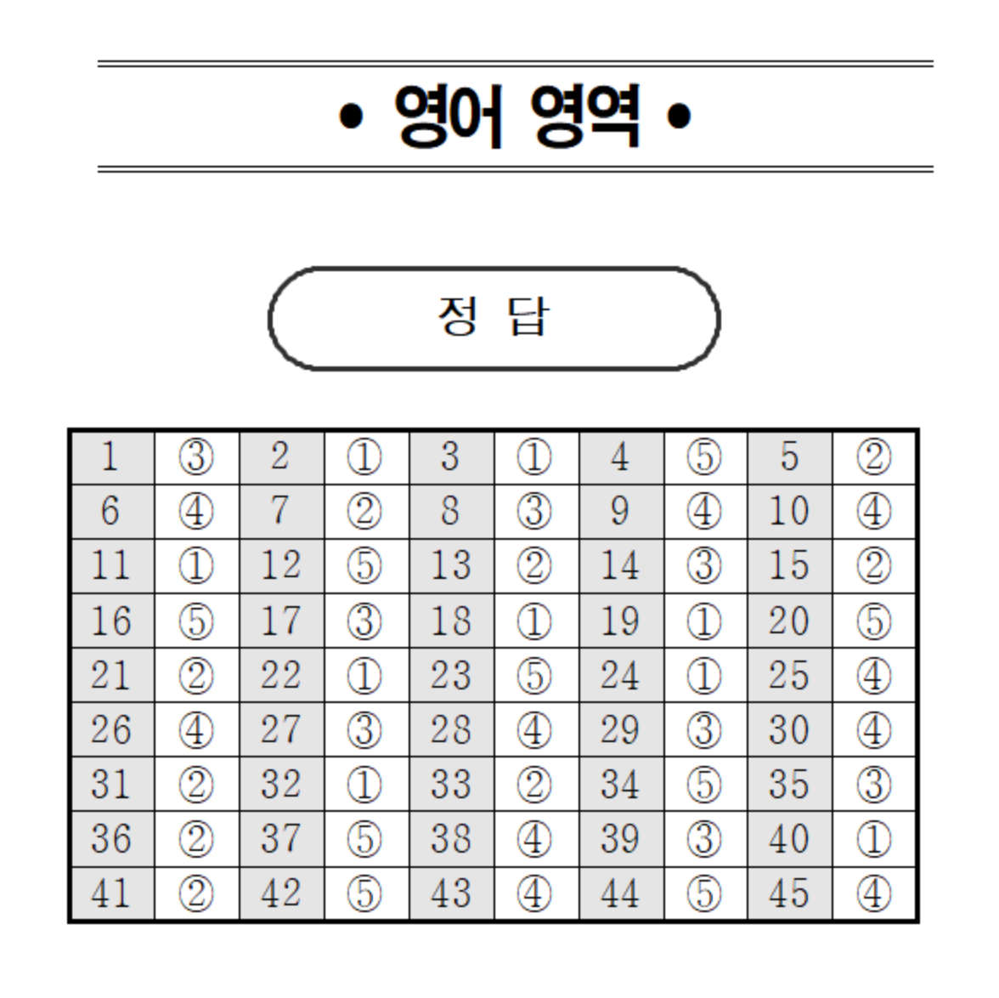

### 영어영역

### 정답

| 1 | ③ | 2 | ① | 3 | ① | 4 | ⑤ | 5 | ② |
| --- | --- | --- | --- | --- | --- | --- | --- | --- | --- |
| 6 | ④ | 7 | ② | 8 | ③ | 9 | ④ | 10 | ④ |

- ①
- ②

①

③

- ①
- ②

⑤

11

16

12

17

13

18

14

19

15

20

- ③

| 21 | ② | 22 | ① | 23 | ⑤ | 24 | ① | 25 | ④ |
| --- | --- | --- | --- | --- | --- | --- | --- | --- | --- |
| 26 | ④ | 27 | ③ | 28 | ④ | 29 | ③ | 30 | ④ |
| 31 | ② | 32 | ① | 33 | ② | 34 | ⑤ | 35 | ③ |
| 36 | ② | 37 | ⑤ | 38 | ④ | 39 | ③ | 40 | ① |

41 ②

42 ⑤

43 ④

5 45

- ④

44

