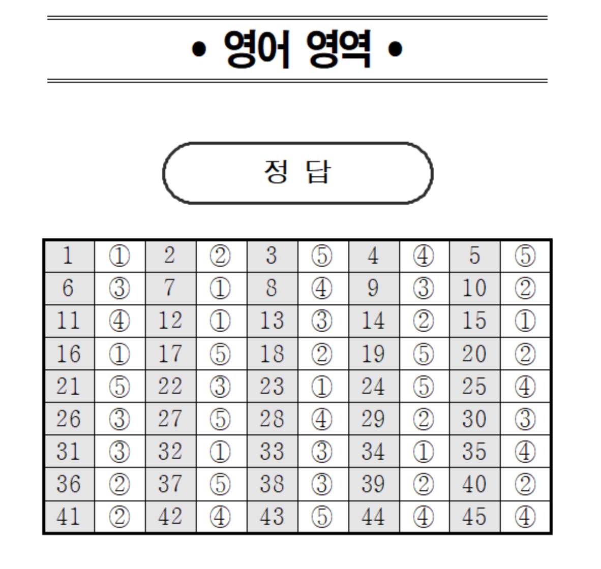

영어 영역

### 정답

| 1 | ① | 2 | ② | 3 | 5 | 4 | ④ | 5 | 5 |
| --- | --- | --- | --- | --- | --- | --- | --- | --- | --- |
| 6 | ③ | 7 | ① | 8 | ④ | 9 | ③ | 10 | ② |
| 11 | ④ | 12 | ① | 13 | ③ | 14 | ② | 15 | ① |
| 16 | ① | 17 | ⑤ | 18 | ② | 19 | ⑤ | 20 | ② |
| 21 | ⑤ | 22 | ③ | 23 | ① | 24 | ⑤ | 25 | ④ |
| 26 | ③ | 27 | ⑤ | 28 | ④ | 29 | ② | 30 | ③ |
| 31 | ③ | 32 | ① | 33 | ③ | 34 | ① | 35 | ④ |
| 36 | ② | 37 | ⑤ | 38 | ③ | 39 | ② | 40 | ② |
| 41 | ② | 42 | ④ | 43 | 5 | 44 | ④ | 45 | ④ |

